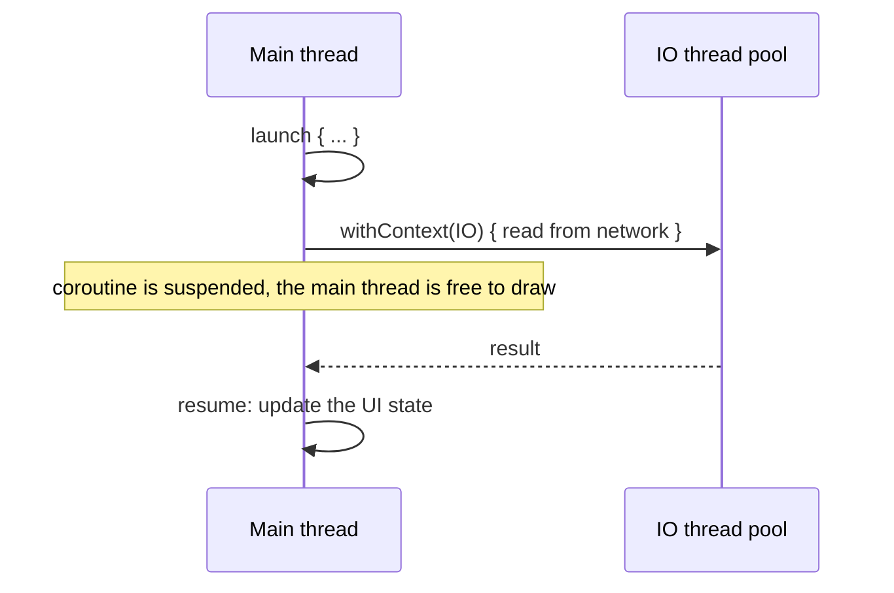
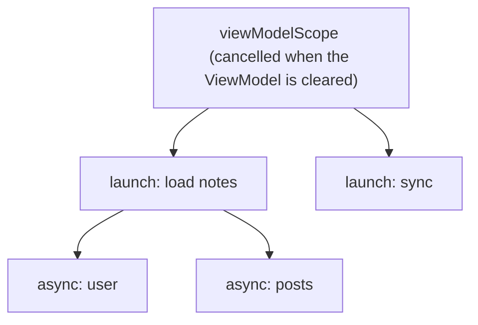
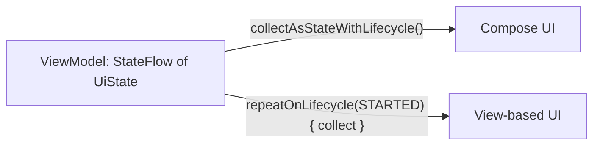

# Coroutines & Flow

> Coroutines let you write asynchronous code that reads like normal code, without blocking the main thread. Flow is the stream of values over time. This topic comes up in almost every Android interview.

Roadmap topic 3 · Stage 1: Foundations

**Go deeper:** `1` Platform Basics (main thread) · `4` Lifecycle (`viewModelScope`) · `5` Compose (`collectAsStateWithLifecycle`) · `6` Architecture · `8` Networking · `12` Testing (`runTest`, Turbine) · `16` iOS (async/await, actors) · `03-leetcode-patterns` (concurrency problems).

**Marks:** 🟢 must know · 🟡 good to know

---

#### 1. What Is It?

*Do slow work without freezing the screen.*

| 🟢 Must know | 🟡 Good to know |
|---|---|
| why concurrency: keep the main thread free | `async` / `await` and parallel work |
| coroutines and `suspend` functions | channels, `buffer`, `conflate`, back-pressure |
| dispatchers: `Main`, `IO`, `Default` | `callbackFlow` |
| structured concurrency: scope, job, children | testing coroutines and flows |
| `viewModelScope`, `lifecycleScope`, not `GlobalScope` | races, `Mutex`, thread-safe state |
| cancellation is cooperative | legacy: threads, `Handler`, `AsyncTask`, RxJava |
| exceptions: `try/catch`, `supervisorScope` | iOS equivalents |
| Flow: cold, `collect`, operators | |
| `StateFlow` and `SharedFlow` | |
| collecting safely in the UI | |

1. A **coroutine** is a light unit of work that can pause and resume. A **`suspend` function** can pause without blocking a thread.
2. A **dispatcher** decides which threads run it.
3. A **scope** owns coroutines; cancelling the scope cancels its children (**structured concurrency**).
4. A **`Flow`** is an asynchronous stream of values. **`StateFlow`** holds the latest state; **`SharedFlow`** broadcasts events.

**Signals in an interview:** "how do you call an API without blocking the UI?", "what happens to a request when the user leaves the screen?", "`Flow` vs `StateFlow`", "`launch` vs `async`", "why not `GlobalScope`?".

---

#### 2. How It Works

**A suspend function pauses; it does not block.**



**Dispatchers.**

| Dispatcher | Use for |
|---|---|
| `Dispatchers.Main` | UI updates, light work |
| `Dispatchers.IO` | network, database, files (waiting work) |
| `Dispatchers.Default` | CPU work: sorting, parsing a big list, image processing |
| `Dispatchers.Main.immediate` | run now if already on Main |

Libraries like Room and Retrofit `suspend` functions already switch threads for you ("main-safe"). Your own blocking code needs `withContext`.

**Structured concurrency.** Every coroutine has a parent. The parent waits for its children, and cancelling the parent cancels them all.



1. Use **`viewModelScope`** for work that belongs to the screen's state, **`lifecycleScope`** / `repeatOnLifecycle` for work tied to the UI being visible, and `WorkManager` for work that must survive the app (topic 10).
2. **Avoid `GlobalScope`.** It has no parent, so nothing cancels it: leaks and work that outlives its screen.

**Cancellation is cooperative.** Cancelling asks a coroutine to stop. It stops at the next suspension point of a cancellable function (`delay`, `withContext`, `yield`). A tight loop with no suspension keeps running unless you check `isActive` or call `ensureActive()`.

1. Never swallow `CancellationException`. If you `catch (e: Exception)`, rethrow it.
2. Use `try/finally` (and `withContext(NonCancellable)` for cleanup that must suspend).

**Exceptions.**

| Builder | Exception behaviour |
|---|---|
| `launch` | an uncaught exception cancels the parent and siblings; goes to the handler |
| `async` | the exception is thrown at `await()` (and also cancels the parent in a normal scope) |
| `supervisorScope` / `SupervisorJob` | a failing child does not cancel its siblings |
| `try/catch` | works inside the coroutine around suspending calls |
| `CoroutineExceptionHandler` | last resort for `launch` at the top level (logging) |

**Flow (cold).** A `flow { }` does nothing until someone collects it, and each collector starts it again. Operators: `map`, `filter`, `onEach`, `combine`, `zip`, `flatMapLatest`, `debounce`, `distinctUntilChanged`, `catch`, `onStart`, `onCompletion`, `flowOn`.

**Hot flows.**

| | `StateFlow` | `SharedFlow` |
|---|---|---|
| Holds a value | yes, always (needs an initial value) | no (optional `replay`) |
| New collector gets | the current value | nothing, or the replay |
| Equal value set twice | ignored (conflated) | emitted |
| Use for | UI state | one-off events, broadcasts |

**Collect safely in the UI.** Collecting in the background wastes battery and can crash. Collect only while the UI is at least `STARTED`.



🟡 **`async` / `await`.** Start independent calls together; total time is the slowest, not the sum.

🟡 **Back-pressure.** `buffer()` lets the producer run ahead; `conflate()` keeps only the latest; `collectLatest` cancels the previous block when a new value arrives. A `Channel` sends values between coroutines (a queue).

🟡 **`callbackFlow`.** Turns a callback API (location updates, connectivity) into a Flow. Always call `awaitClose { unregister }`.

🟡 **Races.** Coroutines on `Default`/`IO` can run in parallel. Shared mutable state needs a `Mutex`, an atomic, or a single owner (confine writes to one coroutine or use `StateFlow.update { }`).

🟡 **Testing.** `runTest` skips `delay` using virtual time. Use `StandardTestDispatcher` / `UnconfinedTestDispatcher` and replace `Dispatchers.Main` with a test rule. Use Turbine to assert Flow emissions (topic 12).

🟡 **Legacy.** `Thread`, `Handler`, `AsyncTask` (removed), RxJava (still in older apps). **iOS:** `async/await`, actors, `AsyncSequence`, `@MainActor` (topic 16).

---

#### 3. Naive vs Better Design

| Naive | Better |
|---|---|
| network call on the main thread | `suspend` call, `withContext(IO)` if blocking |
| `GlobalScope.launch { }` | `viewModelScope.launch { }` |
| two calls one after another | `async` for both, then `await` |
| `catch (e: Exception) { }` around suspend calls | catch specific exceptions; rethrow `CancellationException` |
| loop with no cancellation check | `ensureActive()` in the loop |
| expose `MutableStateFlow` | expose `StateFlow` (`asStateFlow()`) |
| `SharedFlow` for screen state | `StateFlow` for state, `SharedFlow`/`Channel` for events |
| `collect` in `onCreate` | `repeatOnLifecycle` or `collectAsStateWithLifecycle` |
| `count++` from many coroutines | `MutableStateFlow.update { it + 1 }`, `AtomicInteger`, or a `Mutex` |

```kotlin
// Naive: blocks the main thread, never cancelled, and it hides cancellation
fun load() {
    GlobalScope.launch(Dispatchers.Main) {
        try { notes = api.notesBlocking() } catch (e: Exception) { }
    }
}
```

---

#### 4. Code

Main-safe repository, and a `ViewModel` that exposes one state:

```kotlin
class NotesRepository(private val api: NotesApi, private val dao: NoteDao) {
    suspend fun refresh() {
        val remote = api.notes()                       // Retrofit suspend function: main-safe
        dao.replaceAll(remote.map { it.toEntity() })   // Room suspend function: main-safe
    }
    fun observe(): Flow<List<Note>> = dao.observeAll().map { rows -> rows.map { it.toDomain() } }
}

class NotesViewModel(private val repo: NotesRepository) : ViewModel() {
    private val _state = MutableStateFlow<UiState<List<Note>>>(UiState.Loading)
    val state: StateFlow<UiState<List<Note>>> = _state.asStateFlow()     // read-only outside

    init { refresh() }

    fun refresh() = viewModelScope.launch {
        try { repo.refresh() } catch (e: IOException) { _state.value = UiState.Error("Offline") }
    }
}
```

Parallel calls, and the test that proves the timing:

```kotlin
suspend fun loadScreen(api: Api): Pair<User, List<Post>> = coroutineScope {
    val user = async { api.user() }        // 300 ms
    val posts = async { api.posts() }      // 500 ms
    user.await() to posts.await()
}

@Test fun `parallel takes the longest, not the sum`() = runTest {
    val api = FakeApi(userDelayMs = 300, postsDelayMs = 500)   // fakes call delay(...)
    val start = currentTime
    loadScreen(api)
    assertEquals(500, currentTime - start)                      // virtual time, runs instantly
}
```

Checks: with `delay` fakes of 300 and 500 ms, the virtual clock advances by `500` (parallel). A sequential version would give `800`.

Cancellation done right:

```kotlin
suspend fun importLines(lines: List<String>, save: suspend (String) -> Unit) {
    for (line in lines) {
        currentCoroutineContext().ensureActive()      // stop promptly if cancelled
        save(line)
    }
}

suspend fun safeCall(block: suspend () -> Unit) {
    try { block() }
    catch (e: CancellationException) { throw e }      // never swallow cancellation
    catch (e: IOException) { /* show an error */ }
}
```

`supervisorScope`: one failure does not cancel the sibling:

```kotlin
suspend fun loadBoth() = supervisorScope {
    val a = async { runCatching { api.profile() } }
    val b = async { runCatching { api.settings() } }
    a.await() to b.await()        // each Result is handled separately; a failed one does not cancel the other
}
```

Cold flow, run twice:

```kotlin
val f = flow { println("start"); emit(1); emit(2) }
f.collect { println(it) }
f.collect { println(it) }
```

Checks: prints `start, 1, 2, start, 1, 2`. The flow runs again for every collector.

Search box: debounce, de-duplicate, cancel the old search:

```kotlin
val results: StateFlow<List<Note>> = query
    .debounce(300)                              // wait until typing pauses
    .map { it.trim() }
    .distinctUntilChanged()
    .filter { it.length >= 2 }
    .flatMapLatest { q -> repo.search(q).catch { emit(emptyList()) } }   // new query cancels the old search
    .stateIn(viewModelScope, SharingStarted.WhileSubscribed(5_000), emptyList())
```

`SharingStarted.WhileSubscribed(5_000)` keeps the upstream running for 5 seconds after the last collector leaves (so a rotation doesn't restart it), then stops it.

Collect in the UI:

```kotlin
@Composable
fun NotesScreen(vm: NotesViewModel = hiltViewModel()) {
    val state by vm.state.collectAsStateWithLifecycle()      // stops collecting when the UI is not visible
    NotesContent(state)
}

// View system
lifecycleScope.launch {
    repeatOnLifecycle(Lifecycle.State.STARTED) { vm.state.collect { render(it) } }
}
```

One-off events (navigation, snackbar) without losing or repeating them:

```kotlin
private val _events = Channel<UiEvent>(Channel.BUFFERED)
val events = _events.receiveAsFlow()                 // each event is delivered once
fun onSaved() { viewModelScope.launch { _events.send(UiEvent.NavigateBack) } }
```

Wrap a callback API:

```kotlin
fun LocationManager.updates(provider: String): Flow<Location> = callbackFlow {
    val listener = LocationListener { trySend(it) }
    requestLocationUpdates(provider, 5_000, 10f, listener)
    awaitClose { removeUpdates(listener) }           // runs on cancel: no leak
}
```

Thread-safe counter:

```kotlin
val count = MutableStateFlow(0)
suspend fun hit() = count.update { it + 1 }          // atomic read-modify-write

val mutex = Mutex()
var total = 0
suspend fun add(n: Int) = mutex.withLock { total += n }
```

Checks: 1,000 coroutines on `Dispatchers.Default` calling `hit()` leave `count.value == 1000`; the same loop with a plain `var count++` can finish with less than 1000.

---

#### 5. Performance & Limits

| Item | Remember |
|---|---|
| Cost of a coroutine | a few dozen bytes; 100,000 are fine, 100,000 threads are not |
| `Dispatchers.IO` | up to 64 threads (or the core count if higher); `Default` = the number of CPU cores |
| Blocking inside `Default` | starves other CPU work; use `IO` for blocking calls |
| `StateFlow` | keeps one value; it drops intermediate values for slow collectors |
| `SharedFlow` without a collector | emitted values are lost (unless `replay`) |
| `WhileSubscribed(5_000)` | survives rotation (a few seconds) but frees resources when the screen is gone |
| ANR | blocking the main thread for about 5 seconds |
| `delay` in `runTest` | no real waiting: virtual time |

---

#### 6. Common Mistakes & Edge Cases

1. Blocking calls (`Thread.sleep`, `runBlocking`, JDBC-style IO) on the main thread.
2. `GlobalScope`, or creating your own `CoroutineScope` and never cancelling it.
3. Swallowing `CancellationException` in a broad `catch`.
4. Collecting a flow with `lifecycleScope.launch { collect }` without `repeatOnLifecycle`: it keeps collecting in the background.
5. Using `SharedFlow` for state, or `StateFlow` for one-time events (a rotation replays the event).
6. Launching coroutines from a composable body instead of `LaunchedEffect` (it launches again on every recomposition).
7. Catching exceptions around `launch { }` from the outside: it doesn't work. Catch inside the coroutine.
8. Shared mutable state without `Mutex` or atomics.
9. Changing `Dispatchers.Main` in tests without resetting it.

Edge cases: cancellation arrives during a database write (use a transaction, or `NonCancellable` for cleanup); `async` never awaited hides its exception until the scope fails; `flowOn` changes only the upstream; a `StateFlow` with equal consecutive values emits once; the `ViewModel` is cleared while a request is in flight (the job is cancelled; `WorkManager` for work that must finish).

---

#### 7. Say This in the Interview

1. "A `suspend` function pauses the coroutine without blocking the thread, so the main thread stays free to draw."
2. "I use `viewModelScope` so work is cancelled when the screen's `ViewModel` is cleared, never `GlobalScope`."
3. "Cancellation is cooperative: suspension points check it, and in a tight loop I call `ensureActive()`. I rethrow `CancellationException`."
4. "A `Flow` is cold: it starts when collected. `StateFlow` is hot and keeps the latest value, so I use it for UI state; events go through a `Channel`."
5. "In the UI I collect with `collectAsStateWithLifecycle` or `repeatOnLifecycle(STARTED)` so the app doesn't work while the screen is hidden."
6. "For a search box: `debounce`, `distinctUntilChanged`, `flatMapLatest` so the old request is cancelled."
7. "For independent calls I use `async` so the total time is the slowest call, and `supervisorScope` if one failing should not cancel the rest."

---

#### 8. Quick Check

1. What is the difference between `launch` and `async`?
2. What does `flatMapLatest` do when a new value arrives?
3. Why is `catch (e: Exception)` around a `suspend` call risky?
4. Which flow type do you use for UI state?

<details>
<summary>Answers</summary>

1. `launch` starts a coroutine and returns a `Job` (no result). `async` returns a `Deferred` whose `await()` gives the result.
2. It cancels the work started for the previous value and starts new work for the latest value.
3. It also catches `CancellationException`, so the coroutine doesn't stop when cancelled. Rethrow it or catch specific types.
4. `StateFlow`.

</details>

---

#### 9. Practice

**Interview questions**

1. What is a coroutine, and how is it different from a thread?
2. Explain dispatchers and when to use each.
3. What is structured concurrency?
4. How does cancellation work, and what goes wrong if you ignore it?
5. `Flow` vs `StateFlow` vs `SharedFlow`?
6. How do you collect a flow safely in a Compose screen?
7. How do you run two network calls in parallel?
8. How do you test a `ViewModel` that uses coroutines?

**Hands-on**

1. Build a search box with `debounce` + `flatMapLatest` and log when a request is cancelled.
2. Wrap `ConnectivityManager`'s network callback in a `callbackFlow`.
3. Write a `runTest` test with virtual time for a retry-with-backoff function.

**Coding warm-ups (LeetCode concurrency)**

| # | Question | Link to this topic |
|---|---|---|
| 1114 | [Print in Order](https://leetcode.com/problems/print-in-order/) (Easy) | ordering between threads |
| 1115 | [Print FooBar Alternately](https://leetcode.com/problems/print-foobar-alternately/) (Medium) | hand-off between two workers |
| 1116 | [Print Zero Even Odd](https://leetcode.com/problems/print-zero-even-odd/) (Medium) | three workers taking turns |
| 1117 | [Building H2O](https://leetcode.com/problems/building-h2o/) (Medium) | grouping and barriers |
| 1188 | [Design Bounded Blocking Queue](https://leetcode.com/problems/design-bounded-blocking-queue/) (Medium, premium) | a channel with back-pressure |
| 1226 | [The Dining Philosophers](https://leetcode.com/problems/the-dining-philosophers/) (Medium) | avoiding deadlock |

**Remember:** suspend ≠ blocked · scope owns coroutines · `viewModelScope`, not `GlobalScope` · cancellation is cooperative, never swallow it · `StateFlow` for state, `Channel`/`SharedFlow` for events · collect with the lifecycle · `async` for parallel work.
