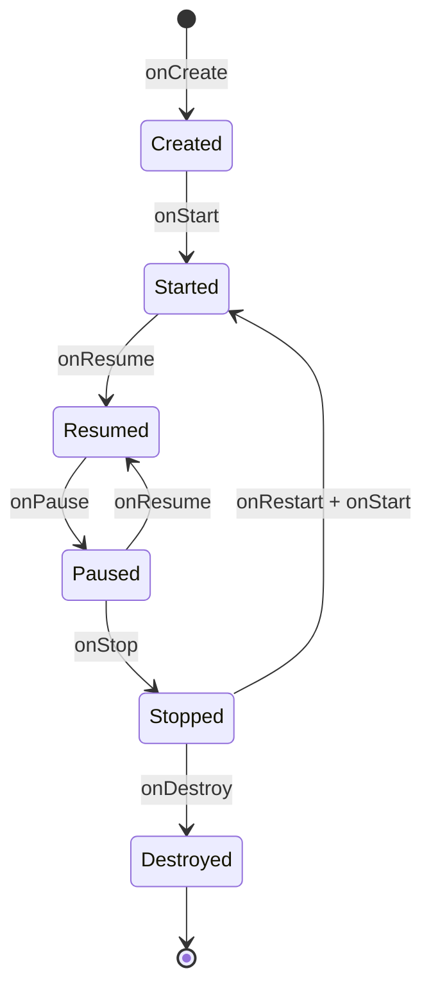
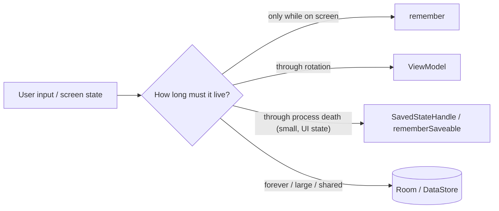

# App Components & Lifecycle

> Android creates, pauses, recreates and kills your screens. If you do not know when, you lose the user's data. This is the most asked mobile interview topic.

Roadmap topic 4 · Stage 2: Building the App

**Go deeper:** `1` Platform Basics (process death) · `3` Coroutines (`viewModelScope`) · `5` Compose (`rememberSaveable`) · `6` Architecture · `10` Background Work · `16` iOS (view controller and scene lifecycle) · `13` Security (exported components).

**Marks:** 🟢 must know · 🟡 good to know

---

#### 1. What Is It?

*The parts an Android app is made of, and the callbacks that tell you what is happening.*

| 🟢 Must know | 🟡 Good to know |
|---|---|
| Activity, single-activity approach | services, foreground services |
| activity and fragment lifecycle callbacks | broadcast receivers, content providers |
| configuration changes | launch modes and task behaviour |
| process death and state restoration | Application class, startup libraries |
| `ViewModel`: what it keeps, what it does not | the manifest: components, permissions, `exported` |
| intents: explicit vs implicit | iOS equivalents |
| navigation and the back stack | |
| deep links and app links | |

1. An **Activity** is a screen or entry point. Modern apps use **one Activity** and many Compose destinations.
2. The system calls **lifecycle callbacks** as the screen is created, shown, hidden and destroyed.
3. A **configuration change** (rotation, language, dark mode) recreates the Activity. **Process death** ends the whole process.
4. A **`ViewModel`** survives a configuration change but not process death.
5. **Intents** start components and carry data. **Deep links** open a specific screen from a URL.

**Signals in an interview:** "what happens on rotation?", "the screen lost my input", "ViewModel vs `savedInstanceState`", "implicit vs explicit intent", "how do you handle a link that opens the app?".

---

#### 2. How It Works

**Activity lifecycle.**



| Callback | State | Do |
|---|---|---|
| `onCreate` | created | set up UI, restore saved state, inject dependencies |
| `onStart` | visible | start things that need to be visible (collect flows) |
| `onResume` | in the foreground, has focus | start camera preview, sensors |
| `onPause` | partly covered or leaving | stop exclusive resources fast |
| `onStop` | not visible | save data, stop updates; (since Android 9 `onSaveInstanceState` runs after `onStop`) |
| `onDestroy` | finishing or being recreated | release; do not rely on it for saving |

Typical sequences:

| Event | Callbacks |
|---|---|
| Open the app | `onCreate → onStart → onResume` |
| Press Home | `onPause → onStop` |
| Return from Home | `onRestart → onStart → onResume` |
| Rotate | `onPause → onStop → onDestroy → onCreate → onStart → onResume` |
| Press Back on the last screen | `onPause → onStop → onDestroy` |
| Killed in background | nothing (no callback) |

**Fragment** lifecycle is similar, plus a separate **view lifecycle** (`viewLifecycleOwner`): observe on that, not on the fragment, or you leak. In Compose, destinations replace fragments.

**What survives what.**

| Place | Rotation | Process death | App reinstall / clear data |
|---|---|---|---|
| Local variable / field in the Activity | lost | lost | lost |
| `remember` in Compose | lost | lost | lost |
| `rememberSaveable` | kept | kept | lost |
| `ViewModel` field | kept | **lost** | lost |
| `SavedStateHandle` (in `ViewModel`) | kept | kept (small data) | lost |
| Room / `DataStore` / files | kept | kept | lost |



Saved state goes through a `Bundle` with a size limit (about 1 MB shared by the whole transaction), so keep it small: ids, text, scroll position, not lists of objects.

**Intents.**

1. **Explicit:** names the exact component (`Intent(this, DetailActivity::class.java)`). Used inside your app.
2. **Implicit:** describes an action (`ACTION_VIEW` a URL, `ACTION_SEND` text) and the system picks an app. Check that an app can handle it.
3. Pass **small data** as extras (ids, not objects). Get a result with the Activity Result APIs (`registerForActivityResult`), not `startActivityForResult`.
4. Treat every incoming intent as untrusted input (topic 13).

**Navigation and the back stack.** Each navigation adds an entry to a stack; Back pops it. Compose Navigation keeps a `NavBackStackEntry` per destination and gives each its own `ViewModel` and saved state. Pass **ids** to destinations, load data from the repository.

**Deep links and app links.**

1. A **deep link** is a URI pattern that opens a destination.
2. An **app link** is a verified `https` deep link (`autoVerify`, with a `assetlinks.json` file on your domain), so it opens your app without a chooser.
3. Always validate the arguments (a bad id must show a safe error, not crash).

🟡 **Services.** A `Service` runs without UI. A **foreground service** shows a notification and has a declared type (location, media playback, data sync, …). For deferrable work prefer WorkManager (topic 10).

🟡 **Broadcast receivers and content providers.** A receiver reacts to system or app events (many are restricted in the manifest on newer Android; register at runtime). A content provider shares structured data between apps (rare today; `FileProvider` is the common case).

🟡 **Launch modes and tasks.** `standard`, `singleTop`, `singleTask`, `singleInstance` control whether a new instance is created. A notification that opens a screen usually needs the right back stack (`TaskStackBuilder`).

🟡 **Application class and startup.** `Application.onCreate` runs before any screen; keep it light (topic 11). The `androidx.startup` library orders initializers.

🟡 **Manifest.** Declares components, permissions, intent filters, and `android:exported` (required on components with intent filters when targeting Android 12+). A component that is exported can be started by other apps.

🟡 **iOS.** `UIViewController` (`viewDidLoad`, `viewWillAppear`, `viewDidDisappear`) and the scene lifecycle (`active`, `inactive`, `background`) (topic 16).

---

#### 3. Naive vs Better Design

| Naive | Better |
|---|---|
| keep UI state in fields of the Activity | `ViewModel` + `SavedStateHandle` or `rememberSaveable` |
| `android:configChanges` to "stop" recreation | handle recreation; it also happens on process death |
| save big objects in a `Bundle` | save ids, reload from the database |
| `startActivityForResult` | Activity Result APIs |
| collect flows in `onCreate` forever | `repeatOnLifecycle(STARTED)` |
| pass whole objects between screens | pass ids; the next screen loads the data |
| trust the incoming deep link | parse and validate; show a safe error |
| `exported="true"` by default | export only what must be public |
| 20 Activities | one Activity, many destinations |

```kotlin
// Naive: the counter and the draft vanish on rotation or process death
class EditorActivity : AppCompatActivity() {
    var draft = ""
}
```

---

#### 4. Code

A `ViewModel` that survives rotation and process death:

```kotlin
class EditorViewModel(private val saved: SavedStateHandle, private val repo: NotesRepository) : ViewModel() {
    val noteId: Long = checkNotNull(saved["noteId"])
    val draft = saved.getStateFlow("draft", "")              // StateFlow backed by saved state
    fun onDraftChange(text: String) { saved["draft"] = text }
    fun save() = viewModelScope.launch { repo.save(noteId, draft.value) }
}
```

In Compose, UI-only state:

```kotlin
var expanded by rememberSaveable { mutableStateOf(false) }   // survives rotation and process death
var scratch by remember { mutableStateOf("") }               // lost on rotation
```

Observing the lifecycle:

```kotlin
class LoggingObserver : DefaultLifecycleObserver {
    override fun onStart(owner: LifecycleOwner) { Log.d("Life", "visible") }
    override fun onStop(owner: LifecycleOwner) { Log.d("Life", "hidden") }
}
// in the Activity: lifecycle.addObserver(LoggingObserver())
```

Intents:

```kotlin
// Explicit: start a screen of this app with an id
startActivity(Intent(this, DetailActivity::class.java).putExtra("noteId", 42L))

// Implicit: ask the system to share text, and check that something can handle it
val send = Intent(Intent.ACTION_SEND).apply { type = "text/plain"; putExtra(Intent.EXTRA_TEXT, "Hello") }
startActivity(Intent.createChooser(send, "Share note"))

// Result API
val pick = registerForActivityResult(ActivityResultContracts.PickVisualMedia()) { uri -> uri?.let(::attach) }
pick.launch(PickVisualMediaRequest(ActivityResultContracts.PickVisualMedia.ImageOnly))
```

Compose Navigation with type-safe routes and a deep link:

```kotlin
@Serializable object NotesList
@Serializable data class NoteDetail(val id: Long)

NavHost(navController, startDestination = NotesList) {
    composable<NotesList> { NotesScreen(onOpen = { id -> navController.navigate(NoteDetail(id)) }) }
    composable<NoteDetail>(
        deepLinks = listOf(navDeepLink<NoteDetail>(basePath = "https://notes.example.com/note"))
    ) { entry ->
        val route = entry.toRoute<NoteDetail>()
        DetailScreen(id = route.id)        // the screen's ViewModel loads the note by id
    }
}
```

Manifest for the deep link (verified app link):

```xml
<activity android:name=".MainActivity" android:exported="true">
    <intent-filter android:autoVerify="true">
        <action android:name="android.intent.action.VIEW" />
        <category android:name="android.intent.category.DEFAULT" />
        <category android:name="android.intent.category.BROWSABLE" />
        <data android:scheme="https" android:host="notes.example.com" android:pathPrefix="/note" />
    </intent-filter>
</activity>
```

Test a deep link and process death from the terminal:

```bash
adb shell am start -a android.intent.action.VIEW -d "https://notes.example.com/note/42" com.example.notes
adb shell am kill com.example.notes          # with the app in the background
```

A tiny model of the back stack (what navigation does):

```kotlin
class BackStack<T> {
    private val stack = ArrayDeque<T>()
    fun navigate(dest: T) = stack.addLast(dest)
    fun back(): T? = if (stack.size > 1) { stack.removeLast(); stack.last() } else null   // keep the root
    val current get() = stack.lastOrNull()
}
```

Checks: `navigate("List")`, `navigate("Detail")` → `current == "Detail"`; `back()` → `"List"`; `back()` again → `null` (the root stays; the system finishes the Activity).

---

#### 5. Performance & Limits

| Item | Remember |
|---|---|
| Saved state / `Bundle` | keep well under 1 MB in total (the transaction limit is shared); `TransactionTooLargeException` otherwise |
| `ViewModel` | lives from first use until the screen is permanently gone (not on rotation) |
| `viewModelScope` | cancelled when the `ViewModel` is cleared |
| Cold start | `Application.onCreate` + first Activity `onCreate` + first frame; keep them light (topic 11) |
| Foreground service | needs a type and a visible notification; the OS can stop it on newer Android versions after a time limit for some types |
| Deep link | untrusted input: validate id and format |

---

#### 6. Common Mistakes & Edge Cases

1. Storing state in the Activity or in a static field.
2. Ignoring process death: it works in testing, then users lose data.
3. Large objects in a `Bundle`.
4. Collecting flows outside the lifecycle.
5. Leaking the Activity via a static or a long-lived listener.
6. Using `configChanges` to hide recreation.
7. Exported components with no permission check.
8. Doing work in `onDestroy` and expecting it to run.

Edge cases: rotation while a network call is running (the `ViewModel` keeps the call); two quick rotations; the user opens a deep link while the app is already open (new intent: `onNewIntent`); the deep link points to a deleted note; "Don't keep activities" in developer options (use it to test); the system dark-mode switch recreates the Activity; multi-window and split screen (resize is a configuration change).

---

#### 7. Say This in the Interview

1. "On rotation the Activity is destroyed and recreated, but the `ViewModel` survives. On process death everything is gone except saved state and persistent storage."
2. "I keep UI state in a `ViewModel`, small restorable bits in `SavedStateHandle` or `rememberSaveable`, and real data in Room."
3. "I test process death with 'Don't keep activities' and `adb shell am kill`."
4. "I pass ids between screens and load data in the destination."
5. "I validate every deep link and intent extra because they are untrusted input."
6. "I collect with `repeatOnLifecycle(STARTED)` so nothing runs when the screen is hidden."

---

#### 8. Quick Check

1. Which callback order runs on rotation?
2. Does the `ViewModel` survive process death?
3. Explicit or implicit intent: opening your own `DetailActivity`?
4. Why is `exported` important?

<details>
<summary>Answers</summary>

1. `onPause → onStop → onDestroy → onCreate → onStart → onResume`.
2. No. Use `SavedStateHandle` or a database.
3. Explicit.
4. An exported component can be started by any app, so it must validate input and not expose private actions.

</details>

---

#### 9. Practice

**Interview questions**

1. Explain the Activity lifecycle in order for start, rotate, background and kill.
2. What survives a configuration change? What survives process death?
3. `ViewModel` vs `onSaveInstanceState` vs `rememberSaveable`?
4. Explicit vs implicit intents?
5. How do deep links and app links work, and how do you secure them?
6. Why single-activity?
7. What is a foreground service, and when do you need it?

**Hands-on**

1. Add a text field and prove it survives rotation and `adb shell am kill`.
2. Add a verified deep link to a detail screen, and handle an invalid id.
3. Write down the callback order you see in Logcat for the five events in the table.

**Coding warm-ups (LeetCode, the back stack is a stack)**

| # | Question | Link to this topic |
|---|---|---|
| 1472 | [Design Browser History](https://leetcode.com/problems/design-browser-history/) (Medium) | back / forward navigation |
| 155 | [Min Stack](https://leetcode.com/problems/min-stack/) (Medium) | a stack with extra information |
| 20 | [Valid Parentheses](https://leetcode.com/problems/valid-parentheses/) (Easy) | stack matching |
| 946 | [Validate Stack Sequences](https://leetcode.com/problems/validate-stack-sequences/) (Medium) | push / pop order |

**Remember:** rotation recreates the Activity, process death ends the process · `ViewModel` survives rotation only · save small state, store real data · pass ids, not objects · validate deep links · collect with the lifecycle.
