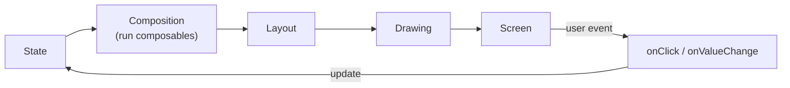
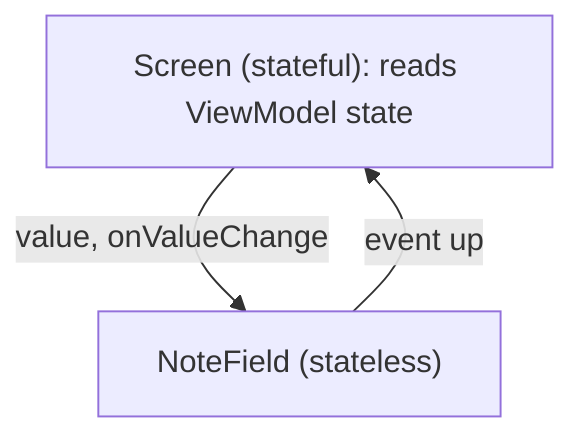
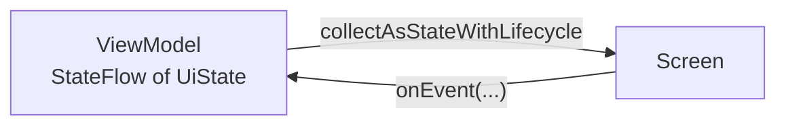

# UI with Jetpack Compose

> In Compose the UI is a function of state. Change the state and Compose redraws only what depends on it. Interviewers check that you understand recomposition, state hoisting and side effects.

Roadmap topic 5 · Stage 2: Building the App

**Go deeper:** `3` Coroutines (`collectAsStateWithLifecycle`, `LaunchedEffect`) · `4` Lifecycle · `6` Architecture (UI state) · `11` Performance (Compose) · `12` Testing (Compose tests) · `14` Accessibility and adaptive UI · `16` iOS (SwiftUI).

**Marks:** 🟢 must know · 🟡 good to know

---

#### 1. What Is It?

*Describe the UI for the current state; the framework does the updating.*

| 🟢 Must know | 🟡 Good to know |
|---|---|
| composables: UI as a function of state | Material theming and design tokens |
| state and recomposition | stability, `derivedStateOf` |
| `remember`, `rememberSaveable`, state hoisting | animations, gestures, custom drawing |
| `Row`, `Column`, `Box`, modifier order | previews, testable UI |
| `LazyColumn`, keys | View system basics and interop |
| side effects: `LaunchedEffect`, `DisposableEffect` | iOS: SwiftUI |
| `ViewModel` + single UI state | |
| navigation in Compose | |

1. A **composable** is a function that emits UI. It should have no hidden side effects.
2. **State** is a value Compose observes (`mutableStateOf`, `StateFlow` collected as state).
3. When state changes, Compose **recomposes** only the composables that read it.
4. **State hoisting:** a composable receives `value` and `onValueChange`, so the caller owns the state.

**Signals in an interview:** "what is recomposition?", "`remember` vs `rememberSaveable`", "why does my list jump?", "where do you launch a coroutine in a composable?", "how do you avoid needless recomposition?".

---

#### 2. How It Works

**The loop.**



**Recomposition.** When a state object that a composable read changes, Compose re-runs that composable (and children whose inputs changed) and skips the rest. Composables can run often, in any order, and be skipped, so they must be **fast and free of side effects**.

**`remember` and `rememberSaveable`.**

| | Rotation | Process death |
|---|---|---|
| `remember { }` | lost (the Activity is recreated) | lost |
| `rememberSaveable { }` | kept | kept (small, `Bundle`-able values) |
| state in the `ViewModel` | kept | lost, unless `SavedStateHandle` |

**State hoisting.**



Stateless composables are easy to test, preview and reuse.

**Layout and modifiers.** `Column` stacks vertically, `Row` horizontally, `Box` overlaps. Modifiers apply in the order written:

```kotlin
Modifier.padding(16.dp).background(Color.Red)   // padding first: red fills only the area inside the 16 dp margin
Modifier.background(Color.Red).padding(16.dp)   // red fills the whole box, the content is inset by 16 dp
```

Read left to right: each modifier wraps what comes after it.

**Lazy lists.** `LazyColumn` composes only the visible items. Give each item a stable **`key`** (the id) so state and animations follow the item when the list changes.

**Side effects.**

| API | Use for |
|---|---|
| `LaunchedEffect(key)` | run a suspend block when entering the composition and when `key` changes |
| `rememberCoroutineScope()` | launch from an event handler (a click) |
| `DisposableEffect(key)` | register and clean up a listener (`onDispose`) |
| `SideEffect` | publish Compose state to non-Compose code |
| `rememberUpdatedState` | use the latest lambda inside a long-running effect |
| `produceState`, `snapshotFlow` | turn non-Compose sources into state / state into a Flow |

Never start a coroutine directly in the body of a composable: it would restart on every recomposition.

**`ViewModel` + one UI state.** The screen collects one state object and sends events up.



🟡 **Theming.** `MaterialTheme` provides colour, typography and shapes; use theme tokens (`MaterialTheme.colorScheme.primary`), not hard-coded colours, so dark mode and brands work (topic 14).

🟡 **Stability and skipping.** Compose skips a composable when its inputs are unchanged. Types it cannot prove stable (a `List`, a class with a `var`) may force recomposition; recent compilers enable "strong skipping" by default, which helps. Use immutable data, `ImmutableList` or `@Immutable`/`@Stable` when the compiler report shows a problem. **`derivedStateOf`** turns a fast-changing value into a slower one (for example "show the button when the scroll offset > 0").

🟡 **Animations, gestures, drawing.** `animate*AsState`, `AnimatedVisibility`, `Modifier.pointerInput`, `Canvas`. Read animated values as late as possible (in the draw or layout phase) to avoid recomposing every frame.

🟡 **Previews and testing.** `@Preview` for stateless composables; `createComposeRule()` for UI tests (topic 12).

🟡 **View system.** XML layouts, `RecyclerView`, `ViewBinding` still exist in older apps. Interop: `AndroidView` (View inside Compose) and `ComposeView` (Compose inside Views). Migrate screen by screen.

🟡 **iOS.** SwiftUI is also state-driven: `@State`, `@Binding`, `@Observable` (topic 16).

---

#### 3. Naive vs Better Design

| Naive | Better |
|---|---|
| a composable that calls the repository | the `ViewModel` loads data; the composable shows state |
| `var text by remember` inside a reusable field | hoist state: `value` + `onValueChange` |
| `LazyColumn { items(list) { … } }` with no key | `items(list, key = { it.id })` |
| launch a coroutine in the composable body | `LaunchedEffect(key)` or an event handler scope |
| pass the whole `ViewModel` to child composables | pass state and lambdas |
| hard-coded colours and sizes | theme tokens and `dp`/`sp` |
| `remember` for state that must survive rotation | `rememberSaveable` or the `ViewModel` |
| one giant composable | small composables, each with clear inputs |

```kotlin
// Naive: network call in the body of the composable runs again on every recomposition
@Composable fun Profile() {
    val user = runBlocking { api.user() }
    Text(user.name)
}
```

---

#### 4. Code

Stateless component and its stateful screen:

```kotlin
@Composable
fun NoteField(value: String, onValueChange: (String) -> Unit, modifier: Modifier = Modifier) {
    OutlinedTextField(value = value, onValueChange = onValueChange, label = { Text("Note") }, modifier = modifier)
}

@Composable
fun EditorScreen(vm: EditorViewModel = hiltViewModel()) {
    val draft by vm.draft.collectAsStateWithLifecycle()
    NoteField(value = draft, onValueChange = vm::onDraftChange)      // state lives in the ViewModel
}
```

One screen state and an exhaustive `when`:

```kotlin
@Composable
fun NotesContent(state: UiState<List<Note>>, onOpen: (Long) -> Unit, onRetry: () -> Unit) {
    when (state) {
        UiState.Loading -> CircularProgressIndicator()
        is UiState.Error -> ErrorView(state.message, onRetry)
        is UiState.Content -> if (state.items.isEmpty()) EmptyView() else NotesList(state.items, onOpen)
    }
}

@Composable
fun NotesList(notes: List<Note>, onOpen: (Long) -> Unit) {
    LazyColumn {
        items(notes, key = { it.id }) { note ->                 // stable key: state follows the item
            ListItem(headlineContent = { Text(note.title) }, modifier = Modifier.clickable { onOpen(note.id) })
        }
    }
}
```

Side effects:

```kotlin
@Composable
fun EventsHandler(events: Flow<UiEvent>, onNavigateBack: () -> Unit, snackbar: SnackbarHostState) {
    val latestBack by rememberUpdatedState(onNavigateBack)
    LaunchedEffect(Unit) {                                     // starts once, cancelled on leaving the composition
        events.collect { e ->
            when (e) {
                is UiEvent.Message -> snackbar.showSnackbar(e.text)
                UiEvent.NavigateBack -> latestBack()
            }
        }
    }
}

@Composable
fun BackHandlerExample(enabled: Boolean, onBack: () -> Unit) {
    val dispatcher = LocalOnBackPressedDispatcherOwner.current?.onBackPressedDispatcher
    DisposableEffect(dispatcher, enabled) {
        val cb = object : OnBackPressedCallback(enabled) { override fun handleOnBackPressed() = onBack() }
        dispatcher?.addCallback(cb)
        onDispose { cb.remove() }                              // always clean up
    }
}
```

`derivedStateOf`:

```kotlin
val listState = rememberLazyListState()
val showScrollToTop by remember { derivedStateOf { listState.firstVisibleItemIndex > 0 } }   // recomposes when it flips, not on every pixel
```

A Compose UI test:

```kotlin
@get:Rule val rule = createComposeRule()

@Test fun `shows empty message`() {
    rule.setContent { NotesContent(UiState.Content(emptyList()), onOpen = {}, onRetry = {}) }
    rule.onNodeWithText("No notes yet").assertIsDisplayed()
}
```

Modifier order check: `Box(Modifier.size(100.dp).padding(10.dp).background(Color.Red))` → red square is `80 × 80 dp` (padding removes space before the background). `Box(Modifier.size(100.dp).background(Color.Red).padding(10.dp))` → red is `100 × 100 dp` and the content is inset by 10.

---

#### 5. Performance & Limits

| Item | Remember |
|---|---|
| Frame budget | 16 ms at 60 Hz: composition + layout + draw must fit |
| Lazy list | composes only visible items (plus a small buffer); a non-lazy `Column` composes all |
| Keys | without keys, items are matched by position: state jumps when the list changes |
| Recomposition | cheap if the work is cheap; expensive work belongs in `remember`, `derivedStateOf` or the `ViewModel` |
| Animated values | read in the draw / layout phase (`graphicsLayer { }`, lambda modifiers) to skip recomposition |
| Release builds | Compose is much faster with R8 and baseline profiles; judge performance in release mode |
| Layout Inspector / compiler reports | find recomposition counts and unstable parameters |

---

#### 6. Common Mistakes & Edge Cases

1. Doing side effects (network, writing state) in the composable body.
2. Missing `key` in `LazyColumn`.
3. `remember` for state that should survive rotation.
4. Passing the `ViewModel` down the tree.
5. Reading fast-changing state (scroll offset, animation) high in the tree.
6. A `remember` without keys when the calculation depends on a parameter: use `remember(param)`.
7. Heavy work in the body (sorting a big list on every recomposition).
8. A nested scrolling container with infinite height (`LazyColumn` inside `Column(Modifier.verticalScroll)`).
9. Hard-coded text and colours (breaks dark mode and translation).

Edge cases: very large font scale; empty, loading and error states; rotation in the middle of typing; keyboard (IME) covering the field; list item removed while animating; state hoisted too high (everything recomposes) or too low (cannot share).

---

#### 7. Say This in the Interview

1. "Compose describes the UI as a function of state. When state changes, only the composables that read it recompose."
2. "I hoist state: a composable takes a value and a lambda, and the screen or `ViewModel` owns the state. That makes it testable and reusable."
3. "`remember` keeps a value across recompositions; `rememberSaveable` also keeps it across rotation and process death."
4. "Side effects go in `LaunchedEffect`, `DisposableEffect` or event handlers, never in the body, because the body can run many times."
5. "Lists use `LazyColumn` with stable keys. I read fast-changing state as late as possible, or wrap it in `derivedStateOf`."
6. "The screen collects one `UiState` with `collectAsStateWithLifecycle` and sends events to the `ViewModel`."

---

#### 8. Quick Check

1. What triggers recomposition?
2. Where do you start a coroutine from a click?
3. Why add `key` to `LazyColumn` items?
4. `remember` vs `rememberSaveable` on rotation?

<details>
<summary>Answers</summary>

1. A change in a state object that a composable read (or a change in its input parameters).
2. In the click handler, with the `ViewModel` (`viewModelScope`) or `rememberCoroutineScope()`.
3. So item identity and state stay with the item when the list changes order or content.
4. `remember` is lost; `rememberSaveable` is kept.

</details>

---

#### 9. Practice

**Interview questions**

1. What is recomposition, and how do you keep it cheap?
2. What is state hoisting?
3. `remember` vs `rememberSaveable` vs `ViewModel` state?
4. Which side-effect API for which job?
5. Why does a `LazyColumn` need keys?
6. How do you test a composable?
7. How do you interoperate with the View system?

**Hands-on**

1. Build a notes list with loading, empty, error and content states and a preview for each.
2. Turn on the recomposition-count display in Layout Inspector and reduce the counts on one screen.
3. Write one Compose UI test for the empty state and one for a click.

**Coding warm-ups (LeetCode, lists and diffs)**

| # | Question | Link to this topic |
|---|---|---|
| 21 | [Merge Two Sorted Lists](https://leetcode.com/problems/merge-two-sorted-lists/) (Easy) | merging two ordered lists (diffing) |
| 146 | [LRU Cache](https://leetcode.com/problems/lru-cache/) (Medium) | cache for list item images |
| 1472 | [Design Browser History](https://leetcode.com/problems/design-browser-history/) (Medium) | navigation state |

**Remember:** UI = f(state) · hoist state · `remember` vs `rememberSaveable` · effects not in the body · keys in lazy lists · one UI state from the `ViewModel` · read fast-changing state late.
