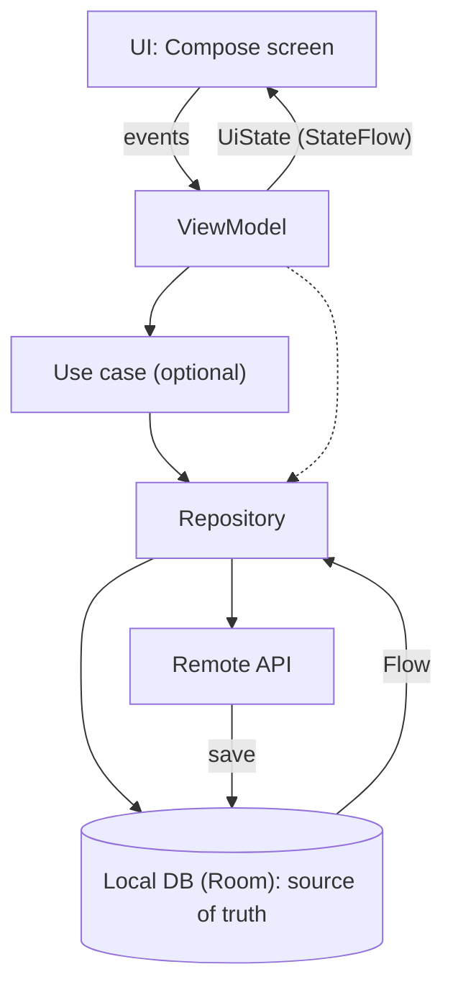
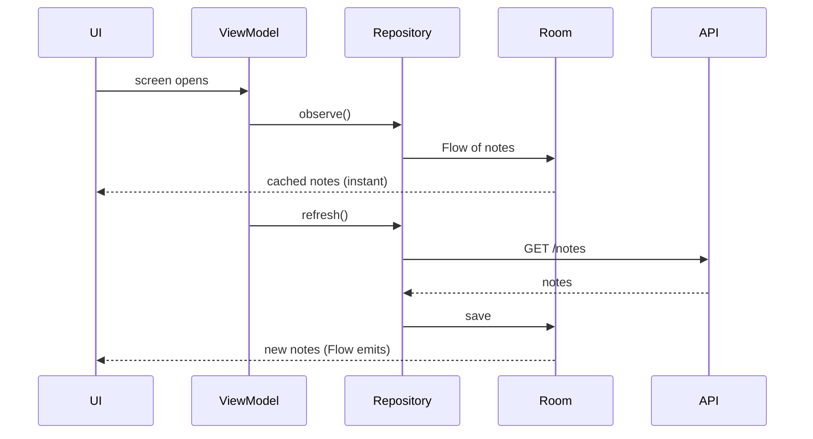
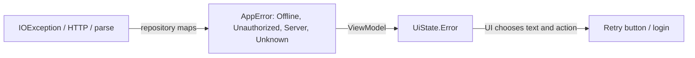

# App Architecture

> Architecture answers one question: where does each piece of logic live, so the app stays testable, survives rotation and process death, and can grow? The short answer: state flows down, events flow up, and one place owns each piece of data.

Roadmap topic 6 · Stage 2: Building the App

**Go deeper:** `2` Kotlin (sealed state) · `3` Coroutines & Flow · `5` Compose · `7` DI & Modularization · `9` Local Storage & Offline-First · `12` Testing · `09-architecture` (the general architecture roadmap) · `05-system-design/30-Mobile-Specific-Topics`.

**Marks:** 🟢 must know · 🟡 good to know

---

#### 1. What Is It?

*A structure that keeps UI, business rules and data apart.*

| 🟢 Must know | 🟡 Good to know |
|---|---|
| layers: UI, domain (optional), data | clean architecture, dependency direction |
| MVVM and MVI | mapping between layers |
| unidirectional data flow | navigation architecture |
| repository, single source of truth | explaining architecture decisions |
| UI state with sealed types | anti-patterns |
| one-time events | |
| one error model | |
| use cases: when they help | |

1. **UI layer:** composables + `ViewModel`. Shows state, sends events.
2. **Domain layer (optional):** use cases and business models. Pure Kotlin.
3. **Data layer:** repositories, local database, network. Hides where data comes from.
4. **Unidirectional data flow (UDF):** state flows down, events flow up.
5. **Single source of truth (SSOT):** usually the local database; the UI observes it.

**Signals in an interview:** "describe your app's architecture", "MVVM vs MVI", "where does this logic go?", "how do you handle one-time events?", "how do you test it?".

---

#### 2. How It Works

**Layers and the data flow.**



Dependencies point **inward**: UI → domain → data interfaces. The domain layer does not know about Android or Retrofit.

**MVVM and MVI.**

| | MVVM | MVI |
|---|---|---|
| State | one or a few `StateFlow`s | one immutable state object |
| Input | `ViewModel` functions (`onSaveClicked()`) | one stream of intents / actions |
| Change | functions update state | a **reducer** `(state, action) → new state` |
| Benefit | simple, less ceremony | predictable, easy to log and replay |

Both give you UDF. In an interview, say you use one **UI state** object and plain `ViewModel` functions, and explain a reducer if asked.

**UI state.** Use a sealed type when the states are exclusive (`Loading`, `Content`, `Error`). If content stays visible while it refreshes or after a failed refresh, use one data class with the content plus `isRefreshing` and `error`. Do not allow impossible combinations where you can avoid them.

**Repository and single source of truth.**



The UI never reads the network directly. It reads the database; the network only updates the database.

**One-time events** (navigate, show a snackbar). Put what the screen **shows** in state. Put what **happens once** in a `Channel` (consumed once) or model it as state with an explicit "consumed" call. A replaying `SharedFlow` shows the snackbar again after rotation.

**One error model.** Convert exceptions at the boundary into a small sealed type, then map to text in the UI.



**Use cases.** A use case is a class with one job (`GetFeedUseCase`). They help when logic is shared by several `ViewModel`s or combines several repositories. If a use case only forwards a repository call, skip it.

🟡 **Clean architecture and dependency direction.** The domain defines interfaces (`NotesRepository`); the data layer implements them. Gains: testability and replaceable data sources. Cost: more files and mapping; apply it where the app is big enough.

🟡 **Mapping.** DTO (network shape) → entity (database shape) → domain model → UI model. Separate models let the API, the database and the screen change independently. Map at the boundaries and keep mappers as plain, tested functions.

🟡 **Navigation architecture.** Navigation events come from the UI; the `ViewModel` asks for navigation via an event or state; feature modules expose destinations (topic 7). Pass ids.

🟡 **Anti-patterns.** Logic in composables; God `ViewModel`; a `Context` or `View` in the `ViewModel`; Android types (`Uri`, `Bundle`) in the domain; the UI reading the network; a mutable `StateFlow` exposed publicly; one `Utils` class for everything.

---

#### 3. Naive vs Better Design

| Naive | Better |
|---|---|
| composable calls Retrofit | composable → `ViewModel` → repository |
| state spread over many `var`s | one `UiState` |
| UI reads the network, and sometimes the cache | UI reads Room; network updates Room |
| events as `SharedFlow(replay=1)` | `Channel` or state with consume |
| `catch (e: Exception) { }` everywhere | repository maps to `AppError` once |
| DTO used all the way to the UI | map DTO → entity → domain → UI |
| a use case that forwards one call | call the repository |
| one 2,000-line `ViewModel` | one `ViewModel` per screen, shared logic in use cases |

```kotlin
// Naive: logic, network and state all inside the UI
@Composable fun Notes() {
    var notes by remember { mutableStateOf(listOf<Note>()) }
    LaunchedEffect(Unit) { notes = retrofit.create(Api::class.java).notes() }
}
```

---

#### 4. Code

UI state and a reducer (MVI style, a pure function that is easy to test):

```kotlin
data class NotesUi(val notes: List<Note> = emptyList(), val loading: Boolean = false, val error: String? = null)

sealed interface Action {
    data object Load : Action
    data class Loaded(val notes: List<Note>) : Action
    data class Failed(val message: String) : Action
}

fun reduce(s: NotesUi, a: Action): NotesUi = when (a) {
    Action.Load -> s.copy(loading = true, error = null)
    is Action.Loaded -> s.copy(loading = false, notes = a.notes)
    is Action.Failed -> s.copy(loading = false, error = a.message)      // old notes stay visible
}
```

Checks: `reduce(NotesUi(), Action.Load)` → `loading = true`. Then `Loaded(listOf(note))` → `loading = false`, `notes.size == 1`. Then `Load` and `Failed("offline")` → `error = "offline"` and `notes.size == 1` (the stale content is still shown).

A `ViewModel` that uses it:

```kotlin
@HiltViewModel
class NotesViewModel @Inject constructor(private val repo: NotesRepository) : ViewModel() {
    private val _ui = MutableStateFlow(NotesUi())
    val ui: StateFlow<NotesUi> = _ui.asStateFlow()

    private fun dispatch(a: Action) = _ui.update { reduce(it, a) }

    init {
        viewModelScope.launch { repo.observe().collect { dispatch(Action.Loaded(it)) } }   // the database drives the UI
        refresh()
    }

    fun refresh() = viewModelScope.launch {
        dispatch(Action.Load)
        runCatching { repo.refresh() }
            .onFailure { if (it is CancellationException) throw it; dispatch(Action.Failed(it.toAppError().message())) }
    }
}
```

Repository with a single source of truth:

```kotlin
interface NotesRepository {
    fun observe(): Flow<List<Note>>
    suspend fun refresh()
}

class OfflineFirstNotesRepository(private val api: NotesApi, private val dao: NoteDao) : NotesRepository {
    override fun observe() = dao.observeAll().map { rows -> rows.map(NoteEntity::toDomain) }
    override suspend fun refresh() {
        val dtos = try { api.notes() } catch (e: IOException) { throw e } catch (e: HttpException) { throw ApiException(e.code()) }
        dao.replaceAll(dtos.map(NoteDto::toEntity))
    }
}
```

Mappers (plain functions):

```kotlin
data class NoteDto(val id: Long, val title: String?, val updatedAt: Long)
data class NoteEntity(val id: Long, val title: String, val updatedAt: Long)
data class Note(val id: Long, val title: String, val updatedAt: Long)

fun NoteDto.toEntity() = NoteEntity(id, title?.trim().orEmpty().ifEmpty { "Untitled" }, updatedAt)
fun NoteEntity.toDomain() = Note(id, title, updatedAt)
```

Checks: `NoteDto(1, "  Hi ", 5).toEntity().title` → `"Hi"`; `NoteDto(2, null, 5).toEntity().title` → `"Untitled"`; `NoteDto(3, "   ", 5).toEntity().title` → `"Untitled"`.

One error model:

```kotlin
class ApiException(val code: Int) : Exception("HTTP $code")

sealed interface AppError {
    data object Offline : AppError
    data object Unauthorized : AppError
    data class Server(val code: Int) : AppError
    data class Unknown(val cause: Throwable) : AppError
}

fun Throwable.toAppError(): AppError = when (this) {
    is IOException -> AppError.Offline
    is ApiException -> if (code == 401) AppError.Unauthorized else AppError.Server(code)
    else -> AppError.Unknown(this)
}

fun AppError.message() = when (this) {
    AppError.Offline -> "You are offline"
    AppError.Unauthorized -> "Please sign in again"
    is AppError.Server -> "Server problem ($code)"
    is AppError.Unknown -> "Something went wrong"
}
```

Checks: `IOException().toAppError()` → `Offline`; `ApiException(401)` → `Unauthorized`; `ApiException(503)` → `Server(503)`; `IllegalStateException()` → `Unknown`.

A use case that earns its place (two repositories):

```kotlin
class GetHomeUseCase(private val notes: NotesRepository, private val profile: ProfileRepository) {
    operator fun invoke(): Flow<Home> = combine(notes.observe(), profile.observe()) { n, p -> Home(p, n.take(5)) }
}
```

Test with a fake repository (no mocks). A `MainDispatcherRule` sets `Dispatchers.setMain(StandardTestDispatcher())` so `viewModelScope` runs under the test scheduler (topic 12):

```kotlin
class FakeNotesRepository : NotesRepository {
    val notes = MutableStateFlow(listOf<Note>())
    var failRefresh = false
    override fun observe() = notes
    override suspend fun refresh() { if (failRefresh) throw IOException() }
}

@Test fun `refresh failure keeps old notes and shows error`() = runTest {
    val repo = FakeNotesRepository().apply { notes.value = listOf(Note(1, "a", 0)); failRefresh = true }
    val vm = NotesViewModel(repo)
    advanceUntilIdle()
    assertEquals(1, vm.ui.value.notes.size)
    assertEquals("You are offline", vm.ui.value.error)
}
```

---

#### 5. Performance & Limits

| Item | Remember |
|---|---|
| State updates | `StateFlow` ignores equal values; use immutable data so `copy()` produces a real change |
| Large lists in state | keep the list in one object; use stable keys and diffs in the UI |
| Mapping cost | map once at the boundary; don't re-map in the composable |
| `ViewModel` size | one per screen; if it grows past a few hundred lines, extract use cases |
| Layers | each layer adds files; choose the number of layers by the size of the app |
| Testing speed | pure reducers and fakes run in milliseconds |

---

#### 6. Common Mistakes & Edge Cases

1. Business logic in composables or `Activity`.
2. Holding a `Context`, `View` or `Activity` in a `ViewModel`.
3. Several sources of truth for the same data (memory + database + network).
4. Using `SharedFlow(replay)` for events.
5. A loading flag that never turns off after an error.
6. Hiding errors with an empty `catch`.
7. Over-layering a tiny app, or no layers in a big one.
8. A use case that wraps one call.
9. Network DTOs leaking into the UI.

Edge cases: a refresh fails but cached data exists (show the data plus a small error); process death while loading (the `ViewModel` restarts and loads again); two screens editing the same record (the database `Flow` updates both); the first launch with no cache and no network (a real empty/offline state).

---

#### 7. Say This in the Interview

1. "I use three layers: UI (Compose + `ViewModel`), an optional domain layer, and a data layer with repositories. State flows down and events flow up."
2. "The local database is the single source of truth. The UI observes it with a `Flow`, and the network only refreshes it."
3. "Each screen has one immutable `UiState`. Impossible states are not representable."
4. "One-time events go through a `Channel`, not a replaying `SharedFlow`."
5. "Exceptions are mapped to a small `AppError` type in the repository, and the UI chooses the message and the action."
6. "I add a use case when logic is shared or combines several repositories, not by default."
7. "Because dependencies are interfaces, I test the `ViewModel` with fakes."

---

#### 8. Quick Check

1. Where does the UI get its data in an offline-first app?
2. Why not use a replaying `SharedFlow` for a snackbar?
3. MVVM vs MVI in one sentence?
4. When do you skip a use case?

<details>
<summary>Answers</summary>

1. From the local database (via a `Flow`); the network only updates the database.
2. After rotation a new collector receives the replayed event, so the snackbar shows again.
3. Both have one-way data flow; MVI funnels all changes through one reducer over one state.
4. When it only forwards one repository call.

</details>

---

#### 9. Practice

**Interview questions**

1. Describe the architecture of an app you built.
2. MVVM vs MVI?
3. What is the single source of truth, and why use the database?
4. How do you model UI state?
5. How do you handle navigation and snackbar events?
6. What goes into the domain layer?
7. How do you handle errors from network to screen?

**Hands-on**

1. Refactor a screen that calls Retrofit from a composable into `ViewModel` + repository + Room.
2. Write the reducer tests for load, success and failure.
3. Draw your app's modules and arrows; mark any arrow that points the wrong way.

**Coding warm-ups (LeetCode)**

| # | Question | Link to this topic |
|---|---|---|
| 146 | [LRU Cache](https://leetcode.com/problems/lru-cache/) (Medium) | an in-memory cache in the data layer |
| 355 | [Design Twitter](https://leetcode.com/problems/design-twitter/) (Medium) | merging feeds in a repository |
| 981 | [Time Based Key-Value Store](https://leetcode.com/problems/time-based-key-value-store/) (Medium) | versions in a local store |

**Remember:** state down, events up · the database is the single source of truth · one `UiState` per screen · events through a `Channel` · map exceptions once · fakes over mocks · no Android types in the domain.
