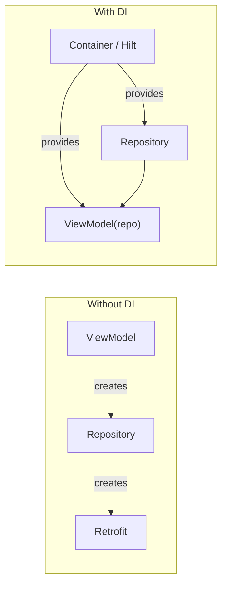
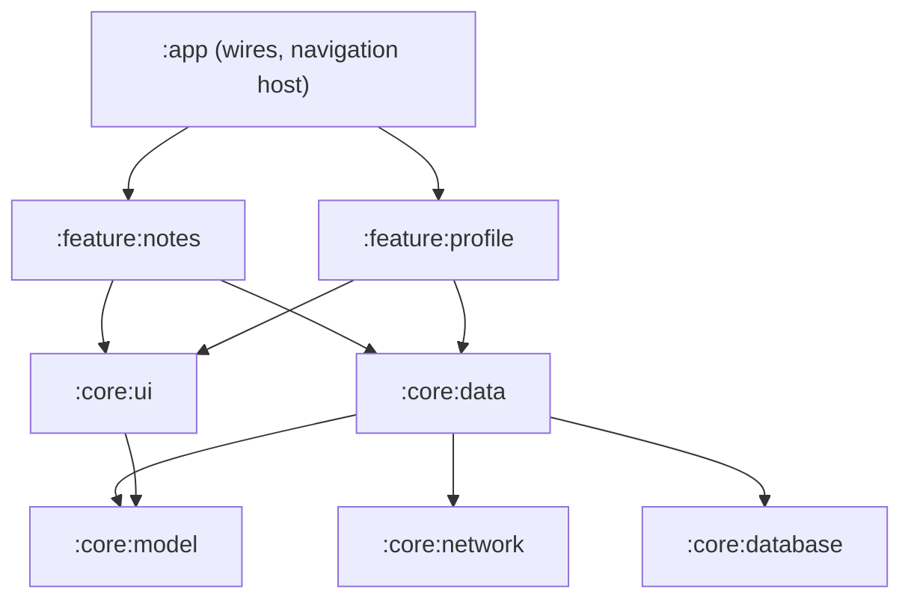

# Dependency Injection & Modularization

> DI gives a class what it needs instead of letting it build it, so you can swap parts in tests. Modularization splits the app into modules with clear boundaries, so teams and builds scale.

Roadmap topic 7 · Stage 2: Building the App

**Go deeper:** `6` App Architecture · `12` Testing · `15` Build, Release & Monitoring (build speed, CI) · `09-architecture` (modular monolith, boundaries) · `02-algorithm` (graph cycles).

**Marks:** 🟢 must know · 🟡 good to know

---

#### 1. What Is It?

*Pass dependencies in; draw clear lines between parts of the app.*

| 🟢 Must know | 🟡 Good to know |
|---|---|
| what DI solves | API / implementation module split |
| Hilt, Koin, manual DI | build speed: caching, parallel builds, no cycles |
| scopes: application, activity, `ViewModel` | version catalogs, convention plugins |
| constructor injection | dynamic feature modules, app size |
| module structure: app, feature, core | when modularization is not worth it |
| module boundaries and dependency direction | |

1. **DI:** a class declares its dependencies in its constructor; something else supplies them.
2. **Hilt** (built on Dagger) generates the wiring at compile time. **Koin** resolves it at runtime. **Manual DI** is plain constructors and a container.
3. **Scope:** how long an instance lives (the app, an Activity, a `ViewModel`).
4. **Modules:** `:app` (wires everything), `:feature:*` (screens), `:core:*` (shared building blocks).

**Signals in an interview:** "why DI?", "Hilt vs Koin", "what is `@Singleton`?", "how do you structure modules?", "how do you speed up the build?".

---

#### 2. How It Works

**Without and with DI.**



Why it matters: a `ViewModel(repo: NotesRepository)` can get a **fake** in a test; a `ViewModel` that does `Retrofit.Builder()...` cannot.

**Constructor injection** is the default: no hidden global access, dependencies are visible, the class is easy to test. Field injection (`@Inject lateinit var`) only for Android classes you cannot construct (Activity, Application).

**Hilt vs Koin vs manual.**

| | Hilt | Koin | Manual |
|---|---|---|---|
| Wiring checked | compile time (errors early) | runtime (errors on use) | compile time |
| Setup | annotations, a generated graph | a Kotlin DSL | none |
| Android integration | `@HiltViewModel`, `@AndroidEntryPoint` | `koinViewModel()` | write it yourself |
| Build time | annotation processing adds some | small | none |
| Good for | most Android teams, large apps | small apps, KMP | small apps, learning |

**Scopes.**

| Scope | Lives as long as | Example |
|---|---|---|
| `@Singleton` (`SingletonComponent`) | the app process | `OkHttpClient`, `Retrofit`, Room database |
| `@ActivityRetainedScoped` | across rotation | shared state for a flow |
| `@ViewModelScoped` | one `ViewModel` | a helper owned by it |
| unscoped | a new instance every time | mappers, use cases |

Scope only what must be shared or is expensive. Everything that is scoped stays in memory for that long.

**Module structure.**



Rules:

1. Dependencies point **downward**; no cycles.
2. **Features do not depend on each other.** They talk through `:app` (navigation) or shared `:core` contracts.
3. A module exposes a **small public API** and hides the rest (`internal`).
4. `:app` is thin: dependency wiring, the navigation host, the manifest.

🟡 **API and implementation split.** `:feature:notes:api` holds the navigation route and interfaces; `:feature:notes:impl` holds screens. Other features depend only on `api`, so `impl` changes do not rebuild them.

🟡 **Build speed.** Gradle builds modules in parallel and caches outputs; the build only redoes modules whose inputs changed. Fewer, smaller public APIs → fewer rebuilds. Enable the configuration cache and build cache. Use `implementation`, not `api`, so changes do not leak to consumers.

🟡 **Version catalogs and convention plugins.** `gradle/libs.versions.toml` lists library versions once. A **convention plugin** applies shared settings (Android config, Kotlin options, Compose, Hilt) to every module with one line.

🟡 **Dynamic feature modules.** Delivered on demand from Play, to keep the initial download small. Use for large, rarely used features.

🟡 **When not to.** A small app with one or two developers gains little from 30 modules and pays in build configuration and indirection. Start with packages per feature; split a module when build time, team conflicts or reuse show the need.

---

#### 3. Naive vs Better Design

| Naive | Better |
|---|---|
| `object NetworkClient` accessed everywhere | inject `NotesApi`; provide it once |
| `ViewModel` builds its own repository | constructor injection |
| everything `@Singleton` | scope only shared, expensive objects |
| `api(...)` for every dependency | `implementation(...)` |
| feature A imports feature B's classes | go through `:app` navigation or a `:core` contract |
| one `:app` module with 2,000 files | feature + core modules |
| 40 modules for a 3-screen app | packages first; split later |
| versions copied into every `build.gradle` | version catalog |

```kotlin
// Naive: a hidden global; cannot be replaced in a test
class NotesViewModel : ViewModel() {
    private val repo = NotesRepository(RetrofitProvider.api, AppDatabase.instance.noteDao())
}
```

---

#### 4. Code

Manual DI (no framework):

```kotlin
class AppContainer(context: Context) {
    private val db = Room.databaseBuilder(context, AppDatabase::class.java, "app.db").build()
    private val retrofit = Retrofit.Builder().baseUrl("https://api.example.com/")
        .addConverterFactory(Json.asConverterFactory("application/json".toMediaType())).build()
    val notesRepository: NotesRepository = OfflineFirstNotesRepository(retrofit.create(NotesApi::class.java), db.noteDao())
}
// Application: lateinit var container; ViewModel factory passes container.notesRepository
```

Hilt:

```kotlin
@HiltAndroidApp class NotesApp : Application()

@Module @InstallIn(SingletonComponent::class)
object NetworkModule {
    @Provides @Singleton
    fun okHttp(auth: AuthInterceptor): OkHttpClient = OkHttpClient.Builder().addInterceptor(auth).build()

    @Provides @Singleton
    fun retrofit(client: OkHttpClient): Retrofit = Retrofit.Builder().baseUrl("https://api.example.com/").client(client)
        .addConverterFactory(Json.asConverterFactory("application/json".toMediaType())).build()

    @Provides @Singleton
    fun notesApi(retrofit: Retrofit): NotesApi = retrofit.create(NotesApi::class.java)
}

@Module @InstallIn(SingletonComponent::class)
abstract class DataModule {
    @Binds abstract fun repo(impl: OfflineFirstNotesRepository): NotesRepository      // interface → implementation
}

class OfflineFirstNotesRepository @Inject constructor(private val api: NotesApi, private val dao: NoteDao) : NotesRepository { /* … */ }

@HiltViewModel
class NotesViewModel @Inject constructor(private val repo: NotesRepository) : ViewModel()

@AndroidEntryPoint class MainActivity : ComponentActivity()
```

In a test, replace the module:

```kotlin
@TestInstallIn(components = [SingletonComponent::class], replaces = [DataModule::class])
@Module abstract class FakeDataModule {
    @Binds abstract fun repo(fake: FakeNotesRepository): NotesRepository
}
```

Koin:

```kotlin
val appModule = module {
    single { Room.databaseBuilder(androidContext(), AppDatabase::class.java, "app.db").build() }
    single<NotesRepository> { OfflineFirstNotesRepository(get(), get<AppDatabase>().noteDao()) }
    viewModel { NotesViewModel(get()) }
}
```

Gradle: a feature module, a version catalog and a convention plugin:

```kotlin
// feature/notes/build.gradle.kts
plugins { id("notes.android.feature") }       // convention plugin: Android library + Compose + Hilt
dependencies {
    implementation(projects.core.data)
    implementation(projects.core.ui)
    implementation(libs.androidx.navigation.compose)
}
```

```toml
# gradle/libs.versions.toml
[versions]
kotlin = "2.0.21"
compose-bom = "2024.10.01"
[libraries]
androidx-navigation-compose = { module = "androidx.navigation:navigation-compose", version = "2.8.3" }
```

A check that the module graph has no cycles (a graph problem from topic 2):

```kotlin
fun hasCycle(deps: Map<String, List<String>>): Boolean {
    val state = HashMap<String, Int>()                  // 1 = visiting, 2 = done
    fun dfs(module: String): Boolean {
        when (state[module]) { 1 -> return true; 2 -> return false }
        state[module] = 1
        for (d in deps[module].orEmpty()) if (dfs(d)) return true
        state[module] = 2
        return false
    }
    return deps.keys.any { dfs(it) }
}
```

Checks: `hasCycle(mapOf(":app" to listOf(":feature", ":core"), ":feature" to listOf(":core"), ":core" to listOf()))` → `false`. Add `":core" to listOf(":feature")` (core depends on feature) → `true`. Gradle refuses to build a cycle; this shows why.

A test that needs no framework:

```kotlin
@Test fun `refresh error is shown`() = runTest {
    val vm = NotesViewModel(FakeNotesRepository().apply { failRefresh = true })   // constructor injection
    advanceUntilIdle()
    assertNotNull(vm.ui.value.error)
}
```

---

#### 5. Performance & Limits

| Item | Remember |
|---|---|
| Hilt | generates code at compile time (kapt/KSP): prefer KSP for faster builds |
| Koin | no codegen, but a missing binding fails at runtime (verify the graph in a test) |
| Singletons | stay in memory for the life of the process |
| Modules | more modules = more parallelism and better caching, but also more configuration time |
| `api` vs `implementation` | `api` leaks the dependency to all consumers, forcing more rebuilds |
| Incremental builds | change a module's public API and everything that depends on it rebuilds |
| Dynamic features | smaller install, but more complexity (delivery, testing) |

---

#### 6. Common Mistakes & Edge Cases

1. Service-locator style (`get()` all over the code) instead of constructor injection.
2. Scoping everything as `@Singleton` (memory held forever; shared mutable state).
3. Injecting an `Activity` context into a singleton (a leak).
4. Circular module dependencies.
5. Features depending on each other.
6. Putting everything in `:core:common` (a junk drawer everything depends on).
7. Premature modularization.
8. Using `api` everywhere.

Edge cases: a `ViewModel` needs a runtime argument (use `SavedStateHandle` or assisted injection); a binding missing only in release; the same interface with two implementations (`@Named` or qualifiers); tests that need a different module; multi-module navigation between features.

---

#### 7. Say This in the Interview

1. "DI means a class receives its dependencies instead of creating them. It makes code testable, because I can pass a fake."
2. "I use constructor injection by default. Hilt checks the graph at compile time and integrates with `ViewModel`; Koin is lighter but fails at runtime."
3. "I scope only what must be shared: Retrofit, OkHttp and the database are singletons; mappers and use cases are unscoped."
4. "I split into `:app`, `:feature:*` and `:core:*`. Dependencies point down, features don't depend on each other, and the public API of each module is small."
5. "Modularization speeds up builds through parallelism and caching, but it is not free, so I start with packages and split when there's a reason."

---

#### 8. Quick Check

1. Why is constructor injection easier to test?
2. What is the difference between `@Provides` and `@Binds`?
3. Why shouldn't feature A depend on feature B?
4. What does `implementation` vs `api` change?

<details>
<summary>Answers</summary>

1. The test passes a fake through the constructor; nothing is created inside the class.
2. `@Provides` is a function that builds an instance (for third-party classes); `@Binds` maps an interface to an implementation that Hilt already knows how to construct.
3. It creates coupling, cycles and rebuilds; features should communicate through `:app` or `:core` contracts.
4. `implementation` hides the dependency from consumers; `api` exposes it, so consumers recompile when it changes.

</details>

---

#### 9. Practice

**Interview questions**

1. What problem does DI solve?
2. Hilt vs Koin vs manual DI?
3. What are scopes, and what would you scope as a singleton?
4. How do you structure the modules of a large app?
5. How do you avoid circular dependencies?
6. How do you speed up a slow build?
7. When is modularization not worth it?

**Hands-on**

1. Convert one class that creates its own dependencies to constructor injection and write a test with a fake.
2. Move one feature into its own module and check which modules rebuild when you change it.
3. Move the library versions into a version catalog.

**Coding warm-ups (LeetCode, dependency graphs)**

| # | Question | Link to this topic |
|---|---|---|
| 207 | [Course Schedule](https://leetcode.com/problems/course-schedule/) (Medium) | detect a cycle in the module graph |
| 210 | [Course Schedule II](https://leetcode.com/problems/course-schedule-ii/) (Medium) | build order of modules |
| 1203 | [Sort Items by Groups Respecting Dependencies](https://leetcode.com/problems/sort-items-by-groups-respecting-dependencies/) (Hard) | modules (groups) plus ordering |
| 802 | [Find Eventual Safe States](https://leetcode.com/problems/find-eventual-safe-states/) (Medium) | nodes that never reach a cycle |

**Remember:** constructor injection · interfaces + fakes for tests · scope only what must be shared · `:app` → features → core, no cycles · features don't depend on features · split modules when there's a reason.
