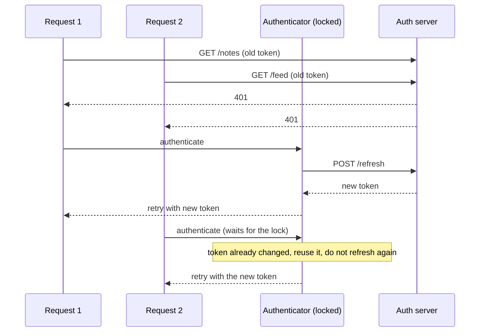

# Networking

> The network is the least reliable part of a mobile app. Good networking code sets timeouts, refreshes tokens once, retries safely, models errors, pages data and caches responses.

Roadmap topic 8 · Stage 3: Data & Background

**Go deeper:** `04-backend-engineering/02-Networking-and-HTTP` and `03-API-Design` (the server side) · `05-system-design/22-Reliable-Requests-and-External-Services` (retries, idempotency) · `05-system-design/24-Real-Time-Communication-and-Push` · `3` Coroutines · `6` Architecture (error model) · `9` Offline-First · `16` iOS (`URLSession`).

**Marks:** 🟢 must know · 🟡 good to know

---

#### 1. What Is It?

*Talking to your backend from the app, safely and efficiently.*

| 🟢 Must know | 🟡 Good to know |
|---|---|
| HTTP basics from the app's side | image loading and caching (Coil, Glide) |
| OkHttp and Retrofit, or Ktor | uploads and downloads: progress, resume |
| JSON serialization, unknown fields | WebSockets and SSE |
| interceptors | connectivity, metered networks |
| auth tokens: attach, refresh on `401`, no refresh storm | GraphQL and gRPC clients |
| timeouts, retries with backoff, idempotency | compression, payload size, mobile-friendly APIs |
| error modelling | iOS: `URLSession` |
| pagination: cursor, Paging library | |
| HTTP caching, `ETag` | |

1. **OkHttp** is the HTTP engine (connections, TLS, caching, interceptors). **Retrofit** turns an interface into API calls. **Ktor** is a Kotlin-first alternative (also for KMP).
2. **kotlinx.serialization** (or Moshi) turns JSON into Kotlin classes.
3. **Interceptors** see every request and response.
4. The app must plan for slow, failing and repeated requests.

**Signals in an interview:** "how do you refresh an expired token with 10 parallel requests?", "how do you retry?", "how do you page a feed?", "what happens offline?", "how do you cache?".

---

#### 2. How It Works

**The client stack.**


**Timeouts.** Set a connect timeout (about 10 s), a read timeout (about 15 to 30 s), and an overall `callTimeout` as a safety net. A request with no timeout can hang the screen.

**JSON.** Use `ignoreUnknownKeys = true` so a newer server can add fields without breaking old apps. Give optional fields defaults. Parse into DTOs and map to domain models (topic 6).

**Interceptors vs authenticator.**

| | Application interceptor | Network interceptor | `Authenticator` |
|---|---|---|---|
| Runs | once per call | per network hop (redirects, retries) | when the server answers `401` |
| Use for | add headers, auth token, logging | see real network bytes, cache headers | refresh the token and retry |

**Token refresh without a storm.**



Steps: take a lock; compare the token that failed with the current token; if they differ, someone already refreshed, so just retry; otherwise refresh once. If the refresh fails with `401`/`400`, sign the user out. Never retry the refresh call itself through the same authenticator.

**Retries.**

1. Retry only what is safe: `GET`, `PUT`, `DELETE` and `POST` with an `Idempotency-Key`.
2. Retry on `5xx`, `429` (respect `Retry-After`), timeouts and connection failures. Do not retry `4xx` (except `408`, `429`).
3. **Exponential backoff with jitter**, a small limit (3 to 5 tries), and stop if the user left the screen (cancellation).

**Error modelling.** Four families: **network** (no connection, timeout), **HTTP** (status code and error body), **parsing** (bad JSON), **business** (a valid response that says "insufficient funds"). Map each to one sealed `AppError` in the repository (topic 6).

**Pagination.**

1. **Cursor pagination:** the server returns `items` and `nextCursor`; you send the cursor back. Stable when items are added.
2. **Offset/page number:** simple but skips or repeats items when the list changes.
3. The **Paging 3** library handles loading, placeholders, retry and a `RemoteMediator` that writes pages into Room (database-driven paging).

**HTTP caching and conditional requests.** The server sends `Cache-Control` and `ETag`. The client sends `If-None-Match: <etag>`; the server answers `304 Not Modified` with no body. OkHttp's `Cache` does this when configured.

🟡 **Image loading.** Coil or Glide: memory and disk cache, downsampling to the view size, placeholders, cancel when the item scrolls away. Ask the CDN for the right size (topic 11, `SD 16`).

🟡 **Uploads and downloads.** Show progress, use `WorkManager` for long transfers, split large files into chunks and resume (topic 10, `SD 16`). Stream; never load a large file into memory.

🟡 **WebSockets and SSE.** For live data (chat, prices). Reconnect with backoff and recover missed messages (`SD 24`). Close when the app goes to the background.

🟡 **Connectivity.** `ConnectivityManager` callbacks tell you about changes, but the only proof is a successful request. Check **metered** networks before big downloads.

🟡 **GraphQL and gRPC.** GraphQL (Apollo Kotlin) lets the client choose fields (smaller payloads, more server complexity). gRPC uses protobuf (compact, streaming) and needs a proxy for browsers.

🟡 **Mobile-friendly APIs.** Fewer round trips (an endpoint shaped for the screen), compression (`gzip` is automatic in OkHttp), only needed fields, delta sync (`BE 3`, `SD 30`).

🟡 **iOS.** `URLSession` with `async/await` (topic 16).

---

#### 3. Naive vs Better Design

| Naive | Better |
|---|---|
| no timeouts | connect / read / call timeouts |
| every request refreshes the token on `401` | one refresh behind a lock; others reuse it |
| retry immediately, forever | backoff + jitter, limit, only safe requests |
| retry a `POST` blindly | `Idempotency-Key` |
| `catch (e: Exception)` in the UI | repository maps to `AppError` |
| page numbers on a live feed | cursor pagination |
| ignore unknown JSON fields → crash | `ignoreUnknownKeys = true` |
| download every time | `ETag` / `Cache-Control` |
| full-size images | CDN sizes + Coil downsampling |
| log request bodies in release | log only in debug, redact tokens |

```kotlin
// Naive: no timeout, no error handling, refreshes in every call
suspend fun notes(): List<Note> {
    val r = client.newCall(Request.Builder().url(url).build()).execute()    // blocks a thread
    return Json.decodeFromString(r.body!!.string())                          // crashes on unknown fields
}
```

---

#### 4. Code

OkHttp, Retrofit and kotlinx.serialization:

```kotlin
val json = Json { ignoreUnknownKeys = true; explicitNulls = false }

val client = OkHttpClient.Builder()
    .connectTimeout(10, TimeUnit.SECONDS)
    .readTimeout(20, TimeUnit.SECONDS)
    .callTimeout(30, TimeUnit.SECONDS)
    .cache(Cache(File(context.cacheDir, "http"), 10L * 1024 * 1024))     // 10 MB for ETag / Cache-Control
    .addInterceptor(AuthInterceptor(tokens))
    .authenticator(TokenAuthenticator(tokens, refreshApi))
    .apply { if (BuildConfig.DEBUG) addInterceptor(HttpLoggingInterceptor().apply { level = HttpLoggingInterceptor.Level.BASIC }) }
    .build()

val retrofit = Retrofit.Builder()
    .baseUrl("https://api.example.com/")
    .client(client)
    .addConverterFactory(json.asConverterFactory("application/json".toMediaType()))
    .build()

interface NotesApi {
    @GET("notes") suspend fun notes(@Query("cursor") cursor: String?, @Query("limit") limit: Int = 20): PageDto<NoteDto>
    @POST("notes") suspend fun create(@Header("Idempotency-Key") key: String, @Body note: NoteDto): NoteDto
}

@Serializable data class PageDto<T>(val items: List<T>, val nextCursor: String? = null)
```

Attach the token, and refresh once on `401`:

```kotlin
class AuthInterceptor(private val tokens: TokenStore) : Interceptor {
    override fun intercept(chain: Interceptor.Chain): Response {
        val token = tokens.accessToken()
        val request = if (token == null) chain.request()
                      else chain.request().newBuilder().header("Authorization", "Bearer $token").build()
        return chain.proceed(request)
    }
}

class TokenAuthenticator(private val tokens: TokenStore, private val refreshApi: RefreshApi) : Authenticator {
    override fun authenticate(route: Route?, response: Response): Request? {
        if (response.responseCount() >= 2) return null                 // already retried: give up, avoid a loop
        synchronized(this) {                                           // only one refresh at a time
            val current = tokens.accessToken()
            val sent = response.request.header("Authorization")?.removePrefix("Bearer ")
            val fresh = if (current != null && current != sent) current          // another request already refreshed
                        else tokens.refreshBlocking(refreshApi) ?: return null   // refresh failed: sign out
            return response.request.newBuilder().header("Authorization", "Bearer $fresh").build()
        }
    }
}

private fun Response.responseCount(): Int {
    var n = 1; var r = priorResponse
    while (r != null) { n++; r = r.priorResponse }
    return n
}
```

Checks: ten requests fail with `401` at once. The first takes the lock and calls `refreshBlocking` (one `POST /refresh`). The other nine wait, then find `current != sent`, skip the refresh and retry with the new token: **one** refresh in total. If the retried request is `401` again, `responseCount()` is 2, so `authenticate` returns `null` and the call fails instead of looping.

Retry with backoff and jitter:

```kotlin
fun backoffMs(attempt: Int, baseMs: Long = 500, capMs: Long = 30_000): Long = minOf(capMs, baseMs shl attempt)

suspend fun <T> retryWithBackoff(maxTries: Int = 4, block: suspend () -> T): T {
    var attempt = 0
    while (true) {
        try { return block() }
        catch (e: CancellationException) { throw e }
        catch (e: IOException) {
            if (++attempt >= maxTries) throw e
            delay(Random.nextLong(0, backoffMs(attempt - 1) + 1))        // full jitter
        }
    }
}
```

Checks: `backoffMs(0..6)` → `500, 1000, 2000, 4000, 8000, 16000, 30000` (the last is capped from 32,000). The actual wait is a random value between `0` and that number. With `maxTries = 4`, a call that always fails runs 4 times, waits 3 times, then throws the last `IOException`. A cancelled coroutine stops immediately.

Error mapping from a Retrofit call:

```kotlin
suspend fun <T> safeApi(call: suspend () -> T): T = try { call() }
    catch (e: HttpException) { throw ApiException(e.code()) }                // HTTP error with a status
    catch (e: SerializationException) { throw ParseException(e) }            // bad JSON
// IOException passes through as "network"
```

Cursor pagination, with a simple loader:

```kotlin
class FeedPager(private val api: NotesApi) {
    private var cursor: String? = null
    var endReached = false; private set
    suspend fun loadNext(): List<NoteDto> {
        if (endReached) return emptyList()
        val page = api.notes(cursor)
        cursor = page.nextCursor
        endReached = page.nextCursor == null
        return page.items
    }
}
```

Checks: with pages `("a", cursor "p2")`, `("b", cursor null)`, the first `loadNext()` → `[a]`; the second → `[b]` and `endReached = true`; the third → `[]` (no extra request).

Conditional request (`ETag`) is automatic with OkHttp `Cache` when the server sends `ETag` / `Cache-Control`; by hand:

```kotlin
val request = Request.Builder().url(url).header("If-None-Match", savedEtag).build()
client.newCall(request).execute().use { r -> if (r.code == 304) cached else r.body!!.string() }
```

Image loading with Coil in Compose:

```kotlin
AsyncImage(
    model = ImageRequest.Builder(LocalContext.current).data(note.thumbnailUrl).crossfade(true).build(),
    contentDescription = note.title,
    modifier = Modifier.size(64.dp),
    contentScale = ContentScale.Crop
)
```

Wrap connectivity as a Flow (a hint, not proof):

```kotlin
fun ConnectivityManager.isOnline(): Flow<Boolean> = callbackFlow {
    val cb = object : ConnectivityManager.NetworkCallback() {
        override fun onAvailable(network: Network) { trySend(true) }
        override fun onLost(network: Network) { trySend(false) }
    }
    registerDefaultNetworkCallback(cb)
    awaitClose { unregisterNetworkCallback(cb) }
}.distinctUntilChanged()
```

---

#### 5. Performance & Limits

| Item | Remember |
|---|---|
| New connection | DNS + TCP + TLS before the first byte; OkHttp reuses connections (keep-alive, HTTP/2) |
| Payload | compress (`gzip`), send only needed fields; smaller = faster and cheaper on mobile data |
| Timeouts | connect 10 s, read 20 to 30 s, call 30 to 60 s are common starting points |
| Retries | 3 to 5 tries, delays 0.5 s, 1 s, 2 s … capped at 30 s, with jitter |
| HTTP cache | `Cache` size 10 to 50 MB; `304` saves the body |
| Page size | 20 to 50 items; prefetch the next page before the end |
| Images | request size ≈ view size × density; a thumbnail is about 20 KB vs a 3 MB original |
| Parallel requests | OkHttp limits to 64 total and 5 per host by default |

---

#### 6. Common Mistakes & Edge Cases

1. No timeouts.
2. Many parallel `401`s all refreshing the token.
3. Retrying non-idempotent requests with no key.
4. Retrying forever, or without backoff and jitter (a retry storm).
5. Treating "no connection" and "server error" the same.
6. Crashing on unknown JSON fields or a `null` for a non-null field.
7. Offset pagination on a feed that changes.
8. Logging tokens or personal data; logging bodies in release.
9. Parsing a huge response on the main thread, or loading big files into memory.
10. Trusting `onAvailable` as proof of internet access.

Edge cases: captive portals (HTML where JSON was expected); a `401` because the clock is wrong; a refresh token that also expired (sign out cleanly); airplane mode mid-request; a response lost after the server committed (idempotency key); user leaves the screen (cancel the request); a redirect that drops the `Authorization` header; roaming or metered networks for large downloads.

---

#### 7. Say This in the Interview

1. "I use OkHttp and Retrofit with `suspend` functions, kotlinx.serialization with `ignoreUnknownKeys` so a newer server doesn't break old apps, and timeouts on every call."
2. "For auth, an interceptor attaches the token, and an authenticator refreshes it on `401` behind a lock. The others compare tokens and reuse the new one, so there's one refresh, not ten."
3. "I retry only safe or idempotent requests, with exponential backoff and jitter, a small limit, and I stop on cancellation."
4. "The repository maps network, HTTP, parsing and business errors into one `AppError`."
5. "For feeds I use cursor pagination with Paging 3 and a Room-backed `RemoteMediator`."
6. "I use `ETag` and the OkHttp cache so unchanged data returns `304` with no body, and Coil to load right-sized images."

---

#### 8. Quick Check

1. Which requests can you retry automatically?
2. How do you avoid ten refresh calls after ten `401`s?
3. Why cursor over offset pagination?
4. What does `304 Not Modified` save?

<details>
<summary>Answers</summary>

1. Idempotent ones (`GET`, `PUT`, `DELETE`) and `POST` with an idempotency key; on timeouts, `5xx`, `429`.
2. Serialize the refresh with a lock, and let later requests compare the token and reuse the fresh one.
3. New items shift offsets, causing duplicates or gaps; a cursor continues from the last item.
4. The response body and its download time and data.

</details>

---

#### 9. Practice

**Interview questions**

1. How does the app call an API with Retrofit and OkHttp?
2. Interceptor vs authenticator?
3. How do you handle token refresh with many parallel requests?
4. How do you retry safely?
5. How do you model errors?
6. How do you implement an infinite feed?
7. How do you cache responses and images?
8. What changes on a slow or metered connection?

**Hands-on**

1. Build the client above with a fake server (MockWebServer) that returns `401` then `200`; assert exactly one refresh call.
2. Add an `Idempotency-Key` to "create note" and retry it after a simulated timeout.
3. Add Paging 3 with a `RemoteMediator` writing to Room.

**Coding warm-ups (LeetCode)**

| # | Question | Link to this topic |
|---|---|---|
| 146 | [LRU Cache](https://leetcode.com/problems/lru-cache/) (Medium) | memory cache for responses/images |
| 362 | [Design Hit Counter](https://leetcode.com/problems/design-hit-counter/) (Medium, premium) | client-side rate limiting |
| 359 | [Logger Rate Limiter](https://leetcode.com/problems/logger-rate-limiter/) (Easy, premium) | throttling repeated requests/logs |
| 1396 | [Design Underground System](https://leetcode.com/problems/design-underground-system/) (Medium) | tracking request timings |

**Remember:** timeouts everywhere · one token refresh behind a lock · retry only safe requests with backoff + jitter · map errors once · cursor pagination · `ETag` and caches · right-sized images · never trust the network.
