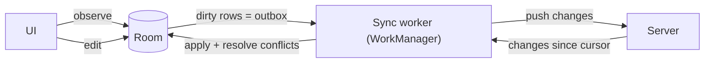

# Local Storage & Offline-First

> Phones lose the network all the time. An offline-first app reads and writes a local database, and a sync engine reconciles it with the server. This is the topic that separates strong mobile engineers.

Roadmap topic 9 · Stage 3: Data & Background

**Go deeper:** `05-system-design/30-Mobile-Specific-Topics` (the server side of sync: delta sync, tombstones, conflicts) · `05-system-design/23-Consistency-and-CAP` · `10-database` · `6` Architecture (single source of truth) · `8` Networking · `10` Background Work (WorkManager) · `13` Security (encrypted storage) · `16` iOS (Core Data, SwiftData).

**Marks:** 🟢 must know · 🟡 good to know

---

#### 1. What Is It?

*Store data on the device and keep it in step with the server.*

| 🟢 Must know | 🟡 Good to know |
|---|---|
| choosing storage: DataStore, Room, files, cache | DataStore vs `SharedPreferences` |
| Room: entities, DAOs, `Flow` | indexes and query speed on device |
| Room migrations | encrypted storage |
| offline-first: the database is the source of truth | large data: files vs blobs, clearing caches |
| cache strategies | deletes and tombstones |
| sync: push local changes, pull remote changes | testing Room and migrations |
| conflict resolution | iOS: Core Data, SwiftData |
| never touch the database on the main thread | |

1. **Offline-first:** the UI reads from the local database. Writes go to the database first, then to the server.
2. **Sync engine:** pushes local changes (the **outbox**), pulls remote changes (a **cursor**), and resolves conflicts.
3. **Migration:** every old database version must upgrade to the new schema without losing data.

**Signals in an interview:** "design an offline notes app", "what if the user edits on two devices?", "how do you migrate the schema?", "Room vs `DataStore`?", "cache-first or network-first?".

---

#### 2. How It Works

**Choosing storage.**

| Need | Use |
|---|---|
| a few settings or flags | **DataStore** (Preferences or Proto) |
| structured, queryable data, relations | **Room** (SQLite) |
| big files (photos, downloads) | files in `filesDir` / `cacheDir`, with the path or URI in Room |
| temporary, rebuildable data | cache directory or memory cache |
| secrets (tokens) | Android Keystore-backed storage (topic 13) |
| shared user files | the Photo Picker / Storage Access Framework |

**Room in layers.** `@Entity` = table, `@Dao` = queries, `@Database` = holder. A DAO function that returns `Flow<List<T>>` re-emits when the table changes, so the UI updates itself. `suspend` DAO functions run off the main thread.

**Offline-first flow.**



**Cache strategies.**

| Strategy | How | Good for |
|---|---|---|
| Cache-first | show the cache; fetch only when missing or expired | rarely changing data (settings, catalog) |
| Network-first | try the network; fall back to the cache on failure | data that must be fresh |
| Stale-while-revalidate | show the cache now, refresh in the background, update when it arrives | feeds, notes (most screens) |

**Sync steps.**

1. **Write locally:** save the change with `dirty = true` and a client-generated ID.
2. **Push:** a worker sends dirty rows (with an `Idempotency-Key`), then marks them clean when the server confirms.
3. **Pull:** ask for `changes?since=<cursor>`; apply them; store the new cursor only after the page is applied.
4. **Conflicts:** same record changed locally and on the server.
5. **Deletes:** keep a **tombstone** (`deleted = true`) until the server confirms, otherwise the next pull brings the row back.
6. Trigger: app start, connectivity returning, a push "sync now", and a periodic fallback (topic 10).

**Conflict resolution.**

| Rule | How | Cost |
|---|---|---|
| Last-write-wins | the newer `updatedAt` (server-assigned if you can) wins | simple; can silently lose an edit |
| Field merge (three-way) | compare each field with the common base; keep the changed one | no lost edits unless both change the same field |
| Ask the user | show both versions | best for important data, more UI |

**Migrations.** Bump `version`, provide a `Migration(from, to)` with SQL (or an auto-migration for simple changes). Users can jump from any old version to the newest, so every path must exist. Test them (`MigrationTestHelper`). `fallbackToDestructiveMigration()` deletes user data: only for pure caches.

🟡 **DataStore vs `SharedPreferences`.** DataStore is asynchronous (coroutines/`Flow`), transactional and safe on the main thread's lifecycle. `SharedPreferences` reads on first access can block, and `apply()` can cause ANRs on lifecycle events. Use DataStore for new code.

🟡 **Indexes.** An index on `updatedAt` or a foreign key speeds queries and slows writes slightly. Check queries with `EXPLAIN QUERY PLAN` for big tables; keep list queries paged.

🟡 **Encryption.** Tokens and secrets: Keystore-backed. A whole encrypted database (SQLCipher) is for high-sensitivity data. Check the current recommended APIs (topic 13).

🟡 **Large data.** Store files on disk and keep the path in the database. Clear caches on logout and when storage is low. Never put a big blob in a row you list.

🟡 **iOS.** Core Data and SwiftData; same ideas (topic 16).

---

#### 3. Naive vs Better Design

| Naive | Better |
|---|---|
| UI shows the network response, saved nowhere | UI observes Room; network updates Room |
| write to the server, wait, then update the UI | write local first (optimistic), sync later |
| two copies of data (memory and DB) | one source of truth |
| delete the row locally | tombstone until the server confirms |
| `fallbackToDestructiveMigration` on real data | a tested `Migration` |
| auto-increment IDs created on the device | client-generated UUIDs |
| overwrite local edits with every pull | resolve conflicts; keep dirty rows |
| store the page cursor before applying the page | store it after |
| `SharedPreferences` for everything | DataStore for settings, Room for data |

```kotlin
// Naive: the UI depends on the network; offline = empty screen
fun load() = viewModelScope.launch { _notes.value = api.notes() }
```

---

#### 4. Code

Entity, DAO and database:

```kotlin
@Entity(tableName = "notes", indices = [Index("updatedAt")])
data class NoteEntity(
    @PrimaryKey val id: String,                 // UUID made on the device
    val title: String,
    val body: String,
    val updatedAt: Long,
    val deleted: Boolean = false,               // tombstone
    val dirty: Boolean = false                  // waiting to be pushed (the outbox)
)

@Dao
interface NoteDao {
    @Query("SELECT * FROM notes WHERE deleted = 0 ORDER BY updatedAt DESC")
    fun observeAll(): Flow<List<NoteEntity>>

    @Query("SELECT * FROM notes WHERE dirty = 1")
    suspend fun pending(): List<NoteEntity>

    @Query("SELECT * FROM notes WHERE id = :id")
    suspend fun find(id: String): NoteEntity?

    @Upsert suspend fun upsert(note: NoteEntity)

    @Query("UPDATE notes SET dirty = 0 WHERE id = :id AND updatedAt = :updatedAt")
    suspend fun markSynced(id: String, updatedAt: Long)          // only if not edited again meanwhile

    @Query("DELETE FROM notes WHERE deleted = 1 AND dirty = 0")
    suspend fun purgeSyncedDeletes()
}

@Database(entities = [NoteEntity::class], version = 2)
abstract class AppDatabase : RoomDatabase() { abstract fun noteDao(): NoteDao }
```

A migration, and its test:

```kotlin
val MIGRATION_1_2 = object : Migration(1, 2) {
    override fun migrate(db: SupportSQLiteDatabase) {
        db.execSQL("ALTER TABLE notes ADD COLUMN deleted INTEGER NOT NULL DEFAULT 0")
    }
}
// Room.databaseBuilder(context, AppDatabase::class.java, "app.db").addMigrations(MIGRATION_1_2).build()

@Test fun migrate1To2() {
    helper.createDatabase("test.db", 1).apply { execSQL("INSERT INTO notes VALUES ('a','x',1)"); close() }
    val db = helper.runMigrationsAndValidate("test.db", 2, true, MIGRATION_1_2)
    db.query("SELECT deleted FROM notes WHERE id = 'a'").use { assertTrue(it.moveToFirst()); assertEquals(0, it.getInt(0)) }
}
```

Checks (the same SQL on SQLite): the existing row `('a','x',1)` gets `deleted = 0`, so no data is lost.

Write locally first (optimistic), delete with a tombstone:

```kotlin
class NotesRepository(private val dao: NoteDao, private val clock: () -> Long = System::currentTimeMillis) {
    fun observe() = dao.observeAll()
    suspend fun create(title: String, body: String): String {
        val id = UUID.randomUUID().toString()
        dao.upsert(NoteEntity(id, title, body, clock(), dirty = true))
        return id
    }
    suspend fun delete(id: String) {
        val n = dao.find(id) ?: return
        dao.upsert(n.copy(deleted = true, dirty = true, updatedAt = clock()))      // hidden from the UI, kept for sync
    }
}
```

Cache-first / stale-while-revalidate as a Flow:

```kotlin
fun <T> staleWhileRevalidate(cache: Flow<T>, refresh: suspend () -> Unit): Flow<T> = channelFlow {
    launch { runCatching { refresh() } }          // refresh in the background; failures are ignored here
    cache.collect { send(it) }                    // cached value now, then updates when Room changes
}
```

Applying a remote change safely (pure function, easy to test):

```kotlin
fun applyRemote(local: NoteEntity?, remote: NoteEntity): NoteEntity = when {
    local == null -> remote                                  // new on this device
    !local.dirty -> remote                                   // nothing local to lose
    remote.updatedAt > local.updatedAt -> remote             // the server is newer: LWW
    else -> local                                            // my edit is newer: keep it, it will be pushed
}
```

Checks: no local row → remote. Local clean → remote. Local dirty `updatedAt = 5`, remote `7` → remote (my edit is dropped; use field merge if that is not acceptable). Local dirty `9`, remote `7` → local stays dirty and will be pushed.

Field merge (three-way):

```kotlin
data class Doc(val title: String, val body: String)

private fun pick(base: String, mine: String, theirs: String) = if (mine != base) mine else theirs

fun merge(base: Doc, mine: Doc, theirs: Doc) =
    Doc(pick(base.title, mine.title, theirs.title), pick(base.body, mine.body, theirs.body))
```

Checks: `base = Doc("t","b")`, `mine = Doc("t2","b")`, `theirs = Doc("t","b2")` → `Doc("t2","b2")` (both edits kept). If both change the title (`mine "m"`, `theirs "x"`) → `"m"` (mine wins, a rule you must state).

The sync worker (push, then pull):

```kotlin
@HiltWorker
class SyncWorker @AssistedInject constructor(
    @Assisted context: Context, @Assisted params: WorkerParameters,
    private val dao: NoteDao, private val api: NotesApi, private val cursors: CursorStore
) : CoroutineWorker(context, params) {

    override suspend fun doWork(): Result = try {
        for (n in dao.pending()) {                                            // 1. push
            api.upsert(n.id, n.toDto(), idempotencyKey = "${n.id}-${n.updatedAt}")
            dao.markSynced(n.id, n.updatedAt)
        }
        var cursor = cursors.get()                                            // 2. pull
        do {
            val page = api.changes(since = cursor)
            page.items.forEach { dao.upsert(applyRemote(dao.find(it.id), it.toEntity())) }
            cursor = page.nextCursor ?: cursor
            cursors.save(cursor)                                              // after applying the page
        } while (page.hasMore)
        dao.purgeSyncedDeletes()
        Result.success()
    } catch (e: IOException) { Result.retry() }                               // WorkManager backs off and retries
}
```

DataStore for settings:

```kotlin
val Context.settings by preferencesDataStore("settings")
private val DARK = booleanPreferencesKey("dark_mode")

fun Context.darkMode(): Flow<Boolean> = settings.data.map { it[DARK] ?: false }
suspend fun Context.setDarkMode(on: Boolean) { settings.edit { it[DARK] = on } }
```

---

#### 5. Performance & Limits

| Item | Remember |
|---|---|
| Room on the main thread | disabled by default (throws); use `suspend` / `Flow` |
| `Flow` from Room | re-emits on any change to the queried tables: keep queries specific, use `distinctUntilChanged` |
| Large lists | page with Paging 3 instead of loading 10,000 rows |
| Transactions | `@Transaction` / `withTransaction` for several writes (faster and atomic) |
| Migration | runs once at startup: keep it fast; large data copies can delay launch |
| Cache size | cap disk caches (10 to 100 MB) and clear on low storage / logout |
| Sync cadence | on change, on connectivity, push-triggered; periodic work has a 15-minute minimum |
| Cursor | save it only after the page is applied, so a crash repeats the page instead of skipping it |

---

#### 6. Common Mistakes & Edge Cases

1. Two sources of truth (screen memory, network, database).
2. Deleting rows locally, so the next pull resurrects them.
3. No conflict rule for offline edits.
4. Destructive migrations on user data; missing migration paths for old versions.
5. Database or file work on the main thread.
6. Using auto-increment IDs created on the device, which clash across devices.
7. Saving the cursor before applying the page.
8. Syncing everything every time instead of a delta.
9. Trusting the device clock for ordering.
10. Forgetting to clear user data on logout.

Edge cases: the user edits a record while the push is in flight (`markSynced` checks `updatedAt`); the app is killed mid-sync (the push is idempotent, the pull repeats); a record deleted on one device and edited on another; the app is offline for months (the server compacted tombstones: do a full resync); low disk space; the schema changes while a sync is running.

---

#### 7. Say This in the Interview

1. "I make the local database the single source of truth. The UI observes Room with a `Flow`, and the network only updates the database."
2. "Writes are optimistic: save locally with `dirty = true` and a client-generated ID, then a WorkManager job pushes them with an idempotency key."
3. "For pull I use a cursor and save it after applying the page. Deletes are tombstones until the server confirms."
4. "Conflicts: last-write-wins by server version for most fields; three-way merge or asking the user for important text."
5. "Every old schema version needs a migration path, and I test migrations with `MigrationTestHelper`."
6. "For stale-while-revalidate I show the cache immediately, refresh in the background and let Room's `Flow` update the screen."

---

#### 8. Quick Check

1. Why a tombstone instead of deleting the row?
2. Where do you save the sync cursor, and when?
3. Room vs `DataStore`?
4. What is wrong with `fallbackToDestructiveMigration` for notes?

<details>
<summary>Answers</summary>

1. The next pull would otherwise bring the deleted row back, and the server would never learn about the delete.
2. In persistent storage, after the page has been applied.
3. Room for structured, queryable data; `DataStore` for small settings.
4. It wipes the user's data when the schema changes.

</details>

---

#### 9. Practice

**Interview questions**

1. Design an offline-first notes app.
2. Which storage for what: Room, DataStore, files?
3. How do you migrate a Room schema?
4. How do you handle conflicts from two devices?
5. Cache-first vs network-first vs stale-while-revalidate?
6. How do you sync deletes?
7. Why client-generated IDs?

**Hands-on**

1. Convert a network-only screen to Room as the single source of truth.
2. Add a `SyncWorker` and test it with a fake API that fails once.
3. Write and test a migration that adds a column and one that adds a table.

**Coding warm-ups (LeetCode)**

| # | Question | Link to this topic |
|---|---|---|
| 146 | [LRU Cache](https://leetcode.com/problems/lru-cache/) (Medium) | disk / memory cache eviction |
| 460 | [LFU Cache](https://leetcode.com/problems/lfu-cache/) (Hard) | eviction by frequency |
| 981 | [Time Based Key-Value Store](https://leetcode.com/problems/time-based-key-value-store/) (Medium) | versions by timestamp |
| 1146 | [Snapshot Array](https://leetcode.com/problems/snapshot-array/) (Medium) | versions and snapshots |
| 380 | [Insert Delete GetRandom O(1)](https://leetcode.com/problems/insert-delete-getrandom-o1/) (Medium) | O(1) store with removal |

**Remember:** the database is the single source of truth · write local first, sync from an outbox · cursor saved after the page · tombstones for deletes · client-generated IDs · a conflict rule · tested migrations · no main-thread database work.
