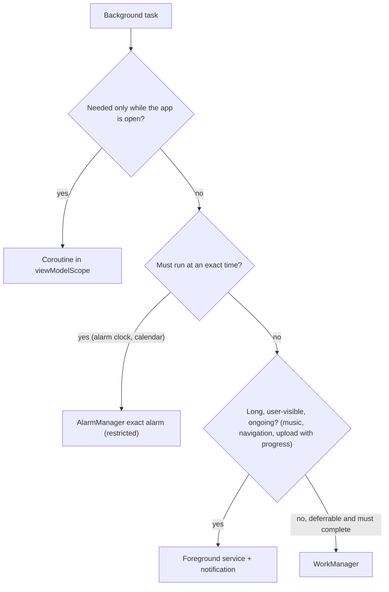
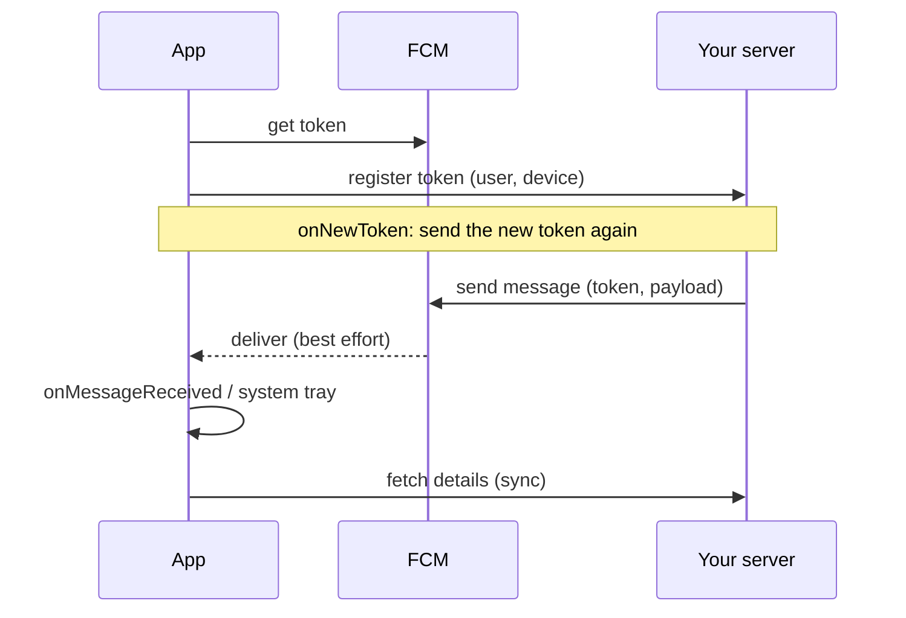

# Background Work & Notifications

> Phones protect battery by limiting background work. Pick the right tool, make the work safe to retry, and treat push notifications as a best-effort hint, not a delivery guarantee.

Roadmap topic 10 · Stage 3: Data & Background

**Go deeper:** `05-system-design/24-Real-Time-Communication-and-Push` (push design) · `05-system-design/30-Mobile-Specific-Topics` · `3` Coroutines · `4` Lifecycle (services) · `9` Offline-First (sync worker) · `19` Permissions · `11` Performance (battery) · `16` iOS (background tasks, APNs).

**Marks:** 🟢 must know · 🟡 good to know

---

#### 1. What Is It?

*Work that runs when the screen is off, and messages that arrive when the app is closed.*

| 🟢 Must know | 🟡 Good to know |
|---|---|
| why background work is restricted | Doze, App Standby, battery optimization |
| WorkManager | foreground services: types and notification |
| choosing the right tool | exact alarms |
| push with FCM: token, refresh, message types | periodic sync cost |
| notification channels and the permission | push reliability |
| handling a push, opening the right screen | iOS: background tasks, APNs |

1. **WorkManager** runs deferrable, guaranteed work (it survives app and device restarts), with constraints and retries.
2. **Foreground service** runs long, user-visible work with a notification.
3. **FCM** delivers push messages. Messages are **best effort**.
4. **Notification channels** let users control each kind of notification; on Android 13+ the app needs the notification **permission**.

**Signals in an interview:** "upload a photo even if the user leaves", "sync every hour", "how do you handle a push?", "why didn't the notification arrive?", "Doze".

---

#### 2. How It Works

**Why restricted.** Background work drains the battery. Android limits it with **Doze** (the idle device defers jobs and network to maintenance windows), **App Standby buckets** (rarely used apps get fewer jobs and alarms), background start limits, and **foreground service rules**. Your work must expect to be delayed, stopped and restarted.

**Choosing the tool.**



**WorkManager.**

| Feature | Detail |
|---|---|
| Work types | `OneTimeWorkRequest`, `PeriodicWorkRequest` (minimum interval **15 minutes**) |
| Constraints | network type (connected, unmetered), charging, battery not low, storage not low, idle |
| Results | `success`, `failure`, `retry` (with backoff) |
| Backoff | linear or exponential, starting at least 10 seconds |
| Unique work | `enqueueUniqueWork(name, policy, request)` avoids duplicates (`KEEP`, `REPLACE`, `APPEND`) |
| Chaining | `beginWith(a).then(b)` passes output to input |
| Expedited | `setExpedited(...)` for short, important work, subject to a quota |
| Survives | app kill, reboot (persisted in its own database) |

Work must be **idempotent**: it may run twice, or be stopped midway.

**Push with FCM.**



1. The **token** identifies this app install on this device. It can change (reinstall, restore, clear data), so handle `onNewToken` and refresh it on the server. Remove invalid tokens when FCM reports `UNREGISTERED`.
2. **Notification message:** FCM shows it when the app is in the background; `onMessageReceived` runs only when the app is in the foreground.
3. **Data message:** always goes to `onMessageReceived` (subject to background limits): use it to sync or build your own notification.
4. Payload is small (about 4 KB). Send an id or "sync now", then fetch the data.
5. Use high priority only for user-visible messages (chat); it can wake the device from Doze.

**Notification channels and permission.** From Android 8, each notification belongs to a **channel** (name, importance, sound). Users control channels in settings; create them at startup, with clear names. From Android 13, `POST_NOTIFICATIONS` is a runtime permission: ask in context (after the user sees the value), and keep working if denied.

**Handling a tap.** Build a `PendingIntent` to a deep link or an Activity with the right back stack; use `FLAG_IMMUTABLE`. The screen loads data by id.

🟡 **Doze and standby.** In Doze, normal alarms, jobs and syncs wait for maintenance windows. High-priority FCM and foreground services are exempt in limited ways. Do not ask users to disable battery optimization except for apps that truly need it.

🟡 **Foreground services.** Must declare a **type** (location, media playback, data sync, camera, …) in the manifest and show a notification. Newer Android restricts starting them from the background and limits some types. Prefer WorkManager for deferrable work.

🟡 **Exact alarms.** `SCHEDULE_EXACT_ALARM` / `USE_EXACT_ALARM` are restricted to alarm and calendar apps. For most tasks, inexact alarms or WorkManager are right.

🟡 **Periodic sync cost.** Every wake-up costs battery and data. Prefer push-triggered sync, batch work, and a periodic fallback no more often than needed.

🟡 **Push reliability.** FCM is best effort: messages can be delayed, dropped or collapsed. Keep a sync-on-open path. Use `collapse_key` for "latest wins" messages.

🟡 **iOS.** `BGTaskScheduler` for background refresh and processing, silent push (`content-available`), APNs; the system decides when (topic 16).

---

#### 3. Naive vs Better Design

| Naive | Better |
|---|---|
| a `Thread` or coroutine for work that must finish after exit | WorkManager |
| a service running forever "to stay alive" | push or periodic work with constraints |
| poll the server every 10 seconds | FCM "sync now" + pull |
| `AlarmManager` for ordinary syncs | WorkManager |
| ask for notification permission at first launch | ask in context |
| one channel for everything | channels per type (messages, promos, system) |
| send the full data in the push | id + fetch |
| ignore token refresh | `onNewToken` → update the server |
| schedule duplicate work each launch | unique work with `KEEP` |
| non-idempotent worker | safe to run twice |

```kotlin
// Naive: dies with the process; duplicates itself on every app start
fun startSync() { GlobalScope.launch { while (true) { sync(); delay(10_000) } } }
```

---

#### 4. Code

A `CoroutineWorker` with constraints, backoff and unique scheduling:

```kotlin
class UploadWorker(ctx: Context, params: WorkerParameters, private val uploader: PhotoUploader) : CoroutineWorker(ctx, params) {
    override suspend fun doWork(): Result {
        val path = inputData.getString("path") ?: return Result.failure()
        return try {
            uploader.upload(path)                                    // idempotent: same file, same key
            Result.success()
        } catch (e: IOException) {
            if (runAttemptCount < 5) Result.retry() else Result.failure()      // bounded retries
        }
    }
}

fun scheduleUpload(context: Context, path: String) {
    val request = OneTimeWorkRequestBuilder<UploadWorker>()
        .setInputData(workDataOf("path" to path))
        .setConstraints(Constraints.Builder().setRequiredNetworkType(NetworkType.UNMETERED).build())   // Wi-Fi
        .setBackoffCriteria(BackoffPolicy.EXPONENTIAL, 30, TimeUnit.SECONDS)
        .build()
    WorkManager.getInstance(context).enqueueUniqueWork("upload-$path", ExistingWorkPolicy.KEEP, request)
}

fun schedulePeriodicSync(context: Context) {
    val request = PeriodicWorkRequestBuilder<SyncWorker>(1, TimeUnit.HOURS)
        .setConstraints(Constraints.Builder().setRequiredNetworkType(NetworkType.CONNECTED).build())
        .build()
    WorkManager.getInstance(context).enqueueUniquePeriodicWork("sync", ExistingPeriodicWorkPolicy.KEEP, request)
}
```

Checks: calling `scheduleUpload` twice for the same path keeps one job (`KEEP`). With exponential backoff from 30 s, a failing worker is retried after about 30 s, 60 s, 120 s, 240 s and 480 s; on the sixth run (`runAttemptCount == 5`) it returns `failure`. `PeriodicWorkRequestBuilder(5, MINUTES)` is raised to the 15-minute minimum.

FCM service:

```kotlin
class AppMessagingService : FirebaseMessagingService() {
    override fun onNewToken(token: String) {
        // store locally, then send to the server when signed in (retry with WorkManager)
        TokenSync.enqueue(applicationContext, token)
    }

    override fun onMessageReceived(message: RemoteMessage) {
        val data = message.data                              // data message: type, id
        when (val dest = route(data)) {
            Destination.SyncOnly -> SyncWorker.enqueue(applicationContext)
            else -> showNotification(dest, data["title"] ?: "New activity")
        }
    }
}
```

Route a push payload to a destination (pure function, easy to test):

```kotlin
sealed interface Destination {
    data object Home : Destination
    data object SyncOnly : Destination
    data class NoteDetail(val id: Long) : Destination
}

fun route(data: Map<String, String>): Destination = when (data["type"]) {
    "note" -> data["id"]?.toLongOrNull()?.let { Destination.NoteDetail(it) } ?: Destination.Home
    "sync" -> Destination.SyncOnly
    else -> Destination.Home
}
```

Checks: `route(mapOf("type" to "note", "id" to "42"))` → `NoteDetail(42)`; `route(mapOf("type" to "note"))` → `Home` (missing id); `route(mapOf("type" to "note", "id" to "abc"))` → `Home`; `route(mapOf("type" to "sync"))` → `SyncOnly`; `route(emptyMap())` → `Home`. A bad or hostile payload never crashes the app.

Channel, permission and notification:

```kotlin
fun createChannels(context: Context) {
    val channel = NotificationChannel("messages", "Messages", NotificationManager.IMPORTANCE_HIGH)
    context.getSystemService(NotificationManager::class.java).createNotificationChannel(channel)
}

// Android 13+: ask in context
val askNotifications = registerForActivityResult(ActivityResultContracts.RequestPermission()) { granted -> /* update UI */ }
if (Build.VERSION.SDK_INT >= 33) askNotifications.launch(Manifest.permission.POST_NOTIFICATIONS)

fun showNotification(context: Context, noteId: Long, title: String) {
    val tap = PendingIntent.getActivity(
        context, noteId.toInt(),
        Intent(Intent.ACTION_VIEW, Uri.parse("https://notes.example.com/note/$noteId")).setPackage(context.packageName),
        PendingIntent.FLAG_IMMUTABLE or PendingIntent.FLAG_UPDATE_CURRENT
    )
    val n = NotificationCompat.Builder(context, "messages")
        .setSmallIcon(R.drawable.ic_notification).setContentTitle(title)
        .setContentIntent(tap).setAutoCancel(true).build()
    NotificationManagerCompat.from(context).notify(noteId.toInt(), n)   // guard with a permission check
}
```

Foreground service type in the manifest:

```xml
<service android:name=".UploadService" android:foregroundServiceType="dataSync" android:exported="false" />
<uses-permission android:name="android.permission.FOREGROUND_SERVICE" />
<uses-permission android:name="android.permission.FOREGROUND_SERVICE_DATA_SYNC" />
```

Test a worker:

```kotlin
@Test fun `upload retries on io error`() = runTest {
    val worker = TestListenableWorkerBuilder<UploadWorker>(context).setRunAttemptCount(1).build()
    assertEquals(ListenableWorker.Result.retry(), worker.doWork())          // with a failing fake uploader
}
```

---

#### 5. Performance & Limits

| Item | Remember |
|---|---|
| `PeriodicWorkRequest` minimum | 15 minutes (flex window optional) |
| WorkManager backoff | starts at 10 s minimum, up to 5 hours |
| Doze | defers jobs and network until maintenance windows; windows get further apart |
| FCM payload | about 4 KB: send ids, not content |
| FCM delivery | best effort; use collapse keys, keep a sync-on-open path |
| Expedited work | a quota; for short, important tasks only |
| Foreground service | needs a type and a visible notification; some types have time limits on newer Android |
| Notification permission | runtime permission on Android 13+; the system may block repeated prompts |

---

#### 6. Common Mistakes & Edge Cases

1. Using a plain coroutine or `Thread` for work that must finish after the user leaves.
2. Polling instead of push or constraints.
3. Not handling `onNewToken`; sending to dead tokens forever.
4. Putting the full payload into the push.
5. Asking for the notification permission on first launch with no context.
6. One notification channel for all.
7. Non-idempotent workers; duplicate scheduling.
8. Mutable `PendingIntent`s, or tapping a notification into the wrong back stack.
9. Relying on a push for correctness (no sync on open).
10. Asking users to turn off battery optimization.

Edge cases: the device reboots (WorkManager reschedules); the user force-stops the app (no push or jobs until the user opens it again); OEM battery managers kill background work; the push arrives when the user is on a different account; the token refreshes while signed out (store it and send after sign-in); notifications denied (use in-app indicators); a `retry` loop on a permanent error (cap attempts).

---

#### 7. Say This in the Interview

1. "Background work is restricted for battery, so I pick the lightest tool: a coroutine while the app is open, WorkManager for deferrable work that must finish, a foreground service for long user-visible work, an exact alarm only when time matters."
2. "WorkManager persists across restarts, supports constraints and backoff, and my workers are idempotent because they can run twice."
3. "Push uses FCM. I register the token with my server and update it in `onNewToken`. The payload is small, and it triggers a sync; the app also syncs on open because delivery is best effort."
4. "Notification channels let users tune each category, and on Android 13 I ask for the permission in context and keep working when it's denied."
5. "Tapping a notification opens a deep link with the right back stack, and the screen loads data by id."

---

#### 8. Quick Check

1. Which tool uploads a photo after the user leaves the app?
2. What is the minimum interval of periodic work?
3. When does `onMessageReceived` run for a notification message?
4. Why must a worker be idempotent?

<details>
<summary>Answers</summary>

1. WorkManager (a foreground service if you need visible progress).
2. 15 minutes.
3. Only when the app is in the foreground; in the background the system shows it.
4. It may run more than once or be interrupted and restarted.

</details>

---

#### 9. Practice

**Interview questions**

1. Which background tool for which job?
2. How does WorkManager guarantee work?
3. How do FCM tokens and refresh work?
4. Data vs notification messages?
5. What is Doze, and how does it change your design?
6. How do you open the right screen from a notification?
7. Why might a push not arrive?

**Hands-on**

1. Add a `SyncWorker` with a network constraint and test it with `TestListenableWorkerBuilder`.
2. Handle `onNewToken` and re-register on sign-in.
3. Add channels and the Android 13 permission flow, and test the denied path.

**Coding warm-ups (LeetCode)**

| # | Question | Link to this topic |
|---|---|---|
| 621 | [Task Scheduler](https://leetcode.com/problems/task-scheduler/) (Medium) | scheduling with cool-downs |
| 253 | [Meeting Rooms II](https://leetcode.com/problems/meeting-rooms-ii/) (Medium, premium) | overlapping jobs |
| 1834 | [Single-Threaded CPU](https://leetcode.com/problems/single-threaded-cpu/) (Medium) | a job queue ordered by time and length |
| 703 | [Kth Largest Element in a Stream](https://leetcode.com/problems/kth-largest-element-in-a-stream/) (Easy) | a heap over a stream |

**Remember:** pick the lightest tool · WorkManager for deferrable guaranteed work · workers are idempotent · push is a hint, so sync on open · handle `onNewToken` · channels + permission in context · deep link with the right back stack.
