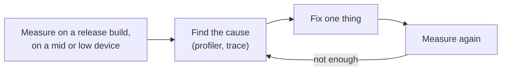
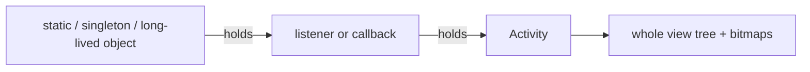

# Performance & Memory

> Users judge your app by how fast it starts, how smoothly it scrolls and whether it ever freezes or crashes. Measure first, then fix the one thing the measurement points to.

Roadmap topic 11 · Stage 4: Quality

**Go deeper:** `1` Platform Basics (main thread, ANR) · `3` Coroutines · `5` Compose (recomposition) · `8` Networking (payloads, images) · `15` Build, Release & Monitoring (Play Vitals) · `10-database` (indexes).

**Marks:** 🟢 must know · 🟡 good to know

---

#### 1. What Is It?

*Startup time, frame rate, responsiveness, memory and battery.*

| 🟢 Must know | 🟡 Good to know |
|---|---|
| startup: cold, warm, hot | LeakCanary |
| frame budget, jank | Baseline Profiles, Macrobenchmark |
| ANR | R8, app size, App Bundle |
| memory leaks | battery and network efficiency |
| profile first | Compose performance |
| lists and images | Perfetto, system traces |
| | StrictMode, low-end devices |

1. **Cold start:** no process yet. **Warm:** process alive, Activity recreated. **Hot:** Activity brought back.
2. **Jank:** frames that miss their deadline (about 16 ms at 60 Hz).
3. **ANR:** the main thread blocked too long (about 5 s for input).
4. **Leak:** an object that can never be freed because something still references it.

**Signals in an interview:** "the app is slow to start", "the list stutters", "ANR reports in Play Console", "OutOfMemoryError", "how do you find a leak?", "how do you reduce app size?".

---

#### 2. How It Works

**The method: measure, find, fix, measure again.**



Never guess. Debug builds are slower than release builds (Compose especially), so judge performance in release mode.

**Startup.**

| Type | What happens | Typical cost |
|---|---|---|
| Cold | process start → `Application.onCreate` → first Activity → first frame | the slowest |
| Warm | Activity recreated, process alive | medium |
| Hot | Activity resumes | fastest |

What slows a cold start: heavy `Application.onCreate`, many SDKs initialising eagerly, content providers that run at startup, large dependency graphs built up front, disk reads on the main thread, a big first screen, and unoptimised (uncompiled) code. Fixes: defer or lazy-load initialisation (`androidx.startup`, background threads), show the splash screen API, cache the first screen's data, and add a **Baseline Profile**.

**Frames and jank.** A frame needs input handling + composition/layout + draw + GPU work within the budget. Causes of jank: work on the main thread, overdraw, big images decoded on the main thread, heavy recomposition, layout passes in deep hierarchies, and garbage-collection pauses from allocation churn. Find it with the **Profiler**, **Layout Inspector** (recomposition counts), **Macrobenchmark** (frame timing) and **Perfetto**.

**ANR.** Main thread blocked: input not handled for about 5 s, a broadcast receiver running for about 10 s (foreground), service timeouts. Causes: network/disk/database on the main thread, a lock held by a background thread, a long `onReceive`, deadlocks, heavy `Application` work. Prevent: coroutines, `StrictMode` in debug, `Dispatchers.IO`, short broadcast handling. Find: the ANR trace in Play Console/Crashlytics.

**Memory leaks.** The garbage collector frees only unreachable objects. A leak keeps an Activity (and its whole view tree) reachable.



Common causes: a `Context`/Activity in a static field or singleton; a listener or callback never unregistered; an inner class or `Handler` outliving the Activity; a coroutine in `GlobalScope` capturing a view; a Fragment keeping `binding` after `onDestroyView`; bitmaps never released; unbounded caches.

**Lists and images.** Show only what is visible (`LazyColumn`, `RecyclerView`), give stable keys, avoid heavy work per item. Decode images **at the size they are shown** (downsampling); a 12 MP photo decoded fully is about 48 MB as an ARGB bitmap. Use Coil or Glide (caches, cancel on scroll), and ask the CDN for the right size.

🟡 **LeakCanary.** A debug library that watches destroyed Activities and Fragments, and shows the reference chain when one stays in memory.

🟡 **Baseline Profiles and Macrobenchmark.** A **Baseline Profile** lists the classes and methods used at startup and in key journeys, so they are precompiled at install: startup and scroll can improve substantially. **Macrobenchmark** measures startup and frame timing on a real build.

🟡 **R8, app size, App Bundle.** R8 shrinks, optimises and obfuscates. Enable `isMinifyEnabled` and `isShrinkResources` for release. The App Bundle lets Play deliver only the code and resources a device needs. Remove unused libraries and big assets; use WebP/AVIF; vector drawables.

🟡 **Battery and network.** Batch requests, avoid polling, use push, respect Doze, compress, cache, and keep location updates coarse and short (topics 8, 10, 19).

🟡 **Compose performance.** Check recomposition counts, make parameters stable, use keys in lazy lists, `derivedStateOf`, and read fast state late (topic 5).

🟡 **Perfetto and system traces.** Record a system-wide trace to see threads, CPU scheduling, binder calls and frame timelines.

🟡 **StrictMode.** In debug builds, flags disk/network access on the main thread and leaked closeable objects.

🟡 **Low-end devices.** Test on a slow phone with little RAM; your own phone hides most problems.

---

#### 3. Naive vs Better Design

| Naive | Better |
|---|---|
| "feels slow", change things at random | profile, then fix the measured hot spot |
| initialise every SDK in `Application.onCreate` | lazy / background / `androidx.startup` |
| decode the full image | downsample to the view size |
| `object Cache { var activity: Activity }` | application context, or no reference |
| register a listener, never unregister | tie to the lifecycle; `awaitClose { unregister }` |
| load 10,000 rows | paging |
| measure in a debug build | measure in a release build with R8 |
| test only on your fast phone | include a low-end device |
| poll every 10 seconds | push or batched work |

```kotlin
// Naive: a singleton holds the Activity forever (leak), and decodes a 12 MP bitmap on the main thread
object ImageHolder {
    var activity: Activity? = null
    fun load(path: String) = BitmapFactory.decodeFile(path)
}
```

---

#### 4. Code

Catch main-thread work and leaks in debug builds:

```kotlin
class NotesApp : Application() {
    override fun onCreate() {
        super.onCreate()
        if (BuildConfig.DEBUG) {
            StrictMode.setThreadPolicy(StrictMode.ThreadPolicy.Builder().detectAll().penaltyLog().build())
            StrictMode.setVmPolicy(StrictMode.VmPolicy.Builder().detectLeakedClosableObjects().detectActivityLeaks().penaltyLog().build())
        }
    }
}
// build.gradle.kts:  debugImplementation("com.squareup.leakcanary:leakcanary-android:2.14")
```

A leak and its fix:

```kotlin
// Leak: the singleton keeps the Activity alive after it is destroyed
object Analytics { private var listener: Listener? = null; fun register(l: Listener) { listener = l } }

class DetailActivity : AppCompatActivity() {
    private val l = Listener { /* uses this Activity */ }
    override fun onStart() { super.onStart(); Analytics.register(l) }
    override fun onStop() { Analytics.unregister(l); super.onStop() }       // fix: unregister
}

// Fragment: clear the binding
override fun onDestroyView() { _binding = null; super.onDestroyView() }
```

Downsample an image to the size it is shown:

```kotlin
fun inSampleSize(srcW: Int, srcH: Int, reqW: Int, reqH: Int): Int {
    var sample = 1
    while (srcW / (sample * 2) >= reqW && srcH / (sample * 2) >= reqH) sample *= 2
    return sample
}

fun decode(path: String, reqW: Int, reqH: Int): Bitmap? {
    val bounds = BitmapFactory.Options().apply { inJustDecodeBounds = true }
    BitmapFactory.decodeFile(path, bounds)                                    // read the size only
    val opts = BitmapFactory.Options().apply { inSampleSize = inSampleSize(bounds.outWidth, bounds.outHeight, reqW, reqH) }
    return BitmapFactory.decodeFile(path, opts)
}
```

Checks: `inSampleSize(4000, 3000, 400, 300)` → `8` (decodes 500 × 375); `inSampleSize(100, 100, 400, 300)` → `1` (never upscale). Memory: 4000 × 3000 × 4 bytes = 48,000,000 bytes; 500 × 375 × 4 = 750,000 bytes: **64 times** less.

Frame budget: `1000.0 / hz` → 60 Hz = 16.67 ms; 90 Hz = 11.11 ms; 120 Hz = 8.33 ms.

Startup: defer work, report when the first screen is useful:

```kotlin
class NotesApp : Application() {
    override fun onCreate() {
        super.onCreate()
        // only what the first screen needs; the rest after the first frame
        ProcessLifecycleOwner.get().lifecycleScope.launch(Dispatchers.Default) { initAnalytics(); initCrashReporting() }
    }
}
// in the first screen, when content is shown:   reportFullyDrawn()
```

A Baseline Profile generator and a Macrobenchmark (in a `:benchmark` module):

```kotlin
@RunWith(AndroidJUnit4::class)
class BaselineProfileGenerator {
    @get:Rule val rule = BaselineProfileRule()
    @Test fun generate() = rule.collect(packageName = "com.example.notes") {
        pressHome(); startActivityAndWait()
        device.findObject(By.res("notes_list")).fling(Direction.DOWN)          // include the key journey
    }
}

@RunWith(AndroidJUnit4::class)
class StartupBenchmark {
    @get:Rule val rule = MacrobenchmarkRule()
    @Test fun coldStart() = rule.measureRepeated(
        packageName = "com.example.notes", metrics = listOf(StartupTimingMetric()),
        iterations = 5, startupMode = StartupMode.COLD
    ) { pressHome(); startActivityAndWait() }
}
```

Release build shrinking:

```kotlin
buildTypes { release { isMinifyEnabled = true; isShrinkResources = true
    proguardFiles(getDefaultProguardFile("proguard-android-optimize.txt"), "proguard-rules.pro") } }
```

Trace your own code in a system trace:

```kotlin
trace("NotesRepository.refresh") { repo.refresh() }      // androidx.tracing: shows up in Perfetto
```

Find a slow list item in Compose: open Layout Inspector → "Recomposition counts", scroll, and look for composables whose count climbs with every frame.

---

#### 5. Performance & Limits

| Item | Remember |
|---|---|
| Frame budget | 60 Hz = 16.6 ms; 90 Hz = 11.1 ms; 120 Hz = 8.3 ms |
| ANR | input about 5 s; broadcast about 10 s (foreground) |
| Play Vitals (check current) | slow cold start ≥ 5 s, warm ≥ 2 s, hot ≥ 1.5 s; bad crash rate about 1.1% and ANR rate about 0.47% of daily users |
| Bitmap memory | width × height × 4 bytes (ARGB_8888): 12 MP ≈ 48 MB |
| Java heap per app | limited (often 256 to 512 MB, less on low-end phones); `largeHeap` is a last resort |
| Baseline Profile | commonly improves cold start by tens of percent; measure on your app |
| App size | smaller APKs install more and are updated more; Play shows size, and limits apply to the base module |
| Lists | create views / compose items only for the visible range |

---

#### 6. Common Mistakes & Edge Cases

1. Optimising without measuring, or measuring a debug build.
2. Work on the main thread: network, disk, JSON of a big response, bitmap decoding.
3. Holding an Activity or `View` in a singleton, static or long-lived callback.
4. Full-size images in lists.
5. Unbounded caches and lists.
6. Heavy `Application.onCreate`, many eager SDKs.
7. Polling and wake locks that drain the battery.
8. Ignoring low-end devices and low-memory situations.
9. Allocating inside `onDraw` or per-frame code.

Edge cases: memory trim callbacks (`onTrimMemory`): release caches; a leak that appears only after rotation; ANR only on slow disks; a lock shared by the main thread and a worker; startup slower after adding a library (check its initialiser); a jank spike from garbage collection after allocating many short-lived objects.

---

#### 7. Say This in the Interview

1. "I measure first, on a release build and a mid-range device, then fix the measured cause, then measure again."
2. "Cold start: I keep `Application.onCreate` light, defer SDKs, use the splash screen API, and add a Baseline Profile. I check it with Macrobenchmark."
3. "Jank: the frame budget is 16 ms at 60 Hz. I look for main-thread work, heavy recomposition and big images, using the Profiler and Layout Inspector."
4. "ANR means the main thread was blocked, so I move IO and heavy work off it and enable StrictMode in debug."
5. "Leaks: usually an Activity reachable from a static, a singleton or an unregistered listener. LeakCanary shows the reference chain."
6. "Images are downsampled to the displayed size and cached; lists use lazy layouts with keys."

---

#### 8. Quick Check

1. Cold, warm, hot start: which is slowest?
2. What is the usual cause of an ANR?
3. Why does a 12 MP photo use about 48 MB?
4. What does a Baseline Profile do?

<details>
<summary>Answers</summary>

1. Cold start.
2. Blocking the main thread (network, disk, database, locks, long receivers).
3. 4000 × 3000 pixels × 4 bytes per pixel = 48,000,000 bytes once decoded.
4. It tells the system which code to precompile at install, so startup and key journeys run faster.

</details>

---

#### 9. Practice

**Interview questions**

1. How do you diagnose a slow cold start?
2. What causes jank, and how do you find it?
3. What is an ANR, and how do you prevent it?
4. How do you find and fix a memory leak?
5. How do you load many images efficiently?
6. How do you reduce app size?
7. What is a Baseline Profile?

**Hands-on**

1. Record a Macrobenchmark cold start, add lazy initialisation and a Baseline Profile, and compare.
2. Create a leak on purpose, find it with LeakCanary, and fix it.
3. Make a list with large images stutter, then fix it with downsampling and keys.

**Coding warm-ups (LeetCode)**

| # | Question | Link to this topic |
|---|---|---|
| 146 | [LRU Cache](https://leetcode.com/problems/lru-cache/) (Medium) | bounded memory cache |
| 460 | [LFU Cache](https://leetcode.com/problems/lfu-cache/) (Hard) | eviction by use |
| 346 | [Moving Average from Data Stream](https://leetcode.com/problems/moving-average-from-data-stream/) (Easy, premium) | frame-time averages |
| 295 | [Find Median from Data Stream](https://leetcode.com/problems/find-median-from-data-stream/) (Hard) | median / percentile of timings |

**Remember:** measure first · release build, real device · main thread stays free · keep references short-lived · downsample images · light startup + Baseline Profile · StrictMode and LeakCanary in debug.
