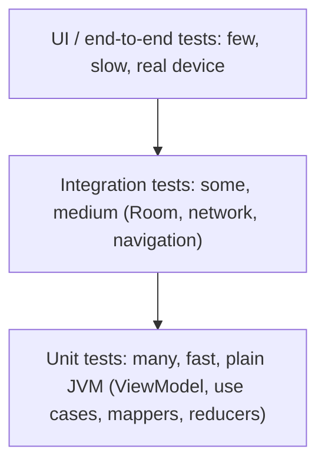

# Testing

> Tests let you change code without fear. Write many fast unit tests, fewer integration tests, and only a few UI tests. Make the code testable by injecting what it depends on.

Roadmap topic 12 · Stage 4: Quality

**Go deeper:** `3` Coroutines (`runTest`) · `6` Architecture (what to test) · `7` DI (fakes) · `5` Compose · `9` Offline-First (migration tests) · `04-backend-engineering/07-Testing-and-Debugging` · `15` Build, Release & Monitoring (CI) · `16` iOS (XCTest).

**Marks:** 🟢 must know · 🟡 good to know

---

#### 1. What Is It?

*Checking that the code does what you expect, automatically.*

| 🟢 Must know | 🟡 Good to know |
|---|---|
| the test pyramid | Robolectric vs instrumented tests |
| unit tests for `ViewModel`s, use cases, mappers | screenshot tests |
| fakes vs mocks | testing migrations and offline behaviour |
| testing coroutines and flows | CI: fast and reliable |
| testable code: injected dependencies | flaky tests |
| Compose UI tests, Espresso | iOS: XCTest |
| repository tests: fake network, in-memory Room | |

1. **Unit tests:** one class, no Android framework, milliseconds.
2. **Integration tests:** several parts together (repository + in-memory Room + fake network).
3. **UI tests:** the real screen on a device or emulator; slower and more fragile.
4. **Fake:** a simple working replacement. **Mock:** an object that records calls and checks them.

**Signals in an interview:** "how do you test a `ViewModel`?", "fake vs mock?", "how do you test coroutines?", "how do you avoid flaky tests?", "what do you test first?".

---

#### 2. How It Works

**The test pyramid.**



**Testable code.** Dependencies come through constructors (topic 7); time and dispatchers are injected; no hidden globals; business logic is not in the Activity or composable. This is why architecture and testing go together.

**Where tests run.**

| Kind | Runs on | Speed | Use for |
|---|---|---|---|
| Local unit test (`src/test`) | JVM | ms | logic, `ViewModel`, mappers |
| Robolectric | JVM with simulated Android | fast | code that needs `Context`, Room, resources |
| Instrumented (`src/androidTest`) | device / emulator | slow | real UI, real framework behaviour, migrations |

**Fakes vs mocks.** Prefer **fakes** (a `FakeNotesRepository` with in-memory data). They test behaviour, survive refactoring, and are reusable. Mocks (MockK) verify "this function was called with X": use them for outgoing side effects (analytics), rarely for data.

**Coroutines and flows.** `runTest` runs a suspend test with **virtual time** (`delay` costs nothing). Replace `Dispatchers.Main` with a test dispatcher so `viewModelScope` is controlled. **Turbine** collects a flow and lets you assert each emission.

**Compose UI tests.** `createComposeRule()` hosts a composable. Find nodes by text, tag or semantics; act (`performClick`); assert. Test the stateless composable with a given state, not the whole app.

**Repository tests.** Use `MockWebServer` (a fake HTTP server) and an in-memory Room database to test the real mapping, error handling and caching without the internet.

🟡 **Robolectric vs instrumented.** Robolectric is faster and runs in CI without an emulator, but is not the real OS. Use instrumented tests for what only the real device proves (permissions, WebView, camera, real migrations).

🟡 **Screenshot tests.** Paparazzi / Roborazzi render composables to images and compare them with a reference. They catch accidental visual changes on the JVM.

🟡 **Migration and offline tests.** `MigrationTestHelper` for Room; fake network that fails to prove the app works offline and syncs later.

🟡 **CI.** Run unit tests on every change; instrumented tests on a schedule or on merge; fail the build on failures; keep it under about 10 minutes.

🟡 **Flaky tests.** Causes: real time and `Thread.sleep`, real network, shared state, animations, order dependence, async work not awaited. Fixes: virtual time, idling/`waitUntil`, isolated state, disable animations on test devices, retry only as a last resort and track it.

🟡 **iOS.** XCTest and Swift Testing (topic 16).

---

#### 3. Naive vs Better Design

| Naive | Better |
|---|---|
| UI tests for everything | many unit tests, a few UI tests |
| mock every dependency | fakes for data, mocks for side effects |
| `Thread.sleep(2000)` in tests | `runTest` / `advanceUntilIdle` / `waitUntil` |
| test the implementation (private calls) | test behaviour and outputs |
| tests that share state or depend on order | each test builds its own objects |
| real network in tests | `MockWebServer` or a fake API |
| `System.currentTimeMillis()` inside the class | inject a clock |
| skip failure paths | test errors, empty, offline, permissions |
| ignore a flaky test | find the cause |

```kotlin
// Naive: not testable: builds its own dependencies and reads real time
class NotesViewModel : ViewModel() {
    private val repo = NotesRepository(RetrofitProvider.api)
    fun isExpired(t: Long) = System.currentTimeMillis() - t > 60_000
}
```

---

#### 4. Code

The `MainDispatcherRule` and a `ViewModel` test with fakes:

```kotlin
class MainDispatcherRule(private val dispatcher: TestDispatcher = StandardTestDispatcher()) : TestWatcher() {
    override fun starting(description: Description) = Dispatchers.setMain(dispatcher)
    override fun finished(description: Description) = Dispatchers.resetMain()
}

class FakeNotesRepository : NotesRepository {
    val notes = MutableStateFlow(listOf<Note>())
    var failRefresh = false
    override fun observe() = notes
    override suspend fun refresh() { if (failRefresh) throw IOException() }
}

class NotesViewModelTest {
    @get:Rule val main = MainDispatcherRule()

    @Test fun `shows notes from the repository`() = runTest {
        val repo = FakeNotesRepository().apply { notes.value = listOf(Note(1, "a", 0)) }
        val vm = NotesViewModel(repo)
        advanceUntilIdle()
        assertEquals(1, vm.ui.value.notes.size)
    }

    @Test fun `refresh failure keeps old notes and shows error`() = runTest {
        val repo = FakeNotesRepository().apply { notes.value = listOf(Note(1, "a", 0)); failRefresh = true }
        val vm = NotesViewModel(repo)
        advanceUntilIdle()
        assertEquals(1, vm.ui.value.notes.size)
        assertEquals("You are offline", vm.ui.value.error)
    }
}
```

Testing a flow with Turbine:

```kotlin
@Test fun `search emits results after debounce`() = runTest {
    val vm = SearchViewModel(FakeSearchRepository(mapOf("kotlin" to listOf("Kotlin notes"))))
    vm.results.test {
        assertEquals(emptyList<String>(), awaitItem())             // initial value
        vm.onQuery("kotlin")
        advanceTimeBy(300); runCurrent()                           // the 300 ms debounce, in virtual time
        assertEquals(listOf("Kotlin notes"), awaitItem())
        cancelAndIgnoreRemainingEvents()
    }
}
```

Inject time so expiry is testable:

```kotlin
class SessionPolicy(private val now: () -> Long) {
    fun isExpired(issuedAt: Long, ttlMs: Long = 60_000) = now() - issuedAt > ttlMs
}

@Test fun expiry() {
    var t = 1_000L
    val policy = SessionPolicy { t }
    assertFalse(policy.isExpired(issuedAt = 1_000))                // 0 ms old
    t = 61_001
    assertTrue(policy.isExpired(issuedAt = 1_000))                 // 60,001 ms old
}
```

Repository test with a fake HTTP server and in-memory Room:

```kotlin
@RunWith(AndroidJUnit4::class)       // Robolectric provides the Context
class RepositoryTest {
    private val server = MockWebServer()
    private lateinit var db: AppDatabase
    private lateinit var repo: OfflineFirstNotesRepository

    @Before fun setUp() {
        db = Room.inMemoryDatabaseBuilder(ApplicationProvider.getApplicationContext(), AppDatabase::class.java)
            .allowMainThreadQueries().build()
        val api = Retrofit.Builder().baseUrl(server.url("/")).client(OkHttpClient())
            .addConverterFactory(Json { ignoreUnknownKeys = true }.asConverterFactory("application/json".toMediaType()))
            .build().create(NotesApi::class.java)
        repo = OfflineFirstNotesRepository(api, db.noteDao())
    }
    @After fun tearDown() { db.close(); server.shutdown() }

    @Test fun `refresh saves notes and ignores unknown fields`() = runTest {
        server.enqueue(MockResponse().setBody("""{"items":[{"id":1,"title":"A","updatedAt":5,"newField":true}]}"""))
        repo.refresh()
        assertEquals(1, db.noteDao().observeAll().first().size)
    }

    @Test fun `server error is mapped`() = runTest {
        server.enqueue(MockResponse().setResponseCode(503))
        val e = runCatching { repo.refresh() }.exceptionOrNull()
        assertEquals(AppError.Server(503), e?.toAppError())
    }
}
```

Compose UI test:

```kotlin
@get:Rule val rule = createComposeRule()

@Test fun `retry button calls onRetry`() {
    var retried = false
    rule.setContent { NotesContent(UiState.Error("offline"), onOpen = {}, onRetry = { retried = true }) }
    rule.onNodeWithText("Retry").performClick()
    assertTrue(retried)
}
```

Pure function tests (the cheapest and the most valuable):

```kotlin
@Test fun `backoff is capped`() {
    assertEquals(500L, backoffMs(0))
    assertEquals(4_000L, backoffMs(3))
    assertEquals(30_000L, backoffMs(10))             // 500 shl 10 = 512,000 → capped
}
```

Checks: the session-policy test passes with `false` then `true`; the backoff test passes with `500`, `4000`, `30000` (500 shl 3 = 4,000; 500 shl 10 is capped).

CI step (GitHub Actions):

```yaml
- run: ./gradlew testDebugUnitTest lint        # fast: every pull request
# nightly: ./gradlew connectedDebugAndroidTest (emulator)
```

---

#### 5. Performance & Limits

| Item | Remember |
|---|---|
| Unit test | milliseconds; hundreds run in seconds |
| Instrumented test | seconds to minutes each; boot the emulator once |
| Pyramid ratio (rule of thumb) | about 70% unit, 20% integration, 10% UI |
| CI time | keep pull-request checks under about 10 minutes |
| `runTest` | `delay(60_000)` takes no real time (virtual) |
| Coverage | a guide, not a goal; cover the logic that must not break |
| Flaky rate | track it; one flaky test slows everyone |

---

#### 6. Common Mistakes & Edge Cases

1. Writing code that cannot be tested (hidden dependencies, logic in the UI).
2. Mocking everything; tests that break at every refactor.
3. `Thread.sleep` or real delays.
4. Not resetting `Dispatchers.Main`.
5. Testing only the happy path: no errors, offline, empty list, denied permission.
6. Tests that depend on each other or on the network.
7. Ignoring flaky tests.
8. Chasing 100% coverage with meaningless tests.

Edge cases: a `StateFlow` conflates values (assert the final state, or use Turbine for transitions); `viewModelScope` with an unconfined dispatcher hides ordering bugs; time zones and locales in date tests (set them explicitly); animations on emulators (disable them); process death (test with `SavedStateHandle` restore); database migrations from every old version.

---

#### 7. Say This in the Interview

1. "I follow the test pyramid: many JVM unit tests for `ViewModel`s, reducers, mappers and use cases; some integration tests for repositories with MockWebServer and in-memory Room; a few Compose UI tests for critical flows."
2. "I prefer fakes to mocks, because they test behaviour and don't break when the implementation changes."
3. "I test coroutines with `runTest` and virtual time, replace the Main dispatcher with a rule, and use Turbine to assert flow emissions."
4. "Code is testable because dependencies are injected: repositories, clock, dispatchers."
5. "I test failures first: error, empty, offline, timeouts, denied permission."
6. "I keep CI fast and treat flaky tests as bugs: no real time, no real network, no shared state."

---

#### 8. Quick Check

1. Why prefer a fake over a mock?
2. What does `runTest` do with `delay(5000)`?
3. How do you test code that uses the current time?
4. Which tests should be the most numerous?

<details>
<summary>Answers</summary>

1. A fake behaves like the real thing and tests outcomes, so it survives refactoring; a mock couples tests to how the code calls its dependencies.
2. It skips it with virtual time, so the test runs instantly.
3. Inject a clock (`() -> Long`) and control it in the test.
4. Local unit tests.

</details>

---

#### 9. Practice

**Interview questions**

1. Explain the test pyramid.
2. Fake vs mock vs stub?
3. How do you test a `ViewModel` that launches coroutines?
4. How do you test a Room-backed repository?
5. How do you test Compose UI?
6. What causes flaky tests, and how do you fix them?
7. What do you test first in a new feature?

**Hands-on**

1. Write a `FakeNotesRepository` and three `ViewModel` tests (success, failure, empty).
2. Add a `MockWebServer` test for a `401` response and an unknown JSON field.
3. Write a Room migration test for version 1 → 2.

**Coding warm-ups (LeetCode)**

| # | Question | Link to this topic |
|---|---|---|
| 232 | [Implement Queue using Stacks](https://leetcode.com/problems/implement-queue-using-stacks/) (Easy) | write tests for each operation |
| 155 | [Min Stack](https://leetcode.com/problems/min-stack/) (Medium) | property-style tests |
| 146 | [LRU Cache](https://leetcode.com/problems/lru-cache/) (Medium) | test eviction order |
| 1188 | [Design Bounded Blocking Queue](https://leetcode.com/problems/design-bounded-blocking-queue/) (Medium, premium) | testing concurrency |

**Remember:** many unit tests, fewer integration, few UI · fakes over mocks · inject clock, dispatcher and repositories · `runTest` and Turbine · test failure paths · no real time or network · treat flaky tests as bugs.
