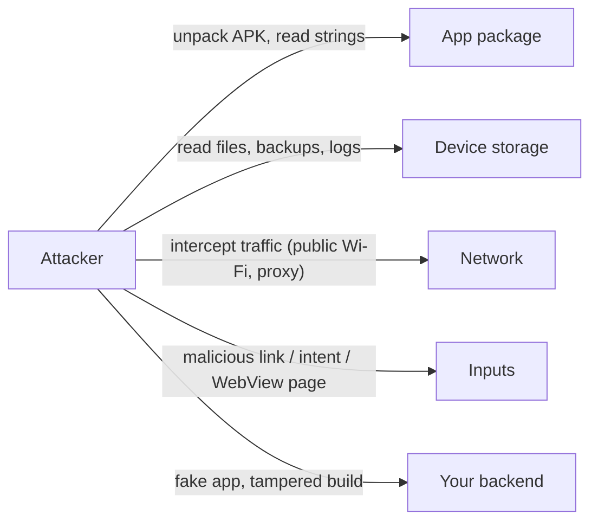
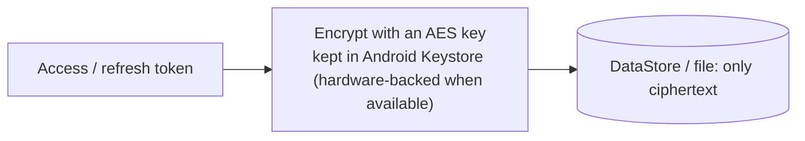

# Security

> Assume the phone, the network and the app package are all in the hands of an attacker. Keep secrets out of the app, protect tokens with the Keystore, use TLS, and treat every outside input as untrusted.

Roadmap topic 13 · Stage 4: Quality

**Go deeper:** `04-backend-engineering/05-Authentication-and-Authorization` and `06-Backend-Security-Essentials` · `05-system-design/29-Backup-Recovery-Security-and-Cost` · `05-system-design/30-Mobile-Specific-Topics` (pinning, attestation) · `8` Networking · `9` Local Storage · `19` Permissions · `16` iOS (Keychain, ATS).

**Marks:** 🟢 must know · 🟡 good to know

---

#### 1. What Is It?

*Protect user data and your backend from a hostile device and network.*

| 🟢 Must know | 🟡 Good to know |
|---|---|
| never ship secrets in the app | certificate pinning and its risk |
| secure token storage: Keystore | R8 obfuscation and its limits |
| TLS everywhere, cleartext blocked | Play Integrity / App Attest |
| validate everything from outside | biometric authentication |
| minimal permissions and data | backup rules |
| logs and screenshots: no sensitive data, `FLAG_SECURE` | WebView risks |
| | root and jailbreak detection |
| | OWASP MASVS and MASTG |

1. **The app is public.** Anyone can unpack an APK and read strings and code. A key in the app is not a secret.
2. **Tokens** are the user's identity. Store them where other apps and backups cannot read them.
3. **Input from outside** (deep links, intents, WebView, backend data, files) can be malicious.
4. **The server is the authority:** it checks permissions and prices; the app only shows.

**Signals in an interview:** "where do you keep the API key?", "how do you store the token?", "what if the phone is rooted?", "how do you stop man-in-the-middle?", "how do you handle a deep link safely?".

---

#### 2. How It Works

**Threat map.**



**Secrets.**

1. Never put API keys, passwords or signing keys in the app, in `strings.xml`, in BuildConfig, or in Git. Obfuscation only slows an attacker.
2. If a third-party service needs a secret, call it from **your backend**. For keys that must be in the app (maps, analytics), restrict them: by package name and signing certificate, by API, and by quota.
3. Provider keys for AI models never go in the app (topic 20).

**Token storage.**



The Keystore keeps the key out of the app's memory and files; the app uses it to encrypt and decrypt. Check the current recommended APIs: some older Jetpack security helper classes are deprecated, and the direct Keystore + `Cipher` approach or the current library is preferred. Use short-lived access tokens and rotate refresh tokens (`BE 5`).

**TLS.** Use HTTPS everywhere. Android blocks cleartext HTTP by default for new target SDKs; configure it explicitly with a **network security config** (only allow cleartext for local debug hosts). Never disable certificate or hostname checks to "make it work".

**Validate everything from outside.**

| Input | Risk | Defence |
|---|---|---|
| Deep link / app link | bad id, redirect, injection | verify scheme and host, parse strictly, check ownership on the server |
| Intent extras | another app sends data | `exported=false` unless needed, validate, permission-protect |
| WebView content | JavaScript attacks | load only trusted URLs, disable file access, no JS unless needed |
| Backend data | unexpected shape | tolerant parsing, limits on size and depth |
| Files / URIs from other apps | path traversal | use `ContentResolver`, don't trust file names |
| Clipboard, push payloads | spoofed data | treat as untrusted |

**Permissions and data.** Ask for the minimum permissions, at the moment of need. Collect the minimum data, keep it for the minimum time (privacy, laws such as GDPR). Declare data use in the store's data-safety form.

**Logs and screens.** Never log tokens, passwords, personal data or full request bodies in release. Mark sensitive screens (`FLAG_SECURE`) so they are hidden in the recent-apps view and blocked from screenshots. Clear the clipboard and caches after sensitive input where it makes sense.

🟡 **Certificate pinning.** The app trusts only your server's certificate (or public key). It blocks man-in-the-middle with a rogue CA, but a rotation without a backup pin locks out every user. Pin the public key, include a backup pin, and have a remote kill switch or short expiry (`SD 30`).

🟡 **R8 obfuscation.** Renames classes and removes unused code. It makes reverse engineering harder, not impossible. Never rely on it for secrets.

🟡 **App integrity.** **Play Integrity API** (iOS: App Attest) lets your backend ask "is this a genuine app on a genuine device?". Use the verdict server-side for sensitive actions. It reduces abuse; it is not perfect.

🟡 **Biometrics.** `BiometricPrompt` unlocks a Keystore key (`setUserAuthenticationRequired(true)`) so a token or action needs fingerprint or face. Offer a device-credential fallback.

🟡 **Backup rules.** `android:allowBackup` and `dataExtractionRules` decide what goes to cloud backup and device transfer. Exclude tokens and sensitive databases.

🟡 **WebView.** Disable what you don't need: file access, JavaScript, `addJavascriptInterface`. Only load HTTPS URLs from an allow-list. Prefer Custom Tabs for external pages.

🟡 **Root/jailbreak detection.** It can be bypassed. Use it as a signal, not a guarantee; protect the backend independently.

🟡 **OWASP MASVS and MASTG.** MASVS is the checklist of requirements; MASTG is the testing guide. Use them for a security review.

🟡 **iOS.** Keychain stores secrets; App Transport Security enforces TLS (topic 16).

---

#### 3. Naive vs Better Design

| Naive | Better |
|---|---|
| API secret in `BuildConfig` | call your backend; restrict any key that must be in the app |
| token in plain `SharedPreferences` | encrypted with a Keystore key |
| `usesCleartextTraffic="true"` | HTTPS; cleartext only for debug hosts |
| trust any certificate in debug and ship it | proper TLS; pinning only with a rotation plan |
| `Log.d("token", token)` | no sensitive data in logs |
| open any deep link | verify host/scheme, parse strictly |
| `exported="true"` on every component | export only what must be public |
| trust the app's price or role field | the server decides |
| WebView with JS and file access | allow-list, minimal settings |
| root check as the only defence | server-side checks + attestation |

```kotlin
// Naive: a "secret" in the app, plain storage, tokens in logs
const val API_SECRET = "sk_live_123"
prefs.edit().putString("token", token).apply()
Log.d("Auth", "token=$token")
```

---

#### 4. Code

Network security config (`res/xml/network_security_config.xml`) and manifest:

```xml
<network-security-config>
    <base-config cleartextTrafficPermitted="false" />
    <domain-config cleartextTrafficPermitted="true">
        <domain includeSubdomains="false">10.0.2.2</domain>     <!-- the emulator's host machine, debug only -->
    </domain-config>
</network-security-config>
```

```xml
<application android:networkSecurityConfig="@xml/network_security_config"
             android:allowBackup="false"
             android:dataExtractionRules="@xml/data_extraction_rules" />
```

Encrypt a token with a Keystore key (AES-GCM):

```kotlin
class TokenCipher(private val alias: String = "token_key") {
    private fun key(): SecretKey {
        val ks = KeyStore.getInstance("AndroidKeyStore").apply { load(null) }
        (ks.getKey(alias, null) as? SecretKey)?.let { return it }
        val spec = KeyGenParameterSpec.Builder(alias, KeyProperties.PURPOSE_ENCRYPT or KeyProperties.PURPOSE_DECRYPT)
            .setBlockModes(KeyProperties.BLOCK_MODE_GCM)
            .setEncryptionPaddings(KeyProperties.ENCRYPTION_PADDING_NONE)
            .setKeySize(256).build()
        return KeyGenerator.getInstance(KeyProperties.KEY_ALGORITHM_AES, "AndroidKeyStore").apply { init(spec) }.generateKey()
    }

    fun encrypt(plain: ByteArray): ByteArray {
        val c = Cipher.getInstance("AES/GCM/NoPadding").apply { init(Cipher.ENCRYPT_MODE, key()) }
        return c.iv + c.doFinal(plain)                               // 12-byte IV, then ciphertext + tag
    }

    fun decrypt(data: ByteArray): ByteArray {
        val c = Cipher.getInstance("AES/GCM/NoPadding").apply { init(Cipher.DECRYPT_MODE, key(), GCMParameterSpec(128, data.copyOfRange(0, 12))) }
        return c.doFinal(data, 12, data.size - 12)
    }
}
```

Checks: `decrypt(encrypt("abc".toByteArray()))` → `"abc"`. Encrypting the same text twice gives different bytes (a fresh IV each time). Changing one byte of the ciphertext makes `decrypt` throw (GCM detects tampering).

Validate a deep link strictly (pure function with `java.net.URI`, easy to test):

```kotlin
fun parseNoteId(link: String): Long? {
    val uri = runCatching { URI(link) }.getOrNull() ?: return null
    if (uri.scheme != "https" || uri.host != "notes.example.com") return null
    val match = Regex("^/note/(\\d{1,18})$").matchEntire(uri.path ?: "") ?: return null
    return match.groupValues[1].toLongOrNull()
}
```

Checks: `parseNoteId("https://notes.example.com/note/42")` → `42`; `"http://notes.example.com/note/42"` → `null` (not https); `"https://evil.com/note/42"` → `null`; `"https://notes.example.com.evil.com/note/1"` → `null` (the host must match exactly); `"https://notes.example.com/note/abc"` → `null`; `"https://notes.example.com/note/-1"` → `null`; `"not a url"` → `null`.

Hide a sensitive screen and require biometrics:

```kotlin
window.setFlags(WindowManager.LayoutParams.FLAG_SECURE, WindowManager.LayoutParams.FLAG_SECURE)   // no screenshots; blank in recents

val prompt = BiometricPrompt(this, ContextCompat.getMainExecutor(this),
    object : BiometricPrompt.AuthenticationCallback() {
        override fun onAuthenticationSucceeded(result: BiometricPrompt.AuthenticationResult) { unlock() }
    })
val info = BiometricPrompt.PromptInfo.Builder().setTitle("Unlock notes")
    .setAllowedAuthenticators(BIOMETRIC_STRONG or DEVICE_CREDENTIAL).build()
prompt.authenticate(info)
```

Certificate pinning (with a backup pin):

```kotlin
val pinner = CertificatePinner.Builder()
    .add("api.example.com", "sha256/AAAAAAAAAAAAAAAAAAAAAAAAAAAAAAAAAAAAAAAAAAA=")   // current key
    .add("api.example.com", "sha256/BBBBBBBBBBBBBBBBBBBBBBBBBBBBBBBBBBBBBBBBBBB=")   // backup key
    .build()
val client = OkHttpClient.Builder().certificatePinner(pinner).build()
```

Safer WebView settings:

```kotlin
webView.settings.apply {
    javaScriptEnabled = false           // turn on only for trusted pages
    allowFileAccess = false
    allowContentAccess = false
    setSupportMultipleWindows(false)
}
```

Backup exclusion (`res/xml/data_extraction_rules.xml`):

```xml
<data-extraction-rules>
    <cloud-backup><exclude domain="sharedpref" path="." /><exclude domain="database" path="." /></cloud-backup>
    <device-transfer><exclude domain="sharedpref" path="." /></device-transfer>
</data-extraction-rules>
```

Redact in logs:

```kotlin
fun String.redactToken() = replace(Regex("(Bearer\\s+)[A-Za-z0-9._~+/=-]+"), "$1***")
```

Checks: `"Authorization: Bearer abc.def-123".redactToken()` → `"Authorization: Bearer ***"`.

---

#### 5. Performance & Limits

| Item | Remember |
|---|---|
| AES-GCM | 12-byte IV, 128-bit tag; never reuse an IV with the same key |
| Keystore | hardware-backed on most devices; keys are non-exportable |
| Pin rotation | ship a backup pin; certificates are renewed about every 90 days to 1 year |
| Token lifetimes | access: minutes; refresh: days to weeks, rotated and revocable |
| R8 | shrinks code size too; it is not encryption |
| Biometric auth | gate high-risk actions, not every screen |
| Play Integrity | server-side verdict; has quotas and can fail on older devices |

---

#### 6. Common Mistakes & Edge Cases

1. Secrets in the app, in resources, in Git.
2. Plain-text tokens or passwords on disk, in backups or in logs.
3. Turning off TLS validation, trusting all certificates, or cleartext in release.
4. Exporting components by default.
5. Trusting deep-link, intent or WebView input.
6. Trusting the client for authorisation or prices.
7. Pinning with no backup pin or rotation plan.
8. Over-collecting data and permissions.
9. Believing obfuscation or root detection is protection.

Edge cases: a stolen unlocked phone (short-lived tokens, re-authentication for sensitive actions); the user clears biometrics (the Keystore key is invalidated: re-login); an expired pin shipped to users (remote config to disable pinning); screenshots in recents showing sensitive data; clipboard snooping; a leaked key (rotate and revoke from the server side).

---

#### 7. Say This in the Interview

1. "The app package is public, so no secret lives in it. Anything secret is called through my backend, and unavoidable keys are restricted by package, signature, API and quota."
2. "Tokens are encrypted with an AES key in the Android Keystore. Access tokens are short-lived, refresh tokens rotate."
3. "HTTPS only, with a network security config that blocks cleartext. Pinning is optional and only with a backup pin and a rotation plan."
4. "Every deep link, intent and WebView page is untrusted. I verify the host and parse strictly, and the server re-checks permissions."
5. "No tokens or personal data in logs; `FLAG_SECURE` on sensitive screens; minimal permissions and data."
6. "I assume the device can be rooted, so security decisions happen on the server, with attestation as an extra signal."

---

#### 8. Quick Check

1. Why is an API key in `BuildConfig` not secret?
2. What does the Keystore protect?
3. Why validate a deep link even for your own domain?
4. What is the risk of certificate pinning?

<details>
<summary>Answers</summary>

1. Anyone can decompile the APK and read it.
2. The encryption key: it stays outside the app's files and memory, so ciphertext copied from the device cannot be decrypted elsewhere.
3. Any app or web page can craft a link; the id or host may be wrong or hostile.
4. A certificate change without a matching pin locks users out until they update.

</details>

---

#### 9. Practice

**Interview questions**

1. Where do you store an API key? A user token?
2. How do you stop man-in-the-middle attacks?
3. How do you secure deep links and exported components?
4. What does R8 give you, and what doesn't it?
5. What are Play Integrity and attestation for?
6. How do you secure a WebView?
7. What would you check in a security review of a mobile app?

**Hands-on**

1. Decompile your release APK and search for strings you would not want public.
2. Replace plain token storage with the Keystore-backed cipher and test the round trip.
3. Add `FLAG_SECURE` to one screen and check the recents view.
4. Walk through a few MASVS items against your app.

**Coding warm-ups (LeetCode, input validation)**

| # | Question | Link to this topic |
|---|---|---|
| 468 | [Validate IP Address](https://leetcode.com/problems/validate-ip-address/) (Medium) | strict parsing of outside input |
| 394 | [Decode String](https://leetcode.com/problems/decode-string/) (Medium) | parsing nested input safely |
| 535 | [Encode and Decode TinyURL](https://leetcode.com/problems/encode-and-decode-tinyurl/) (Medium) | URLs and ids |
| 8 | [String to Integer (atoi)](https://leetcode.com/problems/string-to-integer-atoi/) (Medium) | overflow and bad input |

**Remember:** no secrets in the app · Keystore for tokens · TLS only · everything from outside is untrusted · the server is the authority · no sensitive data in logs · pin carefully, with a backup · obfuscation and root checks are not protection.
