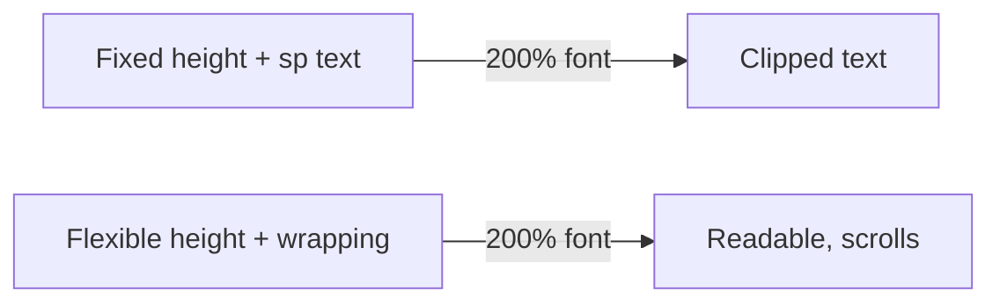
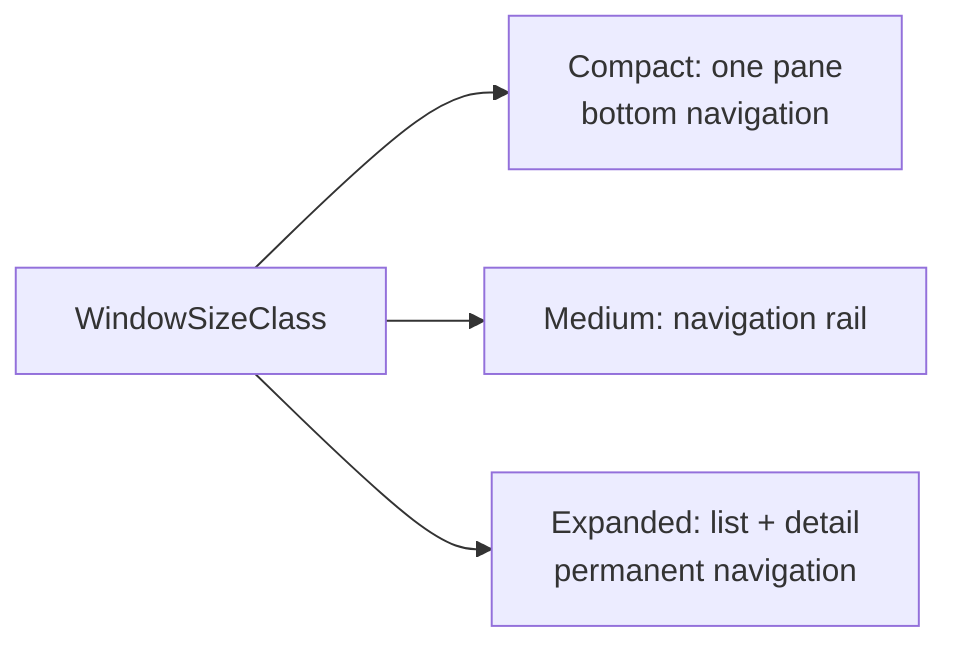

# Accessibility, Localization & Adaptive UI

> An app must work for people who use a screen reader or a large font, speak another language, read right-to-left, or hold a tablet or a foldable. These are quality features that also win interviews.

Roadmap topic 14 · Stage 4: Quality

**Go deeper:** `5` Compose (semantics, theming) · `12` Testing (accessibility checks) · `11` Performance · `16` iOS (VoiceOver, Dynamic Type).

**Marks:** 🟢 must know · 🟡 good to know

---

#### 1. What Is It?

*Make the app usable by everyone, everywhere, on any screen.*

| 🟢 Must know | 🟡 Good to know |
|---|---|
| accessibility basics: descriptions, touch targets, contrast, focus order | right-to-left, locale-aware dates, numbers, currency |
| TalkBack and testing with it | adaptive layouts: tablets, foldables, window size classes |
| font scaling and display size | edge-to-edge and insets |
| strings in resources, plurals, no concatenation | design systems and tokens |
| dark theme | accessibility in Compose (semantics) |
| | reduced motion and other user settings |

1. **Accessibility:** people with low vision, blindness, motor or hearing limits can use the app.
2. **Localization (l10n):** text, formats and layout match the user's language and region.
3. **Adaptive UI:** the layout responds to window size, orientation and posture.

**Signals in an interview:** "how do you make a screen accessible?", "what happens at 200% font?", "how do you support Arabic?", "how do you handle tablets and foldables?", "how do you do dark mode?".

---

#### 2. How It Works

**Accessibility basics.**

| Topic | Rule |
|---|---|
| Content description | meaningful text for an image or icon button (`contentDescription`); `null` for purely decorative images |
| Touch target | at least **48 × 48 dp** |
| Contrast | text contrast at least **4.5 : 1** (3 : 1 for large text) |
| Focus order | logical top-to-bottom, matches the visual order |
| Not colour alone | add text or an icon for errors/status |
| State and role | announce "selected", "checked", "button" correctly |
| Headings | mark headings so users can jump between them |
| Time | don't auto-dismiss important messages too fast |

**TalkBack.** Android's screen reader. It reads each element's description, role and state, and users move by swiping. Test by turning it on and using the screen without looking. Also use the Accessibility Scanner and Compose accessibility checks.

**Font scaling and display size.** Users can scale text to 200% or more. Use `sp` for text and flexible containers (`wrapContentHeight`, `minHeight`), let rows wrap or become columns, and never fix a height around text. Test with the largest font and display size.



**Strings and resources.** All user-visible text lives in `strings.xml` (one per language). Use **plurals** for counts (`1 note`, `2 notes`; some languages have more forms). Use **placeholders** (`%1$s`), never join text pieces in code: word order differs between languages.

**Dark theme.** Use Material theme colour roles (`surface`, `onSurface`), not fixed colours; check contrast in both themes; support dynamic colour as an option.

🟡 **Right-to-left and locale formats.** Use `start`/`end` (not left/right), mirrored icons where meaning depends on direction, and `Locale`-aware formatting for dates, numbers, currency and units. Pseudo-localization and the RTL preview find layout bugs.

🟡 **Adaptive layouts.** Use **window size classes** (`Compact`, `Medium`, `Expanded`) rather than device type. Phones: one pane; tablets/foldables: list and detail side by side (`NavigationSuiteScaffold`, list-detail layouts). Handle resizable windows, split screen and folding postures.



🟡 **Edge-to-edge and insets.** Draw behind system bars and apply window insets (status bar, navigation bar, keyboard `ime`) as padding, so content is not hidden.

🟡 **Design systems.** Tokens (colour, type, spacing, shape) and shared components give consistency and make accessibility fixes apply everywhere.

🟡 **Compose semantics.** Compose builds a semantics tree; use `Modifier.semantics`, `clearAndSetSemantics`, `mergeDescendants`, `stateDescription`, `heading()`, `role`.

🟡 **User settings.** Reduced motion (animation scale), bold text, high contrast, per-app language: respect them.

---

#### 3. Naive vs Better Design

| Naive | Better |
|---|---|
| image button without a description | `contentDescription = "Delete note"` |
| 24 dp touch target | at least 48 dp |
| text size in `dp` and fixed heights | `sp` and flexible layouts |
| `"You have " + n + " notes"` | `pluralStringResource(R.plurals.notes, n, n)` |
| hard-coded colours | theme colour roles |
| `left` / `right` padding | `start` / `end` |
| `SimpleDateFormat("MM/dd/yyyy")` | locale-aware `DateTimeFormatter.ofLocalizedDate` |
| tablet = stretched phone layout | window size classes and list-detail |
| error shown only in red | red + icon + text |

```kotlin
// Naive: unlabeled icon, tiny target, text built by concatenation, fixed colour
Icon(Icons.Default.Delete, contentDescription = null, modifier = Modifier.size(20.dp).clickable { delete() })
Text("You have " + count + " notes", color = Color(0xFF999999))
```

---

#### 4. Code

Accessible icon button and a heading:

```kotlin
IconButton(onClick = onDelete, modifier = Modifier.size(48.dp)) {            // 48 dp touch target
    Icon(Icons.Default.Delete, contentDescription = stringResource(R.string.delete_note))
}

Text(stringResource(R.string.recent), style = MaterialTheme.typography.titleMedium,
     modifier = Modifier.semantics { heading() })
```

Group related items and add state for the screen reader:

```kotlin
Row(
    modifier = Modifier
        .semantics(mergeDescendants = true) {                                // read as one element
            stateDescription = if (note.pinned) "Pinned" else "Not pinned"
            role = Role.Button
        }
        .clickable(onClick = onOpen)
        .padding(16.dp)
) {
    Text(note.title, modifier = Modifier.weight(1f))
    if (note.pinned) Icon(Icons.Default.PushPin, contentDescription = null)  // decorative: covered by the state
}
```

Resources, plurals and placeholders:

```xml
<!-- res/values/strings.xml -->
<string name="greeting">Hello, %1$s!</string>
<plurals name="notes_count">
    <item quantity="one">%d note</item>
    <item quantity="other">%d notes</item>
</plurals>
```

```kotlin
Text(stringResource(R.string.greeting, user.name))
Text(pluralStringResource(R.plurals.notes_count, count, count))
```

Checks: `count = 1` → `"1 note"`; `count = 5` → `"5 notes"`. In Arabic or Russian the resource file can define more forms (`few`, `many`) without any code change.

Locale-aware formatting:

```kotlin
val date = LocalDate.of(2025, 3, 5).format(DateTimeFormatter.ofLocalizedDate(FormatStyle.MEDIUM).withLocale(Locale.US))        // Mar 5, 2025
val price = NumberFormat.getCurrencyInstance(Locale.GERMANY).format(1234.5)                                                     // 1.234,50 €
```

Checks: the US date prints `Mar 5, 2025`; the German currency format prints `1.234,50 €` (the separators change with the locale).

Adaptive layout with window size classes:

```kotlin
@Composable
fun NotesApp(windowSize: WindowSizeClass) {
    when (windowSize.widthSizeClass) {
        WindowWidthSizeClass.Compact -> NotesListOnly()                     // phone: one pane
        else -> Row { NotesList(Modifier.weight(0.4f)); NoteDetail(Modifier.weight(0.6f)) }   // tablet / unfolded
    }
}
// in the Activity: val windowSize = calculateWindowSizeClass(this)
```

Edge-to-edge and insets:

```kotlin
enableEdgeToEdge()                                                          // in the Activity before setContent
Scaffold(modifier = Modifier.fillMaxSize()) { padding ->                    // Scaffold passes system-bar padding
    NotesList(Modifier.padding(padding).imePadding())                       // keep content above the keyboard
}
```

A tiny contrast check (the formula behind "4.5 : 1"):

```kotlin
private fun channel(c: Int): Double { val s = c / 255.0; return if (s <= 0.03928) s / 12.92 else Math.pow((s + 0.055) / 1.055, 2.4) }
private fun luminance(r: Int, g: Int, b: Int) = 0.2126 * channel(r) + 0.7152 * channel(g) + 0.0722 * channel(b)

fun contrastRatio(a: Triple<Int, Int, Int>, b: Triple<Int, Int, Int>): Double {
    val l1 = luminance(a.first, a.second, a.third); val l2 = luminance(b.first, b.second, b.third)
    return (maxOf(l1, l2) + 0.05) / (minOf(l1, l2) + 0.05)
}
```

Checks: black on white `contrastRatio(Triple(0,0,0), Triple(255,255,255))` → `21.0`; grey `#999999` on white → about `2.85` (fails 4.5 : 1); `#767676` on white → about `4.54` (passes).

Compose accessibility test:

```kotlin
rule.onNodeWithContentDescription("Delete note").assertIsDisplayed().assertHasClickAction()
rule.onNodeWithText("Save").assertHeightIsAtLeast(48.dp)
```

---

#### 5. Performance & Limits

| Item | Remember |
|---|---|
| Touch target | at least 48 × 48 dp |
| Text contrast | 4.5 : 1 normal, 3 : 1 large text (18 sp+ or bold 14 sp+) |
| Font scale | test at 200% (Android allows up to about 200%+) |
| Plural forms | English has 2; Arabic has 6; use the plurals resource |
| Window size classes | width: Compact < 600 dp, Medium 600 to 839 dp, Expanded ≥ 840 dp |
| Dark theme | pure `#000` backgrounds on OLED save battery; avoid pure white text on black |
| RTL | about 10% of users read right-to-left (Arabic, Hebrew, Persian, Urdu) |
| Animations | respect "remove animations" (animator duration scale 0) |

---

#### 6. Common Mistakes & Edge Cases

1. Missing or meaningless content descriptions ("button", "image").
2. Fixed heights and `dp` for text.
3. Concatenated strings; hard-coded text in code.
4. Colour as the only signal.
5. Left/right instead of start/end.
6. Tablet = stretched phone UI; rotating loses the selected item.
7. Ignoring the keyboard and system bars (hidden fields).
8. Testing only in English and light mode.
9. Custom controls with no semantics (invisible to TalkBack).

Edge cases: very long German words; text that grows in translation (30% longer); numbers inside RTL text; the system language differs from the app language (per-app language); folding while the screen is open (configuration change); font scale and display size both at maximum; focus order after a dialog closes.

---

#### 7. Say This in the Interview

1. "Accessibility starts with the basics: content descriptions, 48 dp targets, contrast of at least 4.5 to 1, a logical focus order, and not relying on colour alone. I verify with TalkBack and the Accessibility Scanner."
2. "I use `sp` and flexible layouts so 200% font works."
3. "All text is in resources with plurals and placeholders. I never concatenate, and I use locale-aware formatters."
4. "I use start/end and theme colour roles, so RTL and dark mode work."
5. "Layouts adapt using window size classes: one pane on compact, list-detail on expanded, and I handle insets and the keyboard."

---

#### 8. Quick Check

1. What is the minimum touch target size?
2. Why avoid string concatenation for user-visible text?
3. Window size class or device type for tablets?
4. What contrast ratio is needed for normal text?

<details>
<summary>Answers</summary>

1. 48 × 48 dp.
2. Word order and plural forms differ by language; resource strings with placeholders and plurals handle that.
3. Window size class: a phone can be in split screen and a tablet can be narrow.
4. At least 4.5 : 1.

</details>

---

#### 9. Practice

**Interview questions**

1. How do you make a screen accessible?
2. How do you test accessibility?
3. How do you support other languages and RTL?
4. How do you handle large font sizes?
5. How do you build for tablets and foldables?
6. How do you support dark theme?

**Hands-on**

1. Turn on TalkBack and complete the main flow of your app without looking.
2. Set font size and display size to the maximum and fix every clipped screen.
3. Add a second language (and a pseudo-locale) and an RTL language, and review the layouts.
4. Make the notes screen list-detail on a tablet.

**Coding warm-ups (LeetCode)**

| # | Question | Link to this topic |
|---|---|---|
| 273 | [Integer to English Words](https://leetcode.com/problems/integer-to-english-words/) (Hard) | formatting numbers as text |
| 12 | [Integer to Roman](https://leetcode.com/problems/integer-to-roman/) (Medium) | locale-specific number systems |
| 68 | [Text Justification](https://leetcode.com/problems/text-justification/) (Hard) | text layout and wrapping |
| 722 | [Remove Comments](https://leetcode.com/problems/remove-comments/) (Medium) | careful text processing |

**Remember:** describe images, 48 dp targets, contrast 4.5 : 1 · `sp` and flexible layouts · strings in resources with plurals · theme colours for dark mode · start/end for RTL · window size classes · test with TalkBack.
