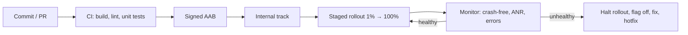

# Build, Release & Monitoring

> Shipping is part of engineering. A good release process builds the same way every time, rolls out slowly, can be switched off without a new release, and tells you quickly when real users are hurting.

Roadmap topic 15 · Stage 5: Shipping

**Go deeper:** `05-system-design/28-Deployment-and-Release` (canary, feature flags, safe migrations) · `05-system-design/27-Observability` · `05-system-design/30-Mobile-Specific-Topics` (old versions) · `7` DI & Modularization (build speed) · `11` Performance (Play Vitals) · `13` Security (signing) · `16` iOS (TestFlight).

**Marks:** 🟢 must know · 🟡 good to know

---

#### 1. What Is It?

*From source code to a safe release on real phones, and watching it afterwards.*

| 🟢 Must know | 🟡 Good to know |
|---|---|
| Gradle: modules, build types, flavors | CI/CD: GitHub Actions, Fastlane |
| signing and key safety | force update, in-app updates |
| version code and version name | analytics: events, privacy, consent |
| release tracks, staged rollout | A/B testing |
| feature flags and remote config | logging and correlation IDs |
| backward compatibility with old versions | store policies, target API level |
| crash reporting, non-fatal errors | reproducible and fast builds |
| app health metrics | |

1. **Build:** Gradle compiles the app into an AAB per **build type** (debug, release) and **flavor** (free, paid, staging).
2. **Sign:** the key proves updates come from you. Losing it is serious.
3. **Release:** internal → closed → open → production, with a **staged rollout** (1%, 5%, 20%, 50%, 100%).
4. **Control:** **feature flags** turn things on and off without a release.
5. **Watch:** crash-free rate, ANR rate, cold start, errors.

**Signals in an interview:** "how do you release safely?", "a bad release is out, what now?", "how do you keep old app versions working?", "how do you know the release is healthy?".

---

#### 2. How It Works

**The release pipeline.**



**Gradle basics.**

| Concept | Meaning |
|---|---|
| Module | a Gradle project (`:app`, `:feature:notes`) |
| Build type | debug / release settings (minify, signing, debuggable) |
| Product flavor | variants (free/paid, staging/production) with their own config and resources |
| Build variant | flavor × build type (`stagingDebug`, `productionRelease`) |
| `implementation` vs `api` | whether a dependency is visible to consumers (topic 7) |

**Signing.** Use **Play App Signing**: Google holds the app signing key; you upload with a separate **upload key** that can be reset if lost. Keep keystores and passwords out of Git (CI secrets). Never share the upload key by chat.

**Versioning.** `versionCode` is an integer that must grow with every upload. `versionName` is the human text (`1.4.0`). Many teams derive `versionCode` from CI build numbers or from `major*10000 + minor*100 + patch`.

**Tracks and staged rollout (Play).** Internal testing → closed → open → production. In production use a **staged rollout**: start at 1 to 5%, watch for a day, then increase. You can halt a rollout, but you cannot take a version back from users who have it, so the fix is a new version (and server-side flags). iOS: TestFlight, then **phased release** over 7 days.

**Feature flags and remote config.**

1. A server-controlled switch: show a feature to 10% of users, or turn it off for everyone.
2. A **kill switch** for risky features (payments, a new sync engine).
3. Bucket users with a stable hash so a user stays in the same group (`SD 28`).
4. Flags are code paths: remove them when the experiment ends.

**Backward compatibility.** Old versions stay in use for years. The API only adds fields; the app ignores unknown fields; a removed endpoint stays until usage drops; breaking changes need a new version path. A **force-update** screen blocks only versions you cannot support (`SD 30`).

**Crash reporting and non-fatal errors.** Crashlytics (or similar) groups crashes by stack trace and shows device, OS and version. Log **non-fatal** errors (handled failures) and add context (screen, user id hash, feature flag state), never personal data.

**Health metrics.**

| Metric | What it tells you |
|---|---|
| Crash-free users / sessions | stability |
| ANR rate | main-thread blocking |
| Cold start time | startup |
| Frame jank | smoothness |
| API error rate and latency (client side) | backend and network health |
| Adoption of the new version | how fast users move |

Play Console **Android vitals** flags apps with bad behaviour thresholds (crash and ANR rates), which can reduce visibility.

🟡 **CI/CD.** On every PR: build, lint, unit tests. On merge: instrumented tests and a signed internal build. Tools: GitHub Actions, Gradle Managed Devices, Fastlane or the Play Publisher plugin. Cache Gradle to keep it fast.

🟡 **Force and in-app updates.** The Play **In-App Updates** API offers *flexible* (background) or *immediate* (blocking) updates. A backend `minSupportedVersion` in remote config drives a force-update screen.

🟡 **Analytics.** Design events (`note_created`, with a few properties) before coding; get consent where required; avoid personal data; check event volume and cost.

🟡 **A/B testing.** Randomise stable buckets, define the metric first, run long enough, and keep the code paths clean.

🟡 **Logging and correlation IDs.** Send a request ID (`X-Request-Id`) from the app; the backend logs it, so one failed user action can be traced across systems (`SD 27`).

🟡 **Store policies.** Play requires a recent **target API level**, data-safety declarations, and policy compliance for permissions and background use. Plan the yearly target bump.

🟡 **Build performance.** Modules, build cache, configuration cache, KSP over kapt, a version catalog, and no cycles keep builds fast and reproducible.

---

#### 3. Naive vs Better Design

| Naive | Better |
|---|---|
| release to 100% on Friday | staged rollout, watch metrics, release early in the week |
| keystore in the repo | Play App Signing, upload key in CI secrets |
| ship a risky feature with no off switch | feature flag / kill switch |
| rename an API field | add a field; keep the old one |
| find out about crashes from reviews | crash reporting + alerts |
| build on one laptop | CI builds the same way every time |
| `versionCode` edited by hand | generated from the CI build number |
| remove a flag never | delete flags after rollout |
| force-update everyone for any change | force-update only unsupported versions |

```kotlin
// Naive: shipped with no way to turn it off
fun onSyncClicked() = newSyncEngine.run()          // if it crashes, only a new release can fix it
```

---

#### 4. Code

Build types, flavors and signing from environment variables:

```kotlin
android {
    defaultConfig { versionCode = (System.getenv("BUILD_NUMBER") ?: "1").toInt(); versionName = "1.4.0" }

    signingConfigs {
        create("release") {
            storeFile = System.getenv("KEYSTORE_PATH")?.let(::file)
            storePassword = System.getenv("KEYSTORE_PASSWORD")
            keyAlias = System.getenv("KEY_ALIAS")
            keyPassword = System.getenv("KEY_PASSWORD")
        }
    }
    buildTypes {
        debug { applicationIdSuffix = ".debug"; isDebuggable = true }
        release { isMinifyEnabled = true; isShrinkResources = true; signingConfig = signingConfigs.getByName("release")
                  proguardFiles(getDefaultProguardFile("proguard-android-optimize.txt"), "proguard-rules.pro") }
    }
    flavorDimensions += "env"
    productFlavors {
        create("staging") { dimension = "env"; applicationIdSuffix = ".staging"; buildConfigField("String", "API_URL", "\"https://staging.api.example.com/\"") }
        create("production") { dimension = "env"; buildConfigField("String", "API_URL", "\"https://api.example.com/\"") }
    }
}
```

A feature flag with a stable percentage bucket:

```kotlin
fun bucket(userId: String, flag: String): Int = Math.floorMod((userId + ":" + flag).hashCode(), 100)

fun isEnabled(userId: String, flag: String, percent: Int, killSwitchOn: Boolean = false): Boolean =
    !killSwitchOn && bucket(userId, flag) < percent
```

Checks: the same `userId` and `flag` always give the same bucket, so a user never flips between groups. With `percent = 0` nobody is enabled; with `100` everyone is enabled; with `killSwitchOn = true` nobody is, even at 100. For many random user ids and `percent = 10`, about 10% are enabled.

Force update from remote config:

```kotlin
fun needsForceUpdate(installedCode: Int, minSupportedCode: Int) = installedCode < minSupportedCode
fun parseVersion(name: String): List<Int> = name.split('.').map { it.toIntOrNull() ?: 0 }
fun isOlder(a: String, b: String): Boolean {
    val x = parseVersion(a); val y = parseVersion(b)
    for (i in 0 until maxOf(x.size, y.size)) {
        val d = x.getOrElse(i) { 0 } - y.getOrElse(i) { 0 }
        if (d != 0) return d < 0
    }
    return false
}
```

Checks: `needsForceUpdate(120, 130)` → `true`; `(130, 130)` → `false`. `isOlder("1.4.0", "1.10.0")` → `true` (compared as numbers, not text: `"1.4" > "1.10"` as strings would be wrong); `isOlder("1.4", "1.4.0")` → `false`.

Staged rollout decision as code (the rule you tell the team):

```kotlin
fun canIncreaseRollout(crashFreeNow: Double, crashFreeBaseline: Double, anrRate: Double, anrLimit: Double = 0.0047, maxDrop: Double = 0.002) =
    crashFreeNow >= crashFreeBaseline - maxDrop && anrRate <= anrLimit
```

Checks: `canIncreaseRollout(0.998, 0.999, 0.003)` → `true` (drop 0.001 ≤ 0.002, ANR under 0.47%); `canIncreaseRollout(0.995, 0.999, 0.003)` → `false` (drop 0.004); `canIncreaseRollout(0.999, 0.999, 0.01)` → `false` (ANR too high).

Crash reporting with context:

```kotlin
FirebaseCrashlytics.getInstance().apply {
    setCustomKey("screen", "notes_list")
    setCustomKey("flag_new_sync", isEnabled(userId, "new_sync", 10))
    log("refresh started")
}
// handled failure:  FirebaseCrashlytics.getInstance().recordException(e)
```

Correlation ID interceptor:

```kotlin
class RequestIdInterceptor : Interceptor {
    override fun intercept(chain: Interceptor.Chain): Response =
        chain.proceed(chain.request().newBuilder().header("X-Request-Id", UUID.randomUUID().toString()).build())
}
```

CI (GitHub Actions):

```yaml
name: android
on: [pull_request]
jobs:
  build:
    runs-on: ubuntu-latest
    steps:
      - uses: actions/checkout@v4
      - uses: actions/setup-java@v4
        with: { distribution: temurin, java-version: 17 }
      - uses: gradle/actions/setup-gradle@v4        # caches Gradle
      - run: ./gradlew lint testDebugUnitTest assembleStagingDebug
```

In-app update:

```kotlin
val manager = AppUpdateManagerFactory.create(context)
manager.appUpdateInfo.addOnSuccessListener { info ->
    if (info.updateAvailability() == UpdateAvailability.UPDATE_AVAILABLE && info.isUpdateTypeAllowed(AppUpdateType.FLEXIBLE)) {
        manager.startUpdateFlowForResult(info, activityResultLauncher, AppUpdateOptions.newBuilder(AppUpdateType.FLEXIBLE).build())
    }
}
```

---

#### 5. Performance & Limits

| Item | Remember |
|---|---|
| Staged rollout steps | 1% → 5% → 20% → 50% → 100%, watch each for hours to a day |
| Play bad-behaviour thresholds (check current) | user-perceived crash about 1.1%, ANR about 0.47% of daily users |
| `versionCode` | integer, must increase; maximum 2,100,000,000 |
| iOS phased release | 7 days, 1% → 100% |
| Review time | Play: hours to days; App Store: usually 1 to 2 days |
| Hotfix | needs a new build and review; a flag or server fix is faster |
| CI | keep pull-request checks under about 10 minutes |
| Old versions | support the last N versions that still have real traffic (look at adoption) |

---

#### 6. Common Mistakes & Edge Cases

1. Releasing to everyone at once.
2. No kill switch for risky features.
3. Keys and passwords in the repo.
4. Breaking the API for old app versions.
5. No crash reporting, or crash reports without context.
6. Collecting personal data in analytics with no consent.
7. Never removing old flags.
8. Forgetting the yearly target API bump until the deadline.
9. Ignoring a small crash rate increase until it is large.

Edge cases: a bad release already at 100% (fix forward: flag off, hotfix, halt, and raise the force-update minimum if needed); a flag service outage (use safe defaults and cached values); a staged rollout that stalls on adoption; different crash rates per device/OS (look at the breakdown); a database migration that fails only for users upgrading from very old versions.

---

#### 7. Say This in the Interview

1. "I use CI to build signed bundles, Play App Signing, and a version code from the CI build number."
2. "Releases go internal → staged rollout. I watch crash-free users, ANR rate and startup before each increase, and I halt if they drop."
3. "Risky features sit behind a remote flag with a kill switch, so I can turn them off without a release."
4. "Old versions keep working: the API only adds fields, the app ignores unknown ones, and a force-update screen covers only the unsupported versions."
5. "Crashlytics gives crashes with context, I log non-fatal errors, and a request ID from the app lets us trace one action through the backend."

---

#### 8. Quick Check

1. Can you take a bad version back from users?
2. Why derive `versionCode` from CI?
3. What does a kill switch do?
4. Why compare versions as numbers?

<details>
<summary>Answers</summary>

1. No. You halt the rollout and ship a fix, and use flags or server changes to limit the damage.
2. It always increases, is unique, and needs no manual edits.
3. It turns a feature off for all users remotely, with no new release.
4. As text, `"1.4"` sorts after `"1.10"`; as numbers `4 < 10`.

</details>

---

#### 9. Practice

**Interview questions**

1. How do you release an app safely?
2. What do you do when a bad release reaches users?
3. How do you keep old versions working?
4. How do you use feature flags and remote config?
5. Which metrics do you watch after a release?
6. How do you manage signing keys?
7. How do you set up CI for an Android app?

**Hands-on**

1. Add staging and production flavors with different API URLs.
2. Set up a GitHub Actions workflow that builds and runs unit tests with caching.
3. Add a remote flag with a kill switch around one risky feature, and test both states.
4. Release to an internal track and practise halting a staged rollout.

**Coding warm-ups (LeetCode)**

| # | Question | Link to this topic |
|---|---|---|
| 165 | [Compare Version Numbers](https://leetcode.com/problems/compare-version-numbers/) (Medium) | force update by version |
| 278 | [First Bad Version](https://leetcode.com/problems/first-bad-version/) (Easy) | find the release that broke it |
| 362 | [Design Hit Counter](https://leetcode.com/problems/design-hit-counter/) (Medium, premium) | counting events for rates |
| 1396 | [Design Underground System](https://leetcode.com/problems/design-underground-system/) (Medium) | metrics from start/end events |

**Remember:** staged rollout and watch · feature flags with a kill switch · Play App Signing, keys out of Git · the API only grows · crash reporting with context · versions as numbers · fix forward, you can't recall a release.
