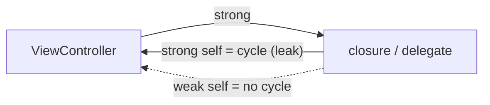

# iOS & Swift Essentials

> You do not need to be an iOS expert, but you should map every Android concept to its iOS equivalent and know the big differences. That is enough for most Android interviews and a good start for cross-platform work.

Roadmap topic 16 · Stage 6: Beyond Android (New)

**Go deeper:** `1` Platform Basics · `3` Coroutines (compare with Swift concurrency) · `4` Lifecycle · `5` Compose (compare with SwiftUI) · `9` Local Storage · `13` Security · `17` Cross-Platform & KMP.

**Marks:** 🟢 must know · 🟡 good to know · (New) beyond the basics

---

#### 1. What Is It?

*The same ideas, with Apple's names.*

| 🟢 Must know | 🟡 Good to know |
|---|---|
| map the concepts Android ↔ iOS | SwiftUI state: `@State`, `@Binding`, `@Observable` |
| Swift basics: optionals, structs, enums, protocols | Combine and `AsyncSequence` |
| ARC and retain cycles | `URLSession` networking |
| Swift concurrency: `async/await`, actors, `MainActor` | Core Data and SwiftData |
| UIKit vs SwiftUI | app and scene lifecycle, background tasks, APNs |
| Keychain | testing: XCTest, Swift Testing |
| | distribution: signing, TestFlight, review |
| | Swift Package Manager |

1. **Swift** is a compiled, type-safe language like Kotlin: optionals, value types, enums with data, protocols.
2. **SwiftUI** is the declarative UI framework (like Compose); **UIKit** is the older imperative one (like Views).
3. **Swift concurrency** (`async/await`, actors) is like coroutines.
4. **ARC** frees objects by reference count, so cycles leak (use `weak`).

**Signals in an interview:** "what is the iOS equivalent of X?", "how does memory management differ?", "SwiftUI vs UIKit?", "how do background tasks differ?".

---

#### 2. How It Works

**Concept map.**

| Android (Kotlin) | iOS (Swift) |
|---|---|
| Activity / Fragment | `UIViewController` / SwiftUI `View` (a scene in the app) |
| Jetpack Compose | SwiftUI |
| View system (XML) + `RecyclerView` | UIKit + `UITableView` / `UICollectionView` |
| `ViewModel` + `StateFlow` | `ObservableObject` / `@Observable` + `@Published` |
| Kotlin coroutines, `Flow` | Swift concurrency (`async/await`), `AsyncSequence`, Combine |
| `Dispatchers.Main` | `@MainActor` |
| Room | Core Data, SwiftData |
| `DataStore` / `SharedPreferences` | `UserDefaults` (settings), Keychain (secrets) |
| Retrofit / OkHttp | `URLSession` |
| Hilt / Koin | initialiser injection, environment, third-party containers |
| WorkManager | `BGTaskScheduler` |
| FCM | APNs (FCM can wrap APNs) |
| Gradle, Maven Central | Swift Package Manager, Xcode |
| AAB / Google Play | IPA / App Store, TestFlight |
| Keystore | Keychain / Secure Enclave |
| Play Integrity | App Attest / DeviceCheck |
| JUnit, Espresso | XCTest, XCUITest, Swift Testing |
| Material | Human Interface Guidelines (HIG) |

**Swift basics vs Kotlin.**

| Idea | Kotlin | Swift |
|---|---|---|
| Nullable | `String?`, `?.`, `?:`, `!!` | `String?` (Optional), `?.`, `??`, `!`, `if let`, `guard let` |
| Value vs reference | data class (reference) | `struct` (value, copied), `class` (reference) |
| Sealed states | `sealed interface` | `enum` with associated values |
| Interfaces | `interface` | `protocol` (with extensions) |
| Immutable | `val` | `let` |
| Extension | `fun String.x()` | `extension String { func x() }` |

Structs are copied on assignment, so most model types are structs. Enums with associated values model state, exactly like sealed classes.

**ARC (Automatic Reference Counting).** Each object has a count of strong references; at zero, it is freed. Two objects that hold each other strongly never reach zero: a **retain cycle** (a leak). Break it with `weak` (becomes `nil` when the object is freed) or `unowned` (assumed alive). Closures that capture `self` are the usual cause: `[weak self]`.



**Swift concurrency.**

| Swift | Kotlin counterpart |
|---|---|
| `async` function, `await` | `suspend` function |
| `Task { }` | `launch { }` |
| `async let` / `TaskGroup` | `async { }` / `coroutineScope` |
| `actor` | confined state with a `Mutex` |
| `@MainActor` | `Dispatchers.Main` |
| `AsyncSequence` / `AsyncStream` | `Flow` |
| `Task.cancel()`, `Task.checkCancellation()` | `cancel()`, `ensureActive()` |

An **actor** protects its mutable state: only one task at a time runs inside it.

**UIKit vs SwiftUI.** SwiftUI is declarative and state-driven (like Compose); the default for new apps. UIKit is still used for complex or older screens and many libraries. They interoperate (`UIHostingController`, `UIViewRepresentable`).

**SwiftUI state.**

| Wrapper | Meaning | Compose counterpart |
|---|---|---|
| `@State` | local state owned by the view | `remember { mutableStateOf }` |
| `@Binding` | a two-way reference to state owned elsewhere | passing `value` + `onValueChange` |
| `@Observable` (iOS 17+) / `ObservableObject` | a model the view watches | `ViewModel` with `StateFlow` |
| `@Environment` | shared values from the tree | `CompositionLocal` |

🟡 **Combine and `AsyncSequence`.** Combine is the older reactive framework; new code prefers `async/await` and `AsyncSequence`.

🟡 **Networking.** `URLSession` with `async/await`; `Codable` for JSON; ATS (App Transport Security) requires HTTPS by default.

🟡 **Persistence.** **Core Data** (mature object graph on SQLite) and **SwiftData** (modern, macro-based, for newer OS versions). The same offline-first design applies (topic 9).

🟡 **Lifecycle and background.** The app has a scene lifecycle (`active`, `inactive`, `background`). Background work is strictly limited: `BGTaskScheduler` (refresh and processing), silent push, and a few special modes (audio, location). The system decides when.

🟡 **Testing.** XCTest and the newer Swift Testing; XCUITest for UI; Xcode previews for quick checks.

🟡 **Distribution.** Xcode, certificates and provisioning profiles (automatic signing helps), TestFlight for beta, App Store review (stricter than Play), phased release.

🟡 **Swift Package Manager.** The built-in dependency manager (CocoaPods and Carthage are older).

---

#### 3. Naive vs Better Design

| Naive | Better |
|---|---|
| translate Android code line by line | use iOS idioms (SwiftUI, value types, actors) |
| classes for every model | `struct` for data, `class` only for identity/shared state |
| force unwrap `!` everywhere | `guard let`, `if let`, `??` |
| `self` captured strongly in a stored closure | `[weak self]` |
| update the UI from any thread | `@MainActor` |
| shared mutable state with locks | an `actor` |
| secrets in `UserDefaults` | Keychain |
| assume background work runs on a schedule | `BGTaskScheduler` is best effort; design for it |
| ignore HIG | follow platform conventions (navigation, gestures) |

```swift
// Naive: force unwrap and a retain cycle
class Screen { var onDone: (() -> Void)?
    func setup() { onDone = { self.finish() } }       // strong cycle: Screen → closure → Screen
    func finish() {} }
let name = user.name!                                  // crash if nil
```

---

#### 4. Code

Optionals, a struct and an enum with associated values:

```swift
struct User { let id: Int; let name: String; let email: String? }

func domain(of user: User?) -> String {
    guard let email = user?.email, let at = email.firstIndex(of: "@") else { return "unknown" }
    return String(email[email.index(after: at)...])
}

enum LoadState<T> { case loading; case content(T); case failed(String) }
```

Checks: `domain(of: User(id: 1, name: "Ann", email: "ann@x.com"))` → `"x.com"`; email `nil` → `"unknown"`; user `nil` → `"unknown"` (the same results as the Kotlin version in topic 2).

SwiftUI screen with an observable model and `async/await`:

```swift
@Observable @MainActor
final class NotesModel {
    var state: LoadState<[Note]> = .loading
    private let api: NotesAPI
    init(api: NotesAPI) { self.api = api }

    func load() async {
        do { state = .content(try await api.notes()) }
        catch is CancellationError { }                     // a cancelled task is not an error to show
        catch { state = .failed("Offline") }
    }
}

struct NotesView: View {
    @State private var model = NotesModel(api: LiveNotesAPI())
    var body: some View {
        Group {
            switch model.state {
            case .loading: ProgressView()
            case .failed(let message): Text(message)
            case .content(let notes): List(notes) { Text($0.title) }
            }
        }
        .task { await model.load() }                       // started with the view, cancelled when it disappears
    }
}
```

Networking with `URLSession` and `Codable`:

```swift
struct Note: Codable, Identifiable { let id: Int; let title: String }

func fetchNotes() async throws -> [Note] {
    var request = URLRequest(url: URL(string: "https://api.example.com/notes")!)
    request.timeoutInterval = 20
    let (data, response) = try await URLSession.shared.data(for: request)
    guard (response as? HTTPURLResponse)?.statusCode == 200 else { throw URLError(.badServerResponse) }
    return try JSONDecoder().decode([Note].self, from: data)       // unknown fields are ignored by default
}
```

An actor protecting shared state:

```swift
actor HitCounter {
    private var count = 0
    func hit() { count += 1 }
    func value() -> Int { count }
}
// await counter.hit()  from many tasks: always correct, no manual lock
```

Checks: 1,000 tasks each calling `await counter.hit()` end with `await counter.value() == 1000`.

Break a retain cycle:

```swift
final class Screen {
    var onDone: (() -> Void)?
    func setup() { onDone = { [weak self] in self?.finish() } }    // no strong cycle
    func finish() {}
}
```

Keychain (store a token; simplified):

```swift
func saveToken(_ token: String) {
    let query: [String: Any] = [kSecClass as String: kSecClassGenericPassword,
                                kSecAttrAccount as String: "accessToken",
                                kSecValueData as String: Data(token.utf8),
                                kSecAttrAccessible as String: kSecAttrAccessibleAfterFirstUnlockThisDeviceOnly]
    SecItemDelete(query as CFDictionary)
    SecItemAdd(query as CFDictionary, nil)
}
```

A background refresh task:

```swift
BGTaskScheduler.shared.register(forTaskWithIdentifier: "com.example.notes.refresh", using: nil) { task in
    Task { await SyncEngine.shared.sync(); task.setTaskCompleted(success: true) }
}
// schedule: BGAppRefreshTaskRequest(identifier: "com.example.notes.refresh") — the system picks the time
```

A test (XCTest):

```swift
func testDomain() {
    XCTAssertEqual(domain(of: User(id: 1, name: "Ann", email: "ann@x.com")), "x.com")
    XCTAssertEqual(domain(of: nil), "unknown")
}
```

---

#### 5. Performance & Limits

| Item | Remember |
|---|---|
| Frame budget | 16.7 ms at 60 Hz, 8.3 ms at 120 Hz (ProMotion) |
| Value types | copy-on-write for arrays and strings: cheap until mutated |
| ARC | no pauses like a garbage collector, but retain cycles leak |
| Main actor | UI work and state updates only; heavy work on background tasks |
| Background | the system decides when `BGTaskScheduler` runs; there is no exact schedule |
| App Store review | stricter than Play; privacy manifests and usage descriptions are required |
| Minimum OS | `@Observable` and SwiftData need recent iOS (17+); check your deployment target |

---

#### 6. Common Mistakes & Edge Cases

1. Porting Android architecture 1:1 instead of using SwiftUI patterns.
2. Force unwrapping (`!`).
3. Retain cycles from closures and delegates.
4. UI updates off the main thread.
5. Keeping secrets in `UserDefaults`.
6. Expecting background work to run on time.
7. Missing usage-description strings for permissions (the app crashes or is rejected).
8. Ignoring the HIG, and iOS version differences.

Edge cases: SwiftUI views are structs, recreated often (the model must be stored with `@State` / `@StateObject`); a `Task` is cancelled when its view disappears; Keychain items survive app deletion unless handled; APNs tokens change; low-power mode and background refresh turned off by the user.

---

#### 7. Say This in the Interview

1. "I know the mapping: Activity ↔ view controller, Compose ↔ SwiftUI, Room ↔ Core Data or SwiftData, coroutines ↔ `async/await`, `Dispatchers.Main` ↔ `@MainActor`, Keystore ↔ Keychain, WorkManager ↔ `BGTaskScheduler`, FCM ↔ APNs."
2. "Swift value types (structs) and enums with associated values play the role of data classes and sealed classes."
3. "ARC frees objects at zero references, so a closure capturing `self` strongly can leak; I use `[weak self]`."
4. "Swift concurrency uses `async/await`, structured tasks and actors, which protect mutable state without manual locks."
5. "Architecture ideas carry over: single source of truth, unidirectional data flow, offline-first. Only the framework names change."

---

#### 8. Quick Check

1. What is the Swift equivalent of a Kotlin sealed class?
2. How does a retain cycle form and how do you break it?
3. What does `@MainActor` do?
4. Where do you store a token on iOS?

<details>
<summary>Answers</summary>

1. An `enum` with associated values.
2. Two objects hold strong references to each other (often a closure capturing `self`). Break it with `weak` or `unowned`.
3. It makes the code run on the main thread, like `Dispatchers.Main`.
4. In the Keychain.

</details>

---

#### 9. Practice

**Interview questions**

1. What is the iOS equivalent of an Activity, a `ViewModel`, Room, WorkManager?
2. How does ARC differ from garbage collection?
3. SwiftUI vs UIKit?
4. How do Swift actors work?
5. How is background work different on iOS?
6. Where do you store secrets?

**Hands-on**

1. Rebuild one screen of your Android app in SwiftUI with `async/await`.
2. Write the same `domain(of:)` function in Swift and Kotlin and compare.
3. Create a retain cycle, find it in Xcode's memory graph, and fix it.

**Coding warm-ups (LeetCode, language-agnostic)**

| # | Question | Link to this topic |
|---|---|---|
| 1 | [Two Sum](https://leetcode.com/problems/two-sum/) (Easy) | solve it in Swift too (dictionary) |
| 20 | [Valid Parentheses](https://leetcode.com/problems/valid-parentheses/) (Easy) | arrays as stacks in Swift |
| 49 | [Group Anagrams](https://leetcode.com/problems/group-anagrams/) (Medium) | `Dictionary(grouping:)` |
| 1114 | [Print in Order](https://leetcode.com/problems/print-in-order/) (Easy) | ordering tasks |

**Remember:** same ideas, different names · structs and enums with data ≈ data and sealed classes · `[weak self]` for cycles · `async/await`, actors, `@MainActor` ≈ coroutines · Keychain for secrets · background work is the system's decision.
