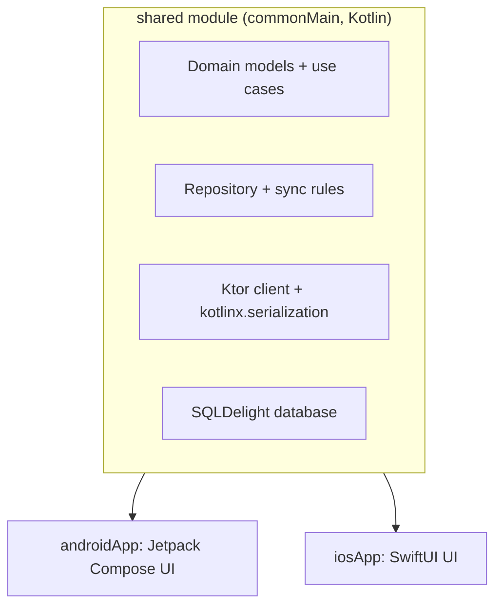
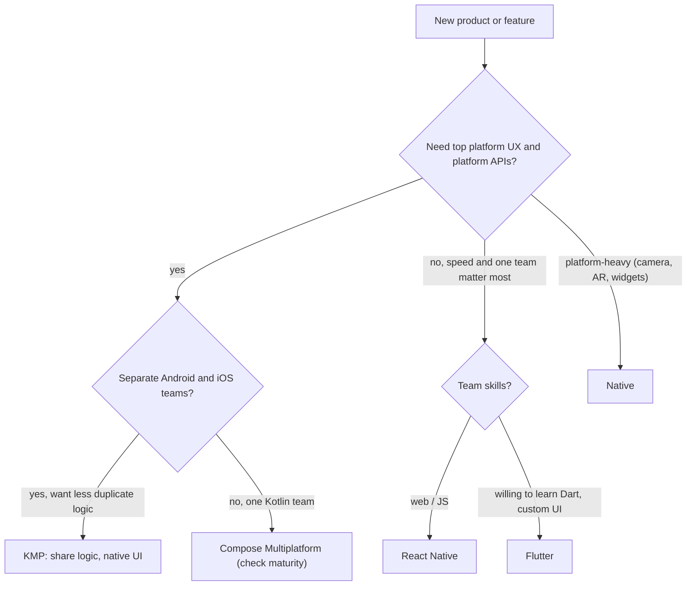

# Cross-Platform & Kotlin Multiplatform

> You can build one app for Android and iOS in several ways. Know the options, what Kotlin Multiplatform (KMP) shares, and how to choose with reasons, not fashion.

Roadmap topic 17 · Stage 6: Beyond Android (New)

**Go deeper:** `2` Kotlin Essentials · `3` Coroutines · `9` Local Storage (SQLDelight idea) · `16` iOS & Swift · `09-architecture` (build vs buy, trade-offs) · `05-system-design/30-Mobile-Specific-Topics`.

**Marks:** 🟢 must know · 🟡 good to know · (New) beyond the basics

---

#### 1. What Is It?

*Share code between platforms without sharing the problems.*

| 🟢 Must know | 🟡 Good to know |
|---|---|
| options: native, KMP, Flutter, React Native | `expect` / `actual` |
| what KMP shares | Compose Multiplatform and its maturity |
| how to choose | libraries for shared code |
| | testing and CI for shared code |
| | migrating step by step |
| | common problems |

1. **Native:** two apps (Kotlin + Compose; Swift + SwiftUI). Best platform fit, highest cost.
2. **KMP:** share Kotlin code (logic, data, networking); the UI stays native, or use Compose Multiplatform.
3. **Flutter:** one codebase in Dart with its own rendering engine.
4. **React Native:** one codebase in JavaScript/TypeScript with native views.

**Signals in an interview:** "native or cross-platform?", "what would you share in KMP?", "what is `expect/actual`?", "how would you migrate?".

---

#### 2. How It Works

**The options compared.**

| | Native | KMP (native UI) | Compose Multiplatform | Flutter | React Native |
|---|---|---|---|---|---|
| Language | Kotlin + Swift | Kotlin (shared) + Swift UI | Kotlin | Dart | TypeScript |
| UI | platform UI | platform UI | shared Compose UI | own engine | native views via a bridge |
| Shared code | none | logic, data, network | logic + UI | almost all | almost all |
| Platform features | direct | direct on each side | via `expect/actual` | plugins | native modules |
| Look and feel | exact | exact | consistent, close to native | consistent | native-like |
| Team skill | two skill sets | Kotlin + iOS UI | Kotlin | Dart | web skills |
| Risk | double work | tooling, iOS debugging | maturity varies by platform | big runtime, plugin gaps | bridge/upgrade pain |

**What KMP shares.**



The usual split: **share what must behave identically** (rules, parsing, caching, sync, validation, analytics events) and **keep UI native** (navigation, animations, platform look). This keeps the platform experience and still removes duplicated logic and duplicated bugs.

**Source sets.**

| Source set | Contains |
|---|---|
| `commonMain` | code for every platform (no JVM-only APIs like `java.text`) |
| `androidMain` | Android implementations (can use Android APIs) |
| `iosMain` | iOS implementations (can call Apple frameworks) |
| `commonTest` | shared tests |

🟡 **`expect` / `actual`.** Declare a function or class in common code (`expect`) and implement it per platform (`actual`). Prefer **interfaces + injection** when possible; use `expect/actual` for small things (platform name, UUID, secure storage, a database driver).

🟡 **Compose Multiplatform.** Shares Compose UI across Android, iOS, desktop and web. Android and desktop are the most mature; iOS support is stable in recent releases but check the current status, the missing platform behaviours (text input, accessibility, gestures) and library support before committing.

🟡 **Libraries for shared code.** **Ktor** (HTTP), **kotlinx.serialization** (JSON), **kotlinx.coroutines** (`Flow` in Swift via wrappers like SKIE or KMP-NativeCoroutines), **SQLDelight** (typed SQL), **kotlinx-datetime**, **Koin** (DI), **Okio**. Android-only libraries (Room historically, Retrofit, Hilt) do not run in common code; check support for each.

🟡 **Testing and CI.** Write tests in `commonTest` and run on JVM and iOS simulators. CI needs a macOS runner for iOS builds. Test the contract between the shared module and each UI.

🟡 **Migrating step by step.** Start with one self-contained module (for example validation, a parser or the networking layer), publish it as a library to both apps, and expand once the team is comfortable. No big rewrite.

🟡 **Common problems.** Swift sees Kotlin through Objective-C (generics, `suspend`, sealed classes need wrappers); debugging across the boundary; build times (iOS framework linking); Gradle + Xcode integration; platform gaps; library maturity; a small hiring pool for both.

**How to choose.**



Decide on: team skills, performance needs, platform features, speed to market, long-term cost (hiring, upgrades), and how much the app's value is in custom UI.

---

#### 3. Naive vs Better Design

| Naive | Better |
|---|---|
| "cross-platform is always cheaper" | compare the total cost: build, upgrade, hiring, platform gaps |
| rewrite both apps at once | share one module first, then grow |
| share UI and logic without checking maturity | share logic first; adopt UI sharing once the platform is proven |
| `expect/actual` for everything | interfaces + dependency injection; `expect/actual` for tiny platform bits |
| Android-only libraries in common code | KMP-ready libraries (Ktor, SQLDelight, kotlinx) |
| expose Kotlin `suspend`/`Flow` directly to Swift | a thin adapter (SKIE / wrappers) |
| pick by fashion | pick by team, product and platform needs |

```kotlin
// Naive: JVM-only API in common code (does not compile for iOS)
fun formatPrice(cents: Long) = java.text.NumberFormat.getCurrencyInstance().format(cents / 100.0)
```

---

#### 4. Code

A shared module layout:

```text
shared/
  src/commonMain/kotlin/   models, repository, use cases, expect declarations
  src/androidMain/kotlin/  actual implementations for Android
  src/iosMain/kotlin/      actual implementations for iOS
  src/commonTest/kotlin/   shared tests
```

`build.gradle.kts` of the shared module:

```kotlin
kotlin {
    androidTarget()
    iosArm64(); iosSimulatorArm64()                  // device and Apple-silicon simulator
    sourceSets {
        commonMain.dependencies {
            implementation(libs.ktor.client.core)
            implementation(libs.kotlinx.serialization.json)
            implementation(libs.kotlinx.coroutines.core)
            implementation(libs.sqldelight.runtime)
        }
        androidMain.dependencies { implementation(libs.ktor.client.okhttp); implementation(libs.sqldelight.android.driver) }
        iosMain.dependencies { implementation(libs.ktor.client.darwin); implementation(libs.sqldelight.native.driver) }
    }
}
```

`expect` / `actual`:

```kotlin
// commonMain
expect fun platformName(): String

// androidMain
actual fun platformName(): String = "Android ${android.os.Build.VERSION.SDK_INT}"

// iosMain
actual fun platformName(): String = UIDevice.currentDevice.systemName() + " " + UIDevice.currentDevice.systemVersion
```

Pure shared logic (no platform APIs), and its shared test:

```kotlin
// commonMain
fun formatPrice(cents: Long, symbol: String = "$"): String {
    val negative = cents < 0
    val abs = if (negative) -cents else cents
    val whole = (abs / 100).toString().reversed().chunked(3).joinToString(",").reversed()
    val fraction = (abs % 100).toString().padStart(2, '0')
    return (if (negative) "-" else "") + symbol + whole + "." + fraction
}

// commonTest
class PriceTest {
    @Test fun formats() {
        assertEquals("$1,234.56", formatPrice(123_456))
        assertEquals("$0.05", formatPrice(5))
        assertEquals("-$2.50", formatPrice(-250))
        assertEquals("$1,000,000.00", formatPrice(100_000_000))
    }
}
```

Checks: the four assertions give `$1,234.56`, `$0.05`, `-$2.50` and `$1,000,000.00`; the same code and the same test run on Android (JVM) and iOS (native).

Shared networking with Ktor, and a repository:

```kotlin
class NotesApi(private val client: HttpClient) {
    suspend fun notes(): List<NoteDto> = client.get("https://api.example.com/notes").body()
}

fun createClient(engine: HttpClientEngine? = null) = HttpClient(engine ?: defaultEngine()) {   // engine from expect/actual or injected
    install(ContentNegotiation) { json(Json { ignoreUnknownKeys = true }) }
    install(HttpTimeout) { requestTimeoutMillis = 20_000 }
}

class NotesRepository(private val api: NotesApi, private val db: NotesQueries) {
    fun observe(): Flow<List<Note>> = db.selectAll().asFlow().mapToList(Dispatchers.Default).map { rows -> rows.map { it.toDomain() } }
    suspend fun refresh() { api.notes().forEach { db.upsert(it.id, it.title) } }
}
```

SQLDelight, typed SQL in a `.sq` file:

```sql
-- Notes.sq
CREATE TABLE note (id INTEGER PRIMARY KEY NOT NULL, title TEXT NOT NULL);
selectAll: SELECT * FROM note ORDER BY id DESC;
upsert: INSERT OR REPLACE INTO note(id, title) VALUES (?, ?);
```

Use it from SwiftUI (through a wrapper that turns a Kotlin `Flow` into an `AsyncSequence`, such as SKIE):

```swift
struct NotesView: View {
    @State private var notes: [Note] = []
    let repo: NotesRepository                        // from the shared Kotlin framework
    var body: some View {
        List(notes, id: \.id) { Text($0.title) }
            .task { for await list in repo.observe() { notes = list } }     // Flow → AsyncSequence
    }
}
```

---

#### 5. Performance & Limits

| Item | Remember |
|---|---|
| KMP runtime cost | shared code compiles to native on iOS (no VM), so performance is close to native |
| App size | a shared Kotlin framework adds a few MB on iOS |
| Build time | iOS framework linking is the slow step; use Gradle caching and build only the needed targets |
| Flutter | ships its own engine (a few MB more) and draws everything itself |
| React Native | JavaScript runtime plus native views; the new architecture reduces bridge cost |
| Typical code sharing | KMP: 30 to 70% of the code (logic, data); Flutter / React Native: 70 to 95%, but with platform code for features |
| Upgrade cost | check how often the framework and plugins break between OS releases |

---

#### 6. Common Mistakes & Edge Cases

1. Choosing by hype instead of team skills and product needs.
2. A big-bang rewrite.
3. Sharing UI before the platform support is mature enough for your needs.
4. Putting JVM-only APIs in common code.
5. Ignoring the iOS developers' workflow (debugging, Xcode, naming of Kotlin APIs in Swift).
6. Leaking Kotlin-specific types to Swift (`Flow`, sealed hierarchies, `suspend`).
7. Not planning for platform differences (permissions, background rules, navigation patterns).
8. Underestimating hiring and upgrade cost.

Edge cases: a platform feature that has no plugin (write a native module or `actual`); a different design language per platform (Material vs HIG); accessibility differences in shared UI; a library that supports only Android; main-thread rules for Kotlin/Native coroutines; version alignment between Kotlin, Gradle and Xcode.

---

#### 7. Say This in the Interview

1. "There are four main options: two native apps, KMP, Flutter and React Native. I decide by team skills, performance and platform needs, speed to market and long-term cost."
2. "With KMP I share business logic, data, networking and sync, and keep the UI native with Compose and SwiftUI. That removes duplicated rules and bugs without giving up the platform feel."
3. "`expect/actual` declares a platform-specific piece in common code; I prefer interfaces and injection and keep `expect/actual` small."
4. "I would migrate gradually: share one module first, measure the benefit, then expand."
5. "Compose Multiplatform shares UI too; I check its maturity for each platform before relying on it."

---

#### 8. Quick Check

1. What does KMP usually share?
2. When do you use `expect/actual`?
3. Why can't `java.text.NumberFormat` be in `commonMain`?
4. What is a safe first step in adopting KMP?

<details>
<summary>Answers</summary>

1. Business logic, data, networking, sync and validation; the UI usually stays native.
2. For a small platform-specific piece (platform name, secure storage, a driver) that cannot be an injected interface.
3. Common code compiles for iOS too, which has no JVM APIs.
4. Share one small, self-contained module (a parser or the networking layer) with both apps.

</details>

---

#### 9. Practice

**Interview questions**

1. Native vs KMP vs Flutter vs React Native: how do you choose?
2. What does KMP share, and what does it not?
3. How do `expect/actual` work?
4. What is Compose Multiplatform, and what are its risks?
5. How would you migrate an existing app to KMP?
6. What are common problems with KMP on iOS?

**Hands-on**

1. Create a KMP module with `formatPrice` and a common test, and use it from Android and a small iOS app.
2. Move one Retrofit call to Ktor in shared code.
3. Write a one-page recommendation (options, scoring, decision) for a hypothetical product.

**Coding warm-ups (LeetCode, pure Kotlin that runs in common code)**

| # | Question | Link to this topic |
|---|---|---|
| 8 | [String to Integer (atoi)](https://leetcode.com/problems/string-to-integer-atoi/) (Medium) | parsing without platform APIs |
| 12 | [Integer to Roman](https://leetcode.com/problems/integer-to-roman/) (Medium) | formatting logic in common code |
| 394 | [Decode String](https://leetcode.com/problems/decode-string/) (Medium) | pure algorithms are easy to share |
| 146 | [LRU Cache](https://leetcode.com/problems/lru-cache/) (Medium) | a shared cache implementation |

**Remember:** share logic, keep UI native (or check Compose Multiplatform's maturity) · `commonMain` has no JVM-only APIs · small `expect/actual`, interfaces first · migrate one module at a time · decide by team, product and platform needs.
