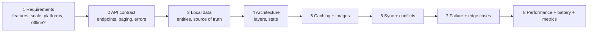
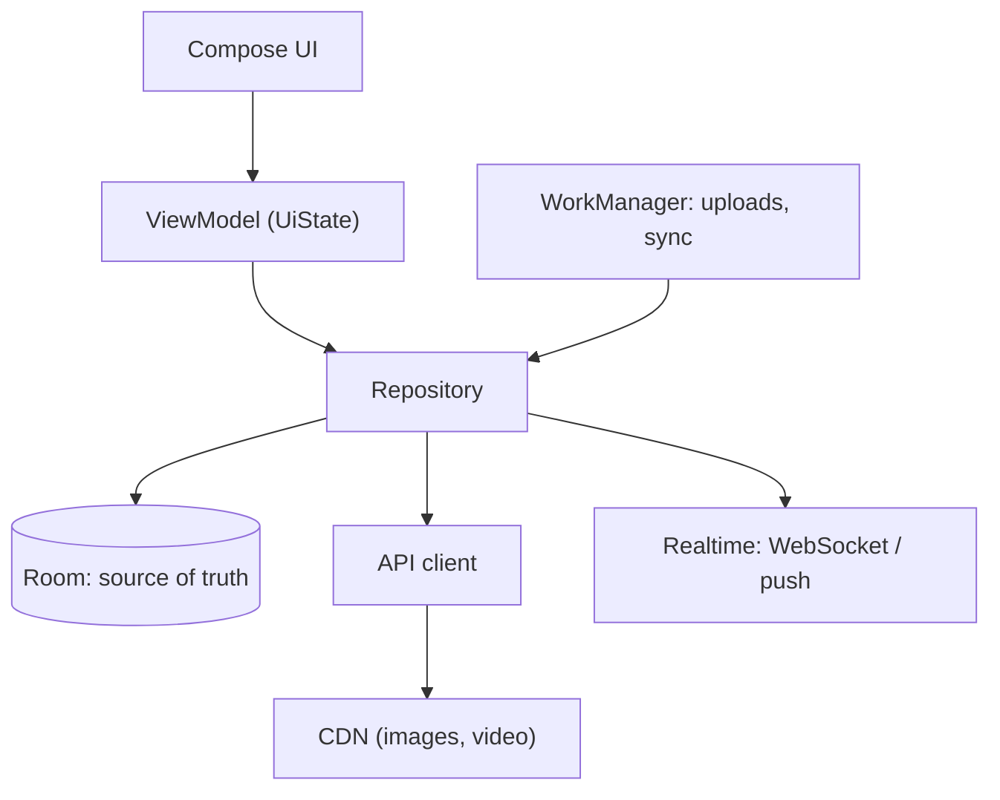
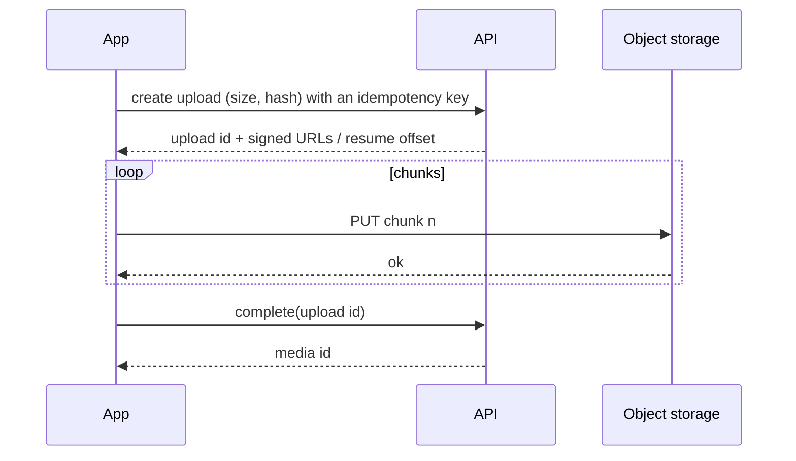

# Mobile System Design

> A mobile design interview checks the client as much as the server: data flow, offline behaviour, pagination, images, real-time updates, uploads, sync, and failure on a bad network. Use the same steps every time.

Roadmap topic 18 · Stage 7: Mobile in the System

**Go deeper:** `05-system-design/31-Interview-Answer-Structure` (the steps) · `05-system-design/30-Mobile-Specific-Topics` · `05-system-design/32-Practice-Projects-and-Designs` · `6` Architecture · `8` Networking · `9` Offline-First · `10` Background Work · `11` Performance.

**Marks:** 🟢 must know · 🟡 good to know

---

#### 1. What Is It?

*Design the app and its conversation with the backend.*

| 🟢 Must know | 🟡 Good to know |
|---|---|
| the steps: requirements → API → local data → architecture → caching → sync → failures → performance | analytics and logging pipeline |
| client concerns: flaky network, offline, old versions, battery | feature flags and config delivery |
| data flow: UI → `ViewModel` → repository → DB → network | location features and battery cost |
| pagination and infinite scroll | video playback and adaptive streaming |
| image loading and caching | client-side rate limiting |
| real-time updates | |
| uploads: chunking, resume, retry | |
| sync design | |

**The steps.**



**Signals in an interview:** "design Instagram's feed / WhatsApp / Google Keep / Uber's rider app on the client", "how would the app work offline?", "how do you upload a 1 GB video?".

---

#### 2. How It Works

**Client building blocks.**



**Client concerns to mention every time** (`SD 30`):

1. **Flaky network:** timeouts, retries with backoff, cached data first.
2. **Offline:** what works offline, and how it syncs later.
3. **Old app versions:** add-only API, force-update fallback.
4. **Battery and data:** batch, push instead of polling, compress, delta sync.
5. **Process death and rotation:** state restored.
6. **Security and privacy:** tokens, minimal data.

**Pagination and infinite scroll.** Cursor pagination from the server; the client keeps a list in the database; prefetch the next page when the user is a few items from the end; show placeholders; handle the end and errors per page (Paging 3 with a `RemoteMediator`). Pull-to-refresh replaces the head of the list.

**Image loading.** CDN URLs in several sizes; Coil/Glide with memory and disk caches; request the size you display; placeholders; cancel loads that scroll off screen; progressive/blurhash previews.

**Real-time updates.**

| Method | Use | Notes |
|---|---|---|
| Polling | simple, low frequency | wastes battery and requests |
| Long polling / SSE | server → client updates | one-way, simple |
| WebSocket | chat, live data | reconnect with backoff, heartbeats, recover missed messages |
| Push (FCM) | closed app | best effort; a hint to sync |

Always **recover missed messages** after reconnecting: ask for everything after the last known id (`SD 24`).

**Uploads (photo or video).**



1. Split into chunks (for example 5 MB), upload them in order, record progress locally.
2. After a failure ask the server which chunks it has and **resume** from there.
3. Run it in **WorkManager** (or a foreground service for visible progress), on a suitable network.
4. Show progress and let the user cancel or retry; make the final step idempotent.

**Sync design.** What to sync (per user, per screen), when (open, change, connectivity, push), how (outbox push, cursor pull), conflicts (rule), deletes (tombstones), and cost (battery, data). See topic 9.

🟡 **Analytics and logging pipeline.** Batch events locally, send in the background, compress, include a session id and app version, respect consent, drop on overflow. Don't block the UI.

🟡 **Feature flags and config.** Fetch remote config at startup with a cached fallback; evaluate flags locally; keep a kill switch.

🟡 **Location features.** Pick the least precise and shortest-lived option that works; batch and throttle updates; stop when not needed (topic 19).

🟡 **Video playback.** HLS/DASH adaptive streaming via ExoPlayer/Media3; buffer limits; preload the next item; cache segments; pause when in the background.

🟡 **Client-side rate limiting.** Debounce searches, cap retries, throttle taps, stop retrying when the server says `429`.

**Designs to practise** (the one main idea of each):

| Design | Main idea (client side) |
|---|---|
| 🟢 News feed | cursor paging in Room, prefetch, image cache, optimistic like |
| 🟢 Chat app | local DB of messages, WebSocket + push, pending state, ordering, dedupe by client id, missed-message recovery |
| 🟢 Offline-first notes | outbox, delta sync, tombstones, conflict rule |
| 🟢 Photo / file upload | chunked, resumable, background, idempotent |
| 🟡 Search with autocomplete | debounce, cancel the previous request, cache recent queries, server suggestions |
| 🟡 Ride tracking | location throttling, WebSocket updates, smooth map animation, battery |
| 🟡 Video player | adaptive streaming, buffering, preloading, offline downloads |
| 🟡 Payments / checkout | idempotency key, state machine, no double charge, handle unknown outcome |
| 🟡 Image gallery | thumbnails, paging, memory budget, downsampling |

---

#### 3. Naive vs Better Design

| Naive | Better |
|---|---|
| UI calls the network and shows the result | UI observes the database; the network refreshes it |
| page numbers, "load all" | cursor pagination + prefetch |
| full-size images in a grid | CDN thumbnails + cache + downsampling |
| poll every few seconds | WebSocket / push + sync on open |
| upload the whole file in one request | chunked, resumable, in the background |
| send a chat message and wait | optimistic pending message with a client id |
| sync everything on every open | delta sync with a cursor |
| ignore the offline state | design the offline path first |
| analytics event per tap, immediately | batched |

---

#### 4. Code

Plan chunks and resume an upload (pure functions):

```kotlin
fun planChunks(total: Long, chunk: Long): List<LongRange> =
    (0 until total step chunk).map { start -> start..minOf(start + chunk, total) - 1 }

fun remaining(total: Long, chunk: Long, uploadedBytes: Long): List<LongRange> =
    planChunks(total, chunk).filter { it.first >= uploadedBytes }
```

Checks: `planChunks(10, 4)` → `[0..3, 4..7, 8..9]` (sizes 4, 4, 2). `remaining(10, 4, 8)` → `[8..9]`; `remaining(10, 4, 10)` → `[]` (nothing left, call `complete`). A file of 1 GB in 5 MB chunks (5,000,000 bytes) → `ceil(1,073,741,824 / 5,000,000) = 215` chunks.

The upload worker:

```kotlin
class UploadWorker(ctx: Context, params: WorkerParameters, private val api: UploadApi, private val store: UploadStore) : CoroutineWorker(ctx, params) {
    override suspend fun doWork(): Result {
        val id = inputData.getString("uploadId") ?: return Result.failure()
        val upload = store.get(id) ?: return Result.failure()
        return try {
            val serverOffset = api.offset(id)                                   // resume from what the server has
            for (range in remaining(upload.size, CHUNK, serverOffset)) {
                ensureActive()
                api.putChunk(id, range.first, upload.read(range))
                store.saveProgress(id, range.last + 1)
                setProgress(workDataOf("percent" to ((range.last + 1) * 100 / upload.size).toInt()))
            }
            api.complete(id, idempotencyKey = id)
            Result.success()
        } catch (e: IOException) { Result.retry() }
    }
    companion object { const val CHUNK = 5_000_000L }
}
```

Chat: merge pending local messages with server messages (dedupe by client id, confirmed first):

```kotlin
data class Msg(val clientId: String, val serverId: Long?, val text: String)

fun mergeMessages(local: List<Msg>, incoming: List<Msg>): List<Msg> {
    val byClient = LinkedHashMap<String, Msg>()
    for (m in local) byClient[m.clientId] = m
    for (m in incoming) byClient[m.clientId] = m                 // the server copy replaces the pending copy
    return byClient.values.sortedWith(compareBy<Msg> { it.serverId == null }.thenBy { it.serverId ?: Long.MAX_VALUE })
}
```

Checks: `local = [a(null), b(null)]`, `incoming = [a(5), c(4)]` → `[c(4), a(5), b(null)]`: `a` is confirmed (no duplicate), `c` arrives from another device, and `b` is still pending at the end. Calling `mergeMessages` again with the same input gives the same result (safe to repeat after a reconnect).

Missed-message recovery after a reconnect:

```kotlin
class ChatSync(private val api: ChatApi, private val dao: MessageDao) {
    suspend fun onReconnected(conversationId: String) {
        val lastId = dao.lastServerId(conversationId) ?: 0L
        val missed = api.messagesAfter(conversationId, lastId)           // everything after the last known id
        dao.upsertAll(missed.map { it.toEntity() })
    }
}
```

Optimistic like (feed):

```kotlin
suspend fun toggleLike(postId: Long) {
    val post = dao.find(postId) ?: return
    dao.upsert(post.copy(liked = !post.liked, likes = post.likes + if (post.liked) -1 else 1, dirty = true))   // UI updates now
    runCatching { api.setLike(postId, !post.liked, idempotencyKey = UUID.randomUUID().toString()) }
        .onFailure { dao.upsert(post) }                                   // roll back on failure
}
```

Prefetch the next page near the end of the list:

```kotlin
val listState = rememberLazyListState()
val shouldLoadMore by remember { derivedStateOf {
    val last = listState.layoutInfo.visibleItemsInfo.lastOrNull()?.index ?: 0
    last >= listState.layoutInfo.totalItemsCount - 5
} }
LaunchedEffect(shouldLoadMore) { if (shouldLoadMore) vm.loadNext() }
```

Batched analytics:

```kotlin
class EventBuffer(private val send: suspend (List<Event>) -> Unit, private val maxSize: Int = 50) {
    private val buffer = ArrayDeque<Event>()
    private val mutex = Mutex()
    suspend fun track(e: Event) = mutex.withLock {
        buffer.addLast(e)
        if (buffer.size >= maxSize) flushLocked()
    }
    suspend fun flush() = mutex.withLock { flushLocked() }
    private suspend fun flushLocked() { if (buffer.isEmpty()) return; val batch = buffer.toList(); buffer.clear(); send(batch) }
}
```

---

#### 5. Performance & Limits

| Item | Remember |
|---|---|
| Page size | 20 to 50 items; prefetch when 5 items from the end |
| Chunk size | 1 to 10 MB per chunk (5 MB is common) |
| Message payload (push) | about 4 KB: send an id, then fetch |
| Image sizes | thumbnail ≈ 20 KB vs original ≈ 3 MB: load thumbnails in lists |
| Memory cache | about 10 to 15% of the app's memory class for images |
| Reconnect | exponential backoff with jitter; resync after reconnect |
| Analytics batch | 20 to 100 events or every 30 to 60 seconds |
| Location | coarse and infrequent by default; 1 update per few seconds only while tracking |
| Video | segments of 2 to 6 seconds; keep a buffer of 10 to 30 seconds |

---

#### 6. Common Mistakes & Edge Cases

1. Starting with boxes before asking about requirements and the offline need.
2. Designing only the server side.
3. Network-first UI with no offline state.
4. Offset pagination for a live feed.
5. Polling instead of push/WebSocket.
6. Uploading large files without chunking or resume.
7. No idempotency on retried writes (double posts, double charges).
8. Ignoring battery and data cost.
9. Missing the empty / loading / error / partial states.
10. Not covering old app versions and rollout.

Edge cases: the app is killed mid-upload; the same message sent from two devices; a deleted post while the user is viewing it; the user logs out with pending changes; a huge video on a metered network (ask first); a push arrives before the data is synced; a very slow network (timeouts and cancellation).

---

#### 7. Say This in the Interview

1. "First I'll clarify requirements, scale, platforms, and whether it must work offline. Then the API, local data, architecture, caching, sync, failures and performance."
2. "The UI observes a local database. A repository refreshes it from the network, so offline works by design."
3. "For the feed: cursor pagination stored in Room, prefetch near the end, thumbnails from a CDN, and optimistic actions with an idempotency key."
4. "For chat: local messages with a client id and pending state, a WebSocket with reconnect and missed-message recovery by last id, and push to wake the app."
5. "For upload: chunked and resumable, run in WorkManager, idempotent completion, progress in the UI."
6. "I always mention flaky networks, old app versions, battery, and how I'd measure success (crash-free, latency, adoption)."

---

#### 8. Quick Check

1. How does a chat client avoid showing a message twice?
2. How does an upload resume after a failure?
3. Why prefetch near the end of a list?
4. Why does push not replace sync-on-open?

<details>
<summary>Answers</summary>

1. Each message has a client-generated id; the server copy replaces the pending copy with the same id.
2. Ask the server for its current offset (or chunk list) and send only the remaining chunks.
3. So the next page is ready before the user scrolls to the end.
4. Push is best effort and can be dropped or delayed.

</details>

---

#### 9. Practice

**Interview questions**

1. Design a news feed for mobile.
2. Design a chat app.
3. Design an offline-first notes app.
4. Design photo or video upload.
5. Design search with autocomplete.
6. Design ride tracking with live location.
7. Design a payment / checkout flow.

**Hands-on**

1. Practise one design per week with the 45-minute split from `SD 31`, out loud.
2. Build the chunk planner and an upload worker against a local fake server.
3. Draw the client architecture and state for one design on one page.

**Coding warm-ups (LeetCode)**

| # | Question | Link to this topic |
|---|---|---|
| 355 | [Design Twitter](https://leetcode.com/problems/design-twitter/) (Medium) | feed merging |
| 56 | [Merge Intervals](https://leetcode.com/problems/merge-intervals/) (Medium) | merging uploaded ranges |
| 163 | [Missing Ranges](https://leetcode.com/problems/missing-ranges/) (Easy, premium) | which chunks are missing |
| 228 | [Summary Ranges](https://leetcode.com/problems/summary-ranges/) (Easy) | compacting uploaded chunks |
| 642 | [Design Search Autocomplete System](https://leetcode.com/problems/design-search-autocomplete-system/) (Hard, premium) | autocomplete |
| 146 | [LRU Cache](https://leetcode.com/problems/lru-cache/) (Medium) | image / response cache |

**Remember:** clarify → API → local data → architecture → caching → sync → failures → performance · the database drives the UI · cursor paging + prefetch · thumbnails + caches · push is a hint, sync on open · chunked resumable uploads in WorkManager · idempotency for retried writes.
