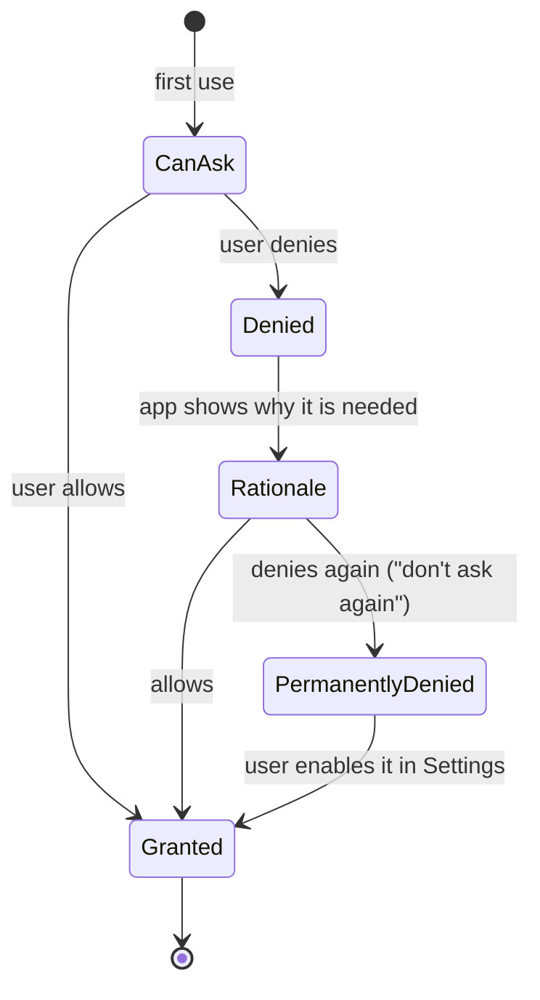

# Device Capabilities & Permissions

> Phones have cameras, GPS, sensors and private data. The OS makes the user the gatekeeper. Ask only when needed, explain why, use the least powerful option, and make the app work when the answer is no.

Roadmap topic 19 · Stage 7: Mobile in the System

**Go deeper:** `1` Platform Basics (permissions) · `4` Lifecycle (Activity Result APIs) · `10` Background Work (notifications, foreground service types) · `13` Security (minimal data) · `11` Performance (battery) · `16` iOS (usage descriptions).

**Marks:** 🟢 must know · 🟡 good to know

---

#### 1. What Is It?

*Using hardware and personal data, with the user's consent.*

| 🟢 Must know | 🟡 Good to know |
|---|---|
| runtime permission flow: context, rationale, denial, "don't ask again" | biometrics and device credentials |
| location: precision, foreground vs background, battery | files and scoped storage |
| camera and media: capture, picker APIs, large images | contacts, calendar, sensitive data |
| connectivity and network changes | Bluetooth, NFC, sensors |
| | privacy dashboard, auto-reset, one-time permissions |
| | store data-safety declarations |

1. **Normal permissions** (internet) are granted at install. **Runtime ("dangerous") permissions** (camera, location, contacts, notifications) need the user's approval while the app is running.
2. Prefer APIs that **need no permission**: the system Photo Picker, `ACTION_IMAGE_CAPTURE`/`TakePicture`, the contact picker, the Storage Access Framework.
3. The user can say yes, no, "only this time", "approximate only", or change it later in Settings.

**Signals in an interview:** "how do you request the camera permission?", "what if the user denies it?", "location in the background?", "how do you pick a photo?", "what is scoped storage?".

---

#### 2. How It Works

**The permission flow.**



Rules:

1. Ask **in context**, right after the user taps the action that needs it ("Take photo"), never in a batch at launch.
2. Before the second request, explain why (**rationale**) in your own UI.
3. After a permanent denial the system dialog no longer appears: show how to open Settings, and offer an alternative.
4. Always **check** the permission before use and handle `SecurityException`; it can be revoked at any time (Settings, auto-reset).
5. **Degrade gracefully**: the feature is off, the rest of the app works.

**Location.**

| Choice | Meaning |
|---|---|
| Coarse vs fine | approximate (a few km) vs precise; users can grant only approximate. Request both and handle either |
| Foreground vs background | background location is a separate, stricter permission and needs a clear user benefit and store review |
| Priority | `BALANCED_POWER_ACCURACY` for most apps; `HIGH_ACCURACY` only while the user is actively navigating |
| Frequency | the longer the interval and the bigger the minimum distance, the less battery used |

Use the **Fused Location Provider**, request updates only while needed, stop them in `onStop`, and for geofences or "arrived" events use the geofencing API instead of polling.

**Camera and media.**

1. **Capture:** `TakePicture` / `CaptureVideo` contracts need no camera permission when the system camera app does the work. Use **CameraX** for an in-app camera (needs `CAMERA`).
2. **Pick:** the **Photo Picker** (`PickVisualMedia`) lets the user choose photos with no permission. On Android 13+ the broad file permission is replaced by `READ_MEDIA_IMAGES`/`VIDEO`; Android 14 adds "selected photos only".
3. **Large images:** downsample and compress before upload (topic 11); never keep full bitmaps in memory.

**Connectivity.** `ConnectivityManager` tells you about network changes and capabilities (Wi-Fi, cellular, metered, validated). It is a hint; the proof is a successful request. Pause big transfers on metered networks (ask the user), and retry when the network returns (topic 8).

🟡 **Biometrics and device credentials.** `BiometricPrompt` (Class 3 / strong) with a device-credential fallback to protect sensitive actions or unlock a Keystore key (topic 13).

🟡 **Files and scoped storage.** Apps have private storage without permission (`filesDir`, `cacheDir`). Shared media goes through **MediaStore**; arbitrary documents through the **Storage Access Framework** (`OpenDocument`, `CreateDocument`) with user-selected URIs. Broad "all files" access is restricted.

🟡 **Contacts, calendar and other sensitive data.** Ask for the minimum (the contact picker returns one contact without a permission). Don't upload data without clear consent.

🟡 **Bluetooth, NFC and sensors.** Bluetooth: `BLUETOOTH_SCAN`/`CONNECT` on Android 12+ (declare `neverForLocation` if you do not derive location); NFC for tags and payments; `SensorManager` for motion sensors (choose the lowest sampling rate that works; unregister when not needed).

🟡 **Privacy dashboard, auto-reset, one-time permissions.** Android shows which apps used the camera, microphone and location. Permissions of unused apps are reset automatically. The user can grant "only this time", so never assume a past "yes" still holds.

🟡 **Store declarations.** Google Play's **Data safety** form and Apple's privacy labels/manifests must match what the app really collects and shares, including SDKs.

---

#### 3. Naive vs Better Design

| Naive | Better |
|---|---|
| request all permissions on first launch | ask in context, one at a time |
| crash or block if denied | explain, offer an alternative, keep other features |
| ask again forever after "don't ask again" | send the user to Settings with a button |
| broad storage permission to pick a photo | Photo Picker (no permission) |
| fine location always, background "just in case" | coarse when enough, foreground only |
| `HIGH_ACCURACY` updates every second | balanced accuracy, longer interval, stop when done |
| assume the permission is still granted | check before every use, handle `SecurityException` |
| upload full-resolution photos | downsample and compress first |
| trust `onAvailable` as "online" | try the request, handle failure |

```kotlin
// Naive: asks at launch, no rationale, crashes when denied
override fun onCreate(b: Bundle?) { super.onCreate(b); requestPermissions(arrayOf(CAMERA, ACCESS_FINE_LOCATION, READ_CONTACTS), 1) }
fun takePhoto() { camera.start() }          // SecurityException if the permission is missing
```

---

#### 4. Code

The permission state as a pure function (easy to test, drives the UI):

```kotlin
enum class PermissionUi { Granted, CanAsk, ShowRationale, PermanentlyDenied }

fun permissionUi(granted: Boolean, shouldShowRationale: Boolean, askedBefore: Boolean): PermissionUi = when {
    granted -> PermissionUi.Granted
    shouldShowRationale -> PermissionUi.ShowRationale          // denied once: explain, then ask again
    askedBefore -> PermissionUi.PermanentlyDenied              // denied and no rationale: the system will not show the dialog
    else -> PermissionUi.CanAsk                                // never asked
}
```

Checks: `permissionUi(true, false, true)` → `Granted`; `(false, false, false)` → `CanAsk`; `(false, true, true)` → `ShowRationale`; `(false, false, true)` → `PermanentlyDenied`.

Request a permission in a Compose screen:

```kotlin
@Composable
fun CameraButton(onPhoto: () -> Unit) {
    val context = LocalContext.current
    val activity = context.findActivity()
    var asked by rememberSaveable { mutableStateOf(false) }
    var showRationale by remember { mutableStateOf(false) }

    val launcher = rememberLauncherForActivityResult(ActivityResultContracts.RequestPermission()) { granted ->
        asked = true
        if (granted) onPhoto()
    }

    Button(onClick = {
        val granted = ContextCompat.checkSelfPermission(context, Manifest.permission.CAMERA) == PackageManager.PERMISSION_GRANTED
        val ui = permissionUi(granted, ActivityCompat.shouldShowRequestPermissionRationale(activity, Manifest.permission.CAMERA), asked)
        when (ui) {
            PermissionUi.Granted -> onPhoto()
            PermissionUi.CanAsk -> launcher.launch(Manifest.permission.CAMERA)
            PermissionUi.ShowRationale -> showRationale = true
            PermissionUi.PermanentlyDenied -> context.startActivity(
                Intent(Settings.ACTION_APPLICATION_DETAILS_SETTINGS, Uri.fromParts("package", context.packageName, null)))
        }
    }) { Text("Take photo") }

    if (showRationale) AlertDialog(
        onDismissRequest = { showRationale = false },
        title = { Text("Camera needed") }, text = { Text("We use the camera only to attach photos to your notes.") },
        confirmButton = { TextButton(onClick = { showRationale = false; launcher.launch(Manifest.permission.CAMERA) }) { Text("Continue") } }
    )
}
```

Photo Picker (no permission):

```kotlin
val pickPhoto = rememberLauncherForActivityResult(ActivityResultContracts.PickVisualMedia()) { uri -> uri?.let(onPicked) }
Button(onClick = { pickPhoto.launch(PickVisualMediaRequest(ActivityResultContracts.PickVisualMedia.ImageOnly)) }) { Text("Choose photo") }
```

Location as a `Flow`, balanced and short-lived:

```kotlin
@SuppressLint("MissingPermission")             // caller checked the permission
fun FusedLocationProviderClient.locations(intervalMs: Long = 10_000): Flow<Location> = callbackFlow {
    val request = LocationRequest.Builder(Priority.PRIORITY_BALANCED_POWER_ACCURACY, intervalMs)
        .setMinUpdateDistanceMeters(25f).build()
    val callback = object : LocationCallback() {
        override fun onLocationResult(result: LocationResult) { result.lastLocation?.let { trySend(it) } }
    }
    requestLocationUpdates(request, callback, Looper.getMainLooper())
    awaitClose { removeLocationUpdates(callback) }          // stop when the collector stops
}
```

Throttle noisy updates with a distance check (the haversine formula):

```kotlin
fun haversineMeters(lat1: Double, lon1: Double, lat2: Double, lon2: Double): Double {
    val r = 6_371_000.0
    val dLat = Math.toRadians(lat2 - lat1); val dLon = Math.toRadians(lon2 - lon1)
    val a = Math.sin(dLat / 2).let { it * it } +
            Math.cos(Math.toRadians(lat1)) * Math.cos(Math.toRadians(lat2)) * Math.sin(dLon / 2).let { it * it }
    return 2 * r * Math.asin(Math.sqrt(a))
}

fun shouldSend(prev: Pair<Double, Double>?, now: Pair<Double, Double>, minMeters: Double = 50.0) =
    prev == null || haversineMeters(prev.first, prev.second, now.first, now.second) >= minMeters
```

Checks: `haversineMeters(0.0, 0.0, 0.0, 0.001)` ≈ `111.2` m; San Francisco `(37.7749, -122.4194)` to Los Angeles `(34.0522, -118.2437)` ≈ `559` km. `shouldSend(null, p)` → `true`; two points `111` m apart with `minMeters = 50` → `true`; `20` m apart → `false` (fewer uploads, less battery).

Connectivity with the metered check:

```kotlin
fun ConnectivityManager.canDownloadLargeFile(): Boolean {
    val caps = getNetworkCapabilities(activeNetwork) ?: return false
    return caps.hasCapability(NetworkCapabilities.NET_CAPABILITY_VALIDATED) &&
           caps.hasCapability(NetworkCapabilities.NET_CAPABILITY_NOT_METERED)       // Wi-Fi or unmetered
}
```

Manifest declarations (only what you use):

```xml
<uses-permission android:name="android.permission.ACCESS_COARSE_LOCATION" />
<uses-permission android:name="android.permission.ACCESS_FINE_LOCATION" />
<uses-permission android:name="android.permission.CAMERA" />
<uses-feature android:name="android.hardware.camera" android:required="false" />   <!-- the app still installs without a camera -->
```

---

#### 5. Performance & Limits

| Item | Remember |
|---|---|
| Permission dialog | after two denials ("don't ask again") the system stops showing it |
| Location interval | 10 s to a few minutes for most apps; every second only while navigating |
| `HIGH_ACCURACY` | uses GPS: highest battery cost |
| Background location | separate permission, extra store review; avoid unless the core feature needs it |
| Photo size | a 12 MP photo is about 48 MB decoded; downsample before upload |
| Sensor rate | use the slowest rate that works; unregister in `onPause` |
| Android 13+ notifications | runtime permission; Android 14 "selected photos" access |
| Auto-reset | permissions of apps unused for months are reset |

---

#### 6. Common Mistakes & Edge Cases

1. Asking for permissions at launch, or all at once.
2. No handling of the denied state; crashing with `SecurityException`.
3. Requesting more than needed (fine and background location, broad storage).
4. Not explaining why before asking.
5. Continuous high-accuracy location updates.
6. Ignoring "approximate only" and "only this time".
7. Declaring a permission the app does not use (store review problem).
8. Using a hardware feature without `<uses-feature required="false">` (the app disappears for devices without it).
9. Uploading unscaled photos.

Edge cases: permission revoked while the app is running (the process may restart); a device without a camera or GPS; user grants approximate location only; the permission dialog is blocked by the system after repeated denials; work profiles and managed devices; photo picker returns a URI that is valid only for a short time (copy what you need).

---

#### 7. Say This in the Interview

1. "I ask for a permission in context, right after the user taps the feature that needs it, explain why before a second request, and design the denied path first."
2. "After a permanent denial I don't re-ask. I show a button that opens Settings and offer an alternative."
3. "I prefer APIs that need no permission: the Photo Picker, the system camera through `TakePicture`, and the contact picker."
4. "For location I ask for the least precise level that works, use foreground location with balanced accuracy and a longer interval, and stop updates when the screen is gone."
5. "I treat connectivity callbacks as hints, check for metered networks before large transfers, and downsample photos before upload."

---

#### 8. Quick Check

1. When is the system permission dialog no longer shown?
2. Which API picks a photo without a permission?
3. Why request both coarse and fine location?
4. What do you do in the app after a permanent denial?

<details>
<summary>Answers</summary>

1. After the user has denied it with "don't ask again" (or denied twice on recent Android versions).
2. The Photo Picker (`PickVisualMedia`).
3. The user may grant only approximate location; the app must work with either.
4. Explain the benefit, offer a button to open the app's Settings page, and keep the rest of the app working.

</details>

---

#### 9. Practice

**Interview questions**

1. Walk me through the runtime permission flow.
2. How do you handle a permanently denied permission?
3. Foreground vs background location?
4. How do you let the user attach a photo?
5. What is scoped storage?
6. How do you detect and react to connectivity changes?
7. How do you reduce the battery cost of location?

**Hands-on**

1. Build the camera button above and test: allow, deny once, deny twice, revoke in Settings.
2. Replace a storage-permission photo selection with the Photo Picker.
3. Track location with balanced accuracy and a distance filter; stop it in `onStop`.

**Coding warm-ups (LeetCode, geometry and distance)**

| # | Question | Link to this topic |
|---|---|---|
| 973 | [K Closest Points to Origin](https://leetcode.com/problems/k-closest-points-to-origin/) (Medium) | nearest places by distance |
| 658 | [Find K Closest Elements](https://leetcode.com/problems/find-k-closest-elements/) (Medium) | nearest values with binary search |
| 149 | [Max Points on a Line](https://leetcode.com/problems/max-points-on-a-line/) (Hard) | coordinates and slopes |
| 1266 | [Minimum Time Visiting All Points](https://leetcode.com/problems/minimum-time-visiting-all-points/) (Easy) | distance between points |

**Remember:** ask in context · explain why · handle denial and "don't ask again" · least powerful API (picker, coarse, foreground) · check before use · stop sensors and location when done · declare only what you use.
