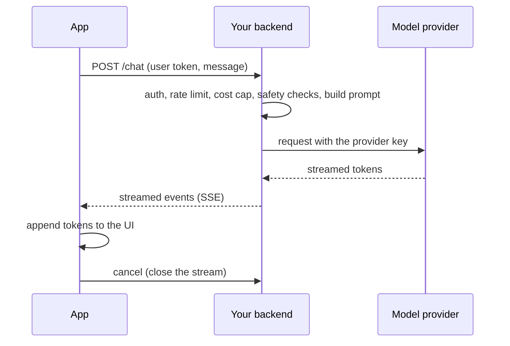
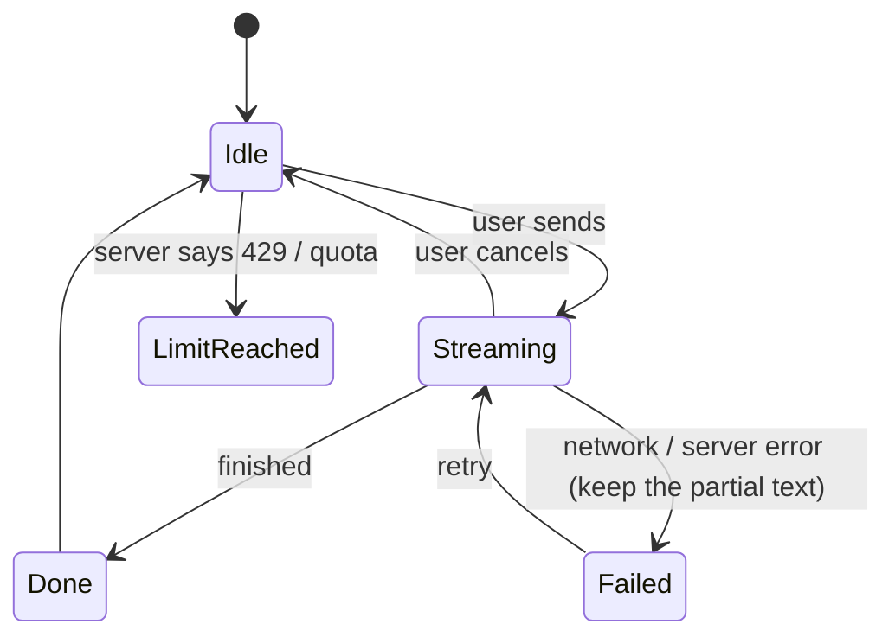
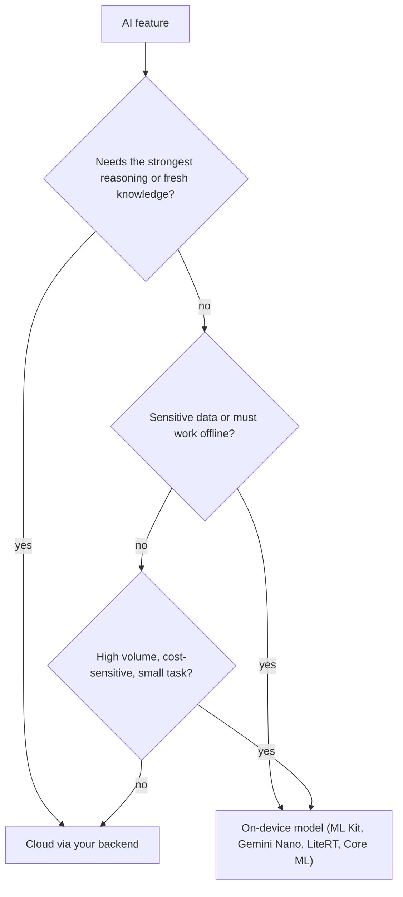

# AI in Mobile Apps

> A mobile AI feature is a normal feature with unusual failure modes: slow, streaming, rate-limited, sometimes wrong, and sometimes sensitive. Call the model through your backend, stream the answer, design every state, and choose on-device or cloud on purpose.

Roadmap topic 20 · Stage 7: Mobile in the System (New)

**Go deeper:** `08-artificial-intelligence` (LLM apps, RAG, safety, cost) · `8` Networking · `3` Coroutines (Flow) · `5` Compose · `13` Security · `19` Permissions (camera, microphone) · `05-system-design/24-Real-Time-Communication-and-Push`.

**Marks:** 🟢 must know · 🟡 good to know · (New) still changing

---

#### 1. What Is It?

*Putting a language model, or a small on-device model, behind a button.*

| 🟢 Must know | 🟡 Good to know |
|---|---|
| the app calls your backend; the backend calls the model; no provider key in the app | on-device options by name: ML Kit, Gemini Nano, LiteRT, Core ML |
| streaming into the UI, with cancel and retry | model download, updates, storage |
| states: loading, streaming, error, offline, limit reached | voice and camera input |
| on-device vs cloud | privacy and third-party models |

1. **Cloud AI:** large, capable models behind your backend. Needs network, costs money per use, sends data off the device.
2. **On-device AI:** small models running on the phone. Works offline, private, fast to start, but less capable and device-dependent.
3. **Streaming:** the answer arrives token by token, so the user sees progress.

**Signals in an interview:** "add a chat assistant to the app", "where does the API key live?", "how do you show a streaming answer?", "what if it's offline or rate limited?", "on-device or cloud?".

---

#### 2. How It Works

**Architecture.**



Why a backend: the provider key must stay secret (the app is public); the backend enforces **per-user limits and budgets**, adds the system prompt and context, filters unsafe input and output, logs for quality, and lets you change models without a new app release.

**Streaming.** Use Server-Sent Events (or a WebSocket). The app appends tokens to the current message, shows a stop button, handles a dropped connection (keep the partial text, offer retry/continue), and stops the stream when the user leaves or cancels.

**States of an AI feature.**



Also design: **offline** (disable the input, explain), **slow** first token (typing indicator, timeout), **empty** and **long** answers, **harmful/blocked** answers (a clear message), **uncertainty** (the answer can be wrong: label it, allow feedback, let the user copy or regenerate).

**On-device vs cloud.**

| | On-device | Cloud |
|---|---|---|
| Quality | smaller models, narrower tasks | strongest models |
| Latency | no network, fast start | network + generation time |
| Privacy | data stays on the phone | data sent to your server and the provider |
| Cost | free per call; model download and battery | per-token cost |
| Offline | works | does not |
| Device support | varies by hardware and OS | all devices |
| Updates | ship a new model file | change the backend |



A hybrid is common: on-device for quick, private tasks (OCR, smart replies, classification), cloud for hard questions, with a fallback when the device is unsupported.

🟡 **On-device options (by name, check current status).** **ML Kit**: ready-made APIs (text recognition, barcode scanning, translation, face detection). **Gemini Nano** via Android's AICore on supported devices (on-device generative text). **LiteRT** (formerly TensorFlow Lite): run your own model files. **Core ML** on iOS (and Apple's on-device foundation models on recent devices).

🟡 **Model download, updates, storage.** Do not bundle large models in the APK. Download on demand (Wi-Fi only if large), verify a checksum, store in app files, version the model, keep the old one until the new one is verified, allow deletion, and fall back to cloud if the download fails.

🟡 **Voice and camera input.** Speech-to-text (system `SpeechRecognizer` or a backend); camera for image questions or OCR. Both need permissions in context (topic 19); downsample images before upload; show a recording indicator.

🟡 **Privacy and third-party models.** Tell users what is sent to which provider; get consent; don't send unnecessary personal data; redact before sending; check provider retention and training policies; offer an opt-out; follow store rules on AI content and user data.

---

#### 3. Naive vs Better Design

| Naive | Better |
|---|---|
| provider API key inside the app | app → your backend → provider |
| wait for the full answer, show a spinner | stream tokens, show progress |
| no stop button; the stream keeps running when the user leaves | cancel on stop, on leaving the screen |
| a single error message | distinct states: offline, rate limit, server error, blocked |
| lose the partial answer on failure | keep it, offer retry |
| send the whole chat history every time | send a summary or the last N messages (cost, latency) |
| unlimited use | per-user limits and a cost cap on the backend |
| trust the answer | label AI content, allow feedback |
| always cloud | on-device for private/offline/simple tasks |

```kotlin
// Naive: a secret in the app, one blocking call, no cancel, no limits
const val OPENAI_KEY = "sk-live-..."
suspend fun ask(q: String): String = http.post("https://api.provider.com/v1/chat", key = OPENAI_KEY, body = q)
```

---

#### 4. Code

The UI state as a pure reducer:

```kotlin
sealed interface ChatUi {
    data object Idle : ChatUi
    data class Streaming(val text: String) : ChatUi
    data class Done(val text: String) : ChatUi
    data class Failed(val partial: String, val reason: String) : ChatUi
    data object LimitReached : ChatUi
}

sealed interface StreamEvent {
    data class Token(val value: String) : StreamEvent
    data object Finished : StreamEvent
    data class Error(val reason: String) : StreamEvent
    data object RateLimited : StreamEvent
    data object Cancelled : StreamEvent
}

fun reduce(s: ChatUi, e: StreamEvent): ChatUi = when (e) {
    is StreamEvent.Token -> ChatUi.Streaming(((s as? ChatUi.Streaming)?.text ?: "") + e.value)
    StreamEvent.Finished -> if (s is ChatUi.Streaming) ChatUi.Done(s.text) else s
    is StreamEvent.Error -> ChatUi.Failed((s as? ChatUi.Streaming)?.text ?: "", e.reason)
    StreamEvent.RateLimited -> ChatUi.LimitReached
    StreamEvent.Cancelled -> ChatUi.Idle
}
```

Checks: starting from `Idle`: `Token("Hel")` → `Streaming("Hel")`; `Token("lo")` → `Streaming("Hello")`; `Finished` → `Done("Hello")`. From `Streaming("Hel")`, `Error("timeout")` → `Failed("Hel", "timeout")` (the partial text is kept); `Cancelled` → `Idle`; `RateLimited` → `LimitReached`.

Stream SSE from your backend into a `Flow`:

```kotlin
fun OkHttpClient.chatStream(url: String, body: RequestBody, token: String): Flow<StreamEvent> = callbackFlow {
    val request = Request.Builder().url(url).header("Authorization", "Bearer $token").post(body).build()
    val source = EventSources.createFactory(this@chatStream).newEventSource(request, object : EventSourceListener() {
        override fun onEvent(eventSource: EventSource, id: String?, type: String?, data: String) {
            if (data == "[DONE]") trySend(StreamEvent.Finished) else trySend(StreamEvent.Token(parseToken(data)))
        }
        override fun onClosed(eventSource: EventSource) { channel.close() }
        override fun onFailure(eventSource: EventSource, t: Throwable?, response: Response?) {
            trySend(if (response?.code == 429) StreamEvent.RateLimited else StreamEvent.Error(t?.message ?: "error"))
            channel.close()
        }
    })
    awaitClose { source.cancel() }                  // user cancelled or left: close the stream, stop the cost
}
```

`ViewModel` that folds events into state and supports cancel:

```kotlin
class ChatViewModel(private val repo: ChatRepository) : ViewModel() {
    private val _ui = MutableStateFlow<ChatUi>(ChatUi.Idle)
    val ui: StateFlow<ChatUi> = _ui.asStateFlow()
    private var job: Job? = null

    fun send(message: String) {
        job?.cancel()
        _ui.value = ChatUi.Idle
        job = viewModelScope.launch {
            repo.stream(message).collect { e -> _ui.update { reduce(it, e) } }
        }
    }
    fun stop() { job?.cancel(); _ui.value = ChatUi.Idle }
}
```

Throttle UI updates (tokens can arrive faster than you need to redraw):

```kotlin
val smooth: Flow<ChatUi> = vm.ui.sample(50)          // at most about 20 redraws per second
```

Send only a bounded history (cost and latency):

```kotlin
fun trimHistory(messages: List<Msg>, maxChars: Int = 4_000): List<Msg> {
    var total = 0
    return messages.asReversed().takeWhile { total += it.text.length; total <= maxChars }.asReversed()
}
```

Checks: with messages of lengths `3000, 2000, 1500` and `maxChars = 4000` → the last two (`2000 + 1500 = 3500`) are kept, the first is dropped; with an empty list → empty.

On-device OCR with ML Kit:

```kotlin
val recognizer = TextRecognition.getClient(TextRecognizerOptions.DEFAULT_OPTIONS)
fun readText(bitmap: Bitmap, onResult: (String) -> Unit) {
    recognizer.process(InputImage.fromBitmap(bitmap, 0))
        .addOnSuccessListener { onResult(it.text) }
        .addOnFailureListener { onResult("") }                 // fall back or ask the user to retry
}
```

Download a model file safely:

```kotlin
suspend fun ensureModel(info: ModelInfo, dir: File, download: suspend (String, File) -> Unit): File {
    val target = File(dir, "${info.name}-${info.version}.tflite")
    if (target.exists() && sha256(target) == info.sha256) return target          // already valid
    val tmp = File(dir, target.name + ".part")
    download(info.url, tmp)
    check(sha256(tmp) == info.sha256) { "checksum mismatch" }                    // never trust the download
    tmp.renameTo(target)
    return target
}
```

---

#### 5. Performance & Limits

| Item | Remember |
|---|---|
| First token latency | often 0.5 to 3 s for cloud models; show an indicator right away |
| Streaming | UI redraws at most about 20 per second; batch tokens |
| Context window | the model reads a limited number of tokens; trim history |
| Cost | per input and output token; cap per user and per day on the backend |
| Rate limits | handle `429` with a clear message and `Retry-After` |
| On-device model size | tens of MB (small tasks) to GBs (language models); download over Wi-Fi |
| Battery | on-device inference uses the CPU/NPU; keep it short and cancel when the app leaves |
| Device support | on-device generative features need specific hardware; always have a fallback |

---

#### 6. Common Mistakes & Edge Cases

1. Shipping a provider key in the app.
2. No cancel or lifecycle handling: the stream and the bill continue after the user leaves.
3. Losing partial text on failure.
4. Treating all errors the same (offline, limit, blocked, server).
5. Sending the entire history and sensitive data every time.
6. No per-user limits on the backend.
7. Presenting AI output as fact; no feedback path.
8. Recomposing the whole screen for every token.
9. Bundling large models in the APK; unverified downloads.

Edge cases: the connection drops mid-answer; the user rotates the screen during streaming (the `ViewModel` keeps the job); two quick sends (cancel the first); the app is backgrounded (stop or pause the stream); a harmful or blocked answer; an unsupported device for on-device AI; the user denies the microphone; non-English input; very long answers.

---

#### 7. Say This in the Interview

1. "The app never holds a provider key. It calls my backend, which authenticates the user, rate limits, applies a budget, builds the prompt and calls the model."
2. "I stream the answer over SSE and append tokens to a single message. The user can stop, and leaving the screen cancels the stream."
3. "The UI has explicit states: idle, streaming, done, failed with the partial text kept, limit reached and offline."
4. "I use on-device models for private, offline or simple tasks like OCR, and the cloud for hard questions, with a fallback when the device doesn't support the model."
5. "Models are downloaded on demand, over Wi-Fi, with a checksum, and versioned. I tell users what is sent to which provider and ask for consent."

---

#### 8. Quick Check

1. Why must the provider key live on the backend?
2. What should the app do with a half-finished answer after an error?
3. Name two reasons to prefer on-device AI.
4. Why sample or batch token updates?

<details>
<summary>Answers</summary>

1. An app package is public; a key inside it can be extracted and abused. The backend also enforces limits.
2. Keep it visible and offer retry or continue.
3. Privacy (data stays on the phone) and offline use (also low latency and no per-call cost).
4. Tokens arrive faster than the screen needs redraws; batching avoids needless recomposition and keeps scrolling smooth.

</details>

---

#### 9. Practice

**Interview questions**

1. How would you add a chat assistant to a mobile app?
2. Where does the model API key live, and why?
3. How do you stream an answer and handle cancel and retry?
4. Which states does the UI need?
5. On-device vs cloud AI?
6. How do you deliver and update an on-device model?
7. What privacy concerns come with sending data to a model?

**Hands-on**

1. Build a streaming chat screen against a fake SSE server; test the reducer with the five events.
2. Add a stop button and prove the server sees the closed connection.
3. Add ML Kit text recognition to the camera flow and a cloud fallback.

**Coding warm-ups (LeetCode)**

| # | Question | Link to this topic |
|---|---|---|
| 359 | [Logger Rate Limiter](https://leetcode.com/problems/logger-rate-limiter/) (Easy, premium) | per-user limits |
| 362 | [Design Hit Counter](https://leetcode.com/problems/design-hit-counter/) (Medium, premium) | usage counting |
| 295 | [Find Median from Data Stream](https://leetcode.com/problems/find-median-from-data-stream/) (Hard) | streaming statistics (latency percentiles) |
| 146 | [LRU Cache](https://leetcode.com/problems/lru-cache/) (Medium) | cache of recent answers |

**Remember:** app → your backend → model, never a key in the app · stream and allow cancel · keep partial text · design every state (offline, limit, blocked) · on-device for private/offline tasks, cloud for hard ones · verify model downloads · tell users what is sent where.
