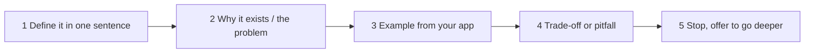

# Mobile Interview Answer Points

> Knowing the topics is half the job. The other half is saying them clearly: a short definition, a concrete example, and the trade-off. This note gives ready answers, coding warm-ups in Kotlin, and the traps to avoid.

Roadmap topic 21 · Stage 8: Interview & Practice (New)

**Go deeper:** `05-system-design/31-Interview-Answer-Structure` (the same habits for design rounds) · `03-leetcode-patterns/21-Coding-Interview-Answer-Points` (coding rounds) · `07-behavioral-leadership` (stories) · every note `1`–`20` for the detail behind each answer.

**Marks:** 🟢 must know · 🟡 good to know · (New) added beyond the original roadmaps

---

#### 1. What Is It?

*A way to answer any mobile question in about a minute.*

| 🟢 Must know | 🟡 Good to know |
|---|---|
| lifecycle, configuration change, process death, state | coding warm-ups in Kotlin |
| coroutines, cancellation, `Flow` vs `StateFlow` | decision stories |
| recomposition, state hoisting | questions to ask the team |
| architecture and why | common traps |
| ANR, leaks, jank, cold start: how you find each | |
| offline-first, sync conflicts, old versions, token refresh | |
| testing, token security, safe release | |

**The answer shape (about 60 seconds):**



**Signals in an interview:** "explain X", "what happens when …", "how do you find …", "how would you design …", "tell me about a time …".

---

#### 2. How It Works

**Ready answers (say them in your own words).**

| Question | Core of the answer |
|---|---|
| **Lifecycle, rotation, process death** | Rotation recreates the Activity; the `ViewModel` survives it. Process death ends the process, and only saved state (`SavedStateHandle`, `rememberSaveable`) and persistent storage survive. I keep UI state in the `ViewModel`, small restorable bits in saved state, real data in Room, and I test with "Don't keep activities" and `adb shell am kill`. |
| **Coroutines and cancellation** | A coroutine is a light task that can suspend without blocking a thread. Scopes own coroutines; `viewModelScope` is cancelled with the `ViewModel`. Cancellation is cooperative: suspension points check it, loops call `ensureActive()`, and I never swallow `CancellationException`. |
| **`Flow` vs `StateFlow`** | `Flow` is cold: each collector starts it. `StateFlow` is hot and always holds the latest value, so it fits UI state. One-off events use a `Channel`. In the UI I collect with the lifecycle (`collectAsStateWithLifecycle`). |
| **Recomposition and hoisting** | Compose re-runs only the composables that read changed state. I hoist state (value + callback) so composables are stateless and testable, keep work out of the body, use keys in lazy lists and read fast-changing state late. |
| **Architecture** | UI (Compose + `ViewModel` with one `UiState`), optional domain layer, data layer with repositories. State flows down and events flow up. The local database is the single source of truth; the network refreshes it. |
| **ANR** | The main thread was blocked (about 5 s for input). Find it from the ANR trace; fix by moving IO and heavy work to coroutines; prevent with StrictMode. |
| **Memory leak** | An Activity stays reachable (static, singleton, listener, long coroutine). Find with LeakCanary or the Profiler heap dump; fix by removing the reference or unregistering. |
| **Jank** | A frame misses its 16 ms budget. Find with the Profiler, Layout Inspector (recomposition counts) or Macrobenchmark; common causes are main-thread work, heavy recomposition and big images. |
| **Cold start** | Process + `Application.onCreate` + first frame. Keep `Application` light, defer SDKs, use the splash screen API, add a Baseline Profile, measure with Macrobenchmark. |
| **Offline-first and sync** | Room is the source of truth. Writes are optimistic with a client id and a `dirty` flag; a WorkManager job pushes with an idempotency key and pulls changes since a cursor; deletes are tombstones; conflicts follow a stated rule. |
| **Old app versions** | The API only adds fields; the app ignores unknown fields; feature flags control rollout; a force-update screen is the last resort. |
| **Token refresh** | An interceptor attaches the token; on `401` an authenticator refreshes once behind a lock and others reuse the new token. If refresh fails, sign out. |
| **Testing** | Pyramid: many JVM unit tests with fakes, some integration tests (MockWebServer, in-memory Room), few UI tests. `runTest` and Turbine for coroutines and flows. |
| **Token security** | Never in code or logs. Short-lived access token, rotating refresh token, encrypted with a Keystore key. TLS only. The server is the authority. |
| **Safe release** | CI builds, internal track, staged rollout with crash-free and ANR checks, feature flags with a kill switch, crash reporting, backward compatible API. |

**Decision stories** (STAR with numbers).

1. **Situation** and goal in one sentence.
2. **Task**: what you were responsible for.
3. **Action**: what you did and why, and the alternatives you rejected.
4. **Result**: a measured outcome (cold start from 3.2 s to 1.9 s, crash-free from 98.8% to 99.6%).
5. **Learning**: what you would do differently.

Prepare three: a **hard bug** (how you found the root cause), a **performance win** (measure, fix, re-measure), a **migration or refactor** (plan, risk, rollout). See `07-behavioral-leadership`.

🟡 **Questions to ask the team.** Which architecture and why? How often do you release, and how do you roll out? Which quality metrics do you watch (crash-free, ANR, startup)? How do you handle old app versions? How is the code tested? How are on-call and incidents handled?

🟡 **Common traps.**

| Trap | What to do instead |
|---|---|
| business logic in the UI | `ViewModel` / use case |
| ignoring process death | say how state is saved and restored |
| only the happy path | name loading, empty, error, offline |
| naming libraries without reasons | say the problem, then the tool |
| "it depends" with no follow-up | state your assumption and decide |
| claiming experience you don't have | say what you know and how you would find out |

---

#### 3. Naive vs Better Design

| Weak answer | Strong answer |
|---|---|
| "ViewModel survives everything." | "It survives configuration changes but not process death; I add `SavedStateHandle`." |
| "I use coroutines." | "I use `viewModelScope`, `withContext(IO)` for blocking work, and I handle cancellation." |
| "I'd use Room." | "Room is the source of truth; the UI observes a `Flow`; sync writes to it." |
| "I'd add caching." | "Stale-while-revalidate: show the cache now, refresh in the background." |
| "We test with Espresso." | "Mostly JVM unit tests with fakes, a few UI tests for critical flows." |
| silence while thinking | "Let me think about the failure case for a moment." |
| lists every library | one tool per problem with the trade-off |

---

#### 4. Code

Kotlin warm-ups that come up in interviews. All use only the standard library and coroutines.

**1. Debounce** (run the action only after the user stops for `delayMs`):

```kotlin
class Debouncer(private val scope: CoroutineScope, private val delayMs: Long) {
    private var job: Job? = null
    fun submit(action: suspend () -> Unit) {
        job?.cancel()                                  // a newer call cancels the older one
        job = scope.launch { delay(delayMs); action() }
    }
}
```

Checks (with `runTest`): call `submit` three times at 0 ms, 100 ms and 200 ms with `delayMs = 300`. The action runs **once**, at 500 ms, for the last call; the first two were cancelled.

**2. Retry with exponential backoff:**

```kotlin
suspend fun <T> retry(times: Int = 3, initialDelayMs: Long = 100, factor: Double = 2.0, block: suspend () -> T): T {
    var delayMs = initialDelayMs
    repeat(times - 1) {
        try { return block() } catch (e: CancellationException) { throw e } catch (e: IOException) { /* retry */ }
        delay(delayMs)
        delayMs = (delayMs * factor).toLong()
    }
    return block()                                     // the last attempt: let the exception out
}
```

Checks: a block that fails twice and then succeeds, with `times = 3`, returns its value after waits of 100 ms and 200 ms (virtual time `300`). A block that always fails throws the last `IOException` after 3 calls.

**3. LRU cache** (`LinkedHashMap` in access order):

```kotlin
class LruCache<K, V>(private val capacity: Int) : LinkedHashMap<K, V>(16, 0.75f, true) {
    override fun removeEldestEntry(eldest: MutableMap.MutableEntry<K, V>) = size > capacity
}
```

Checks: capacity 2: `put(a)`, `put(b)`, `get(a)`, `put(c)` → `b` is evicted; keys are `[a, c]`. (Not thread-safe: wrap with `synchronized` or use a `Mutex`.)

**4. Thread-safe counter:**

```kotlin
class SafeCounter {
    private val value = AtomicInteger(0)
    fun increment() = value.incrementAndGet()
    fun get() = value.get()
}
// or in coroutine code:  val state = MutableStateFlow(0);  state.update { it + 1 }
```

Checks: 1,000 coroutines on `Dispatchers.Default` each calling `increment()` once → `get() == 1000`. A plain `var count++` can end below 1000.

**5. Flatten and de-duplicate while keeping order:**

```kotlin
fun <T> mergeDistinct(vararg lists: List<T>): List<T> = lists.asSequence().flatMap { it.asSequence() }.distinct().toList()
```

Checks: `mergeDistinct(listOf(1, 2), listOf(2, 3), listOf(3, 1))` → `[1, 2, 3]`.

**6. Simple state machine for a request:**

```kotlin
enum class State { Idle, Loading, Success, Error }
fun next(s: State, event: String): State = when (s to event) {
    State.Idle to "load" -> State.Loading
    State.Loading to "ok" -> State.Success
    State.Loading to "fail" -> State.Error
    State.Error to "retry" -> State.Loading
    else -> s                                      // ignore events that do not apply
}
```

Checks: `Idle → load → Loading → fail → Error → retry → Loading → ok → Success`; `Success` ignores `load` (stays `Success`).

---

#### 5. Numbers & Capacity

Numbers worth quoting (and checking against current docs):

| Item | Number |
|---|---|
| Frame budget | 16.6 ms at 60 Hz, 8.3 ms at 120 Hz |
| ANR | input about 5 s; broadcast receiver about 10 s |
| Cold start (Play Vitals "slow") | 5 s or more |
| `PeriodicWorkRequest` minimum | 15 minutes |
| FCM data payload | about 4 KB |
| Touch target | 48 dp; contrast 4.5 : 1 |
| Bitmap memory | width × height × 4 bytes; 12 MP ≈ 48 MB |
| Token lifetime | access: minutes; refresh: days to weeks |
| Page size | 20 to 50 items |
| Retry | 3 to 5 tries, exponential backoff with jitter |
| Staged rollout | 1% → 5% → 20% → 50% → 100% |

---

#### 6. Common Mistakes & Edge Cases

1. Reciting definitions with no example.
2. No trade-offs ("X is best").
3. Ignoring failure cases: process death, offline, denied permission.
4. Naming tools without saying which problem they solve.
5. Long monologues; not checking in with the interviewer.
6. Coding before clarifying; no tests or edge cases.
7. Claiming perfect knowledge; refusing to say "I'm not sure, but I would check X".

Edge cases: a follow-up that changes a requirement (say what changes); a question about iOS or KMP when you are an Android engineer (map the concept, be honest); a vague question ("make it faster": ask what is slow and how it is measured); a question you don't know (reason from first principles, state assumptions).

---

#### 7. Say This in the Interview

1. "In one sentence: … The reason it exists is … In my app I used it for … The trade-off is …"
2. "Let me think about the failure case: process death / offline / denied permission."
3. "I'd measure first: Profiler, Macrobenchmark, Play Vitals, then fix the biggest cause."
4. "Here's my assumption … If that's wrong, I'd change … "
5. "I haven't used that in production, but the concept maps to … and I'd check … "
6. "Would you like me to go deeper on this, or move on to … ?"

---

#### 8. Quick Check

1. Answer in 30 seconds: what survives process death?
2. Give the one-line difference between `StateFlow` and `SharedFlow`.
3. How do you find a memory leak?
4. What is a good ending for an answer?

<details>
<summary>Answers</summary>

1. `SavedStateHandle` / `rememberSaveable` (small), and anything persisted (Room, `DataStore`, files). The `ViewModel` and in-memory objects do not survive.
2. `StateFlow` holds and replays the latest value (state); `SharedFlow` broadcasts events and has no current value unless you set `replay`.
3. LeakCanary in debug, or a heap dump in the Profiler; follow the reference chain from a GC root to the leaked Activity.
4. The trade-off or pitfall, then an offer to go deeper.

</details>

---

#### 9. Practice

**Interview questions**

1. Explain the Activity lifecycle, rotation and process death.
2. Explain coroutines, cancellation and `Flow` vs `StateFlow`.
3. Explain recomposition and how you avoid needless recomposition.
4. Describe your architecture and why you chose it.
5. How do you find and fix an ANR, a leak, jank and a slow cold start?
6. Explain offline-first, conflicts, old app versions and token refresh.
7. How do you test, secure tokens and release safely?
8. Tell me about a hard bug, a performance win and a migration.

**Hands-on**

1. Record yourself answering five of the questions above in 60 seconds each. Listen for missing trade-offs.
2. Write the six warm-ups from memory with tests.
3. Write your three decision stories with numbers.

**Coding warm-ups (LeetCode)**

| # | Question | Link to this topic |
|---|---|---|
| 146 | [LRU Cache](https://leetcode.com/problems/lru-cache/) (Medium) | the cache warm-up |
| 1114 | [Print in Order](https://leetcode.com/problems/print-in-order/) (Easy) | ordering concurrent work |
| 1188 | [Design Bounded Blocking Queue](https://leetcode.com/problems/design-bounded-blocking-queue/) (Medium, premium) | thread-safe design |
| 359 | [Logger Rate Limiter](https://leetcode.com/problems/logger-rate-limiter/) (Easy, premium) | throttling / debounce idea |
| 347 | [Top K Frequent Elements](https://leetcode.com/problems/top-k-frequent-elements/) (Medium) | collection operators |

**Remember:** define → why → example → trade-off → stop · always cover failure cases (process death, offline, denied) · measure before fixing · one tool per problem, with the reason · prepare three stories with numbers · be honest about what you haven't done.
