# Practice: Projects & Exercises

> Reading is not enough. Build one app in stages, each stage adding the topic you just learned, then run exercises that train the skills interviewers test: explaining, debugging, and profiling.

Roadmap topic 22 · Stage 8: Interview & Practice

**Go deeper:** `04-backend-engineering/12-Checkpoint-Project-Notes-API` (the backend for the app) · `05-system-design/32-Practice-Projects-and-Designs` · `21` Mobile Interview Answer Points · every topic `1`–`20`.

**Marks:** 🟢 must know · 🟡 good to know

---

#### 1. What Is It?

*One growing app, a handful of passes, and a few exercises.*

| 🟢 Must know | 🟡 Good to know |
|---|---|
| Notes app: Compose, MVVM, Room, Retrofit, Hilt | chat screen with WebSocket |
| make it offline-first with sync | photo upload in the background |
| add tests | split into feature modules |
| feed with paging and image loading | performance, security and release passes |
| exercises: lifecycle, leak, slow list | a small AI feature |
| | rebuild one screen in SwiftUI or share with KMP |
| | callbackFlow, Room migration, architecture drawing |

1. Build the app **in stages** and keep every stage working.
2. After each stage, write a short note: what you built, one trade-off, one bug.
3. Treat each "pass" as an audit of your own app (performance, security, release).

**Signals in an interview:** "tell me about an app you built", "what was the hardest part?", "how did you make it offline?", "how did you measure performance?".

---

#### 2. How It Works

**The build path.**

```mermaid
flowchart LR
    P1["1 Notes app<br/>Compose, MVVM, Room, Retrofit, Hilt"] --> P2["2 Offline-first<br/>outbox, WorkManager, conflicts"] --> P3["3 Tests<br/>ViewModel, repository, UI"] --> P4["4 Feed<br/>paging, images"]
    P4 --> P5["5 Chat<br/>WebSocket, recovery"] --> P6["6 Photo upload<br/>background, retry"] --> P7["7 Modules<br/>build time"]
    P7 --> P8["8 Performance pass"] --> P9["9 Security pass"] --> P10["10 Release pass"] --> P11["11 AI feature"] --> P12["12 SwiftUI / KMP"]
```



**Build (in order).**

| # | Project | Done when | Topics |
|---|---|---|---|
| 1 | 🟢 **Notes app**: Compose, MVVM, Room, Retrofit, Hilt, against the Notes API (`BE 12`) | list, create, edit, delete; loading / empty / error states; survives rotation and process death | 4–8 |
| 2 | 🟢 **Offline-first**: local DB as the source of truth, WorkManager sync, a conflict rule | works in airplane mode; edits sync later without duplicates; two-device edit follows the rule | 9, 10 |
| 3 | 🟢 **Tests**: `ViewModel`, repository, one UI test | fakes, `runTest`, MockWebServer, in-memory Room; CI runs them | 12 |
| 4 | 🟢 **Feed** with paging and image loading | cursor paging, prefetch, thumbnails, smooth scroll on a mid-range phone | 8, 11, 18 |
| 5 | 🟡 **Chat screen**: WebSocket, reconnect, missed-message recovery | no duplicates; pending messages; works after reconnect | 8, 18 |
| 6 | 🟡 **Photo upload**: background work, retry, progress | chunked, resumable, survives app kill | 10, 18, 19 |
| 7 | 🟡 **Feature modules** and a build-time measurement | features independent; incremental build time compared before/after | 7 |
| 8 | 🟡 **Performance pass**: startup, jank, Baseline Profile, one leak | numbers before/after in release mode | 11 |
| 9 | 🟡 **Security pass**: storage, permissions, network config, checklist | tokens in the Keystore, cleartext blocked, deep links validated | 13, 19 |
| 10 | 🟡 **Release pass**: flavors, signing, internal track, staged rollout, crash reporting | a build on an internal track, a flag with a kill switch | 15 |
| 11 | 🟡 **AI feature**: streaming chat through your backend | stop/retry/limit states; no key in the app | 20, `AI 22` |
| 12 | 🟡 **SwiftUI screen** or a shared **KMP** module | one screen or one module running on both platforms | 16, 17 |

**Exercises.**

| # | Exercise | Skill |
|---|---|---|
| 🟢 | Explain the lifecycle order for start, rotate, background and kill, out loud | lifecycle |
| 🟢 | Debug a memory leak with the Profiler or LeakCanary | leaks |
| 🟢 | Find and fix a slow list in Compose or `RecyclerView` | jank |
| 🟡 | Turn callback code into a `Flow` with `callbackFlow` | coroutines |
| 🟡 | Write a Room migration and test it | storage |
| 🟡 | Draw the architecture of your app: layers, dependencies, problems (`ARCH 14`) | architecture |

**A weekly rhythm.**

| Week | Do |
|---|---|
| 1 | Project 1 (UI, state, navigation) + lifecycle exercise |
| 2 | Project 1 data layer (Room, Retrofit, Hilt) |
| 3 | Project 2 (offline-first) |
| 4 | Project 3 (tests) + migration exercise |
| 5 | Project 4 (feed) + slow-list exercise |
| 6 | Performance pass (project 8) + leak exercise |
| 7 | Security pass (project 9) + release pass (project 10) |
| 8 | Chat or upload (project 5 or 6) + mock interviews with `21` |
| 9+ | Modules, AI feature, SwiftUI / KMP, mobile system designs from `18` |

**How to review each stage.**

1. Does it work offline, rotated, and after process death?
2. Are all states handled (loading, empty, error, partial)?
3. Is there a test for the riskiest logic?
4. Can you explain one trade-off you made?

---

#### 3. Naive vs Better Design

| Naive | Better |
|---|---|
| follow a tutorial and stop | add features the tutorial didn't (offline, tests, release) |
| one giant project at once | stages, each shippable |
| "it works on my phone" | test on a low-end device, in release mode, offline |
| no tests until the end | write tests with each stage |
| no measurements | record numbers before and after each optimisation |
| copy code you can't explain | write the note: why this design |
| only build | build, then explain out loud and review |

---

#### 4. Code

A starter package layout for the notes app (so stages 1 to 4 fit together):

```text
app/src/main/java/com/example/notes/
  data/
    local/      NoteEntity, NoteDao, AppDatabase
    remote/     NotesApi, NoteDto, AuthInterceptor
    NotesRepository.kt       (offline-first)
    SyncWorker.kt
  domain/       Note, AppError, (use cases only when they help)
  ui/
    notes/      NotesScreen, NotesViewModel, NotesUiState
    editor/     EditorScreen, EditorViewModel
    theme/
  di/           NetworkModule, DatabaseModule, RepositoryModule
  NotesApp.kt   MainActivity.kt
```

The acceptance tests for project 2 as a checklist you can turn into automated tests:

| Scenario | Expected |
|---|---|
| Create a note in airplane mode | appears at once; marked pending |
| Turn the network on | the note syncs once; no duplicate on the server |
| Kill the app during sync, reopen | the sync resumes; still no duplicate (idempotency key) |
| Edit the same note on two devices | the conflict rule is applied; nothing is silently lost if the rule says merge |
| Delete on device A | device B removes it after sync (tombstone) |
| Server returns 401 | one token refresh, requests retried |
| Server returns 503 | exponential backoff, the user sees stale data plus a small error |

A simple way to record the performance pass:

```bash
# cold start time (release build, device connected)
adb shell am force-stop com.example.notes
adb shell am start -W -n com.example.notes/.MainActivity     # look at TotalTime in ms

# frame stats after scrolling the list
adb shell dumpsys gfxinfo com.example.notes reset
# ... scroll the list for 10 seconds ...
adb shell dumpsys gfxinfo com.example.notes | grep -E "Janky frames|50th|90th|95th|99th"
```

Keep a table in your repo:

| Metric | Before | After | Change made |
|---|---|---|---|
| Cold start (TotalTime) | 1,850 ms | 1,210 ms | Baseline Profile + deferred SDK init |
| Janky frames (feed) | 12% | 3% | stable keys + thumbnails |
| Leaks found | 1 | 0 | unregister listener in `onStop` |

(The numbers are examples: write your own.)

A README template for each project (interviewers read these):

```text
# Notes app
What: offline-first notes (Compose, MVVM, Room, Retrofit, Hilt)
Architecture: diagram + one paragraph
Key decisions: Room is the source of truth; WorkManager sync; last-write-wins + field merge for body
Trade-offs: no real-time sync; conflicts on body fields are merged, titles use LWW
Tests: 42 unit, 6 integration, 3 UI (run: ./gradlew testDebugUnitTest)
Performance: cold start 1.2 s on a Pixel 6a (release), jank 3%
What I'd do next: push-triggered sync, encryption at rest
```

A callback-to-Flow exercise solution (check yourself against `3`):

```kotlin
fun SensorManager.accelerometer(): Flow<FloatArray> = callbackFlow {
    val sensor = getDefaultSensor(Sensor.TYPE_ACCELEROMETER)
    val listener = object : SensorEventListener {
        override fun onSensorChanged(e: SensorEvent) { trySend(e.values.clone()) }
        override fun onAccuracyChanged(s: Sensor?, a: Int) {}
    }
    registerListener(listener, sensor, SensorManager.SENSOR_DELAY_NORMAL)
    awaitClose { unregisterListener(listener) }
}
```

---

#### 5. Numbers & Capacity

How to size the practice:

| Item | Guide |
|---|---|
| Time per project | notes app 1 to 2 weeks part-time; each later stage a weekend or two |
| Mock interview | 45 minutes + 15 minutes of review |
| Test count | a few tests per stage; critical logic first |
| Devices to try | a recent phone, a low-end phone, an old OS version, a tablet emulator |
| Commits | small, one idea each; makes a good story |
| Portfolio | 2 or 3 polished projects with README, tests and numbers beat 10 unfinished ones |

---

#### 6. Common Mistakes & Edge Cases

1. Tutorial-only learning; never shipping or measuring.
2. Skipping offline, tests and release because "they're boring" (they are what interviews ask about).
3. A project with no README, no architecture note, no numbers.
4. Optimising without recording before/after.
5. Never testing process death, rotation or a bad network.
6. Copying code you can't explain.
7. Doing everything alone, never explaining out loud.

Edge cases: a stage that is too big (split it); a library change breaks the old stage (upgrade deliberately, write the note); no real backend (use the Notes API or a mock server); no spare device (use emulators with slow network and low memory profiles).

---

#### 7. Say This in the Interview

1. "I built a notes app in stages. First Compose, MVVM, Room and Retrofit; then I made it offline-first with a WorkManager sync and a conflict rule."
2. "The hardest part was … I solved it by … and I measured …"
3. "I tested the `ViewModel` with fakes, the repository with MockWebServer and in-memory Room, and the critical flow with a Compose test."
4. "In the performance pass I cut cold start from … to … with a Baseline Profile and deferred initialisation."
5. "If I continued, I'd add push-triggered sync and encryption at rest."

---

#### 8. Quick Check

1. What makes project 2 different from project 1?
2. Why record before/after numbers?
3. Which devices should you test on?
4. Why write a README per project?

<details>
<summary>Answers</summary>

1. The local database becomes the source of truth, and sync handles pending changes, conflicts and failures.
2. To prove an optimisation worked and to tell the story with evidence.
3. A recent phone, a low-end phone, an old OS version, and a tablet or foldable emulator.
4. It forces you to explain decisions and trade-offs, which is what interviewers ask.

</details>

---

#### 9. Practice

**Interview questions**

1. Walk me through an app you built end to end.
2. What was the hardest bug, and how did you find it?
3. How did you make it work offline?
4. How did you test it?
5. How did you measure and improve performance?
6. What would you change if you rebuilt it?

**Hands-on**

1. Complete projects 1 to 4 with notes and numbers.
2. Do all six exercises, with a short written answer for each.
3. Run two mock interviews using `21` and record yourself.

**Coding warm-ups (LeetCode)**

| # | Question | Link to this topic |
|---|---|---|
| 146 | [LRU Cache](https://leetcode.com/problems/lru-cache/) (Medium) | cache for the feed |
| 355 | [Design Twitter](https://leetcode.com/problems/design-twitter/) (Medium) | feed design |
| 1472 | [Design Browser History](https://leetcode.com/problems/design-browser-history/) (Medium) | navigation stack |
| 207 | [Course Schedule](https://leetcode.com/problems/course-schedule/) (Medium) | module dependency cycles |

**Remember:** build in stages and keep each stage working · offline, tests and release are the interview topics · record before/after numbers · write a README with decisions and trade-offs · test rotation, process death and a bad network · explain out loud.
