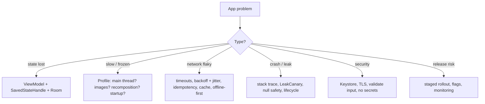

# Mobile Engineering Cheat Sheet

> One-page revision for the night before an interview. The full explanations are in notes 1–22.

---

#### 1. Key Takeaways

1. **The OS is in charge.** Sandboxed process, permissions on request, one main thread that must never block, and the process can be killed any time in the background. Old app versions live for years.
2. **Kotlin:** null safety (`?.`, `?:`, avoid `!!`), `val` first, sealed types for state, collection operators, `Sequence` for big data, scope functions know their return values.
3. **Coroutines:** `suspend` pauses, it does not block. Scope owns coroutines (`viewModelScope`, never `GlobalScope`). Cancellation is cooperative; never swallow `CancellationException`. `StateFlow` for state, `Channel` for events. Collect with the lifecycle.
4. **Lifecycle:** rotation recreates the Activity (the `ViewModel` survives); process death ends everything except saved state and storage. Pass ids, save small state, validate deep links.
5. **Compose:** UI = f(state). Hoist state. `remember` vs `rememberSaveable`. Effects not in the body. Keys in lazy lists. Read fast state late.
6. **Architecture:** UI → `ViewModel` (one `UiState`) → repository → Room (single source of truth) + network. State down, events up. Map errors once into `AppError`.
7. **DI and modules:** constructor injection, fakes in tests, scope only what is shared. `:app` → features → core; no cycles; features do not depend on features.
8. **Networking:** timeouts, one token refresh behind a lock, retry only safe requests with backoff + jitter + idempotency key, cursor pagination, `ETag`, `ignoreUnknownKeys`.
9. **Offline-first:** write local first (client id, `dirty`), WorkManager pushes the outbox, pull by cursor saved after the page, tombstones for deletes, a stated conflict rule, tested migrations.
10. **Background:** pick the lightest tool (coroutine → WorkManager → foreground service → exact alarm). Workers are idempotent. Push is best effort: sync on open. Channels; notification permission in context.
11. **Performance:** measure first (release build, mid device). Frame 16 ms; ANR = blocked main thread; leaks = Activity reachable; downsample images; Baseline Profile; StrictMode and LeakCanary.
12. **Testing:** many JVM unit tests, some integration, few UI. Fakes over mocks. `runTest`, Turbine, `MainDispatcherRule`. Inject clock and dispatchers.
13. **Security:** no secrets in the app; tokens encrypted with a Keystore key; TLS only; all outside input untrusted; server is the authority; no sensitive data in logs.
14. **Quality of experience:** content descriptions, 48 dp targets, contrast 4.5 : 1, `sp`, strings with plurals, start/end, window size classes.
15. **Shipping:** CI, Play App Signing, staged rollout with crash-free / ANR gates, feature flags with a kill switch, crash reporting. You cannot recall a release: fix forward.
16. **Beyond Android:** iOS has the same ideas with other names; KMP shares logic and keeps native UI; choose by team, product and platform needs.
17. **AI features:** app → your backend → model; stream; cancel; keep the partial text; explicit states; on-device for private/offline tasks.

---

#### 2. Numbers and Rules of Thumb

| Topic | Remember |
|---|---|
| Frame budget | 16.6 ms at 60 Hz · 11.1 ms at 90 Hz · 8.3 ms at 120 Hz |
| ANR | input about 5 s · broadcast about 10 s |
| Play Vitals (check current) | slow cold start ≥ 5 s · bad crash rate about 1.1% · bad ANR rate about 0.47% |
| Bitmap memory | width × height × 4 bytes; 12 MP ≈ 48 MB |
| `PeriodicWorkRequest` | minimum 15 minutes |
| WorkManager backoff | starts at 10 s or more, up to 5 hours |
| FCM data payload | about 4 KB: send ids, not data |
| Saved state / `Bundle` | keep well under 1 MB |
| Touch target / contrast | 48 × 48 dp · 4.5 : 1 |
| Window size classes | Compact < 600 dp · Medium 600–839 · Expanded ≥ 840 |
| Timeouts | connect 10 s · read 20–30 s · call 30–60 s |
| Retries | 3–5 tries; 0.5, 1, 2, 4 s … capped at 30 s, with jitter |
| Page size | 20–50 items; prefetch 5 from the end |
| Chunk size (uploads) | 1–10 MB (5 MB common) |
| Staged rollout | 1% → 5% → 20% → 50% → 100% |
| Test pyramid | about 70% unit · 20% integration · 10% UI |
| `Dispatchers.IO` | up to 64 threads; `Default` = number of cores |

| Lifecycle event | Callbacks |
|---|---|
| Open | `onCreate → onStart → onResume` |
| Home | `onPause → onStop` |
| Return | `onRestart → onStart → onResume` |
| Rotate | `onPause → onStop → onDestroy → onCreate → onStart → onResume` |
| Back (last screen) | `onPause → onStop → onDestroy` |
| Killed in background | none |

| State | Rotation | Process death |
|---|---|---|
| `remember` | lost | lost |
| `rememberSaveable` / `SavedStateHandle` | kept | kept |
| `ViewModel` field | kept | lost |
| Room / `DataStore` | kept | kept |

---

#### 3. Patterns and How to Identify Them

| Signal in the question | Think of | Note |
|---|---|---|
| "screen reset after rotation / killed" | `ViewModel` + saved state + Room | 4 |
| "UI freezes", "ANR" | main-thread work → coroutines, StrictMode | 1, 3, 11 |
| "request keeps running after leaving" | structured concurrency, cancellation | 3 |
| "snackbar shows twice" | events via `Channel`, not replayed `SharedFlow` | 3, 6 |
| "list jumps / recomposes too much" | keys, stable params, `derivedStateOf` | 5 |
| "where does this logic go?" | `ViewModel` / repository / use case | 6 |
| "make it testable" | constructor injection, fakes | 7, 12 |
| "ten requests get 401" | one refresh behind a lock | 8 |
| "works offline, syncs later" | Room source of truth, outbox, cursor, tombstones | 9 |
| "two devices edit the same note" | conflict rule: LWW / field merge / ask | 9 |
| "upload even if the user leaves" | WorkManager (chunked, resumable) | 10, 18 |
| "notification didn't arrive" | best effort, Doze, token refresh, sync on open | 10 |
| "slow start / jank / OOM" | measure, Baseline Profile, downsample, leaks | 11 |
| "store the token / API key" | Keystore; key on the backend | 13 |
| "deep link / intent input" | validate host and format; server re-checks | 4, 13 |
| "font 200% / Arabic / tablet" | `sp`, start/end, window size classes | 14 |
| "bad release is out" | halt rollout, flag off, fix forward | 15 |
| "old app versions" | add-only API, ignore unknown fields, force update | 15 |
| "native or cross-platform?" | team, product, platform needs; KMP shares logic | 17 |
| "add AI to the app" | backend proxy, streaming, states | 20 |



---

#### 4. Templates to Memorise

**UI state and reducer**

```kotlin
sealed interface UiState<out T> { data object Loading : UiState<Nothing>; data class Content<T>(val items: T) : UiState<T>; data class Error(val message: String) : UiState<Nothing> }
class VM(private val repo: Repo) : ViewModel() {
    private val _ui = MutableStateFlow<UiState<List<Note>>>(UiState.Loading)
    val ui = _ui.asStateFlow()
    init { viewModelScope.launch { repo.observe().collect { _ui.value = UiState.Content(it) } }; refresh() }
    fun refresh() = viewModelScope.launch { runCatching { repo.refresh() }.onFailure { if (it is CancellationException) throw it } }
}
```

**Collect in Compose**

```kotlin
val state by vm.ui.collectAsStateWithLifecycle()
```

**Cancellation-safe call**

```kotlin
try { block() } catch (e: CancellationException) { throw e } catch (e: IOException) { /* handle */ }
```

**Search box**

```kotlin
query.debounce(300).distinctUntilChanged().filter { it.length >= 2 }.flatMapLatest { repo.search(it) }
    .stateIn(viewModelScope, SharingStarted.WhileSubscribed(5_000), emptyList())
```

**Process death**

```kotlin
class EditorVM(private val saved: SavedStateHandle) : ViewModel() { val draft = saved.getStateFlow("draft", ""); fun set(t: String) { saved["draft"] = t } }
```

**Authenticator (refresh once)**

```kotlin
synchronized(this) { val fresh = if (tokens.current() != sentToken) tokens.current() else tokens.refreshBlocking(); retryWith(fresh) }   // and give up after 2 responses
```

**Offline-first write and sync**

```text
write: Room row (clientId, dirty = true) → UI updates at once
sync:  push dirty rows (Idempotency-Key) → markSynced(id, updatedAt) → pull changes?since=cursor → apply → save cursor
delete: tombstone → purge after the server confirms
```

**WorkManager**

```kotlin
WorkManager.getInstance(ctx).enqueueUniqueWork("sync", ExistingWorkPolicy.KEEP,
    OneTimeWorkRequestBuilder<SyncWorker>().setConstraints(Constraints.Builder().setRequiredNetworkType(NetworkType.CONNECTED).build())
        .setBackoffCriteria(BackoffPolicy.EXPONENTIAL, 30, TimeUnit.SECONDS).build())
```

**Permission**

```text
granted → use · never asked → launcher.launch · denied once → rationale, then ask · permanently denied → open Settings + fallback
```

**Feature flag bucket**

```kotlin
fun on(userId: String, flag: String, pct: Int) = Math.floorMod((userId + ":" + flag).hashCode(), 100) < pct
```

**Test with a fake**

```kotlin
@get:Rule val main = MainDispatcherRule()
@Test fun x() = runTest { val vm = VM(FakeRepo()); advanceUntilIdle(); assertEquals(expected, vm.ui.value) }
```

**Release checklist:** signed AAB · version code from CI · internal track · 1–5% staged · watch crash-free, ANR, startup · kill switch ready · rollback plan.

---

#### 5. Naive to Better

| Naive | Better |
|---|---|
| state in the Activity or a global | `ViewModel` + `SavedStateHandle` + Room |
| network call in the composable | `ViewModel` → repository |
| `GlobalScope`, `catch (e: Exception)` | `viewModelScope`, rethrow cancellation |
| boolean flags for state | sealed `UiState` |
| UI reads the network | UI reads Room; network refreshes it |
| `SharedFlow(replay)` for events | `Channel` |
| every `401` refreshes | one refresh behind a lock |
| retry forever, immediately | limited, exponential backoff with jitter, idempotent |
| page numbers on a feed | cursor pagination |
| delete rows locally | tombstones |
| `fallbackToDestructiveMigration` on user data | tested migrations |
| polling | push + sync on open |
| full-size images | CDN thumbnails + downsampling |
| secret in `BuildConfig` | call the backend; Keystore for tokens |
| trust deep links | validate host and format |
| ask all permissions at launch | ask in context, handle denial |
| mock everything | fakes, `runTest`, Turbine |
| 100% rollout on Friday | staged rollout + flags |
| optimise by guessing | profile, fix, re-measure |

---

#### 6. Common Mistakes and Edge Cases

1. Blocking the main thread; forgetting that the process can die.
2. Leaking an Activity (static, singleton, listener); not cancelling work.
3. Logic in composables; side effects in the composable body; missing list keys.
4. Swallowing `CancellationException`; using `GlobalScope`.
5. Several sources of truth; no conflict rule; destructive migrations.
6. No timeouts; refresh storms; retrying non-idempotent requests.
7. Secrets and tokens in plain storage or logs; exported components; trusting outside input.
8. Permissions at launch; crashing when denied; high-accuracy location always on.
9. Full-size images; polling; heavy `Application.onCreate`.
10. Testing only the happy path, only on a fast phone, only in light mode and English.
11. Edge cases: rotation mid-request, process death mid-sync, offline for months (full resync), two devices editing, the deep link to a deleted item, a push before the data is synced, font 200% and RTL, a permission revoked while running.

---

#### 7. What to Say Out Loud

1. "Rotation recreates the Activity and keeps the `ViewModel`. Process death keeps only saved state and storage, so I save small state and keep data in Room."
2. "A `suspend` function pauses without blocking. I use `viewModelScope`, handle cancellation, and collect flows with the lifecycle."
3. "UI is a function of one `UiState`; state flows down, events flow up; the database is the single source of truth."
4. "On `401` one request refreshes the token behind a lock and the others reuse it."
5. "Offline-first: write local with a client id, sync from an outbox with an idempotency key, pull by cursor, tombstones for deletes, and a stated conflict rule."
6. "I measure first: Profiler, Macrobenchmark and Play Vitals, then fix the biggest cause and measure again."
7. "Tokens are encrypted with a Keystore key; the app holds no secrets; the server is the authority."
8. "I roll out in stages behind a flag and watch crash-free users and ANR rate; I can't recall a release, so I fix forward."
9. "Trade-off: … because … ; the cost is …"

---

#### 8. Practice Order

| Step | Do |
|---|---|
| 1 | Explain lifecycle, rotation and process death out loud (4) |
| 2 | Write the six Kotlin warm-ups with tests (21) |
| 3 | Build the notes app with Compose, MVVM, Room, Retrofit, Hilt (5–8, 22) |
| 4 | Make it offline-first, with sync and a conflict rule (9, 10) |
| 5 | Add tests: `ViewModel`, repository, one UI test (12) |
| 6 | Profile it: startup, jank, one leak (11) |
| 7 | Review security and release (13, 15) |
| 8 | Practise mobile designs: feed, chat, upload, notes (18) |
| 9 | Read this sheet, then the "Say This in the Interview" part of your weakest notes |
