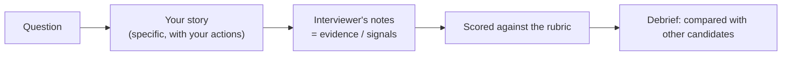

# How Behavioral Interviews Work

> A behavioral interview is an evidence hunt. The interviewer wants proof of how you acted in real situations, because past behaviour is the best predictor of future behaviour. Your job is to give clear, honest evidence.

Roadmap topic 1 · Stage 1: Foundations

**Go deeper:** `2` The STAR Method · `3` Building Your Story Bank · `18` Situational & Tough Questions · `19` Company Values & Interviewer Types · `05-system-design/31-Interview-Answer-Structure` (the same habits for design rounds).

**Marks:** 🟢 must know · 🟡 good to know

**A note on examples:** the example answers in this folder are **illustrations** with made-up numbers. Replace them with your own real stories. Invented stories fall apart under follow-up questions.

---

#### 1. What Is It?

*A conversation in which every answer is scored against a list of qualities.*

| 🟢 Must know | 🟡 Good to know |
|---|---|
| what interviewers look for: the signals | who interviews you |
| past behaviour predicts future behaviour | calibration across candidates |
| common formats: "tell me about a time", probes, situational | red flags |
| level expectations: mid, senior, staff / architect | remote interview basics |
| interviewers take notes and score with a rubric | |
| be honest | |

1. **Competency:** a quality the role needs (ownership, communication, judgment, collaboration, learning, impact).
2. **Signal:** a piece of evidence in your answer that the competency is present ("I wrote the rollback plan before we shipped").
3. **Rubric:** the scale the interviewer scores against (for example "no evidence / some / strong evidence").
4. **Probe:** a follow-up that tests your story ("what was your part?", "what would you change?").

**Signals in an interview:** "Tell me about a time when…", "Describe a situation where…", "How do you handle…", "What would you do if…".

---

#### 2. How It Works

**From your words to a hiring decision.**



You do not control the score, but you control the quality of the evidence you hand over: specific actions, your own role, numbers, and a lesson.

**What interviewers look for.**

| Competency | The signal they want |
|---|---|
| Ownership | you acted without being told, and followed through to the end |
| Communication | you were clear, early and honest with the right people |
| Collaboration | you worked well with others and shared credit |
| Judgment | you weighed options and chose with reasons |
| Learning | you learned from mistakes and feedback, and changed something |
| Impact | your work made a measurable difference |
| Leadership | you helped others succeed and raised the bar |
| Resilience | you stayed effective under pressure, ambiguity and change |

**Question formats.**

| Format | Example | What to do |
|---|---|---|
| Behavioral | "Tell me about a time you disagreed with a teammate." | pick a real story, use STAR |
| Probe / follow-up | "What was your part? What would you change?" | answer directly with detail |
| Situational | "What would you do if a release crashes and you can't roll back?" | clarify, state your approach, name trade-offs, tie to experience |
| Open | "Tell me about yourself." | your career story (topic 16) |

**Level expectations.**

| Level | They expect |
|---|---|
| Mid | you do the work well, ask for help early, learn fast |
| Senior | you own outcomes end to end, make good decisions, help others, raise quality |
| Staff / architect | you shape direction across teams, handle ambiguity, grow other leads, and measure business impact |

The same story can pass at one level and fail at another: scope matters. A bug you fixed is a mid story; a quality programme you drove across teams is a staff story.

🟡 **Who interviews you.** A hiring manager (fit, ownership, growth), peer engineers (collaboration, technical judgment), cross-functional partners (communication, influence), sometimes a dedicated behavioral or "bar-raiser" interviewer (consistency with the company's standard).

🟡 **Calibration.** After the interviews, the panel compares notes and scores. Clear, specific, memorable evidence survives that discussion; vague answers do not.

🟡 **Red flags.** Blaming others; no ownership ("the team did it"); no result; claiming the team's credit; negativity about past employers or managers; stories that change under questioning; no learning.

🟡 **Remote basics.** Test camera, sound and connection; look at the camera when you finish a point; pause instead of filling silence; keep notes (not a script) out of sight lines; have water.

---

#### 3. Weak Answer vs Strong Answer

| | Weak | Strong |
|---|---|---|
| Specificity | "We usually communicate a lot." | "On the checkout project I sent a weekly one-page status to product and backend." |
| Ownership | "The team decided…" | "I proposed… I wrote… I convinced…" |
| Result | "It went well." | "Crash-free users rose from 98.9% to 99.6% in four weeks." |
| Honesty | claims a perfect record | owns a mistake and shows the fix |
| Follow-up | defensive or vague | calm, more detail, admits what is unknown |
| Tone | blames or complains | factual, respectful, focused on the problem |
| Learning | none | one concrete change in how you work now |

**Example (illustrative).** Question: "Tell me about a time you took ownership."

> **Weak:** "I'm a very proactive person. If something is broken I fix it. Our team is great at ownership and we all pitch in."
>
> **Strong:** "Our release builds took 40 minutes and nobody owned it, so people skipped local test runs. I measured where the time went (not the tests, the dependency download), added Gradle caching to CI, and moved two slow steps to run in parallel. Builds dropped to 14 minutes in two weeks, and pull requests per week rose from 31 to 46. I also wrote a one-page runbook so the next person could maintain it."

---

#### 4. Templates & Worked Examples

**What a strong answer contains (checklist).**

1. One sentence of context (a real project, a real stake).
2. Your goal or responsibility.
3. Three to five actions, each in the first person, with a reason.
4. A result with a number (or an honest estimate).
5. One lesson, or what you would do differently.

**What the interviewer's notes might look like (illustrative).**

```text
Q: A time you disagreed with a teammate.
Candidate: Android lead; disagreed with backend on pagination (offset vs cursor).
Evidence: ran a 1-hour test showing duplicates on a live feed; proposed cursor; agreed to keep
          offset for the admin screen; backend shipped cursor in 2 sprints.
Signals:  + influence with data, + compromise, + result measured (dup rate 4% → 0)
Gaps:     - did not say what he'd do if backend refused
Score:    3/4
```

**Probe answers (short, honest, specific).**

| Probe | A good reply |
|---|---|
| "What was your part?" | "I designed the cursor API and wrote the client; the backend engineer built the endpoint." |
| "What would you change?" | "I'd have run the duplicate test before the meeting, not after the argument." |
| "What if they had said no?" | "I'd have shipped the client with a de-duplication workaround and revisited with the metric." |
| "How do you know it worked?" | "Duplicate reports dropped from about 4% of sessions to none, in the analytics dashboard." |

---

#### 5. Numbers & Metrics to Quote

| Item | Guide |
|---|---|
| A behavioral round | 45 to 60 minutes; about 2 to 4 main questions with follow-ups |
| A good answer | about 2 minutes (roughly 250 to 300 words at a normal speaking pace) plus probes |
| Your own prep | 8 to 10 stories, each with a 30-second and a 2-minute version |
| Panel | usually 3 to 6 interviews in a loop; some are only behavioral |
| Result types | time saved, crash-free rate, ANR rate, startup time, conversion, retention, cost, incidents, delivery time |
| Scale words | users affected, team size, duration, number of teams |

If you do not know an exact number, say "roughly" and give the range you do know.

---

#### 6. Common Mistakes & Edge Cases

1. Vague, general answers ("I usually…") instead of one specific event.
2. All "we", no "I".
3. No result, or a result with no evidence.
4. Inventing or inflating a story; it breaks under probes.
5. Blaming people or companies.
6. Too much background, so the action never arrives.
7. Treating every question as an exam instead of a conversation.
8. Memorised scripts that sound robotic.

Edge cases: you have no story for a question (use a related one, or say what you would do and why, topic 18); a story is confidential (describe it without names or private data); the interviewer interrupts (answer the new question, return to the story only if it helps); you freeze (pause, restate the question, pick the story); a remote connection drops (restate the last point calmly).

---

#### 7. Say This in the Interview

1. "Let me think for a moment about the best example." (A short pause is fine.)
2. "The situation was… My part was… What I did was… The result was…"
3. "I did X because Y; the alternative was Z, which I rejected because…"
4. "I'm not sure about the exact figure, but it was roughly…"
5. "Looking back, I would…"
6. "Would it help if I went deeper on the decision, or on the result?"

---

#### 8. Quick Check

1. What is a "signal"?
2. Why are vague answers a problem in a scored interview?
3. What changes between a senior and a mid-level story?
4. What should you do when you have no perfect story?

<details>
<summary>Answers</summary>

1. A piece of evidence in your answer that shows a competency is present.
2. The interviewer has no evidence to write down, so they cannot score you well.
3. The scope: ownership of outcomes, helping others, raising quality and cross-team impact, not just doing the task.
4. Use a related real story, or say honestly what you would do and why, ideally linking to a similar experience.

</details>

---

#### 9. Practice

**Interview questions**

1. Tell me about a time you took ownership.
2. Tell me about your proudest piece of work. What was the result?
3. Tell me about something you got wrong.
4. What would you do if a release started crashing and you couldn't roll back?
5. Tell me about yourself.

**Exercises**

1. For each competency in the table, write one real event from the last three years (one line each).
2. Take one answer you gave in an old interview and mark: specific? "I"? number? lesson?
3. Ask a friend to probe one story with "what was your part?" and "what would you change?" and note where you hesitate.

**Remember:** they hunt for evidence · specific, first-person actions · numbers · honesty · one lesson · scope fits the level.
