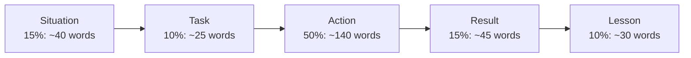

# The STAR Method

> STAR is a shape for a story, not a script to recite. Short setup, long action, a real result, and a lesson: tell any story in this shape and it lands clearly, even under pressure.

Roadmap topic 2 · Stage 1: Foundations

**Go deeper:** `1` How Behavioral Interviews Work · `3` Story Bank · `18` Situational Questions · `21` Mock Interviews · `03-leetcode-patterns/21-Coding-Interview-Answer-Points` (the same "explain your thinking" habit).

**Marks:** 🟢 must know · 🟡 good to know

---

#### 1. What Is It?

*Situation, Task, Action, Result, plus Learning.*

| 🟢 Must know | 🟡 Good to know |
|---|---|
| S: the context in one or two sentences | variations: CAR, SOAR |
| T: your goal or responsibility | adapting one story to many questions |
| A: what you did, step by step (the longest part) | recovering when you lose the thread |
| R: the outcome, with numbers | |
| L: a short lesson | |
| "I" for actions, "we" for context | |
| about two minutes | |
| quantify the result | |

1. **Situation:** where and when, what was at stake.
2. **Task:** what you were responsible for.
3. **Action:** what *you* did, in order, with the reason for the key choices.
4. **Result:** what changed, measured.
5. **Learning:** what you took away, or would do differently.

**Signals in an interview:** every "Tell me about a time…" question.

---

#### 2. How It Works

**The shape and the time budget (about 2 minutes ≈ 280 words).**



| Part | Question it answers | Good looks like |
|---|---|---|
| Situation | Where are we, and why does it matter? | one or two sentences; a real stake |
| Task | What was my job? | "I was responsible for…", distinct from the team |
| Action | What did I do, and why? | 3 to 5 steps, "I", with reasons and trade-offs |
| Result | What changed? | a number, a time frame, a comparison |
| Learning | What do I do differently now? | one concrete habit or process change |

**"I" and "we".** Use "we" to set the scene ("our team shipped…"). Switch to "I" as soon as you describe what you did ("I profiled…, I proposed…"). An all-"we" answer hides your contribution; an all-"I" answer sounds like you did not work with anyone, so credit others where it is true.

**Quantify.** Pick the metric that matches the story:

| Story about | Result metrics |
|---|---|
| Performance | cold start 3.2 s → 1.9 s; jank 12% → 3% |
| Quality | crash-free users 98.8% → 99.6%; ANR rate 0.9% → 0.3% |
| Delivery | build time 40 → 14 min; release every 2 weeks → weekly |
| Product | checkout completion 60% → 78%; retention +4 points |
| Cost / scale | cloud cost −30%; supports 5× users |
| People | new joiner shipped first feature in week 2 instead of week 5 |

If you have no number, give an honest proxy ("support tickets about X stopped") and say it is an estimate.

🟡 **Variations.** **CAR** (Context, Action, Result) is shorter. **SOAR** adds Obstacle. Use whichever you remember under pressure; the content matters more than the label.

🟡 **One story, many questions.** Keep the facts the same and change the emphasis: the same migration story can answer "technical decision" (stress the options), "conflict" (stress the disagreement with a teammate), or "leadership" (stress how you got buy-in).

🟡 **If you lose the thread.** Pause, say "let me restate", give the one-sentence version, and continue from the action.

---

#### 3. Weak Answer vs Strong Answer

| | Weak | Strong |
|---|---|---|
| Situation | three minutes of company history | two sentences |
| Task | missing, or the team's goal | your specific responsibility |
| Action | "we worked on it and fixed it" | 3 to 5 first-person steps with reasons |
| Result | "it went well" | "dropped from 3.2 s to 1.9 s; ratings up 0.2" |
| Lesson | none | "I now measure before I optimise" |
| Length | 5+ minutes, rambling | about 2 minutes, then stops |

**Example (illustrative): "Tell me about a time you improved performance."**

> **Situation:** Our Android app's cold start was 3.2 seconds on mid-range phones, and Play Vitals flagged it as slow; store reviews mentioned it. *(Task)* As the Android lead I owned getting it under 2 seconds in one quarter.
>
> **Action:** I first measured instead of guessing: a Macrobenchmark showed 900 ms in `Application.onCreate` from five SDKs initialising eagerly, and 600 ms from building the whole dependency graph. I moved analytics and crash reporting to a background thread after the first frame, made the heavy objects lazy, and added a Baseline Profile. I proposed the plan in a one-page doc, so the team agreed on the trade-off: analytics would miss the very first 300 ms of events. I added a startup benchmark to CI so it could not regress silently.
>
> **Result:** Cold start dropped from 3.2 s to 1.9 s (median, Pixel 6a, release build), the slow-start share in Play Vitals went from 18% to 5%, and the benchmark has caught two regressions since.
>
> **Lesson:** I now measure first and put the number in CI, so a win stays a win."

This is about 180 words: roughly 80 seconds. You can add detail on request.

---

#### 4. Templates & Worked Examples

**STAR skeleton (fill it in for every story).**

```text
TITLE:
SITUATION (1–2 sentences):  When/where? What was at stake?
TASK (1 sentence):          What was MY responsibility?
ACTION (3–5 steps):         1) I…  because…
                            2) I…  because…
                            3) I…  (alternatives I rejected: …)
RESULT (with numbers):      Metric before → after, time frame, who benefited
LESSON (1 sentence):        What I do differently now
30-SECOND VERSION:          Situation + the one key action + the result number
FOLLOW-UPS I EXPECT:        What was your part? What went wrong? What would you change?
```

**The 30-second version of the example above.**

> "Cold start was 3.2 seconds. I profiled it, found eager SDK initialisation, deferred it and added a Baseline Profile, and got it to 1.9 seconds, with a benchmark in CI to keep it there."

**Turning a weak action into a strong one.**

| Weak | Strong |
|---|---|
| "We looked into the performance." | "I recorded a Macrobenchmark and a system trace on a mid-range device." |
| "The team fixed the issue." | "I moved SDK init off the main thread and wrote the PR; two teammates reviewed." |
| "I improved communication." | "I started a weekly one-page status for product and backend." |
| "It was successful." | "Crash-free users rose from 98.8% to 99.6%." |

**Adapting the same story.**

| Question | Emphasise |
|---|---|
| "A technical decision" | the options (lazy init vs splitting modules) and why |
| "A time you influenced others" | the one-page proposal and agreeing the analytics trade-off |
| "Something you're proud of" | the measured result and the CI guard |
| "A time you learned something" | learning Macrobenchmark and Baseline Profiles |

---

#### 5. Numbers & Metrics to Quote

| Item | Guide |
|---|---|
| Length | 2 minutes ≈ 250 to 300 words; 30 seconds ≈ 70 words |
| Situation + Task | no more than 25% of the time |
| Action | about half of the time |
| Steps in the Action | 3 to 5 |
| Numbers in a story | at least one result number, ideally a before and an after |
| Stories to prepare | 8 to 10 |
| Practice | tell each aloud at least 3 times, with a timer |

---

#### 6. Common Mistakes & Edge Cases

1. Too much background; the interviewer waits for the action.
2. Too little action: "we fixed it".
3. No result, or no number.
4. Rambling past three minutes.
5. All "we" (or all "I").
6. A lesson that is a cliché ("communication is important").
7. Reciting a memorised paragraph word for word.
8. Skipping the reasons: *why* you chose that action.

Edge cases: the result was mixed or negative (say so, and explain what you learned: this is often stronger); the outcome is not measurable yet (state the leading indicator); a team result with your small part (describe your part precisely and name the others); you cannot share numbers (use relative ones: "cut by a third").

---

#### 7. Say This in the Interview

1. "The situation was… and my responsibility was…"
2. "First I… because… Then I… The alternative was… but…"
3. "The result: X went from A to B within C."
4. "What I took from it: I now…"
5. "I can go into more detail on the decision or the result, whichever helps."

---

#### 8. Quick Check

1. Which STAR part should be the longest?
2. When do you say "we" and when "I"?
3. What do you do if you have no number?
4. Why add a lesson?

<details>
<summary>Answers</summary>

1. Action.
2. "We" for the team's context, "I" for what you personally did.
3. Give an honest proxy or estimate and say it is an estimate.
4. It shows self-awareness and answers the usual follow-up "what would you change?".

</details>

---

#### 9. Practice

**Interview questions**

1. Tell me about a time you improved something measurably.
2. Tell me about a hard problem you solved.
3. Tell me about a time you led something.
4. What is the work you are most proud of?

**Exercises**

1. Write one real story on the skeleton. Count the words in each part.
2. Record the 2-minute version, then cut it to 30 seconds without losing the number.
3. Rewrite your three weakest action sentences using the table above.
4. Tell the same story as an answer to two different questions, changing only the emphasis.

**Remember:** short setup · long action in the first person · a real result with a number · one lesson · about two minutes · adapt emphasis, not facts.
