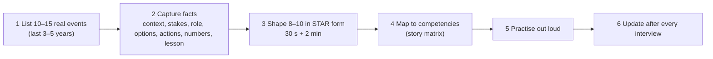

# Building Your Story Bank

> A story bank is a small set of real, rehearsed stories that cover every competency. You build it once, from your own work, and reuse it in every interview.

Roadmap topic 3 · Stage 1: Foundations

**Go deeper:** `2` The STAR Method · `4`–`8` the core stories · `9`–`15` people and leadership stories · `19` Company Values · `21` Mock Interviews.

**Marks:** 🟢 must know · 🟡 good to know

---

#### 1. What Is It?

*8 to 10 stories, each with a 30-second and a 2-minute version, mapped to competencies.*

| 🟢 Must know | 🟡 Good to know |
|---|---|
| collect events from real work | short (30 s) and full (2 min) versions |
| 8 to 10 stories that cover several competencies | choose the right scope for the target level |
| a story matrix | a running achievements log |
| a capture sheet for each story | protect confidential details |
| at least one: win, failure, conflict, decision, incident, helping someone grow | |

1. **Event:** something that really happened (a launch, an outage, a disagreement, a mistake).
2. **Story:** an event shaped into STAR form with numbers and a lesson.
3. **Matrix:** a grid that shows which story answers which question.

**Signals in an interview:** you are asked about a topic and you can pick the right story in two seconds.

---

#### 2. How It Works

**Pipeline: events → stories → matrix → practice.**



**Where to find events.** Your calendar, pull requests, design docs, incident reports, release notes, performance reviews, thank-you messages, your manager's feedback, and your promotion packet. Ask: "What took me out of my comfort zone?", "What did I fix that nobody asked me to?", "What went wrong?"

**What to capture for each story.**

| Field | Example |
|---|---|
| Context | Android app, 2M users, checkout flow |
| Stakes | 40% drop-off; revenue risk |
| My role | tech lead for the Android client (team of 4) |
| Options | patch the old flow / rebuild with Compose and a state machine |
| My actions | wrote the proposal; built the state machine; ran the staged rollout |
| Numbers | completion 60% → 78%; crash-free 99.1% → 99.6% |
| Lesson | write the rollback plan before the feature |
| Competencies | ownership, technical decision, delivery, impact |

**The story matrix.** Rows are stories, columns are competencies. Mark how strongly the story answers it: ● strong, ○ partial.

| Story | Ownership | Decision | Conflict | Failure | Incident | Mentoring | Influence | Ambiguity |
|---|---|---|---|---|---|---|---|---|
| A. Checkout rebuild | ● | ● | ○ | | | | ● | ○ |
| B. Startup time win | ● | ○ | | | | | ○ | |
| C. Bad release rollback | | ○ | | ○ | ● | | | ○ |
| D. Pagination dispute | | ● | ● | | | | ● | |
| E. Missed estimate | | | | ● | | | | ○ |
| F. Coached a junior | | | | | | ● | ○ | |
| G. Vague "make it faster" ask | ○ | | | | | | | ● |

Rules for a good matrix:

1. Every column has **at least two** stories (so you can avoid repeating one).
2. No story is used for more than **three** columns in one interview loop.
3. You have at least one story for each: **win, failure, conflict, decision, incident, helping someone grow**.
4. Check the gaps and fill them with a new event.

🟡 **Short and full versions.** The 30-second version (situation, key action, result) answers "briefly, tell me about…" and lets the interviewer choose to dig deeper. The 2-minute version has the full STAR.

🟡 **Scope for the level.** For a senior role, prefer stories where you owned an outcome or influenced a team. For staff or architect roles, include cross-team direction, trade-offs and business impact. For mid roles, show strong execution and learning.

🟡 **Achievements log.** Every Friday, add one line: date, what you did, the number. After a year you will have the raw material for every interview, review and promotion.

🟡 **Confidentiality.** Describe the problem and your actions without private names, customer data or secret numbers. Use relative figures ("cut by a third"), generic names ("a payments partner") and avoid anything under NDA.

---

#### 3. Weak Answer vs Strong Answer

| | Weak bank | Strong bank |
|---|---|---|
| Size | 20 shallow ideas | 8 to 10 polished stories |
| Coverage | all wins | win, failure, conflict, decision, incident, mentoring |
| Detail | memories from the shower | written facts with numbers |
| Reuse | one story used for everything | each story mapped to 2 or 3 competencies, with alternates |
| Practice | never said aloud | timed, recorded, probed |
| Freshness | from 8 years ago | mostly the last 2 to 4 years |
| Level | small tasks | scope matching the target level |

---

#### 4. Templates & Worked Examples

**Capture sheet (copy for each story).**

```text
STORY: ______________________________   (date: ____ )
Competencies: [ ] ownership [ ] decision [ ] conflict [ ] failure [ ] incident [ ] mentoring
              [ ] influence [ ] ambiguity [ ] delivery [ ] communication
Context & stakes:
My role:
Options considered:
My actions (1–5):
Numbers (before → after, time frame):
Other people & what they did (credit):
Lesson / what I'd change:
30-second version:
Likely follow-ups:
Confidentiality notes:
```

**Worked example (illustrative): "Bad release rollback".**

```text
STORY: Crash spike after release 4.12
Competencies: incident (strong), decision (partial), failure (partial), communication (partial)
Context & stakes: Friday release; crash-free users fell from 99.5% to 97.9% within 3 hours at 20% rollout.
My role: on-call Android lead.
Options: halt rollout + flag off the new sync / hotfix / wait for Monday.
Actions: halted the rollout in Play Console at 20%; turned the remote flag "new_sync" off (it removed the crash for 90%
         of affected users); posted status every 30 min in the incident channel; found root cause (a null in a migration
         for users from version 3.x); shipped a hotfix in 26 hours; wrote a blameless review.
Numbers: affected 3,100 users (0.9% of the base); crash-free back to 99.4% within 4 hours of the flag change.
Other people: backend engineer helped confirm the data shape; QA built the test for 3.x → 4.12.
Lesson: staged rollout saved us, but we hadn't tested upgrades from old versions; added upgrade tests to CI.
30-second version: "A release raised crashes at 20% rollout. I halted it, flagged the feature off, found the migration bug,
         and hotfixed in a day. Added upgrade tests so it can't recur."
Follow-ups: Why not roll back? (can't recall an app; flag was faster.) What would you change? (upgrade tests earlier.)
```

**Matching a question to a story in two seconds.**

| Question starts with… | Reach for… |
|---|---|
| "a time you failed…" | the failure story (E) |
| "a production issue…" | the incident story (C) |
| "a disagreement…" | the conflict story (D) |
| "a hard decision…" | the decision story (A or D) |
| "helped someone grow…" | the mentoring story (F) |
| "unclear requirements…" | the ambiguity story (G) |

---

#### 5. Numbers & Metrics to Quote

| Item | Guide |
|---|---|
| Events to list | 10 to 15 |
| Stories to polish | 8 to 10 |
| Versions of each | 30 seconds (about 70 words) and 2 minutes (about 280 words) |
| Competencies per story | 2 or 3 |
| Stories per competency | at least 2 |
| Recency | mostly the last 3 to 5 years |
| Practice | each story told aloud at least 3 times before the interview |
| Log | one line per week |

---

#### 6. Common Mistakes & Edge Cases

1. Only success stories.
2. Using one story for every question.
3. Stories with no numbers.
4. Stories where your part is unclear.
5. Choosing small tasks for a senior or staff role.
6. Leaking confidential information.
7. Preparing stories on the morning of the interview.
8. Having no story for a failure, conflict or incident, and then inventing one.

Edge cases: early in your career with few big stories (use smaller but real ones and show learning speed); a long gap in work (use side projects, open source, volunteering, learning, honestly); a story from a team that went badly (focus on your actions and lessons, not blame); the question is outside the bank (use the closest story and say how it relates, topic 18).

---

#### 7. Say This in the Interview

1. "A good example is from the checkout rebuild. In short: …" (the 30-second version)
2. "I can go deeper on the decision or on the rollout, whichever is more useful."
3. "I don't have an exact example of that, but the closest is… and here is what I learned."
4. "I'll keep the details general because of confidentiality, but the problem and my actions were…"

---

#### 8. Quick Check

1. How many stories should you prepare?
2. What categories must you cover?
3. Why keep a 30-second version?
4. How do you avoid repeating a story in one loop?

<details>
<summary>Answers</summary>

1. About 8 to 10, polished.
2. At least one win, failure, conflict, decision, incident and a time you helped someone grow.
3. It answers brief questions and lets the interviewer choose where to dig.
4. Map each story to several competencies and keep an alternate for each; track which stories you used in each round.

</details>

---

#### 9. Practice

**Interview questions**

1. What is the work you are most proud of?
2. Tell me about a time you made a mistake.
3. Tell me about a time you worked through a conflict.
4. Tell me about a decision you are glad you made.
5. Tell me about a time you helped someone grow.

**Exercises**

1. List 10 to 15 events from your last 3 to 5 years, one line each.
2. Fill in a capture sheet for the best five.
3. Build your matrix; mark any empty column and find an event for it.
4. Start the achievements log today (one line this week).
5. Tell two stories aloud with a timer; keep the 30-second versions on a card.

**Remember:** 8 to 10 real stories · numbers and lessons · cover win, failure, conflict, decision, incident, mentoring · every competency has two stories · practise aloud · keep a weekly log.
