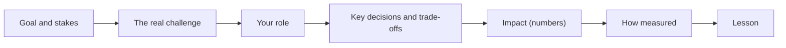

# Project Challenges & Impact

> "Tell me about a hard project" is the most common behavioral question. The answer is not a project description. It is a story about a real difficulty, your part in it, the choices you made, and a measured result.

Roadmap topic 4 · Stage 2: Core Stories

**Go deeper:** `2` STAR · `3` Story Bank · `5` Technical Decisions · `6` Architecture Decisions · `12` Leadership Without Authority · `06-mobile-engineering/15-Build-Release-and-Monitoring` (metrics) · `06-mobile-engineering/22-Practice-Projects-and-Exercises`.

**Marks:** 🟢 must know · 🟡 good to know

---

#### 1. What Is It?

*A story about a project where the problem was hard and your work changed an outcome.*

| 🟢 Must know | 🟡 Good to know |
|---|---|
| pick a project where the problem was hard, and say why | mobile examples of strong projects |
| show the challenge: ambiguity, deadline, scope change, ownership, technical limit | trade-offs you accepted, what you deferred |
| show your role and decisions, not only the team's result | what you would do differently |
| show impact with numbers | |
| explain how you measured success | |

1. **Challenge:** what made it hard (not just big).
2. **Role:** what you owned and decided.
3. **Impact:** the measurable difference.
4. **Measurement:** how you knew it worked.

**Signals in an interview:** "Tell me about a challenging project", "the work you're most proud of", "a project you drove end to end", "your biggest impact".

---

#### 2. How It Works

**The story arc.**



**Kinds of challenge** (pick the one that is really true):

| Challenge | What to show |
|---|---|
| Ambiguity | how you turned a vague goal into a plan |
| Deadline | what you cut, protected and communicated |
| Changing scope | how you re-planned and kept stakeholders aligned |
| Unclear ownership | how you stepped in and agreed owners |
| Technical limit | how you found a way (prototype, measurement, trade-off) |
| People / dependencies | how you aligned teams or unblocked others |
| Risk | how you reduced it (staged rollout, flags, tests) |

**Impact: pick the metric that fits.**

| Area | Examples |
|---|---|
| Quality | crash-free users 98.8% → 99.6%, ANR rate, bug reports −40% |
| Speed | cold start 3.2 → 1.9 s, build time 40 → 14 min |
| Product | checkout completion 60% → 78%, retention, ratings |
| Cost | cloud cost −30%, support tickets −25% |
| Delivery | release every 2 weeks → weekly, lead time |
| People | onboarding from 5 weeks to 2 |

Always give a **before and after**, the **time frame**, and **how you measured** (a dashboard, an experiment, Play Vitals).

🟡 **Mobile examples** of strong projects: an offline-first rebuild; a slow startup fix; a checkout redesign; a large migration (Java → Kotlin, XML → Compose, RxJava → coroutines); modularising to cut build time; a design-system roll-out; an accessibility overhaul; a payments integration; an AI feature.

🟡 **Trade-offs.** Say what you did not do and why ("we shipped without tablet layouts to hit the date; we added them in the next release").

🟡 **What you'd do differently.** One honest improvement ("I would have set up the success metric before starting").

**Example (illustrative): offline-first rebuild.**

> **Situation:** Our notes app lost user edits whenever the network dropped; 11% of support tickets were "my note disappeared", and ratings were 3.9. **Task:** I was the Android tech lead, responsible for making the app work offline within two quarters.
>
> **Action:** I started with the failure cases, not the architecture: I listed what must work offline (read, create, edit) and what could wait (search). I proposed Room as the source of truth with a WorkManager outbox, and wrote a one-page design with the conflict rule (last write wins per note, with a merge for the body). Because it touched every screen, I split it into four releases behind a flag, migrating the notes list first. I wrote the sync tests with a fake network that fails at random, and I met weekly with the backend engineer to add a changes-since-cursor endpoint. When the deadline slipped by two weeks because of a database migration bug found in QA, I cut the share-sheet feature to protect the date and told product the same day.
>
> **Result:** "Disappeared note" tickets fell from 11% to 2% of volume, crash-free users stayed at 99.5% through the migration, and the store rating rose from 3.9 to 4.4 in three months.
>
> **Lesson:** I'd define the success metric and the rollback plan before writing code, which I did for the second half and not the first.

---

#### 3. Weak Answer vs Strong Answer

| | Weak | Strong |
|---|---|---|
| Choice of project | the biggest, but your part is small | smaller, but you drove it |
| Challenge | "it was big and complex" | a specific difficulty and why it was hard |
| Role | "we built…" | "I owned… I decided… I convinced…" |
| Impact | "users liked it" | before/after numbers and how measured |
| Trade-offs | none | what you cut and why |
| Tone | boastful or modest to the point of vague | factual, credits others |

---

#### 4. Templates & Worked Examples

**Project-story template.**

```text
PROJECT:                         TIME FRAME:           TEAM SIZE / MY ROLE:
GOAL & STAKES (one sentence):
THE REAL CHALLENGE (why hard):
WHAT I OWNED / DECIDED:
KEY ACTIONS (3–5, with reasons):
  1.
  2.
  3.
TRADE-OFFS (what I cut / deferred):
IMPACT (before → after, time frame):
HOW MEASURED:
WHAT I'D DO DIFFERENTLY:
```

**Turning a team result into your story.**

| Team-level sentence | Your-level sentence |
|---|---|
| "We migrated to Compose." | "I wrote the migration plan, converted the three highest-traffic screens, and built the lint rule that stopped new XML screens." |
| "We improved stability." | "I added crash reporting with release tracking and a weekly review, and fixed the top three crashes (62% of all crashes)." |
| "The launch went well." | "I owned the rollout plan: 5% → 20% → 100% with a kill switch; we caught one bug at 5% and fixed it before wide release." |

**Follow-up answers.**

| Probe | Reply |
|---|---|
| "Why was it hard?" | name the specific constraint: "no source of truth, 40 screens, a fixed date" |
| "What was your part?" | the exact decisions and deliverables |
| "How did you measure success?" | metric, source, before/after, time frame |
| "What would you change?" | one concrete change |
| "What didn't work?" | an honest one: "the first sync design lost edits; the tests found it" |

---

#### 5. Numbers & Metrics to Quote

| Item | Guide |
|---|---|
| Story length | about 2 minutes; the challenge and the actions take most of the time |
| Result | 1 to 3 numbers, each with a before and an after |
| Time frame | say it ("in three months", "within two releases") |
| Scope | users, team size, duration, number of screens or services |
| Credit | name at least one other person's contribution |
| Percentages | pair them with the absolute number if it is small |

---

#### 6. Common Mistakes & Edge Cases

1. Describing the project (features, tech) instead of your part.
2. A "hard" project that was only big, not difficult.
3. No numbers, or numbers with no source.
4. Taking the whole team's credit.
5. A perfect story without a single problem; it sounds unreal.
6. Too much technical detail for the interviewer's background.
7. No lesson.

Edge cases: the project failed or was cancelled (own it, show what you learned, and what survived); the results arrived after you left (use leading indicators); your role was small (choose a different project, or describe a part you really owned); confidentiality (use relative figures).

---

#### 7. Say This in the Interview

1. "What made it hard was… not just the size, but…"
2. "I owned… and I decided… because…"
3. "To limit risk I… (staged rollout, flag, tests)."
4. "We measured it with… Before it was X, after Y, within Z."
5. "To hit the date, we deliberately cut… and told… the same day."
6. "If I did it again, I'd…"

---

#### 8. Quick Check

1. What makes a project "hard" in an interview?
2. Which parts of the story should be longest?
3. How do you describe impact?
4. What do you do if the project failed?

<details>
<summary>Answers</summary>

1. A specific difficulty (ambiguity, deadline, technical limit, dependencies), not just size.
2. The challenge and your actions.
3. Before/after numbers, a time frame and how you measured them.
4. Own it, explain what you tried and learned, and say what you changed afterward.

</details>

---

#### 9. Practice

**Interview questions**

1. Tell me about the most challenging project you've worked on.
2. What is the work you are most proud of, and what was its impact?
3. Tell me about a project you drove from start to finish.
4. Tell me about a time a project's scope or deadline changed.
5. Tell me about a trade-off you made to ship on time.

**Exercises**

1. Choose two projects and fill in the template for each.
2. Write one team-level sentence and rewrite it as a your-level sentence for each of your last three projects.
3. Find the number for each result: dashboard, analytics, store vitals, ticket counts.
4. Tell the story in two minutes and then in thirty seconds.

**Remember:** hard means a specific difficulty · your role and decisions · before/after numbers · say how you measured · name the trade-off · one lesson.
