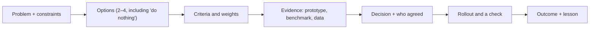

# Technical Decisions

> A decision story shows judgment: you saw options, compared them with clear criteria, used evidence, chose, brought people along, and learned from the outcome.

Roadmap topic 5 · Stage 2: Core Stories

**Go deeper:** `4` Project Challenges · `6` Architecture Decisions · `9` Conflict Resolution · `11` Communication · `09-architecture` (trade-offs, ADRs) · `06-mobile-engineering/17-Cross-Platform-and-Kotlin-Multiplatform` (a typical build-vs-choose decision).

**Marks:** 🟢 must know · 🟡 good to know

---

#### 1. What Is It?

*The story of one real choice between options.*

| 🟢 Must know | 🟡 Good to know |
|---|---|
| tell a real decision: problem, options, comparison, choice, outcome | a decision you reversed |
| show the criteria: cost, risk, time, skills, maintainability, user impact | a decision with little information |
| show your evidence: prototype, benchmark, data | recording it: ADR, design doc |
| show how you brought others along | build vs buy, library, framework stories |
| be ready for "what if you had chosen the other option?" | |

1. **Decision:** a choice with real alternatives and real consequences.
2. **Criteria:** the things you cared about, ideally stated before comparing.
3. **Evidence:** a measurement or a prototype, not an opinion.
4. **Outcome:** what happened, and what you would change.

**Signals in an interview:** "Tell me about a hard technical decision", "How did you choose between X and Y?", "A decision you'd make differently?", "Build or buy?".

---

#### 2. How It Works

**The decision flow.**



**Typical criteria.**

| Criterion | Question |
|---|---|
| User impact | Does the user notice, and how much? |
| Risk | What can go wrong, and can we undo it? |
| Time / cost | How long, how many people? |
| Maintainability | Who maintains it in a year? |
| Team skills | Can the team learn and support it? |
| Reversibility | Is it a one-way or a two-way door? |

**A weighted comparison** makes the reasoning visible (the scores are your judgment: argue the weights, not the arithmetic). Example: migrating a large app from RxJava to coroutines. Weights: risk 30%, time 20%, maintainability 30%, team skills 20%. Scores 1 (bad) to 5 (good):

| Option | Risk | Time | Maint. | Skills | Weighted |
|---|---|---|---|---|---|
| A. Big-bang rewrite | 2 | 2 | 5 | 3 | **3.1** |
| B. Incremental, module by module | 4 | 3 | 4 | 4 | **3.8** |
| C. Keep RxJava | 5 | 5 | 1 | 3 | **3.4** |

(B: 0.3×4 + 0.2×3 + 0.3×4 + 0.2×4 = 3.8.) The table is a tool for the conversation, not the decision itself; explain the one number that surprised you.

**Evidence beats opinion.**

| Evidence | Example |
|---|---|
| Prototype | built the offline flow for one screen in 2 days to test the design |
| Benchmark | Macrobenchmark showed startup 1.9 s vs 3.2 s |
| Data | analytics showed 38% of sessions had no network at some point |
| Spike | a 1-day experiment to answer one risky question |
| Expert input | asked the backend lead about the API limits |

**Bringing others along.** Write a one-page proposal, show the options and the evidence, ask for objections, address the strongest one, and agree who decides and by when. If you disagree after the decision, "disagree and commit" (topic 9).

🟡 **A decision you reversed.** Say what new information appeared, how you recognised it, and how you changed course without blame ("the benchmark showed the cache made things slower, so I removed it in the next release").

🟡 **A decision with little information.** Name the unknowns, choose the reversible option, set a check date and a trigger for revisiting ("we'll review after 2 weeks of data").

🟡 **Record it.** An ADR (architecture decision record) or short design doc: context, options, decision, consequences. It prevents re-arguing and helps new joiners (`ARCH 3`, `ARCH 14`).

🟡 **Build vs buy; library; framework.** Criteria: total cost over time, lock-in, security and maintenance, fit, exit plan. A good story shows an exit plan.

**Example (illustrative): choosing how to migrate from RxJava to coroutines.**

> **Situation:** Our Android app had 140 RxJava classes; new hires didn't know Rx and bugs came from missed disposals. **Task:** As the tech lead, I had to propose how to move to coroutines and Flow.
>
> **Action:** I listed three options: rewrite everything in one quarter, migrate module by module, or keep Rx. I agreed the criteria with the team first: risk, time, maintainability, skills. To test the riskiest assumption (interop), I spent two days converting one repository and its tests with the `kotlinx-coroutines-rx3` adapters; it worked with no behaviour change. I presented a scoring table and a one-page proposal; one engineer worried about long coexistence, so we added a rule that no new Rx code is allowed and a lint check. We chose the incremental option and recorded it as an ADR.
>
> **Result:** In six months 85% of the classes were migrated, memory-leak bugs from undisposed streams dropped from about 6 a quarter to 1, and a new joiner shipped a feature in week 2.
>
> **Lesson:** a two-day spike on the riskiest assumption saved us from arguing about it for weeks. The full rewrite would have needed a feature freeze, which product would not have accepted."

---

#### 3. Weak Answer vs Strong Answer

| | Weak | Strong |
|---|---|---|
| Options | one ("we used Hilt") | two to four, including "do nothing" |
| Criteria | none or "it's best practice" | named, weighted, tied to the problem |
| Evidence | opinion | prototype, benchmark or data |
| People | "I decided" or "they decided" | how you aligned and handled objections |
| Outcome | not mentioned | measured, plus what you'd change |
| Counterfactual | can't answer | "the other option would have cost… because…" |

---

#### 4. Templates & Worked Examples

**Decision-story template.**

```text
DECISION:                      WHEN / SCOPE:
PROBLEM & CONSTRAINTS:
OPTIONS: A) …  B) …  C) do nothing
CRITERIA (and weights):
EVIDENCE I GATHERED:
WHO I INVOLVED / WHO DECIDED:
OBJECTIONS AND HOW I HANDLED THEM:
DECISION AND WHY:
ROLLOUT AND CHECKS:
OUTCOME (numbers):
WHAT I'D CHANGE / WHAT IF THE OTHER OPTION:
```

**A small ADR.**

```text
ADR-014: Migrate RxJava to coroutines incrementally
Status: accepted (2025-03-04)
Context: 140 Rx classes; onboarding cost; leaks from undisposed streams.
Options: rewrite in one quarter / incremental module by module / keep Rx.
Decision: incremental, starting with data layer; no new Rx code; lint rule enforces it.
Consequences: Rx and coroutines coexist for ~2 quarters (adapters needed); review in Q3.
```

**Weighted score (the arithmetic).**

```kotlin
data class Option(val name: String, val scores: Map<String, Int>)

fun weighted(option: Option, weights: Map<String, Double>) =
    weights.entries.sumOf { (criterion, w) -> w * (option.scores[criterion] ?: 0) }
```

Checks: weights `risk 0.3, time 0.2, maint 0.3, skills 0.2`; option B scores `4, 3, 4, 4` → `3.8`; option A `2, 2, 5, 3` → `3.1`; option C `5, 5, 1, 3` → `3.4`. (Reasoning: the scores are judgments. Share them and invite challenge.)

**Answering "what if you had chosen the other option?"**

| Choice | Honest counterfactual |
|---|---|
| incremental over rewrite | "We'd have frozen features for a quarter; product wouldn't accept it, and a big-bang switch has no easy rollback." |
| Room over files | "Simpler at first, but conflict handling and queries would have been hand-written and error-prone." |
| buy an SDK over build | "We'd have shipped sooner, but lock-in and per-user cost grew; I'd now add an exit plan." |

---

#### 5. Numbers & Metrics to Quote

| Item | Guide |
|---|---|
| Options | 2 to 4 (always mention "do nothing") |
| Criteria | 3 to 5, stated before comparing |
| Evidence | at least one measured item |
| Time to decide | say it ("a two-day spike, a one-week review") |
| People | who you consulted and who made the final call |
| Outcome | 1 to 3 numbers, plus a date for the check |
| Reversibility | label the decision one-way or two-way |

---

#### 6. Common Mistakes & Edge Cases

1. "We chose X because it is best practice": no criteria.
2. Only one option.
3. Opinion instead of evidence.
4. Presenting the decision as obvious; no trade-off.
5. Ignoring people who disagreed.
6. No outcome, or no honest assessment.
7. Choosing a tiny decision (a variable name) for a senior role.

Edge cases: the decision was made by someone else (describe your input and how you supported it); it turned out wrong (own it; show how you detected and reversed it); a decision under time pressure (say what you did to limit risk); a decision you made alone (explain why no consultation was possible and how you communicated it).

---

#### 7. Say This in the Interview

1. "The options were A, B, and doing nothing. The criteria I cared about were…"
2. "To test the riskiest assumption I… (spike, benchmark)."
3. "I wrote a one-page proposal, asked for the strongest objection, and addressed it by…"
4. "It's a two-way door, so I set a review date: …"
5. "The trade-off I accepted was…"
6. "If I'd chosen B instead, the cost would have been…"

---

#### 8. Quick Check

1. How many options should a decision story mention?
2. Why state criteria before comparing?
3. What is a two-way door decision?
4. How do you answer "what if you'd chosen differently?"

<details>
<summary>Answers</summary>

1. Two to four, including doing nothing.
2. It shows the choice was reasoned, not rationalised after the fact.
3. One that can be reversed at low cost, so you can decide faster and check later.
4. State the honest cost of the other option, using the same criteria.

</details>

---

#### 9. Practice

**Interview questions**

1. Tell me about a hard technical decision you made.
2. How did you choose between two libraries or approaches?
3. Tell me about a decision you changed your mind about.
4. Tell me about a decision made with incomplete information.
5. Have you made a build-vs-buy decision?

**Exercises**

1. Write one decision story with the template and a weighted table.
2. Write an ADR for a decision you made last year.
3. Practise the "what if the other option" answer for the same story.
4. List which evidence (prototype, benchmark, data) you used; if none, note what you would use now.

**Remember:** 2–4 options incl. do nothing · criteria first · evidence over opinion · bring people along · name the trade-off · outcome and lesson.
