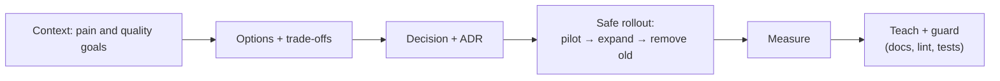
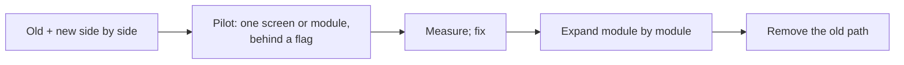

# Architecture Decisions

> An architecture story is a decision with lasting impact: how the app is structured, how it will change, and how you made that change safely. Show the goal, the trade-offs, the careful rollout and the proof it worked.

Roadmap topic 6 · Stage 2: Core Stories

**Go deeper:** `5` Technical Decisions · `4` Project Challenges · `12` Leadership Without Authority · `09-architecture` (quality goals, ADRs, evolution) · `06-mobile-engineering/06-App-Architecture`, `07-Dependency-Injection-and-Modularization`, `09-Local-Storage-and-Offline-First` · `05-system-design`.

**Marks:** 🟢 must know · 🟡 good to know

---

#### 1. What Is It?

*A decision about structure that the team will live with for years.*

| 🟢 Must know | 🟡 Good to know |
|---|---|
| pick a decision with lasting impact | technical debt; rewrite vs refactor |
| explain the context and quality goals | documenting and teaching it |
| explain options and trade-offs in plain language | keeping the design from drifting |
| explain how you introduced it safely, in steps | a decision that turned out wrong |
| explain the result and how you knew it worked | |

1. **Quality goals** (`ARCH 2`): what the architecture must achieve (fast start, offline, testable, easy to change, secure).
2. **Trade-off:** what you gave up to get it.
3. **Safe introduction:** small steps, flags, checks, rollback.
4. **Proof:** metrics before and after.

**Signals in an interview:** "Tell me about an architecture change you led", "How did you migrate safely?", "How did you convince the team?", "A design you'd do differently?".

---

#### 2. How It Works

**The story in order.**



**Typical mobile architecture decisions.**

| Decision | Quality goals it serves | Typical trade-off |
|---|---|---|
| Modularization | build speed, ownership, boundaries | more setup, indirection |
| MVVM / MVI, one UI state | testability, predictable state | more boilerplate |
| Offline-first (Room as source of truth) | reliability on bad networks | sync complexity, conflicts |
| Migrating to Compose | productivity, consistency | interop period, learning curve |
| Dependency injection (Hilt) | testability, replaceability | build time, learning |
| Kotlin Multiplatform | shared logic, consistency | tooling, iOS integration |
| Feature flags + staged rollout | release safety | flag debt |

**Safe introduction (the strangler pattern).**



Rules: each step ships on its own; every step is reversible; a metric tells you whether to continue.

**Rewrite vs refactor.** A rewrite resets the debt but freezes features and repeats old mistakes; refactoring keeps shipping but is slower. Default to incremental refactor with a clear end state, and rewrite only when the old code cannot be changed safely and the cost of keeping it is clear.

**Technical debt.** Name it, size it (hours of rework, bugs per month, build time), tie it to a business effect, and schedule a fixed share of capacity (for example 15 to 20%) instead of "someday".

**Documenting and teaching.** ADR with the options and consequences; a short architecture diagram; a "how to add a feature" guide; pairing on the first feature in the new structure; a brown-bag session.

**Keeping the design from drifting.** Automated guards: module dependency rules, lint, architecture tests (Konsist/ArchUnit-style), PR templates, a CODEOWNERS file, and a periodic review (`ARCH 17`).

🟡 **A decision that turned out wrong.** The strongest version: "we split into 30 modules too early; build configuration time rose, so we merged them into 12". Show how you saw it, how you decided to change, and the lesson.

**Example (illustrative): modularizing a 400k-line app.**

> **Situation:** Incremental builds took 6 minutes, two teams edited the same files, and pull requests conflicted daily. **Task:** As the senior Android engineer, I led a proposal to modularize without slowing feature work.
>
> **Action:** I wrote down the quality goals first: build under 2 minutes, features owned by teams, no feature-to-feature dependencies. I compared three options: leave the monolith and tune Gradle, split by layer, or split by feature plus a core. A dependency analysis showed the layer split would still force rebuilds of everything, so I chose feature plus core and recorded it in an ADR. To introduce it safely, I extracted one low-risk feature (settings) as a pilot; it cut the incremental build for that area by 40%, and showed the missing API boundaries. Then we extracted one feature per sprint, 20% of capacity, with a lint rule that forbids feature-to-feature imports. I paired with each team on its first extraction.
>
> **Result:** After 5 months, the incremental build dropped from 6 minutes to 1 minute 50 seconds, merge conflicts in shared files fell by about two-thirds, and we shipped on the usual release schedule throughout.
>
> **Lesson:** Our first plan had 25 modules, which made configuration slow; we merged to 14. I'd start with fewer, larger modules and split on evidence."

---

#### 3. Weak Answer vs Strong Answer

| | Weak | Strong |
|---|---|---|
| Why | "it's the modern way" | quality goals and the real pain |
| Options | one | several, with trade-offs in plain words |
| Rollout | a big-bang switch | pilot, steps, flags, rollback |
| Proof | none | before/after metrics |
| People | imposed | involved the team, documented, taught |
| Guard | none | lint / tests / review to stop drift |
| Honesty | everything worked | what turned out wrong and how it was changed |

---

#### 4. Templates & Worked Examples

**ADR template.**

```text
ADR-NNN: <decision title>
Status: proposed / accepted / superseded by ADR-MMM
Context: the pain and the quality goals (measurable)
Options: A … B … C (do nothing)
Decision: what we chose, in one paragraph
Consequences: good / bad / what we must now do
Rollout: steps, flags, checks, rollback
Review date: <when we reassess>
```

**Quality-goal sentences (make them measurable).**

| Vague | Measurable |
|---|---|
| "faster builds" | incremental build under 2 minutes |
| "more reliable" | crash-free users above 99.5%, works offline for core flows |
| "easier to test" | 80% of ViewModels covered by JVM tests with fakes |
| "better ownership" | each module has a CODEOWNER, no cross-feature imports |

**A guard against drift (an architecture check in plain Kotlin).**

```kotlin
fun forbiddenImports(importsByModule: Map<String, List<String>>): List<String> =
    importsByModule.flatMap { (module, imports) ->
        imports.filter { it.startsWith("feature.") && !it.startsWith("feature.${module.removePrefix(":feature:")}.") }
            .map { "$module imports $it" }
    }
```

Checks: with `":feature:notes"` importing `feature.notes.ui.NotesScreen` and `feature.profile.ProfileApi`, the result is `[":feature:notes imports feature.profile.ProfileApi"]`; a feature importing only its own package gives `[]`. In real projects use a lint rule or an architecture-test library; the idea is that the rule runs in CI, so the design cannot drift unnoticed.

**Handling objections.**

| Objection | A good reply |
|---|---|
| "It's too much work." | "Here is the pilot cost and the monthly cost of the current pain; we take 20% capacity, not a freeze." |
| "We'll lose velocity." | "The pilot showed no slowdown; if the metric drops, we stop and review." |
| "Why not rewrite?" | "A rewrite freezes features for a quarter and has no rollback; the strangler approach keeps shipping." |

---

#### 5. Numbers & Metrics to Quote

| Item | Guide |
|---|---|
| Quality goals | 2 to 4, each measurable |
| Pilot | one small, low-risk unit (a screen or module) |
| Capacity for debt / migration | commonly 15 to 25% of the sprint |
| Time frame | quarters, not weeks; say it |
| Metrics | build time, crash-free rate, test coverage of critical logic, lead time, conflicts per week |
| Rollback | name the exact way back at each step |
| Review | a date to reassess (for example 3 months) |

---

#### 6. Common Mistakes & Edge Cases

1. Picking a trend, not a problem.
2. A big-bang rewrite with no way back.
3. No metrics, so no proof.
4. Imposing the design without the team.
5. No documentation or guard, so the design drifts.
6. Hiding the parts that went wrong.
7. Over-engineering a small app.
8. Telling an architecture story with only tool names.

Edge cases: the migration was never finished (say why, what you learned, and the state now); two architectures coexist (explain the rule that keeps it safe); you inherited the decision (describe how you evaluated and improved it); the decision was made above you (describe how you influenced the details).

---

#### 7. Say This in the Interview

1. "The pain was…, so the quality goals were… (build under two minutes, features independently owned)."
2. "I compared three options; the trade-off of the one I chose was…"
3. "To introduce it safely I started with a pilot behind a flag, measured, then moved one module per sprint, with a rollback at each step."
4. "I recorded it in an ADR, paired with each team on its first extraction, and added a lint rule so the boundaries can't erode."
5. "The result was… (numbers). What I'd change is…"

---

#### 8. Quick Check

1. What should the story start with?
2. What is the strangler approach?
3. How do you prevent architectural drift?
4. How much capacity should a migration take?

<details>
<summary>Answers</summary>

1. The pain and the measurable quality goals, not the technology.
2. Run the new and old paths side by side and move over piece by piece until the old one can be removed.
3. Automated guards (lint, architecture tests, CODEOWNERS), documentation and periodic review.
4. A fixed share, commonly 15 to 25%, so feature work continues.

</details>

---

#### 9. Practice

**Interview questions**

1. Tell me about an architecture change you led.
2. How did you migrate without disrupting delivery?
3. How did you convince others to adopt it?
4. How did you know it worked?
5. Tell me about an architecture decision that turned out wrong.
6. Rewrite or refactor: how do you decide?

**Exercises**

1. Write an ADR for one structural decision you made.
2. Rewrite two vague goals as measurable ones.
3. Describe a safe, step-by-step rollout for your story, with the rollback for each step.
4. Prepare the "what went wrong" part of the story.

**Remember:** start from pain and measurable goals · trade-offs in plain words · pilot then expand, always reversible · measure · document, teach and guard · be honest about what went wrong.
