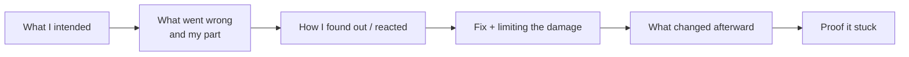

# Failure Stories & Learning

> "Tell me about a failure" tests honesty and growth. A strong answer owns a real mistake with real consequences, shows what you did to fix it, and names what changed in how you work.

Roadmap topic 7 · Stage 2: Core Stories

**Go deeper:** `2` STAR · `8` Production Incidents · `13` Mentoring (giving and receiving feedback) · `14` Delivery & Estimation · `16` Career Story (weaknesses) · `18` Tough Questions.

**Marks:** 🟢 must know · 🟡 good to know

---

#### 1. What Is It?

*A story where something went wrong, you owned it, and you changed.*

| 🟢 Must know | 🟡 Good to know |
|---|---|
| choose a real failure with real consequences | a mistake in review, estimation, communication or judgment |
| own it: what *you* did or missed | a project that missed its goal |
| explain how you found out and reacted | feedback you received and acted on |
| explain how you fixed it and limited damage | |
| explain what changed afterward | |
| calm, honest, no blame | |

1. **Failure:** an outcome worse than intended, where your decision or action was part of the cause.
2. **Ownership:** saying "I" about the cause, without excuses.
3. **Learning:** a concrete change in a process, check or habit.

**Signals in an interview:** "Tell me about a time you failed", "a mistake you made", "a project that didn't go as planned", "feedback you received", "your biggest weakness (with an example)".

---

#### 2. How It Works

**The arc of a good failure story.**



**What counts as a good failure.**

| Good choice | Poor choice |
|---|---|
| a missed estimate that delayed a launch | "I work too hard" (a hidden strength) |
| a bug you shipped that reached users | a failure that was entirely someone else's fault |
| a communication gap that surprised a stakeholder | something trivial with no consequence |
| a design that did not scale and was replaced | a failure so serious it suggests poor judgment, with no growth |
| feedback you ignored at first, then acted on | a story with no lesson |

**Tone.** Calm, factual, no drama, no blame, no self-punishment. Say the cost plainly ("it delayed the launch by three weeks"), then move to the response.

**The four things interviewers listen for.**

1. **Ownership:** "I did not ask whether the sandbox needed approval."
2. **Response:** what you did in the first hours and days.
3. **Learning:** a specific change, not "communicate more".
4. **Proof:** evidence that the change worked next time.

🟡 **Kinds of mistakes.**

| Kind | Example change afterward |
|---|---|
| Code review miss | added a checklist for risky areas (migrations, threading) |
| Estimation | estimate with ranges, list assumptions, add a buffer, re-estimate at milestones |
| Communication | raise risks early; weekly written status |
| Judgment | write down the decision and the revisit trigger |
| Scope / planning | agree the success metric and the cut line before starting |

🟡 **A project that missed its goal.** Explain the goal, why it was missed (honestly, including your part), what was salvaged, and what you changed.

🟡 **Feedback you received.** Describe the feedback in the other person's words, your first reaction (be honest), what you did, and the observable change ("my reviews now include the reason, and my last two reviewers said so").

**Example (illustrative): a missed estimate.**

> **Situation:** I estimated four weeks to add a payments provider's SDK to our Android app and promised that date to product. **Task:** I was the engineer responsible for the estimate and the delivery.
>
> **What went wrong:** It took seven weeks. I had estimated only the coding. I did not ask whether the provider's sandbox needed an approval, which took two weeks, and I did not allow time for compliance review of the new permissions. I told product the delay only in the week the launch was due, because I kept hoping to catch up. Marketing had already booked a campaign.
>
> **Response:** Once I saw I would not recover, I told my manager and product the same day, with a new date and two options: ship the card flow first and the wallet flow later, or move the campaign. We shipped cards on the new date and wallets two weeks after, and marketing moved the campaign by a week. I wrote a short review.
>
> **What changed:** I now estimate with a range (optimistic, likely, pessimistic), list the assumptions and external dependencies first, and re-estimate at the end of the first week. I report a risk the moment I see it. On the next integration, the same method predicted five to seven weeks; it took six, and nobody was surprised.

---

#### 3. Weak Answer vs Strong Answer

| | Weak | Strong |
|---|---|---|
| Choice | "I care too much" | a real mistake with a real cost |
| Cause | "the requirements kept changing" | "I did not ask / check / say…" |
| Tone | defensive or dramatic | calm, factual |
| Response | not mentioned | what you did in the first hours and days |
| Learning | "communicate more" | a specific new practice |
| Proof | none | "on the next project this happened…" |
| Blame | on others | on your own decisions, credit to others who helped |

---

#### 4. Templates & Worked Examples

**Failure-story template.**

```text
FAILURE:                         WHEN / SCOPE:
WHAT I INTENDED:
WHAT WENT WRONG (my part, plainly):
THE COST (time, users, money, trust):
HOW I FOUND OUT / MY FIRST REACTION:
WHAT I DID TO FIX IT AND LIMIT THE DAMAGE:
WHAT I CHANGED (process, check, habit):
EVIDENCE IT WORKED NEXT TIME:
```

**Three-point estimate (a concrete change you can describe).**

```kotlin
fun threePointEstimate(optimistic: Double, likely: Double, pessimistic: Double) =
    (optimistic + 4 * likely + pessimistic) / 6.0

fun overrunPercent(estimated: Double, actual: Double) = (actual - estimated) / estimated * 100
```

Checks: `threePointEstimate(3.0, 4.0, 9.0)` → `4.67` weeks (the pessimistic case pulls the average up); `overrunPercent(4.0, 7.0)` → `75.0` (the example above was 75% over). An estimate stated as a range ("4 to 7 weeks, most likely 5") would have been closer to the truth than the single promise of 4.

**Words to own a mistake.**

| Instead of | Say |
|---|---|
| "There was a miscommunication." | "I didn't confirm the date with product." |
| "The requirements changed." | "I should have written down the assumptions so we noticed the change." |
| "QA missed it." | "I shipped without a test for upgrades from old versions." |
| "Mistakes happen." | "Here's what I do now to stop that mistake." |

**A good answer to "what would you change?"**

> "I would raise the dependency question in the first meeting and tell product the first week I saw a risk, not the last."

**Feedback story outline.**

```text
Feedback: "Your code review comments feel abrupt." (from a teammate, in a 1:1)
My reaction: defensive for a day; then I re-read ten of my comments and saw they gave no reasons.
Action: added a reason and a suggestion to each comment; asked the teammate to tell me if it improved.
Result: after a month the same teammate said reviews felt "clear, not harsh"; review turnaround stayed the same.
```

---

#### 5. Numbers & Metrics to Quote

| Item | Guide |
|---|---|
| Story length | about 2 minutes; the response and the change get more time than the mistake |
| Cost | quantify: weeks of delay, users affected, money, support tickets |
| Time to tell the right people | say it ("the same day") |
| Change | one concrete habit or check |
| Proof | a second event where the change helped, with a number if you have one |
| Number of failure stories | prepare at least two (one technical, one communication or judgment) |

---

#### 6. Common Mistakes & Edge Cases

1. A fake failure ("I'm a perfectionist").
2. Blaming other people, tools or "the situation".
3. A failure with no consequence, so no stakes.
4. No fix and no learning.
5. Over-apologising, or telling it as a tragedy.
6. Choosing a failure that signals a dealbreaker (ethics, repeated carelessness) with no change.
7. Learning that is a cliché.

Edge cases: the failure was shared with a team (say your part, not theirs); the failure was legally or commercially sensitive (generalise details); you have no major failure (use a smaller real one with a clear lesson; say honestly that the scale was small); the interviewer pushes ("is that really a failure?") (explain the cost you saw).

---

#### 7. Say This in the Interview

1. "The mistake was mine: I… and I didn't…"
2. "The cost was… (weeks, users, trust)."
3. "As soon as I saw it, I told… the same day, with two options."
4. "To limit the damage I…"
5. "What I do differently now is… and on the next project that meant…"
6. "I'd rather share a real mistake than a polished non-answer, because it shows what I changed."

---

#### 8. Quick Check

1. What makes a failure story strong?
2. Why is "I work too hard" a weak answer?
3. What is the best proof of learning?
4. How should you describe blame?

<details>
<summary>Answers</summary>

1. Ownership of a real mistake, a calm response, and a concrete change with evidence.
2. It is a hidden strength, not a failure, and interviewers see it as avoiding the question.
3. A later situation where the changed habit prevented the problem.
4. Keep it on your own decisions; credit those who helped and avoid blaming people.

</details>

---

#### 9. Practice

**Interview questions**

1. Tell me about a time you failed.
2. Tell me about a mistake that reached users or customers.
3. Tell me about a project that didn't meet its goal.
4. What is the most useful feedback you've received, and what did you do with it?
5. What would you do differently on your last big project?

**Exercises**

1. Write two failure stories with the template: one technical, one about communication or judgment.
2. Replace every blaming phrase with an ownership phrase.
3. Find the evidence that your change worked.
4. Tell the story aloud; check that the response and the change take more time than the mistake.

**Remember:** a real failure with a real cost · own your part · calm tone · fix and limit damage · a concrete change · proof it stuck.
