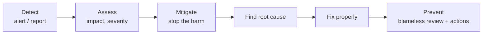

# Production Incidents

> An incident story shows how you behave when it matters. Tell it in order: detect, assess, stop the harm, find the cause, fix, prevent. Show calm communication, your own decisions, and what changed afterward.

Roadmap topic 8 · Stage 2: Core Stories

**Go deeper:** `7` Failure Stories · `11` Communication · `05-system-design/27-Observability` (alerts, SLOs) · `05-system-design/28-Deployment-and-Release` (rollback, flags) · `06-mobile-engineering/15-Build-Release-and-Monitoring` · `06-mobile-engineering/11-Performance-and-Memory`.

**Marks:** 🟢 must know · 🟡 good to know

---

#### 1. What Is It?

*A story about an unplanned problem that hurt users, and how you handled it.*

| 🟢 Must know | 🟡 Good to know |
|---|---|
| tell it in order: detect, assess, stop the harm, root cause, fix, prevent | mobile examples |
| calm, clear communication during the incident | mobile constraint: you can't recall an app |
| your own role and decisions | monitoring, alerts and tests added afterward |
| quick fix vs real root cause | on-call experience and stress |
| blameless review, actions, owners | |
| impact: users, duration, cost | |

1. **Incident:** an unplanned event that degrades the service for users.
2. **Mitigation:** an action that reduces harm quickly (halt rollout, flag off), before the real fix.
3. **Root cause:** the underlying reason, found by asking "why" repeatedly.
4. **Blameless postmortem:** a review that looks for causes in systems and process, not in people.

**Signals in an interview:** "Tell me about a production issue", "a time you were on call", "a bug that reached users", "how do you handle pressure?".

---

#### 2. How It Works

**The incident timeline.**



**Severity and who to tell.**

| Severity | Meaning | Example | Who |
|---|---|---|---|
| SEV1 | most users affected or data/money at risk | login broken for everyone | on-call, manager, leadership, comms |
| SEV2 | many users or a key flow degraded | crash spike on checkout | on-call, team lead, product |
| SEV3 | small group or workaround exists | a screen broken on one OS version | team, tracked in the backlog |

**Mobile constraints.** You cannot instantly roll back an app: users have the old build until they update. So you use:

1. **Halt the staged rollout** (stops new users getting the bad build).
2. **Feature flag / remote config off** (turns the feature off for everyone, often in minutes).
3. **Server-side fix** (change the API response to be safe for the bad client).
4. **Hotfix release** (a new build, with a staged rollout and a force-update if needed).
5. **Communicate** in-app or on the status page if users are affected (`SD 28`, `MOB 15`).

**Communication during an incident.**

| Rule | Why |
|---|---|
| one incident channel and one lead | avoid confusion |
| status every 30 minutes even if "no change" | stakeholders stop asking |
| facts, impact, next step, next update time | clear and calm |
| separate "what we know" from "what we guess" | avoids wrong decisions |

**Root cause: ask "why" until it is a process.**

```text
Symptom: crash on launch for users upgrading from 3.x.
Why 1: a database migration threw a NullPointerException.
Why 2: the 3.x schema allowed null in a column the new code assumes is non-null.
Why 3: the migration was only tested from the previous version (4.11), not older ones.
Why 4: CI has no upgrade test matrix.
Root cause: no upgrade tests from old versions.   → action: add a test matrix in CI
```

**Blameless review.** Facts and timeline; impact; what went well; what went poorly; root causes; action items with owners and dates. It asks "how did the system let this happen?" not "who did it?".

🟡 **Monitoring and testing afterward.** Alerts on crash-free rate and error budget burn (`SD 27`); release dashboards; upgrade tests; canary rollout gates; runbooks; feature flags for risky changes.

🟡 **On-call and stress.** Stay calm by following a checklist, writing things down, making one change at a time, asking for help early, and handing over cleanly. Look after yourself afterward (rest, debrief).

**Example (illustrative): crash spike after a release.**

> **Situation:** On a Friday, release 4.12 was at a 20% staged rollout. Within three hours the crash-free rate dropped from 99.5% to 97.9% and alerts fired. I was the on-call Android lead.
>
> **Assess and mitigate:** I confirmed it in Crashlytics: one `NullPointerException` in a database migration, only on users upgrading from 3.x. Roughly 3,100 users (0.9% of the base) were affected. First I halted the rollout so no one else got it. Then I turned off the remote flag `new_sync`, which stopped the crash for about 90% of affected users within 20 minutes; I posted a status update every 30 minutes in the incident channel and told support what to say.
>
> **Root cause and fix:** I reproduced it with a 3.x database on an emulator, found the null, and wrote the fix and a regression test. QA ran the upgrade test; we shipped a hotfix after 26 hours at a 5% staged rollout, then 100%. Crash-free users were back to 99.4% within four hours of the flag change.
>
> **Prevent:** In the blameless review we found the migration was only tested from 4.11. I added an upgrade-test matrix (3.x, 4.0, 4.11) to CI, a crash-free alert at 99%, and a rule that migrations ship behind a flag.
>
> **Lesson:** The staged rollout and the flag limited the damage, but the real fix was testing upgrades from old versions."

---

#### 3. Weak Answer vs Strong Answer

| | Weak | Strong |
|---|---|---|
| Order | jumps around | detect → assess → mitigate → root cause → fix → prevent |
| First action | tried to fix the bug while users suffered | stopped the harm first |
| Role | "we fixed it" | "I decided to halt and flag off; I led the communication" |
| Communication | not mentioned | regular status, one channel, clear ask |
| Cause | the symptom | root cause by "why" chain |
| Prevention | "we'll be careful" | specific tests, alerts, process, owners |
| Tone | panic or blame | calm, blameless |
| Impact | not quantified | users, duration, rating, cost |

---

#### 4. Templates & Worked Examples

**Incident-story template.**

```text
INCIDENT:                        WHEN / SEVERITY:               MY ROLE:
DETECTION (how we knew, how fast):
IMPACT (users, duration, money, ratings):
MY FIRST ACTIONS (stop the harm):
COMMUNICATION (to whom, how often):
ROOT CAUSE (the why chain):
THE FIX (and how it was verified / rolled out):
PREVENTION (tests, alerts, process, owners):
WHAT I'D DO DIFFERENTLY:
```

**A status update (copy and adapt).**

```text
[SEV2] Crash spike in release 4.12 (update 3, 18:30)
Impact: ~3,100 users upgrading from 3.x crash on launch; crash-free users 97.9% (normal 99.5%).
What we did: staged rollout halted at 20%; remote flag new_sync OFF at 17:55.
Now: crash rate falling (97.9% → 99.0%); root cause identified (migration null) – fix in review.
Next: hotfix build tomorrow; next update 19:00.
Needs: support to tell affected users to update when the fix is out.
```

**Blameless review outline.**

```text
Summary and impact  |  Timeline (UTC)  |  What went well  |  What went poorly  |  Where we got lucky
Root causes (system / process)  |  Action items: owner – due date – verified how
```

**Metrics.**

```kotlin
fun mttrMinutes(incidents: List<Pair<Long, Long>>): Double =        // pairs of (start, resolved) in minutes
    incidents.map { (start, end) -> (end - start).toDouble() }.average()
```

Checks: incidents lasting `45`, `30` and `120` minutes → `mttrMinutes` = `65.0`. Track it over time to show that the process is improving ("from 4 hours to 90 minutes in six months").

**Handling follow-up probes.**

| Probe | Reply |
|---|---|
| "Why didn't you just roll back?" | "An app can't be recalled; the flag turned the feature off in minutes, and the hotfix needed a day." |
| "What was your exact role?" | "I was on-call lead: I made the call to halt and flag off, and I ran the communication." |
| "How do you know it won't happen again?" | "The upgrade-test matrix would have caught this; I verified it by running it against the 4.12 build, and it failed." |

---

#### 5. Numbers & Metrics to Quote

| Item | Guide |
|---|---|
| Time to detect | minutes from the first bad event to the alert |
| Time to mitigate | minutes from detection to harm stopped |
| Time to resolve | to the permanent fix (MTTR) |
| Impact | users affected, % of base, duration, ratings, support tickets, money |
| Status cadence | every 30 minutes for SEV1 and SEV2 |
| Follow-up | actions with owners and dates; review within a week |
| Staged rollout | halt at the first sign of problems |

---

#### 6. Common Mistakes & Edge Cases

1. Starting with the root cause instead of the order of events.
2. Fixing before stopping the harm.
3. "We" for everything; your decisions are invisible.
4. No communication story.
5. Blaming a person or team.
6. Stopping at the quick fix and never finding the root cause.
7. No prevention.
8. No numbers on impact.

Edge cases: you caused the incident (own it first; blamelessness applies to the review, not to avoiding ownership); you were not the lead (describe your role precisely: investigation, communication, fix); the incident was not yours but you improved the process; a near miss (still valid: describe what caught it and what you changed); no on-call experience (use a production bug you handled, or describe your approach honestly).

---

#### 7. Say This in the Interview

1. "First I stopped the harm: I halted the rollout and turned the flag off. Then I looked for the cause."
2. "I posted a status every 30 minutes with impact, what we knew, and the next update time."
3. "The quick fix was the flag. The root cause was that migrations were only tested from the previous version."
4. "In the blameless review we agreed three actions with owners: an upgrade-test matrix, a crash-free alert, and migrations behind a flag."
5. "Impact was 0.9% of users for about four hours; crash-free was back to 99.4%."
6. "An app can't be rolled back, so staged rollouts and remote flags are our safety net."

---

#### 8. Quick Check

1. What do you do first in an incident?
2. What is a mitigation?
3. Why can't you simply roll back a mobile app?
4. What is a blameless review?

<details>
<summary>Answers</summary>

1. Assess the impact and stop the harm (halt rollout, flag off), before looking for the full fix.
2. An action that reduces harm quickly, before the permanent fix.
3. Users already have the build installed; you can only stop new installs, use flags or server changes, and ship a hotfix.
4. A review that looks at system and process causes, not at who made the mistake.

</details>

---

#### 9. Practice

**Interview questions**

1. Tell me about a production issue you handled.
2. How did you communicate during the incident?
3. How did you find the root cause?
4. What did you change to prevent it from happening again?
5. How do you stay calm on-call?
6. A release is crashing and you can't roll back: what do you do?

**Exercises**

1. Write the story with the template; put the numbers in.
2. Draft the status update you would have posted.
3. Write the "why" chain for the root cause.
4. List the alerts, tests and process changes that prevent a repeat, with owners.

**Remember:** stop the harm first · communicate on a schedule · quick fix vs root cause · blameless review with owners · mobile: halt rollout, flag off, server fix, hotfix · quantify impact.
