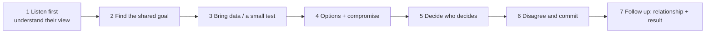

# Conflict Resolution & Disagreement

> Healthy teams disagree. The strong answer shows that you listen first, find the shared goal, use evidence, and support the final decision, and that the relationship was better afterward.

Roadmap topic 9 · Stage 3: People & Collaboration

**Go deeper:** `5` Technical Decisions · `10` Cross-Team Collaboration · `11` Communication · `13` Mentoring (feedback) · `12` Leadership Without Authority · `18` Situational Questions.

**Marks:** 🟢 must know · 🟡 good to know

---

#### 1. What Is It?

*A real disagreement, handled with respect, resolved with evidence.*

| 🟢 Must know | 🟡 Good to know |
|---|---|
| a real disagreement with a real cost of not resolving it | conflicts with product, design, backend, QA, engineers |
| steps: listen, understand, shared goal, data, agree | a time you were wrong |
| respect: attack the problem, not the person | escalation: when and how |
| disagree and commit | giving direct feedback kindly (SBI) |
| the result and the relationship afterward | |

1. **Conflict:** people want incompatible things, or see the same facts differently.
2. **Shared goal:** the outcome both sides actually want (a stable app, a launch date, a good user experience).
3. **Disagree and commit:** you argue your view, then fully support the decision.

**Signals in an interview:** "Tell me about a disagreement with a teammate / manager / another team", "a time you changed your mind", "a difficult colleague", "how do you give hard feedback?".

---

#### 2. How It Works

**The steps.**



**Why people disagree.**

| Cause | What helps |
|---|---|
| different information | share the facts and the sources |
| different goals or incentives | name them; find the shared goal |
| different risk tolerance | quantify the risk and the reversibility |
| unclear ownership | agree who decides |
| style or communication | talk directly, assume good intent |
| stress and deadlines | pause, then revisit |

**Conflict ladder.**

| Step | Action |
|---|---|
| 1 | talk to the person directly and privately, with curiosity |
| 2 | bring evidence or run a small experiment |
| 3 | involve a neutral third person (tech lead, peer) |
| 4 | escalate to the common manager **with** a summary of both views and a proposed decision |
| 5 | accept the decision and commit |

Escalation is not failure. It is right when the decision is outside your authority, the cost of delay is high, or the discussion is going in circles. Tell the other person you are doing it and why.

**Disagree and commit.** State your concern and the evidence once, clearly. If the decision goes the other way, support it fully (no "I told you so", no half-effort), and agree on a checkpoint to review ("if the duplicate rate stays above 1% in a month, we revisit").

**Feedback with SBI.** *Situation, Behaviour, Impact* keeps feedback specific and calm: "In yesterday's review (S), you merged without waiting for the second approval (B); that is how the migration bug reached QA (I). Can we agree on the rule?"

🟡 **With whom.**

| Partner | Typical conflict | Approach |
|---|---|---|
| Product | scope vs deadline | show options with cost and risk; agree the cut line |
| Design | feasibility vs polish | prototype; offer an 80% solution now |
| Backend | API shape, timing | contract-first; agree on versions and old app support |
| QA | readiness for release | agree release criteria and risks |
| Engineer | design or review disagreement | evidence, small test, decision owner |
| Manager | priority or workload | bring options and impact; ask what is the priority |

🟡 **A time you were wrong.** Strong evidence of maturity: say what changed your mind (data, a better argument), say so openly, and thank the person.

**Example (illustrative): pagination dispute with backend.**

> **Situation:** We were building the feed API. The backend engineer wanted offset pagination because it was simple and the web app used it; I believed it would cause duplicates and gaps in a live mobile feed. We argued for a week and the sprint was at risk. **Task:** I needed an API shape both teams could ship, and I wanted to keep the relationship healthy.
>
> **Action:** I first asked him to explain his reasons; the main one was delivery time, since cursor pagination needed an index change. We agreed the shared goal: ship the feed without user-visible bugs and without slipping the date. Instead of arguing, I ran a one-hour test on staging: with new posts arriving every few seconds, offset pagination produced duplicates in 4% of scrolled sessions. I showed him the numbers and proposed a compromise: cursor pagination for the mobile feed, offset kept for the admin screen where order doesn't change, and I'd write the client and a test fixture to cut his work. He asked for one thing: a clear cursor format, which I wrote in the contract.
>
> **Result:** The backend shipped cursor pagination in two sprints, duplicates went from 4% of sessions to zero, and we hit the date. He later asked me to review the API for the next feature.
>
> **Lesson:** I now bring a small test, not an opinion, and I ask about their constraints before proposing."

---

#### 3. Weak Answer vs Strong Answer

| | Weak | Strong |
|---|---|---|
| Story | "I was right and they were wrong" | both views had merit; the shared goal is clear |
| Start | argue the position | listen and ask |
| Evidence | opinion, volume | a test, data, a prototype |
| Tone | personal, blaming | about the problem |
| Resolution | won, or gave up | compromise or a clear decision with commitment |
| After | silence | relationship intact or better |
| Learning | none | a changed approach |

---

#### 4. Templates & Worked Examples

**Conflict-story template.**

```text
DISAGREEMENT:                      WITH WHOM (role):           WHEN:
WHAT EACH OF US WANTED (and why):
THE COST OF NOT RESOLVING IT:
SHARED GOAL:
WHAT I DID TO UNDERSTAND THEM:
EVIDENCE / EXPERIMENT:
OPTIONS AND THE COMPROMISE:
WHO DECIDED, AND HOW I SUPPORTED IT:
RESULT (with numbers) AND THE RELATIONSHIP AFTER:
WHAT I LEARNED:
```

**Opening lines for a hard conversation.**

| Situation | Opening |
|---|---|
| to understand | "Help me understand what matters most to you in this." |
| shared goal | "We both want the feed to ship on time without bugs. Can we start there?" |
| concern | "My concern is X; here's the data. What am I missing?" |
| compromise | "What if we do A for this case and B for that one?" |
| decision | "Who should make the call? I'll support it either way." |

**SBI feedback examples.**

| Situation | Behaviour | Impact | Message |
|---|---|---|---|
| In Tuesday's design review | you interrupted two engineers | they stopped sharing ideas | "In Tuesday's review you interrupted Priya and Sam twice; they went quiet afterward. Could you let them finish?" |
| In the last release | the PR was merged without tests | the migration bug reached QA | "The last PR went in without tests, and that migration bug reached QA. Can we add a test requirement to the checklist?" |

**Disagree and commit, in words.**

> "I still think cursor pagination is safer, and I've said why. Since we decided on offset for the first release, I'll build it well, and let's check the duplicate rate after two weeks and revisit if it's above 1%."

**When to escalate (checklist).**

1. The decision is not mine or the other person's.
2. The cost of delay is rising.
3. We've tried talking and evidence.
4. I can write both views fairly in a paragraph.
5. I've told the other person I'm doing it.

---

#### 5. Numbers & Metrics to Quote

| Item | Guide |
|---|---|
| Story length | about 2 minutes; the steps you took are the main part |
| Cost of not resolving | days of delay, risk to launch, team friction |
| Evidence | a measured result from a test, benchmark or data |
| Outcome | a number (duplicates 4% → 0, date met) |
| Relationship | a specific sign (they asked for a review next time) |
| Conversations | say how many, and the order (1:1 first) |

---

#### 6. Common Mistakes & Edge Cases

1. The other person is a villain.
2. A conflict with no real stakes ("we disagreed about naming").
3. Describing winning instead of resolving.
4. Escalating first, or never.
5. No evidence, only persuasion.
6. Complaining about a manager or a past employer.
7. "I never have conflicts."
8. Pretending to commit but sabotaging quietly.

Edge cases: the other person was senior or your manager (show respect and evidence; ask how decisions are made); remote or async disagreement (move to a call, then write the summary); you lost (show how you committed and what happened); an unresolved conflict (say what you did and learned); a conflict about behaviour (use SBI and involve your manager if needed).

---

#### 7. Say This in the Interview

1. "First I asked them to explain their view; their real constraint was…"
2. "We agreed the shared goal was…"
3. "Instead of debating, I ran a small test: …"
4. "We settled on a compromise: …"
5. "I disagreed, I said so once with the data, and when the decision went the other way I fully supported it, with a checkpoint."
6. "We worked well together afterward; they asked me to review their next design."

---

#### 8. Quick Check

1. What is the first step in a disagreement?
2. What does "disagree and commit" mean?
3. When is escalation right?
4. What is SBI?

<details>
<summary>Answers</summary>

1. Listen and understand the other person's view and constraints.
2. Make your case once, then support the final decision fully.
3. When it is outside your authority, the delay is costly, or you've tried talking and evidence.
4. Situation, Behaviour, Impact: a structure for specific, calm feedback.

</details>

---

#### 9. Practice

**Interview questions**

1. Tell me about a disagreement with a teammate.
2. Tell me about a disagreement with your manager.
3. Tell me about a time you disagreed with another team (product, design, backend).
4. Tell me about a time you changed your mind.
5. How do you give difficult feedback?
6. Tell me about a time you committed to a decision you disagreed with.

**Exercises**

1. Write one conflict story with the template; make sure the other person has a reasonable view.
2. Write an SBI message for a real situation you've faced.
3. Practise the opening lines aloud with a friend, who plays the other side.
4. Prepare a story where you were wrong or lost.

**Remember:** listen first · find the shared goal · bring evidence · compromise or decide who decides · disagree and commit · keep the relationship · be honest if you were wrong.
