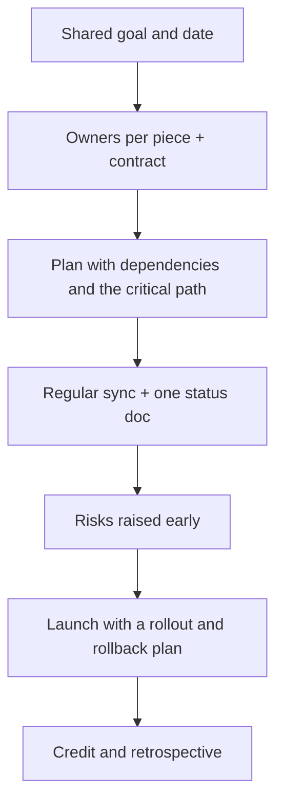

# Cross-Team Collaboration

> Most real features need backend, design, product, QA and sometimes other mobile teams. This story shows how you align people you don't manage: early dependencies, a clear contract, regular communication, and shared credit.

Roadmap topic 10 · Stage 3: People & Collaboration

**Go deeper:** `9` Conflict Resolution · `11` Communication · `12` Leadership Without Authority · `04-backend-engineering/03-API-Design` · `05-system-design/30-Mobile-Specific-Topics` (old app versions) · `09-architecture` (ownership, boundaries).

**Marks:** 🟢 must know · 🟡 good to know

---

#### 1. What Is It?

*Delivering something that needs several teams to move together.*

| 🟢 Must know | 🟡 Good to know |
|---|---|
| working with backend, design, product, QA, other mobile teams | regular communication: shared doc, short sync, owners |
| agreeing an API contract; changes and old app versions | settling priority disagreements between teams |
| handling dependencies: raise early, track | time zones and remote teams |
| influencing without authority | sharing credit |
| a multi-team launch and how you kept everyone aligned | |

1. **Dependency:** work you need from another team before you can finish.
2. **Contract:** the agreed interface between teams (API, events, design specs).
3. **Owner:** one named person accountable for each piece.
4. **Alignment:** everyone sees the same goal, plan, status and risks.

**Signals in an interview:** "Tell me about working with another team", "a project that needed several teams", "a blocker from a dependency", "how do you work with backend?".

---

#### 2. How It Works

**A multi-team launch.**



**Who you work with, and what each needs.**

| Team | They care about | You need from them |
|---|---|---|
| Backend | stable APIs, load, versioning | API contract, error format, pagination, old-app support |
| Design | consistency, accessibility | specs, states (loading/empty/error), assets |
| Product | scope, date, metrics | priorities, decisions, trade-off calls |
| QA | testability, risks | build early, test data, release criteria |
| Other mobile teams (iOS, platform) | parity, shared components | shared behaviour, release timing |
| Security / legal | compliance | review early, not at the end |

**The API contract.** Agree before building: endpoints and fields, pagination, error shapes, auth, rate limits, and the rules for change. Mobile-specific rules (`BE 3`, `SD 30`):

1. Changes are **add-only**: new fields, never remove or rename.
2. The app **ignores unknown fields**; the backend **keeps old versions working** until usage drops.
3. A **version** or a **minimum supported version** is agreed, with a force-update plan.
4. Both sides use a **mock server** or contract tests so work happens in parallel.

**Managing dependencies.**

| Practice | How |
|---|---|
| Find them early | list every "I need X from team Y by date Z" in week 1 |
| Make them visible | one shared table: owner, date, status, risk |
| Find the critical path | the longest chain of dependent work decides the date |
| Unblock yourself | mocks, stubs and feature flags so you can build without waiting |
| Escalate with facts | "this blocks the launch on the 14th; I need a decision by Friday" |

**Influence without authority.** Build trust (deliver what you say), share context (why it matters to *their* goals), make yes easy (a clear, small ask), offer help in return, and give credit publicly.

🟡 **Regular communication.** A short weekly sync (15 minutes, blockers only), a shared document with decisions and owners, and written summaries after meetings.

🟡 **Priority disagreements.** Put both teams' priorities side by side with impact and cost; ask the common manager or product owner to decide; agree a revisit date.

🟡 **Time zones and remote teams.** Write decisions down; agree on overlap hours; use async updates; record short videos for complex topics; avoid "hallway" decisions.

🟡 **RACI.** A chart of who is Responsible, Accountable, Consulted, Informed. One Accountable person per item.

**Example (illustrative): launching in-app payments with four teams.**

> **Situation:** We had eight weeks to launch in-app payments, needing backend (payments API), design, QA and our iOS team. Early on, two teams had different assumptions about the order of events. **Task:** As the Android lead, I was asked to coordinate the mobile side and keep the launch on track.
>
> **Action:** In week one I wrote down every dependency in one table: owner, date, status. That showed the critical path: design specs (3 days) → payments API (5 days) → Android and iOS build (6 days) → QA (3 days), which is 17 working days if nothing slips. I set up a 15-minute Tuesday sync with an owner per piece and one shared doc for decisions. With backend, I agreed an API contract with an idempotency key and error codes, and built against a mock server, so I wasn't blocked when the API was two days late. When design and iOS disagreed on the confirmation screen, I put both options with their cost in the doc and asked the product owner to decide on Thursday. I flagged the sandbox-approval risk in week two, not week six.
>
> **Result:** We launched on the planned date, with a 5% → 100% staged rollout; payment success was 97.8% on day one, and there were no duplicate charges. At the retrospective I thanked the backend engineer by name for the idempotency work.
>
> **Lesson:** a shared dependency table and a mock server turned waiting into progress."

---

#### 3. Weak Answer vs Strong Answer

| | Weak | Strong |
|---|---|---|
| Dependencies | discovered late | listed in week one, owned, tracked |
| Contract | "backend will tell us" | agreed in writing, mock server, add-only rules |
| Updates | when asked | regular, short, one place |
| Blockers | waited | unblocked with mocks; escalated with facts |
| Influence | "they didn't listen" | context, small ask, trust, help in return |
| Credit | took it | shared by name |
| Conflict | blamed another team | put both options with costs and asked for a decision |

---

#### 4. Templates & Worked Examples

**Dependency table.**

| Need | From | By | Owner | Status | Risk if late |
|---|---|---|---|---|---|
| Payment screen specs | Design | Mar 4 | A. Rao | done | blocks UI |
| Payments API (staging) | Backend | Mar 11 | J. Kim | in progress | blocks integration |
| Sandbox approval | Provider | Mar 7 | me | waiting | blocks QA |
| Test accounts | QA | Mar 15 | S. Lee | not started | blocks regression |

**Critical path in code.**

```kotlin
data class Task(val days: Int, val dependsOn: List<String> = emptyList())

fun criticalPath(tasks: Map<String, Task>): Int {
    val finish = HashMap<String, Int>()
    fun finishTime(name: String): Int = finish.getOrPut(name) {
        val t = tasks.getValue(name)
        t.days + (t.dependsOn.maxOfOrNull { finishTime(it) } ?: 0)     // wait for the slowest dependency
    }
    return tasks.keys.maxOf { finishTime(it) }
}
```

Checks: `design 3`, `api 5 (after design)`, `mobile 6 (after design and api)`, `qa 3 (after mobile)` → `criticalPath` = `3 + 5 + 6 + 3 = 17` days. If the API takes 2 days longer, the total becomes `19`: the launch slips by 2 days. A task off the critical path (for example "docs", 2 days, after design) can slip without moving the date.

**API contract checklist.**

```text
[ ] Endpoints, fields, types, nullability       [ ] Pagination (cursor)        [ ] Error format + codes
[ ] Auth and permissions                       [ ] Idempotency for writes      [ ] Rate limits
[ ] Versioning + min supported app version     [ ] Add-only rule agreed        [ ] Mock server / contract tests
[ ] Who tells whom about a change, and when    [ ] Rollout order (backend first, then app)
```

**Short status (shared doc).**

```text
Week 3 – In-app payments (target: Apr 8)
Green: design specs done; Android build 60%.  Amber: payments API 2 days late (owner J. Kim, new date Mar 13).
Red: sandbox approval not received – blocks QA; escalated to partner manager, need decision by Mar 10.
Decisions this week: confirmation screen = option B (product, Thu).  Next sync: Tue 10:00.
```

**Asking for help (make it easy to say yes).**

> "We launch on April 8 and the payments API is on the critical path. Could you review the contract by Thursday? It's one page and I've listed three open questions. I can write the mock server so your testing isn't blocked."

---

#### 5. Numbers & Metrics to Quote

| Item | Guide |
|---|---|
| Teams involved | say how many (for example 4) |
| Duration | weeks to launch |
| Critical path | days of the longest chain |
| Slips and recoveries | "API was 2 days late; mock server avoided the delay" |
| Sync | 15 minutes weekly |
| Outcome | on-time launch, quality (success rate, duplicates, crash-free) |
| Credit | name at least one person from another team |

---

#### 6. Common Mistakes & Edge Cases

1. Discovering dependencies late.
2. No written contract.
3. Waiting for others instead of mocking or flagging.
4. Blaming another team.
5. Updating only when asked.
6. Taking all the credit.
7. Having no owner for a piece.
8. Forgetting old app versions in API changes.

Edge cases: a team that doesn't respond (ask their manager for a contact and a date, with facts); two teams with conflicting priorities (put them side by side and ask the decision owner); a remote team in another time zone (async updates, a decision log); a dependency that is cancelled (re-plan the critical path); conflict in the contract (agree on a compatibility rule: add-only).

---

#### 7. Say This in the Interview

1. "In week one I listed every dependency with an owner and a date, and found the critical path."
2. "We agreed an API contract in writing and I built against a mock server so I wasn't blocked."
3. "I ran one 15-minute sync a week and kept one doc with decisions, owners and risks."
4. "When two teams disagreed, I laid out both options with costs and asked the product owner to decide."
5. "I raised the sandbox-approval risk in week two with a decision date."
6. "I thanked the backend engineer for the idempotency work in the retrospective."

---

#### 8. Quick Check

1. When do you list dependencies?
2. What is the critical path?
3. How do you keep working when an API is late?
4. What are the mobile-specific API rules?

<details>
<summary>Answers</summary>

1. In the first week, with owners and dates.
2. The longest chain of dependent work; it decides the finish date.
3. Build against a mock server or stub and use feature flags.
4. Add-only changes, the app ignores unknown fields, old versions keep working, and a minimum supported version with a force-update plan.

</details>

---

#### 9. Practice

**Interview questions**

1. Tell me about a project that needed several teams.
2. How do you work with backend engineers on an API?
3. Tell me about a time a dependency blocked you.
4. How do you influence a team you don't manage?
5. How do you keep a multi-team project aligned?
6. Tell me about a time you worked with a remote team.

**Exercises**

1. Make a dependency table for your last multi-team project; compute the critical path.
2. Write an API contract checklist and fill it in for one feature.
3. Write a short status in the format above.
4. Write one "easy yes" request to another team.

**Coding warm-ups (LeetCode, dependency graphs)**

| # | Question | Link to this topic |
|---|---|---|
| 207 | [Course Schedule](https://leetcode.com/problems/course-schedule/) (Medium) | detect circular dependencies |
| 210 | [Course Schedule II](https://leetcode.com/problems/course-schedule-ii/) (Medium) | build order |
| 1136 | [Parallel Courses](https://leetcode.com/problems/parallel-courses/) (Medium, premium) | minimum stages (critical path) |
| 2050 | [Parallel Courses III](https://leetcode.com/problems/parallel-courses-iii/) (Hard) | critical path with durations |

**Remember:** list dependencies in week one · written contract + mock server · one owner per piece · short regular updates · raise risks early with a decision date · share credit by name.
