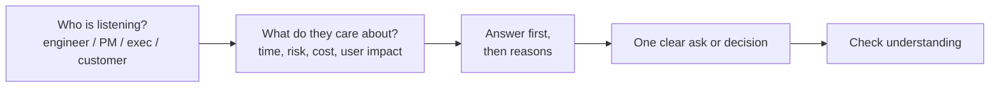

# Communication & Stakeholder Management

> Good engineers are understood. Explain technical topics in simple words, state trade-offs as cost, risk, time and user impact, give clear updates, tell bad news early, and say no with reasons and alternatives.

Roadmap topic 11 · Stage 3: People & Collaboration

**Go deeper:** `9` Conflict Resolution · `10` Cross-Team Collaboration · `12` Leadership Without Authority · `13` Mentoring (feedback) · `09-architecture` (communicating trade-offs, design docs).

**Marks:** 🟢 must know · 🟡 good to know

---

#### 1. What Is It?

*Making the right people understand the right thing at the right time.*

| 🟢 Must know | 🟡 Good to know |
|---|---|
| explain technical topics simply | write design docs and proposals |
| trade-offs in cost, risk, time, user impact | run useful meetings and reviews |
| clear status updates | give and receive feedback |
| set expectations early, tell bad news early | manage up |
| say no with reasons and alternatives | present to leadership |

1. **Stakeholder:** anyone affected by, or with a say in, your work (product, design, support, leadership, users).
2. **Expectation:** what someone believes will happen. Your job is to keep it close to reality.
3. **Status:** where we are, what is at risk, and what you need.

**Signals in an interview:** "Explain a complex topic to a non-technical person", "a time you gave bad news", "how do you handle an unrealistic request?", "how do you keep stakeholders informed?".

---

#### 2. How It Works

**Know the audience, then choose the message.**



**Explaining technical topics simply.**

| Technical | Plain |
|---|---|
| "We need to migrate to Room with a repository." | "We're moving to an on-device database so the app works without internet. Users stop losing notes when the signal drops." |
| "There's technical debt in the networking layer." | "A shortcut we took last year now makes each networking change take twice as long. Fixing it costs two weeks and saves about a day per feature." |
| "The release has a regression." | "A change in this release makes the app close for about 1% of users. We've paused the rollout." |

Use an analogy, a number, and the user impact; avoid jargon, or define it once.

**Trade-offs in business terms.**

| Dimension | Question to answer |
|---|---|
| Cost | How many people-weeks or how much money? |
| Risk | What can go wrong, how likely, how bad, can we undo it? |
| Time | When, and what is delayed? |
| User impact | Who notices, and how much? |

Offer **options**, not one answer: "Option A: ship Friday with feature X cut; Option B: ship in two weeks with everything. I recommend A because…"

**Status updates (the three questions).**

1. **Where are we?** (on track / at risk / blocked, with a date)
2. **What is at risk?** (the top one or two risks and the plan)
3. **What do I need?** (a decision, a person, a date)

**Expectations and bad news.**

| Rule | Why |
|---|---|
| Set expectations at the start (scope, date, assumptions) | no surprises later |
| Tell bad news early, in person or live, with a plan | trust grows; options remain |
| Bring options, not only the problem | shows ownership |
| Follow up in writing | creates a record |

**Saying no.** A good "no" has a reason, an alternative and a next step: "We can't ship the full redesign by the 14th without cutting testing. I can ship the checkout part by the 14th and the rest by the 28th. Would that work?"

🟡 **Design docs and proposals.** Problem, goals/non-goals, options, recommendation, risks, rollout, open questions. One to three pages. Invite comments with a deadline (`ARCH 14`).

🟡 **Useful meetings and reviews.** A purpose, an agenda, the right people, decisions and owners written down, and the notes sent after. Cancel meetings that could be a message.

🟡 **Feedback.** Give: specific, timely, about behaviour (SBI). Receive: listen, ask for an example, thank them, decide what to try.

🟡 **Manage up.** Tell your manager what you're working on, the risks, and what you need before they ask. No surprises. Bring a recommendation with each problem.

🟡 **Present to leadership.** Lead with the answer ("I recommend X, which costs Y and avoids Z"), then three supporting points, then the ask. Keep it short. Prepare for the "what could go wrong" and "what do you need" questions.

**Example (illustrative): telling the VP a launch would slip.**

> **Situation:** Three weeks before a big launch, QA found that the offline sync lost edits in about 1 of 200 test runs. The VP had promised the date to partners. **Task:** I had to tell leadership the truth and propose a way forward.
>
> **Action:** I asked for 15 minutes the same day. I opened with the answer: "We can launch on the 14th with a known risk, or on the 28th with it fixed; I recommend the 28th." I explained it in plain words ("in 1 of 200 tests, a note edited offline can disappear"), gave the user impact (about 500 users a day at our volume), and gave three options with cost and risk: launch on the date and disable offline edits behind a flag, slip two weeks, or launch to 10% first. I recommended the 10% staged launch with the flag, because it kept the date for most users and protected data. I followed up with a one-page written summary.
>
> **Result:** The VP chose the staged launch; we reached 100% in nine days, the bug was fixed in the second week, and no user lost an edit in production. The VP later asked me to join the planning for the next launch.
>
> **Lesson:** early, with options and a recommendation, bad news becomes a decision rather than a surprise."

---

#### 3. Weak Answer vs Strong Answer

| | Weak | Strong |
|---|---|---|
| Language | jargon, acronyms | plain words, one analogy, one number |
| Structure | long background, answer at the end | answer first, then reasons |
| Trade-offs | "it's complicated" | cost, risk, time, user impact, with options |
| Bad news | late, vague, no plan | early, specific, with options and a recommendation |
| Status | "going fine" | on track / at risk / blocked + what I need |
| No | flat refusal, or a silent yes | reason, alternative, next step |
| Follow-up | none | written summary and date |

---

#### 4. Templates & Worked Examples

**Status update.**

```text
Project: Offline sync          Status: AT RISK        Date: Mar 10
Where we are: 80% built; QA found data loss in 1 of 200 runs (fix in progress).
Risks: (1) launch date Mar 14 may not hold; (2) QA needs 3 days after the fix.
Plan: fix by Mar 12; staged 10% launch with the offline-edit flag if QA isn't done.
Need: decision by Mar 11 on the 10% staged launch (owner: product).
```

**Bad-news message.**

```text
Subject: Launch risk – decision needed by Wednesday
Headline: We can't promise Mar 14 for 100% of users. Recommendation: 10% on Mar 14, 100% on Mar 28.
What happened: offline edits can be lost in ~0.5% of cases (found in QA, not in production).
Impact: ~500 users/day if released to everyone; none if staged.
Options: A) launch all on Mar 14 with offline edits off (flag)  B) slip to Mar 28  C) staged (recommended)
Next: I'll send a daily update until the fix is verified.
```

**Saying no with an alternative.**

| Request | Response |
|---|---|
| "Add this to the release tomorrow." | "That would skip testing the sync. I can add it to next week's release, or ship it behind a flag to 5% tomorrow." |
| "Make it 2× faster by Friday." | "I can fix the biggest cause (about 40% of the time) by Friday; the rest needs two weeks. Which matters more?" |
| "Can you just do it?" | "Yes, if we drop X. Here's the cost of each option." |

**One-page proposal structure.**

```text
Problem (1 paragraph, with a number)   Goals / Non-goals
Options (2–3, with trade-offs)         Recommendation and why
Risks and mitigations                  Rollout and rollback
Open questions                         Decision needed by <date>, from <who>
```

**A simple clarity check (for your own writing).**

```kotlin
fun averageWordsPerSentence(text: String): Double {
    val sentences = text.split('.', '!', '?').map { it.trim() }.filter { it.isNotEmpty() }
    return sentences.sumOf { it.split(Regex("\\s+")).size }.toDouble() / sentences.size
}
```

Checks: `averageWordsPerSentence("We paused the rollout. About 1% of users were affected. A fix ships Friday.")` → `(4 + 6 + 4) / 3 = 4.67`. Aim for about 15 to 20 words per sentence in messages to non-technical readers; very long sentences hide the point.

---

#### 5. Numbers & Metrics to Quote

| Item | Guide |
|---|---|
| Executive message | 3 to 5 sentences: answer, reason, ask |
| Status update | under 150 words; same format every week |
| Options | 2 or 3, with a recommendation |
| Design doc | 1 to 3 pages; comments deadline of 3 to 5 days |
| Meetings | agenda, 25 or 50 minutes, decisions and owners recorded |
| Bad news | the same day you know; with a plan within 24 hours |
| Evidence of success | a decision made, a date kept, a stakeholder who asks you back |

---

#### 6. Common Mistakes & Edge Cases

1. Burying the answer under background.
2. Jargon with non-technical audiences.
3. Hiding bad news or reporting it late.
4. Problems without options.
5. A flat "no" or a silent "yes" that you can't deliver.
6. Updates only when asked.
7. Long emails and meetings with no decision.
8. Overpromising to please.

Edge cases: a stakeholder who keeps changing scope (written scope, change log, trade-off for each change); a senior person who disagrees with you in public (stay calm, offer to follow up with data); an executive with two minutes (answer and ask); a mixed audience (start with the headline, offer detail on request); a language barrier (short sentences, written follow-up).

---

#### 7. Say This in the Interview

1. "I start with the answer, then the reasons, then the ask."
2. "I explain it in terms of user impact, cost, risk and time, and I offer two or three options with a recommendation."
3. "As soon as I knew, I told them the same day, with a plan."
4. "I said no to X because…, and offered Y instead."
5. "I send a weekly status: where we are, what's at risk, what I need."
6. "I followed up in writing so the decision was recorded."

---

#### 8. Quick Check

1. What are the three questions in a status update?
2. What should come first when presenting to leadership?
3. What makes a good "no"?
4. When do you share bad news?

<details>
<summary>Answers</summary>

1. Where are we, what is at risk, what do I need.
2. The answer or recommendation, followed by reasons and the ask.
3. A reason, an alternative and a next step.
4. As early as possible, with options and a recommendation.

</details>

---

#### 9. Practice

**Interview questions**

1. Explain a complex technical topic to a non-technical person.
2. Tell me about a time you gave bad news.
3. How do you keep stakeholders informed?
4. Tell me about a time you said no to a request.
5. How do you manage up?
6. Tell me about a presentation to leadership.

**Exercises**

1. Rewrite a technical paragraph for a product manager, in under 60 words.
2. Write a status update and a bad-news message for a real project.
3. Write three "no with alternative" replies to real requests.
4. Draft a one-page proposal and ask a colleague to find the unclear sentences.

**Remember:** answer first · plain words · trade-offs as cost, risk, time, user impact · options with a recommendation · bad news early · no with an alternative · write it down.
