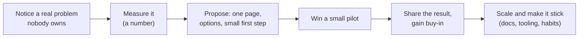

# Leadership Without Authority

> Leadership is not a title. It is noticing a problem nobody owns, proposing a fix, getting people on board, and driving it to the end. This is the core of senior and staff behavioral rounds.

Roadmap topic 12 · Stage 4: Leadership

**Go deeper:** `4` Project Challenges · `6` Architecture Decisions · `9` Conflict · `10` Cross-Team Collaboration · `11` Communication · `13` Mentoring · `09-architecture` (the architect role, `ARCH 1`).

**Marks:** 🟢 must know · 🟡 good to know

---

#### 1. What Is It?

*Getting things done through trust, evidence and initiative, not through rank.*

| 🟢 Must know | 🟡 Good to know |
|---|---|
| initiative and ownership | staff and architect behaviours |
| a problem nobody owned, driven to a fix | staff engineer archetypes |
| leading a project or technical direction as a senior engineer | acting like an owner: user and business |
| getting buy-in: proposal, evidence, small wins | leading an unpopular change |
| raising the quality bar | |
| deciding when the answer is unclear | |

1. **Ownership:** you care about the outcome, not only your ticket.
2. **Influence:** people act because they trust and understand, not because they must.
3. **Buy-in:** real agreement and support.
4. **Quality bar:** the standard the team accepts as normal.

**Signals in an interview:** "Tell me about a time you led without being the manager", "took initiative", "improved how the team works", "influenced a decision", "drove a change people resisted".

---

#### 2. How It Works

**The influence ladder: from noticing to scaling.**



**Tools of influence.**

| Tool | Example |
|---|---|
| Evidence | crash dashboard showing 62% of crashes from three causes |
| A clear proposal | one page: problem, options, recommendation, cost, ask |
| A small pilot | fix the top crash first; show the drop |
| Making it easy | write the lint rule, template or script so others can follow |
| Listening | ask the sceptics what would change their mind |
| Allies | one respected engineer who supports it |
| Credit | give it away; others adopt what they helped shape |
| Persistence | follow up kindly until it is done |

**Raising the quality bar.**

| Lever | Example |
|---|---|
| Code review | checklist (tests, error states, threading), explain *why* |
| Standards | a short style and architecture guide |
| Tests | a rule that bug fixes include a regression test |
| Tooling | CI gates: lint, unit tests, startup benchmark |
| Visibility | a weekly health dashboard (crash-free, ANR, build time) |
| Culture | blameless reviews, celebrate good catches |

**Decide when the answer is unclear.** Write the question, list what you know and don't, choose a reversible option, set a check date and a signal for changing course, and communicate it.

🟡 **Staff and architect behaviours.** Set direction (what to do and why), align teams around it, remove obstacles, write down decisions, grow other leaders, and measure business impact, not only technical output (`ARCH 1`).

🟡 **Staff engineer archetypes.** Four common shapes (names only): **Tech Lead** (guides a team's approach and execution), **Architect** (owns direction and quality of a critical area), **Solver** (parachutes into the hardest problems), **Right Hand** (extends a senior leader's reach).

🟡 **Acting like an owner.** Know the user, the business metric and the cost; fix what's broken near you; say "I'll own it" and follow through; leave things better than you found them.

🟡 **Leading an unpopular change.** Explain the "why" with data, acknowledge the cost, start small, listen to concerns, keep a rollback, and share the first results. Expect resistance; it is information.

**Example (illustrative): taking ownership of app stability.**

> **Situation:** Our crash-free users were 98.6% and slowly falling, but crashes were nobody's job: they appeared in the backlog and were ignored. I wasn't the lead; I was a senior engineer. **Task:** I decided to own it, because ratings were falling and support was escalating.
>
> **Action:** I pulled the data first: three causes made up 62% of all crashes. I wrote a one-page proposal to my manager and tech lead: fix the top three in the next sprint, add a weekly 20-minute crash review, and add a CI gate that blocks releases below 99% on the staged rollout. I did the first fix myself to show it was small (a null in a deep link handler), then asked two teammates to take the others, and I paired with one of them. I wrote a short guide, "How to read a crash report", and a PR template line: "Does this need a regression test?" When the product manager worried about velocity, I showed the cost: crash tickets already took about 20% of our support time.
>
> **Result:** In 8 weeks crash-free users rose from 98.6% to 99.5%, the rating from 4.1 to 4.4, and the weekly review now runs without me. The CI gate has stopped two bad releases since.
>
> **Lesson:** a number, a small first win and making the habit easy mattered more than convincing anyone in a meeting."

---

#### 3. Weak Answer vs Strong Answer

| | Weak | Strong |
|---|---|---|
| Trigger | "my manager asked" | noticed a problem no one owned |
| Evidence | feeling | a measured problem |
| Approach | demanded change | proposal, pilot, small win |
| People | convinced no one, or forced them | listened to objections, found allies |
| Making it stick | one-off fix | docs, tooling, review habit |
| Result | not measured | before/after numbers |
| Credit | "I did it all" | shared |

---

#### 4. Templates & Worked Examples

**One-page proposal.**

```text
TITLE:                                        AUTHOR / DATE:
PROBLEM (with a number):
WHY NOW / WHO IS HURT:
GOALS / NON-GOALS:
OPTIONS: A) …  B) …  C) do nothing
RECOMMENDATION AND FIRST STEP (small, reversible):
COST (people-weeks) AND WHAT WE GIVE UP:
HOW WE'LL MEASURE SUCCESS (metric, date):
RISKS AND ROLLBACK:
WHAT I NEED FROM YOU: (a decision / 2 people / a review by <date>)
```

**Leadership-story template.**

```text
THE PROBLEM NOBODY OWNED:                  HOW I KNEW (data):
MY FIRST STEP (small):
HOW I GOT BUY-IN (who, how, what objections):
WHAT I DID MYSELF / WHAT I DELEGATED:
HOW I MADE IT STICK (docs, tooling, habit):
RESULT (numbers):                          WHO ELSE DESERVES CREDIT:
```

**Handling resistance.**

| Resistance | Reply |
|---|---|
| "We don't have time." | "Here's what the problem costs per week now; the first step is one day." |
| "That's not my job." | "It isn't mine either, which is why it's unowned. I'll start; can you review?" |
| "We tried this before." | "What went wrong? I'll avoid that in the pilot." |
| "Who are you to decide?" | "I'm proposing, not deciding; here's the evidence. What would change your mind?" |

**Measuring a quality bar (code).**

```kotlin
fun crashFreeRate(sessions: Long, crashedSessions: Long) = (1 - crashedSessions.toDouble() / sessions) * 100

fun topCauseShare(crashesByCause: Map<String, Int>, top: Int = 3): Double {
    val total = crashesByCause.values.sum().toDouble()
    return crashesByCause.values.sortedDescending().take(top).sum() / total * 100
}
```

Checks: `crashFreeRate(1_000_000, 14_000)` → `98.6`; `crashFreeRate(1_000_000, 5_000)` → `99.5`. With causes `{A: 300, B: 200, C: 120, D: 100, E: 80, F: 50, G: 30, H: 20}` (total 900), `topCauseShare` (top 3) → `620 / 900 = 68.9` (a Pareto view: fix the top three and most of the pain goes). In the example story, the top three were 62%.

**Staff-level scope check.**

| Question | Senior | Staff |
|---|---|---|
| Whose problem? | my team's | several teams' |
| Who aligns? | my team | other leads and leadership |
| Time horizon | quarter | year |
| Evidence of impact | feature or metric | business or org-wide metric |

---

#### 5. Numbers & Metrics to Quote

| Item | Guide |
|---|---|
| Problem size | a number: % crashes, hours lost, tickets per week |
| Pilot | days to a couple of weeks |
| People influenced | count them (team of 8, 3 teams) |
| Result | before/after: crash-free, build time, review time |
| Sustainability | "the weekly review now runs without me" |
| Capacity ask | for example 10 to 20% for quality work |
| Pareto | the top 3 causes often explain half or more of the pain |

---

#### 6. Common Mistakes & Edge Cases

1. "I led" with no evidence of how others followed.
2. Forcing change instead of building buy-in.
3. A problem with no number.
4. Doing everything yourself (not scalable) or delegating without context.
5. No follow-through.
6. A big-bang proposal instead of a small first step.
7. Claiming all the credit.
8. Confusing loud with leading.

Edge cases: your manager disagrees (ask what outcome they would support; propose a smaller step); the change fails (say what you learned and what you reversed); you have no stories of leading (use any initiative: a doc, a tool, a review habit, an onboarding guide); a leader's change you supported (describe how you made it work on the ground).

---

#### 7. Say This in the Interview

1. "Nobody owned it, and it was costing us X, so I picked it up."
2. "I measured it first: three causes were 62% of the problem."
3. "I wrote a one-page proposal and did the first fix myself to show it was small."
4. "The sceptics' main concern was velocity, so I showed the cost of doing nothing."
5. "I made it stick with a CI gate, a guide and a weekly 20-minute review."
6. "The result was… and the habit now runs without me."

---

#### 8. Quick Check

1. How do you start without authority?
2. What is the value of a small pilot?
3. How do you make a change stick?
4. What distinguishes a staff story from a senior story?

<details>
<summary>Answers</summary>

1. Notice a real problem, measure it, and propose a small first step.
2. It proves the idea cheaply and creates evidence and allies.
3. Docs, tooling (CI gates, lint), review habits and visible metrics.
4. Scope: several teams, longer horizon, and business-level impact.

</details>

---

#### 9. Practice

**Interview questions**

1. Tell me about a time you led without formal authority.
2. Tell me about a problem you saw that nobody owned.
3. How did you get buy-in for a change?
4. How have you raised the quality bar on your team?
5. Tell me about driving an unpopular change.
6. How do you decide when the answer is unclear?

**Exercises**

1. Write one leadership story with the template and numbers.
2. Write the one-page proposal for a problem you see today.
3. List the three biggest quality problems on your team and the metric for each.
4. Prepare answers to the four kinds of resistance.

**Remember:** notice what nobody owns · measure it · propose a small first step · win a pilot, then scale · make it easy and make it stick · listen to the sceptics · share credit.
