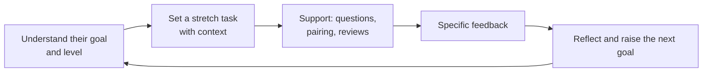

# Mentoring & Growing Others

> Senior engineers multiply their impact by helping others grow. A strong mentoring story shows a real person, what you did (coaching, reviews, delegation, feedback), and an observable change in them.

Roadmap topic 13 · Stage 4: Leadership

**Go deeper:** `9` Conflict (feedback with SBI) · `11` Communication · `12` Leadership Without Authority · `14` Delivery & Team Health · `15` Hiring & Team Building · `06-mobile-engineering/12-Testing` (code review habits).

**Marks:** 🟢 must know · 🟡 good to know

---

#### 1. What Is It?

*Helping someone become better at their work, and showing the result.*

| 🟢 Must know | 🟡 Good to know |
|---|---|
| a time you helped someone grow, with a real outcome | delegating: goal and context, not only tasks |
| how you coach: ask, give context, let people try | mentor vs sponsor |
| code review as teaching | helping a struggling teammate |
| onboarding a new joiner | growing the team's skills: talks, docs, practices |
| feedback that is specific, timely, about behaviour | what you learned from the people you mentored |

1. **Mentoring:** advice and guidance from experience.
2. **Coaching:** helping someone find their own answer by asking questions.
3. **Sponsoring:** using your influence to open doors for someone (nominating them, giving them visible work).
4. **Delegation:** handing over a goal with context and trust.

**Signals in an interview:** "Tell me about a time you helped someone grow", "how do you give feedback?", "how do you onboard someone?", "how do you handle a struggling teammate?", "how do you do code reviews?".

---

#### 2. How It Works

**The growth loop.**



**Coaching with questions (the GROW model).**

| Step | Question |
|---|---|
| Goal | "What do you want to achieve?" |
| Reality | "Where are you now? What have you tried?" |
| Options | "What could you do? What else?" |
| Will | "What will you do, and by when?" |

Give the answer when someone is blocked or in danger of wasting days; ask when they can work it out. Give context ("the team cares about startup time because…") rather than only instructions.

**Code review as teaching.**

| Habit | Example |
|---|---|
| Explain *why* | "Prefer `StateFlow` here: it keeps the latest value for new collectors." |
| Distinguish must-fix from suggestions | "nit:" for style, "blocking:" for correctness |
| Ask instead of tell | "What happens if the network fails here?" |
| Praise good work specifically | "Nice use of a fake; the test is clear." |
| Be kind and clear | about the code, not the person |
| Keep reviews timely | within a working day |

**Onboarding a new joiner.**

| When | Do |
|---|---|
| Before day 1 | laptop, access, a buddy, a first small task |
| Week 1 | architecture tour, run the app, ship a tiny change |
| Weeks 2–4 | a real feature with a mentor; pairing; weekly 1:1 |
| Day 30 / 60 / 90 | check goals, feedback both ways, widen scope |

A good measure is **time to first merged change** (aim for days, not weeks) and **time to first feature**.

**Feedback that helps.** Specific, timely, about behaviour, with the impact and a suggestion (SBI, topic 9). Give praise as often as correction. Ask for feedback on your own mentoring.

🟡 **Delegating.** Give a goal, why it matters, the limits (deadline, quality bar, who to ask) and the authority to decide. Check in, but don't take it back at the first problem. Levels: "do exactly this" → "propose, then do" → "do, then tell me" → "own it."

🟡 **Mentor vs sponsor.** A mentor advises you; a sponsor uses their influence to open doors (recommends you for a project, speaks for you in promotion discussions). Be both when you can.

🟡 **Helping a struggling teammate.** Start with curiosity (what's getting in the way: skills, clarity, workload, personal?); agree clear expectations and small steps; pair; give frequent feedback; involve the manager early if needed; follow up. Avoid public criticism.

🟡 **Growing the team's skills.** Lunch-and-learns, short docs, examples, rotating review ownership, pairing, "how we do X" guides, internal demos.

🟡 **What you learn.** Mentoring sharpens your own understanding, exposes unclear docs, and gives fresh views. Say so.

**Example (illustrative): growing a junior engineer.**

> **Situation:** A junior Android engineer joined, strong at UI but afraid of the data layer; her pull requests sat in review for days and she rarely asked questions. **Task:** I was her buddy and wanted her to own a feature within three months.
>
> **Action:** In our first 1:1 I asked what she wanted: to own a feature end to end. We set a goal: the offline "pinned notes" feature. I gave her the context (why offline matters for our users) and a design doc template, not the solution. I paired with her for the first Room migration, then stepped back. In code reviews I explained the why and marked suggestions as "nit". When she was stuck on a flow bug for two days, I asked her to describe it aloud: she found the cause herself. I told the team, in her presence, that her test fakes were clearer than ours, and I asked her to give a lunch-and-learn on them.
>
> **Result:** She shipped the feature in 8 weeks with no production bugs; her review turnaround went from about 4 days to about 1 day, and she took over reviewing the data layer. She was promoted the following cycle.
>
> **Lesson:** I learned to give context first and to ask before telling. It also made me write the onboarding doc that the next two joiners used."

---

#### 3. Weak Answer vs Strong Answer

| | Weak | Strong |
|---|---|---|
| Story | "I help everyone" | one named (anonymised) person, with a goal |
| Method | told them what to do | asked, gave context, let them try, stepped in when needed |
| Reviews | corrections only | explained why, praise, clear priorities |
| Feedback | vague or delayed | specific (SBI), timely |
| Outcome | none | observable change in their work |
| Credit | "I made them" | their effort, your support |
| Learning | none | what you learned as a mentor |

---

#### 4. Templates & Worked Examples

**Mentoring-story template.**

```text
PERSON (role/level, anonymised):               THEIR STARTING POINT:
THEIR GOAL / MY GOAL FOR THEM:
WHAT I DID (coach, context, review, pair, delegate):
  1.
  2.
  3.
HOW I GAVE FEEDBACK (an SBI example):
WHAT CHANGED IN THEM (observable, with numbers):
WHAT I LEARNED / WHAT I'D DO DIFFERENTLY:
```

**1:1 agenda (their agenda first).**

```text
1. How are you? (5 min)           2. Your topics: blockers, questions, ideas (15 min)
3. Feedback both ways (5 min)     4. Growth: goal, stretch task, next step (5 min)
Notes and action items: owner – due
```

**Review comment: before and after.**

| Before | After |
|---|---|
| "Wrong. Use StateFlow." | "blocking: with `SharedFlow` a late collector misses the value. `StateFlow` keeps the latest, which is what a screen needs. Want to pair on it?" |
| "Needs tests." | "Could you add a test for the offline case? A fake repository works well; see `NotesRepositoryTest` for an example." |
| "Style." | "nit: extract this to a function; the name will explain the intent." |

**Onboarding checklist.**

```text
[ ] Buddy and a first-week plan          [ ] Access, build running, app on a device
[ ] Architecture walkthrough (30 min)    [ ] A tiny first change merged in the first 3 days
[ ] First real feature scoped and paired [ ] Weekly 1:1 booked for 3 months
[ ] Feedback after 30 / 60 / 90 days     [ ] The new joiner improves the onboarding doc
```

**Delegation conversation.**

> "I'd like you to own the pinned-notes feature. The goal is that notes work offline; the deadline is the end of next sprint; the quality bar is tests for the sync and a staged rollout. You can decide the design; check with me before you change the API. How can I help?"

**Tracking growth (code).**

```kotlin
fun averageDays(daysToFirstMergedPr: List<Int>) = daysToFirstMergedPr.average()
```

Checks: onboarding times of `12, 9, 15` days before improving the process → `12.0`; after adding the checklist and a buddy, `3, 4, 2` → `3.0`. A change from 12 to 3 days is the kind of number to quote.

---

#### 5. Numbers & Metrics to Quote

| Item | Guide |
|---|---|
| Time to first merged change | days (aim for under a week) |
| Time to first feature | weeks |
| Review turnaround | from days to hours |
| 1:1 | weekly or fortnightly, 30 minutes |
| Outcome | a promotion, an owned feature, fewer defects, a skill the team now has |
| Scope | number of people mentored, over what period |
| Team skill | a talk given, a doc used by N people |

---

#### 6. Common Mistakes & Edge Cases

1. Doing the task for them instead of coaching.
2. Only correcting; no praise.
3. Vague feedback ("do better").
4. Delegating tasks with no context or authority.
5. A story with no observable change in the other person.
6. Taking all the credit for their growth.
7. Public criticism.
8. Ignoring different styles or goals.

Edge cases: a mentee who doesn't improve (clear expectations, small steps, involve the manager, document, be fair); a mentee who is more senior in some areas (learn from each other); remote mentoring (schedule, camera, pair on screen share); you have never formally mentored (use informal help: reviews, onboarding, a talk).

---

#### 7. Say This in the Interview

1. "First I asked what they wanted to achieve, then gave context rather than a solution."
2. "In reviews I explain why, mark nits, and call out what was done well."
3. "I paired on the first migration, then stepped back so they owned the rest."
4. "I used SBI for feedback: situation, behaviour, impact."
5. "She shipped the feature in eight weeks, and her review turnaround went from four days to one."
6. "I learned to ask before telling, and I wrote the onboarding doc the next joiners used."

---

#### 8. Quick Check

1. What is the difference between mentoring and sponsoring?
2. Why explain *why* in a code review?
3. What does good delegation include?
4. How do you measure the effect of onboarding?

<details>
<summary>Answers</summary>

1. Mentoring gives advice; sponsoring uses your influence to open opportunities.
2. It teaches the principle, so the person can apply it next time.
3. A goal, context, limits (deadline, quality bar) and the authority to decide.
4. Time to first merged change and first feature, plus feedback from the new joiner.

</details>

---

#### 9. Practice

**Interview questions**

1. Tell me about a time you helped someone grow.
2. How do you give feedback?
3. How do you do code reviews?
4. How do you onboard a new team member?
5. How have you helped a struggling teammate?
6. What have you learned from someone you mentored?

**Exercises**

1. Write a mentoring story with the template, and name the observable change.
2. Rewrite three of your review comments in the "after" style.
3. Draft an onboarding checklist for your team.
4. Prepare an SBI feedback example about a real situation.

**Remember:** ask first, give context · let them try, step in when needed · explain the why in reviews · specific, timely feedback · delegate goal + context + authority · show an observable change.
