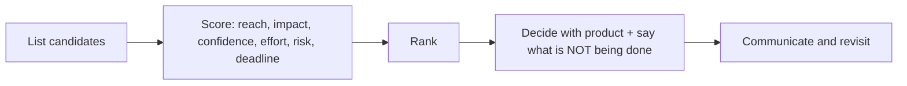

# Delivery, Prioritization & Team Health

> Shipping the right things, at a sustainable pace, with a healthy team. This story shows how you decide what comes first, trade scope against time and quality, estimate honestly, unblock others and protect the team.

Roadmap topic 14 · Stage 4: Leadership

**Go deeper:** `4` Project Challenges · `7` Failure (estimation) · `11` Communication · `13` Mentoring · `17` Ambiguity & Pressure · `09-architecture` (technical debt, delivery metrics) · `06-mobile-engineering/15-Build-Release-and-Monitoring`.

**Marks:** 🟢 must know · 🟡 good to know

---

#### 1. What Is It?

*Deciding what to do, doing it at a healthy pace, and keeping the team well.*

| 🟢 Must know | 🟡 Good to know |
|---|---|
| prioritizing: impact, effort, risk, deadlines | retrospectives |
| trading scope, time and quality, and explaining the choice | delivery metrics as a team, not to blame |
| balancing features against technical debt | protecting the team from interruption and burnout |
| estimating with ranges and assumptions; handling a miss | handling an underperforming teammate |
| unblocking others | planning a release and a plan for problems |

1. **Prioritization:** choosing what to do first from many valid things.
2. **Scope, time, quality:** you can fix two; the third gives.
3. **Technical debt:** shortcuts that make future change costlier.
4. **Team health:** people can do good work for a long time without burning out.

**Signals in an interview:** "everything is urgent, how do you decide?", "scope vs deadline", "features vs technical debt", "a missed estimate", "a teammate who is struggling", "burnout".

---

#### 2. How It Works

**Prioritizing.**



**RICE scoring** is one common method: `Reach × Impact × Confidence ÷ Effort`.

| Item | Reach (users / quarter) | Impact (0.5–3) | Confidence | Effort (person-weeks) | Score |
|---|---|---|---|---|---|
| A. Offline mode | 2,000 | 2 | 0.8 | 4 | **800** |
| B. Fix checkout crash | 500 | 3 | 1.0 | 1 | **1,500** |
| C. New onboarding | 10,000 | 0.5 | 0.5 | 5 | **500** |

Do B first (small, high impact, certain), then A, then C. The number starts the conversation; deadlines, dependencies, risk and strategy also matter. Always state what you are **not** doing.

**The scope-time-quality triangle.**

| Squeeze | Choice | Say |
|---|---|---|
| Time is fixed | cut scope, keep quality | "We ship the core flow on the 14th; sharing follows in the next release." |
| Scope is fixed | move the date | "All of it needs two more weeks." |
| Both fixed | quality drops (bugs, debt) | "That will cost us X later; here's the risk. Do you accept it?" |

Don't silently cut quality (tests, accessibility, security). Make the trade-off visible and get the owner's decision.

**Features vs technical debt.** Make debt visible and priced: how many hours it costs per week, how many bugs it causes. Reserve a steady share of capacity (for example 15 to 20%) and attach debt work to features that touch the same code. Avoid the all-or-nothing "debt sprint".

**Estimating.** Use ranges and assumptions: "4 to 7 weeks, most likely 5; assumes sandbox access." Break work into pieces, include dependencies and review/QA, re-estimate at milestones, and when you will miss, say so early with options (topic 7). Three-point formula: `(optimistic + 4 × likely + pessimistic) ÷ 6`.

**Unblocking others.** Ask in standups "what's blocking you?", answer review requests quickly, remove ambiguity (decide or find who can), share context, and pair on stuck work.

🟡 **Retrospectives.** Every sprint or release: what went well, what didn't, what we try next. Pick 1 to 2 actions with owners; check them next time. Keep it blameless.

🟡 **Delivery metrics (as a team).** Lead time, deployment frequency, change-failure rate, time to restore (the DORA set) plus crash-free rate and review time. Use them to find system problems, never to rank individuals (`ARCH 18`).

🟡 **Protecting the team.** Say no to extra interruptions, batch urgent requests through one channel, rotate on-call fairly, set realistic scope, keep the sprint stable, encourage time off. Burnout signs: tiredness, cynicism, mistakes, withdrawal.

🟡 **An underperforming teammate.** Understand first (clarity, skills, load, personal); set clear, specific expectations and small goals; give frequent feedback; support (pairing, training); involve the manager early; document; be fair and respectful; act if there's no progress.

🟡 **Planning a release.** A release date with a cut line, a testing plan, a staged rollout, a rollback or flag plan, and who is on call (`MOB 15`).

**Example (illustrative): prioritizing under pressure.**

> **Situation:** Mid-quarter, product, support and our own team each had "urgent" items: a new onboarding flow, a checkout crash and offline mode, with capacity for one. **Task:** As tech lead I had to propose an order and explain it.
>
> **Action:** I listed the items with reach, impact, confidence and effort. The checkout crash scored highest (1,500) because it affected paying users, took one week, and I was sure of the cause. Offline mode scored 800; onboarding 500. I took the table to the product manager and support lead, added the dependency (offline needed a backend change in four weeks), and proposed: crash fix this sprint, offline starts next sprint, onboarding moves to next quarter. I said clearly what we were not doing and why. Product wanted onboarding earlier, so I offered a small experiment on the existing flow that took two days and gave us data for the decision.
>
> **Result:** The crash fix cut checkout failures from 3.1% to 0.4%; offline shipped in the next quarter on schedule; the onboarding experiment showed a 6% lift, so we kept the bigger redesign on the roadmap. The team kept a steady pace and nobody worked weekends.
>
> **Lesson:** make the ranking visible, say what's not happening, and offer a small test instead of arguing."

---

#### 3. Weak Answer vs Strong Answer

| | Weak | Strong |
|---|---|---|
| Prioritizing | "I do what the loudest asks" | criteria, a score, a ranking, and what's not done |
| Trade-offs | quietly work late or cut quality | visible choice: scope, date or quality, with the owner deciding |
| Debt | "someday" | priced, a steady capacity share |
| Estimates | one number | range, assumptions, re-estimates |
| Miss | hide until the end | tell early with options |
| Team | push harder | sustainable pace, protect focus |
| Metrics | rank people | team-level system metrics |

---

#### 4. Templates & Worked Examples

**Prioritization sheet (RICE).**

```kotlin
data class Item(val name: String, val reach: Int, val impact: Double, val confidence: Double, val effortWeeks: Double)

fun rice(item: Item) = item.reach * item.impact * item.confidence / item.effortWeeks

fun ranked(items: List<Item>) = items.sortedByDescending { rice(it) }.map { it.name }
```

Checks: `A (2000, 2.0, 0.8, 4.0)` → `800.0`; `B (500, 3.0, 1.0, 1.0)` → `1500.0`; `C (10000, 0.5, 0.5, 5.0)` → `500.0`; `ranked` → `[B, A, C]`.

**Trade-off message.**

```text
We can't deliver everything by Mar 14. Options:
A) Core checkout + offline by Mar 14; share-sheet and tablet layout in the next release. (Recommended)
B) Everything on Mar 28.
C) Everything on Mar 14, with reduced testing and a higher risk of bugs (not recommended).
Decision needed from: Product by Wednesday.
```

**Sprint capacity with a debt share (code).**

```kotlin
fun capacityForFeatures(totalPersonDays: Double, debtShare: Double = 0.2, interruptions: Double = 0.1) =
    totalPersonDays * (1 - debtShare - interruptions)
```

Checks: 5 people × 10 days = `50` person-days; with 20% debt work and 10% interruptions → `35.0` days for new features. Plan the sprint with `35`, not `50`.

**Retrospective format.**

```text
Went well: …     Didn't go well: …     Ideas: …
Actions (max 2): 1) <action> – owner – date   2) …
Last time's actions: done? effect?
```

**Support plan for a struggling teammate.**

```text
Observation (facts, SBI): "In the last 3 PRs, tests were missing; two bugs reached QA."
Cause (asked, not assumed): unclear on test strategy for the data layer.
Expectation: every PR includes a test; first target: this sprint.
Support: pair on one test; link to examples; 15-minute check-ins twice a week.
Review: in 4 weeks; manager informed.
```

**Release plan.**

```text
Cut line: core checkout + offline.   Test plan: upgrade tests from 3.x, 4.0, 4.11.
Rollout: 5% → 20% → 100% over a week, gates: crash-free ≥ 99.3%, ANR ≤ 0.47%.
Rollback: flag `new_sync` off; halt rollout; hotfix within 24 h.   On call: A (Mon–Wed), B (Thu–Sun).
```

---

#### 5. Numbers & Metrics to Quote

| Item | Guide |
|---|---|
| Capacity | plan for 60 to 80% of the nominal time (meetings, interruptions, debt) |
| Debt share | commonly 15 to 25% of capacity |
| Estimate | a range with a most-likely value; re-estimate at milestones |
| Prioritization | a score with at least 3 criteria; list what's not done |
| Metrics | lead time, deployment frequency, change-failure rate, time to restore, crash-free rate |
| Retro | every sprint or release; max 2 actions |
| On-call | rotation of 4 to 6 people; time off after heavy weeks |
| Outcome | on-time delivery, quality (crash rate), team sentiment, retention |

---

#### 6. Common Mistakes & Edge Cases

1. Saying yes to everything.
2. Prioritizing by who shouts loudest.
3. Silently cutting quality or working weekends to hide the problem.
4. A single-number estimate.
5. Telling the stakeholder about a miss at the last minute.
6. A permanent "no time for debt".
7. Using metrics to blame individuals.
8. Ignoring signs of burnout.

Edge cases: two senior stakeholders with opposite priorities (side-by-side comparison, ask the decision owner); a sudden production incident (it interrupts the plan; re-plan openly); a change request mid-sprint (what does it replace?); a team of one; an underperformer who is also a friend (be fair and consistent); a hard deadline you disagree with (give options and risks, then commit).

---

#### 7. Say This in the Interview

1. "I list the options, score reach, impact, confidence and effort, and I always say what we are *not* doing."
2. "When time is fixed, I cut scope, not quality, and I make the trade-off visible to the owner."
3. "I estimate with a range and assumptions, re-estimate weekly, and if I'm going to miss I tell them early with options."
4. "I reserve about 20% of capacity for technical debt and tie it to features in the same code."
5. "We use delivery metrics at team level to find system problems, never to compare people."
6. "I protect the team's focus: one channel for urgent requests, fair on-call, realistic sprints."

---

#### 8. Quick Check

1. What does RICE stand for?
2. If the date is fixed, what gives?
3. How much capacity do you plan for features?
4. When do you tell stakeholders about a miss?

<details>
<summary>Answers</summary>

1. Reach × Impact × Confidence ÷ Effort.
2. Scope (never silently quality); make the choice visible.
3. Less than 100%: subtract debt, interruptions and meetings (for example 70%).
4. As soon as you see it, with options and a recommendation.

</details>

---

#### 9. Practice

**Interview questions**

1. How do you prioritize when everything is urgent?
2. Tell me about a time you traded scope for time.
3. How do you balance features and technical debt?
4. Tell me about an estimate you missed.
5. How do you handle an underperforming teammate?
6. How do you keep a team from burning out?
7. How do you plan a release?

**Exercises**

1. Score five real backlog items with RICE; note what you would not do.
2. Write the trade-off message for a real deadline.
3. Compute your real sprint capacity from last quarter's data.
4. Draft the support plan for a hypothetical struggling teammate.

**Remember:** score, rank, and say what's not done · fix two of scope/time/quality, visibly · estimate in ranges · steady debt share · tell about misses early · protect the team · metrics at team level.
