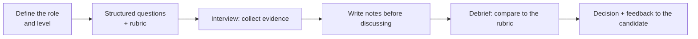

# Hiring & Team Building

> Strong teams are built on fair, structured hiring and a culture where people can speak up. For senior roles you may be asked how you interview, what you look for, and how you help new people succeed.

Roadmap topic 15 · Stage 4: Leadership (New)

**Go deeper:** `1` How Behavioral Interviews Work (the candidate's view) · `13` Mentoring (onboarding) · `14` Delivery & Team Health · `19` Company Values & Interviewer Types · `05-system-design/31-Interview-Answer-Structure`.

**Marks:** 🟢 must know · 🟡 good to know · (New) beyond your original ten topics

---

#### 1. What Is It?

*Choosing, welcoming and growing the people on a team.*

| 🟢 Must know | 🟡 Good to know |
|---|---|
| how you interview: structured questions, evidence, fairness | writing a clear rubric |
| what you look for at each level | reducing bias |
| | selling the team honestly |
| | onboarding for success |
| | culture: trust, learning, psychological safety |
| | growing the skills mix |

1. **Structured interview:** the same questions and scoring for each candidate.
2. **Rubric:** written definitions of what "strong", "okay" and "weak" look like per competency.
3. **Psychological safety:** people can ask, admit mistakes and disagree without fear.
4. **Signal:** evidence that a competency is present.

**Signals in an interview:** "How do you interview candidates?", "What do you look for in a senior Android engineer?", "How do you reduce bias?", "How do you build team culture?".

---

#### 2. How It Works

**The hiring loop.**



**How to interview.**

1. Decide the competencies for the role (for Android senior: Kotlin and coroutines, architecture, quality, collaboration, ownership).
2. Ask the **same core questions** to every candidate, then probe with follow-ups.
3. Take **notes of facts** (what they said and did), not impressions.
4. Score **against the rubric** *before* the debrief, so others do not anchor you.
5. Be a good host: explain the process, give time for their questions, be on time.

**What to look for by level.**

| Level | Evidence |
|---|---|
| Mid | solves well-defined problems, writes clear tested code, asks for help, learns fast |
| Senior | owns outcomes, designs sound solutions, makes trade-offs, mentors, communicates well |
| Staff / architect | shapes direction across teams, handles ambiguity, grows others, ties work to business impact |

**A small rubric (example for Android senior, "technical judgment").**

| Score | Evidence |
|---|---|
| 4 Strong | compares options with criteria, uses data, names trade-offs, anticipates failure cases |
| 3 Good | sound choice with reasons, some trade-offs, minor gaps |
| 2 Mixed | right answer without reasons, or ignores a key risk |
| 1 Weak | no reasons, shallow, or incorrect |

🟡 **Reducing bias.** Use structured questions and a rubric, write notes before talking, avoid "culture fit" as a gut feeling (use "values and behaviours" with evidence), include diverse interviewers, judge answers not accents or backgrounds, do not over-weight where someone studied or worked, and calibrate regularly. Check that questions are job-related and legal.

🟡 **Selling the team honestly.** Describe the real work, problems and growth, not just perks. Candidates stay when expectations match reality. Let them meet the people they'd work with.

🟡 **Onboarding.** A hiring decision is only successful if the person thrives: a buddy, a plan, early wins, regular feedback (topic 13).

🟡 **Culture and psychological safety.** Leaders model it: admit mistakes, thank people for bad news, ask questions, run blameless reviews, welcome disagreement, include quieter voices. Signs: people raise risks early; mistakes are discussed openly; juniors ask questions.

🟡 **Skills mix.** A healthy mobile team has depth in Android, iOS or KMP, backend knowledge, quality/test skill, design sense and mentors. Hire for gaps, not clones.

**Example (illustrative): improving the interview process.**

> **Situation:** Our Android interviews were inconsistent: each interviewer asked their own questions, and debriefs turned into arguments about gut feelings. Offers were slow and two hires left within a year. **Task:** As a senior engineer, I volunteered to improve the process.
>
> **Action:** I proposed a structured loop with four competencies (coding, architecture and trade-offs, collaboration, ownership). With the hiring manager, I wrote a one-page rubric with example evidence for each score. I created a shared question bank and trained six interviewers in a 45-minute session, including how to write notes of facts. We asked interviewers to submit scores before the debrief. I reviewed the first ten loops and gave interviewers feedback on their notes.
>
> **Result:** Time to decision dropped from 11 days to 6, debriefs became shorter, and the offer-acceptance rate went from 55% to 70%. In the next year no new hire left in the first 12 months, and two said the interview showed what the job was really like.
>
> **Lesson:** a shared rubric and notes written before the debrief reduced both bias and noise."

---

#### 3. Weak Answer vs Strong Answer

| | Weak | Strong |
|---|---|---|
| Interviewing | improvised questions | structured questions + rubric |
| Evidence | "I liked them" | facts and signals, written first |
| Bias | "I trust my gut" | blind notes, calibration, job-related questions |
| Level | same bar for all | evidence matched to the level |
| Selling | glossy | honest about work and challenges |
| After the hire | forgotten | onboarding plan and feedback |
| Culture | slogans | behaviours: blameless reviews, safe questions |

---

#### 4. Templates & Worked Examples

**Interview scorecard.**

```text
Candidate: ____   Role/Level: Senior Android   Interviewer: ____   Date: ____
Competency: Technical judgment
Questions asked: …
Evidence (facts, quotes): …
Score (1–4): _   Why (map to the rubric): …
Concerns / follow-ups for the debrief: …
Recommendation: Strong yes / Yes / No / Strong no
```

**Aggregating scores (code).**

```kotlin
fun recommend(scores: List<Int>, minAverage: Double = 3.0, floor: Int = 2): Boolean =
    scores.average() >= minAverage && scores.all { it >= floor }
```

Checks: `recommend(listOf(3, 3, 4, 3))` → `true` (average 3.25, none below 2); `recommend(listOf(4, 4, 4, 1))` → `false` (a very weak score blocks the offer even though the average is 3.25); `recommend(listOf(3, 2, 3, 3))` → `false` (average 2.75). A rule like this keeps decisions consistent; the debrief explains the exceptions.

**Good structured questions.**

| Competency | Question |
|---|---|
| Ownership | "Tell me about a problem you fixed that nobody asked you to." |
| Technical judgment | "Tell me about a design decision where you compared options." |
| Collaboration | "Tell me about a disagreement with a teammate and how it ended." |
| Learning | "What did you last learn, and how?" |
| Quality | "How do you decide what to test?" |

**Follow-up probes.** "What was your part?" · "What alternatives did you consider?" · "How did you know it worked?" · "What would you do differently?"

**Selling honestly (example).**

> "Here's the real picture: the app is 8 years old with a mix of XML and Compose; we're migrating one screen per sprint. You'd own the checkout module. We release every two weeks. The challenge is the legacy code, and the upside is that you can shape the architecture."

**Onboarding for a new hire (first 90 days).**

```text
Days 1–5: setup, buddy, tiny change merged      Days 6–30: first feature with pairing, weekly 1:1
Days 31–60: own a small module, give a demo      Days 61–90: lead a task, give feedback on onboarding
```

**Safe-team behaviours (leader checklist).**

```text
[ ] I thank people who bring bad news      [ ] I admit my own mistakes in the retro
[ ] I ask quiet people for their view      [ ] Reviews are blameless: causes in the system
[ ] Newcomers' questions are welcomed      [ ] Disagreements are about the problem, not the person
```

---

#### 5. Numbers & Metrics to Quote

| Item | Guide |
|---|---|
| Loop length | 3 to 5 interviews, 45 to 60 minutes each |
| Time to decision | days (aim for under a week after the final interview) |
| Interviewers | trained on rubric and notes |
| Offer acceptance rate | a signal of the candidate experience and pay/role fit |
| 12-month retention of hires | a signal that the process predicts fit |
| Questions per competency | 1 main + probes |
| Debrief | scores submitted before, 30 minutes |

---

#### 6. Common Mistakes & Edge Cases

1. Improvised, inconsistent questions.
2. Decisions by gut feeling and "culture fit".
3. Interviewing for yourself (clones).
4. Trick questions and trivia instead of job-relevant ones.
5. Poor candidate experience: late, rude, no feedback.
6. Overselling the role.
7. Hiring and forgetting the onboarding.
8. Ignoring quiet signals of unsafe culture.

Edge cases: a strong candidate with a gap (use the rubric: is it a must-have?); an interviewer with a strong bias (calibration, feedback, replace if needed); a candidate with a non-standard background (look at evidence, not the pedigree); a remote hire (extra care with onboarding and communication); a rejected candidate who asks for feedback (give kind, specific, legal feedback).

---

#### 7. Say This in the Interview

1. "I use structured interviews: the same core questions, probes for evidence, and a written rubric."
2. "I write notes of facts and submit my score before the debrief, so I'm not anchored."
3. "At senior level I look for ownership, sound trade-offs, mentoring and clear communication."
4. "To reduce bias I use a rubric, job-related questions, diverse interviewers and calibration."
5. "I sell the role honestly, including the legacy code and the challenges."
6. "I help new hires with a buddy and a 30/60/90-day plan; I judge the process by their first-year retention."

---

#### 8. Quick Check

1. Why write scores before the debrief?
2. What is a rubric?
3. What is psychological safety?
4. Why avoid "culture fit" as a gut feeling?

<details>
<summary>Answers</summary>

1. So that other opinions do not anchor your judgment.
2. Written definitions of what strong, good, mixed and weak evidence look like for each competency.
3. A climate where people can ask, admit mistakes and disagree without fear.
4. It hides bias; use values and behaviours supported by evidence.

</details>

---

#### 9. Practice

**Interview questions**

1. How do you interview candidates?
2. What do you look for in a senior mobile engineer?
3. How do you reduce bias in hiring?
4. How do you help a new hire succeed?
5. How do you build a team culture where people speak up?
6. How would you improve a weak hiring process?

**Exercises**

1. Write a four-competency rubric for your role.
2. Create five structured questions and the evidence you'd expect.
3. Draft an honest pitch for your team in five sentences.
4. Write a 30/60/90-day plan for a new hire.

**Remember:** structured questions · rubric and notes before the debrief · evidence matched to level · reduce bias deliberately · sell honestly · onboard well · build psychological safety.
