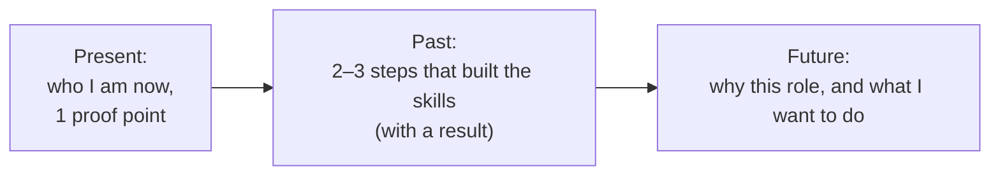

# Career Story & Motivation

> Almost every interview starts with "Tell me about yourself" and ends with "Why us?". Prepare three short answers: your career story, why this company, and why now. Keep them honest, specific and positive.

Roadmap topic 16 · Stage 5: Self & Career

**Go deeper:** `3` Story Bank · `7` Failure (weaknesses with real lessons) · `18` Tough Questions · `19` Company Values · `20` Offers & Career Moves.

**Marks:** 🟢 must know · 🟡 good to know

---

#### 1. What Is It?

*The story that connects your past, present and future to this role.*

| 🟢 Must know | 🟡 Good to know |
|---|---|
| "Tell me about yourself": 60 to 90 seconds | career direction: mobile engineer toward lead or architect |
| "Why this company and role?" | explaining gaps, moves, changes in direction |
| "Why are you leaving?": positive, honest | working style |
| strengths with examples | what you want to learn next |
| weaknesses: real, with action | where you see yourself in a few years |

1. **Career story:** a short, structured summary of your path and strengths.
2. **Motivation:** why this role, this company, this time.
3. **Self-awareness:** honest strengths and weaknesses, with evidence.

**Signals in an interview:** the first five minutes, "walk me through your resume", "why do you want to work here?", "where do you see yourself?", "why are you leaving?".

---

#### 2. How It Works

**The 60 to 90 second career story.**



A reliable shape: **Present – Past – Future**.

| Part | Content | Time |
|---|---|---|
| Present | role, years, what you do best, one result | 15–20 s |
| Past | 2 or 3 steps: what you learned, what you achieved | 30–40 s |
| Future | what you're looking for and why this role fits | 15–20 s |

**Why this company and role.** Three specific reasons: (1) the **product or problem** (what excites you about it, evidence you used or studied it); (2) the **team or engineering practices** (what you learned from their posts, talks or interviewers); (3) the **fit with your skills and growth** (what you'll contribute and learn). Avoid generic praise ("great culture").

**Why are you leaving?** Positive and honest: *pulled towards*, not *pushed away*. "I've grown a lot in X; I want to work on Y at larger scale." Do not blame a manager or company. If it was a layoff or a hard situation, say it simply and move on to what you want next.

**Strengths: claim, evidence.** One sentence of claim, one of proof: "I'm strong at making apps reliable: I cut crashes from 1.4% to 0.5% by..."

**Weaknesses: real, small enough, with action.**

| Weak answer | Strong answer |
|---|---|
| "I'm a perfectionist." | "I used to take on too much myself; I've been delegating and writing down decisions. Last quarter I handed off two modules." |
| "I have no weaknesses." | "I'm less experienced with iOS, so I've been building a small SwiftUI app and pairing with an iOS colleague." |
| "I work too hard." | "I underestimate effort; now I give ranges and re-estimate weekly (topic 14)." |

🟡 **Career direction.** From mobile engineer toward lead or architect: say what you enjoy (shaping design, mentoring, cross-team impact) and what you're doing about it (leading a migration, writing ADRs, mentoring).

🟡 **Gaps, moves, direction changes.** Explain briefly, honestly and forward-looking: what you did during the gap (learning, family, health, projects), and why you're ready now. Don't over-explain or apologise.

🟡 **Working style.** How you do your best work: clear goals, written plans, quick feedback, pairing; and how you adapt.

🟡 **What you want to learn next.** One or two specific areas aligned with the role (system design for mobile, KMP, leading a team).

🟡 **Where you see yourself.** Aim at growth in scope, not a title: "leading technical direction for a mobile product, and growing other engineers".

**Example (illustrative): "Tell me about yourself" for a senior Android engineer (about 65 seconds, 152 words).**

> "I'm a senior Android engineer with eight years of experience, mostly in consumer apps. My strength is making apps fast and reliable at scale. At my current company I lead the Android side of a notes product with about two million users. Last year I rebuilt the sync layer to be offline-first, which cut 'lost note' tickets from 11% of support volume to 2%, and I brought cold start from 3.2 to 1.9 seconds.
>
> Before that, I started at a small agency building client apps, where I learned to ship quickly, and then moved to a fintech, where I learned about security, testing and release discipline: I ran the staged-rollout process there.
>
> What I'm looking for now is a larger scale and more influence on architecture. I've been reading how your team approaches offline sync and performance, and I'd like to work on problems like those, while mentoring other engineers."

**Why this company (illustrative).**

> "Three things. First, the product: I use it daily and I've seen how you handle offline mode, which is the area I know best. Second, your engineering blog on Baseline Profiles and modularization; those are problems I've solved at a smaller scale. Third, I want a role where I can lead technical direction and mentor, which the job description describes."

---

#### 3. Weak Answer vs Strong Answer

| | Weak | Strong |
|---|---|---|
| Length | 5 minutes of résumé | 60 to 90 seconds |
| Content | every job in order | the path that explains why you fit |
| Proof | adjectives | one or two numbers |
| Why us | "great company" | three specific reasons |
| Leaving | complaints | pulled toward growth |
| Weakness | disguised strength | real, small, with action |
| Future | vague or ambitious beyond reason | specific growth and fit |

---

#### 4. Templates & Worked Examples

**Career-story template.**

```text
PRESENT: I'm a ____ with ____ years in ____. I'm strongest at ____. Recently I ____ (result: ____).
PAST:    Before that, ____ (what I learned/achieved). Earlier, ____ (what it taught me).
FUTURE:  Now I'm looking for ____ because ____. This role fits because ____.
```

**"Why this company" template.**

```text
1. Product/problem: what I find compelling, with evidence I've used or studied it.
2. Team/engineering: something specific I learned from your posts, talks or people.
3. Fit/growth: what I will contribute and what I want to learn here.
```

**Timing check (code).**

```kotlin
fun speakingSeconds(text: String, wordsPerMinute: Int = 140): Double =
    text.trim().split(Regex("\\s+")).size * 60.0 / wordsPerMinute
```

Checks: a 210-word answer → `90.0` seconds; a 140-word answer → `60.0`. A 700-word "tell me about yourself" would take `300` seconds (5 minutes): too long.

**Reframing "leaving".**

| Real reason | Say |
|---|---|
| bored, no growth | "I've done what I came to do (the offline rebuild). I want a bigger scale." |
| bad manager | "I'm looking for a team with more mentoring and technical direction." |
| layoff | "My team was affected by a layoff. I've used the time to… and I'm looking for…" |
| low pay | (don't lead with it) "I'm looking for a role at the next level of scope and compensation." |

**Gap explanation.**

> "I took six months off to care for a family member. During that time I built a small SwiftUI app and finished a KMP course. I'm back and ready for a full-time role."

**Strengths and weaknesses grid.**

| Strength | Evidence |
|---|---|
| making apps reliable | crash-free 98.6% → 99.5% in 8 weeks |
| explaining trade-offs | wrote ADRs that unblocked two teams |
| mentoring | junior engineer owned a feature within 8 weeks |

| Weakness | What I'm doing |
|---|---|
| limited iOS experience | built a SwiftUI app; pair with an iOS engineer monthly |
| take on too much myself | delegate with context; track what I hand off |

---

#### 5. Numbers & Metrics to Quote

| Item | Guide |
|---|---|
| Career story | 60 to 90 seconds (about 140 to 210 words) |
| "Why us" | 3 reasons, 30 to 45 seconds |
| Proof points | 1 or 2 numbers in the career story |
| Strengths | 2 or 3, each with evidence |
| Weaknesses | 1 or 2, each with action |
| Future | 1 sentence about scope, not a title |
| Practice | say it aloud until it feels natural, not memorised |

---

#### 6. Common Mistakes & Edge Cases

1. Reciting the résumé.
2. A career story with no thread.
3. Generic reasons for the company.
4. Complaining about a manager or an employer.
5. A disguised-strength weakness.
6. Over-claiming ("I'm the best at…").
7. Salary as the main reason.
8. Hiding gaps or short stints, or over-explaining them.

Edge cases: career change (connect the transferable skills); many short jobs (themes: contracts, startups, learning); fired or laid off (state facts calmly, focus on learning); overqualified (say what you want: scope and learning); you don't know the company well (research before the interview, topic 19).

---

#### 7. Say This in the Interview

1. "I'm a senior Android engineer, and I'm strongest at making apps fast and reliable at scale."
2. "What drew me to this role is…, and what I'd bring is…"
3. "I'm leaving because I want X (pull), not because of Y (push)."
4. "One real weakness is…; here's what I'm doing about it."
5. "In a few years I want to lead technical direction for a mobile product and grow other engineers."

---

#### 8. Quick Check

1. What is the structure of the career story?
2. How long should it be?
3. How do you answer "why are you leaving?"
4. What makes a weakness answer credible?

<details>
<summary>Answers</summary>

1. Present – Past – Future.
2. 60 to 90 seconds.
3. Positively: what you're moving toward, with no blame.
4. It is real, not critical for the role, and comes with concrete action.

</details>

---

#### 9. Practice

**Interview questions**

1. Tell me about yourself.
2. Why this company? Why this role?
3. Why are you leaving your current job?
4. What are your strengths? Your weaknesses?
5. Where do you see yourself in a few years?
6. What do you want to learn next?

**Exercises**

1. Write your career story and time it; aim for 60 to 90 seconds.
2. Write three specific reasons for each company you apply to.
3. List two strengths with numbers and two weaknesses with actions.
4. Record yourself; listen for filler and generic phrases.

**Remember:** present – past – future in 60–90 seconds · specific reasons for this company · pulled toward, not pushed away · strengths with evidence · real weaknesses with action.
