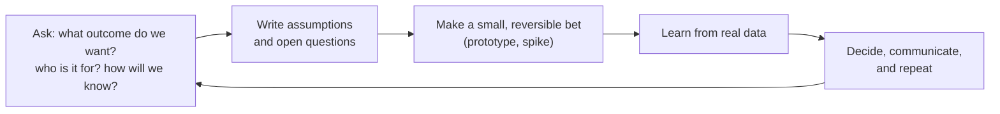

# Ambiguity, Pressure & Change

> Real work is unclear, urgent and always changing. These stories show how you find direction when the goal is vague, keep quality under deadline, adapt to late changes, learn fast and stay steady.

Roadmap topic 17 · Stage 5: Self & Career

**Go deeper:** `4` Project Challenges · `7` Failure · `8` Production Incidents · `11` Communication · `14` Delivery & Prioritization · `18` Situational Questions · `05-system-design/31-Interview-Answer-Structure` (clarifying questions).

**Marks:** 🟢 must know · 🟡 good to know

---

#### 1. What Is It?

*Staying effective when things are unclear, rushed or changing.*

| 🟢 Must know | 🟡 Good to know |
|---|---|
| unclear goal: how you found direction | staying calm and clear under stress |
| tight deadline: keeping quality and focus | pushing back on an unrealistic request |
| late requirement change: how you adapted | ethical concerns |
| learning something fast | reorganizations and leadership change |
| several priorities at once | looking after yourself: avoiding burnout |

1. **Ambiguity:** the goal, scope or approach is not clear and no one can fully explain it.
2. **Pressure:** a deadline, an incident or high stakes limits your options.
3. **Change:** requirements, people or priorities shift mid-way.

**Signals in an interview:** "Tell me about a time the requirements were unclear", "a tight deadline", "something changed late", "you had to learn something quickly", "juggling priorities".

---

#### 2. How It Works

**Handling ambiguity: the clarity loop.**



1. **Clarify the outcome**, not the solution: "What problem are we solving? What would success look like in numbers?"
2. **Write assumptions** and share them. Wrong assumptions are found faster in writing.
3. **Make small bets**: a spike, a prototype, an experiment behind a flag.
4. **Decide with what you have**, mark the decision reversible or not, set a check date.
5. **Communicate**: share what you decided and why.

**Tight deadline.**

| Do | Why |
|---|---|
| Re-confirm the must-have outcome | scope shrinks, the goal stays |
| Cut scope, not quality-critical parts (tests for risky code, security, accessibility basics) | cheap now is costly later |
| Break the work into a thin end-to-end slice first | something shippable early |
| Make risks visible and decide with the owner | no hidden trade-offs |
| Protect focus (fewer meetings, one channel) | speed |
| Plan the rollout (staged, flag) | catches problems safely |
| Debrief after | learning |

**Late requirement change.**

1. Understand the *why* behind the change.
2. Estimate its cost and the impact on the plan.
3. Offer options: absorb (and drop what?), move the date, or defer.
4. Update the plan in writing and tell everyone affected.
5. Keep a change log, so scope changes are visible.

**Learning fast.** Define what "enough" means, find the shortest path (official docs, a small project, an expert for 30 minutes), build something real early, write notes, teach someone. Example: learning Compose in two weeks by migrating one screen.

**Several priorities at once.** List them, rank by impact and deadline (topic 14), tell people what waits, batch interruptions, and reserve focused blocks.

🟡 **Staying calm under stress.** Slow down to speed up: write down the facts, one change at a time, a checklist, ask for help early, breathe, hand off cleanly.

🟡 **Pushing back with alternatives.** "I can't deliver all of it by Friday. I can deliver A and B by Friday and C by the 28th. Which do you prefer?" (topic 11)

🟡 **Ethical concerns.** Privacy (collecting more data than needed), dark patterns (tricking users), skipping safety or security to hit a date. Raise it early, in writing, with a safer alternative; escalate if needed; know your company's policy. It is fine to refuse to do something harmful.

🟡 **Reorganizations and leadership change.** Ask what changes for the goals, keep delivering, build relationships with the new people, document your work, and stay open. Uncertainty is normal.

🟡 **Avoiding burnout.** Sustainable pace, real time off, saying no, small wins, support from friends, mentors and, if needed, professionals. Burnout signs: constant tiredness, cynicism, errors, withdrawal.

**Example (illustrative): an unclear request, "make the app faster".**

> **Situation:** My product manager said, "The app feels slow; make it faster," with no further detail. Everyone had a different idea of "slow". **Task:** I had to turn this into something we could deliver in a quarter.
>
> **Action:** I asked what outcome we wanted and for whom: the PM said the 1-star reviews mentioned slowness. I read 200 reviews and found two themes: slow start, and scrolling jank on cheaper phones. I wrote my assumptions in a doc: cold start under 2 s, jank under 5% on a mid-range device. I made a small bet first: a two-day measurement spike with Macrobenchmark, which showed 3.2 s cold start and 12% jank. I proposed two targets and a plan, got product's agreement, and shipped the startup fix first, since it was the cheaper win. After each release I checked the numbers.
>
> **Result:** Cold start went from 3.2 to 1.9 s and jank from 12% to 3%; the "slow" reviews dropped from 14% of 1-star reviews to 4%, and the rating rose 0.2.
>
> **Lesson:** I turn vague goals into measurable ones and a small first experiment before I plan the whole thing."

---

#### 3. Weak Answer vs Strong Answer

| | Weak | Strong |
|---|---|---|
| Ambiguity | waited for clearer instructions | asked about the outcome, wrote assumptions, ran a small spike |
| Deadline | worked nights, hid the risk | cut scope, protected quality, made trade-offs visible |
| Change | resisted or silently absorbed | understood the why, offered options, updated the plan |
| Learning | "I'm a fast learner" | a specific method and result |
| Pressure | panic or heroics | calm checklist, one change at a time |
| Push back | refused or complied silently | no with an alternative |
| Wellbeing | ignored | sustainable pace, asked for support |

---

#### 4. Templates & Worked Examples

**Assumptions log.**

| # | Assumption | How to check | Owner | Status |
|---|---|---|---|---|
| 1 | "Slow" means cold start and list jank | read 200 reviews; benchmark | me | confirmed |
| 2 | Mid-range phones are the target | analytics: 60% of users | PM | confirmed |
| 3 | Backend latency is fine | trace the API | backend | open |

**Clarifying questions for an unclear request.**

```text
What outcome do we want, and how will we know we got it (a metric)?     Who is it for?
What triggered this now?                                               What's the deadline and why?
What's in scope and out of scope?                                      What can't change? What can?
Who decides? Who must be consulted?                                    What is the worst that could happen?
```

**Deadline plan.**

```text
Must-have outcome: ____          Cut line: features below are deferred: ____
Thin slice by: ____ (end to end)  Risks + owners: ____
Quality I will not cut: tests for sync, accessibility basics, staged rollout
Check-ins: daily 10 minutes       Decision owner for trade-offs: ____
```

**Handling a late change (message).**

```text
Understood: the partner now needs Apple Pay on day one.
Cost: +6 days (SDK, QA, review).  Impact: Mar 14 → Mar 22, or drop the share sheet and keep Mar 14.
Options: A) keep date, drop share sheet  B) move the date  C) both, with higher risk (not recommended)
Please choose by Wednesday. I'll update the plan and tell QA and design.
```

**Learning plan (two weeks).**

```text
Goal: ship one Compose screen to production.   "Enough" = I can explain state hoisting and recomposition.
Days 1–3: official codelab, build a toy screen   Days 4–8: migrate one low-risk screen with a mentor's review
Days 9–12: tests + performance check              Day 14: write a short note / give a 15-minute talk
```

**Time-boxing a spike (code).**

```kotlin
fun withinBudget(spentDays: Double, budgetDays: Double) = spentDays <= budgetDays

fun spikeDecision(spentDays: Double, budgetDays: Double, questionAnswered: Boolean) = when {
    questionAnswered -> "decide"
    withinBudget(spentDays, budgetDays) -> "continue"
    else -> "stop and re-plan"
}
```

Checks: `spikeDecision(1.0, 2.0, false)` → `"continue"`; `(2.5, 2.0, false)` → `"stop and re-plan"`; `(1.0, 2.0, true)` → `"decide"`. A time-boxed spike keeps ambiguity from becoming an open-ended research project.

---

#### 5. Numbers & Metrics to Quote

| Item | Guide |
|---|---|
| Spike | 1 to 3 days, with a written question to answer |
| Clarifying questions | 4 to 8 |
| Assumptions | written, with a check for each |
| Scope cut | say what and why (for example 20% of features) |
| Delay or change cost | days or weeks |
| Outcome | metric before and after, date met, quality kept |
| Time to learn | days to first working result |
| Sustainable pace | no repeated weekends; time off after crunch |

---

#### 6. Common Mistakes & Edge Cases

1. Waiting for perfect clarity.
2. Starting to build before understanding the outcome.
3. Hiding a risk to look reliable.
4. Heroics (nights and weekends) as the plan.
5. Cutting tests or security silently.
6. Accepting every change without cost or trade-off.
7. "I'm a fast learner" with no example.
8. Panic during incidents; no checklist.

Edge cases: no one has the answer (make a reversible decision and set a check date); the stakeholder changes the goal repeatedly (written goals, change log, escalate); an ethical request (raise it, offer alternatives, escalate, refuse if needed); a reorganization makes the plan obsolete (re-plan with the new owner); you are overloaded (tell your manager the trade-offs, not just "I'm busy").

---

#### 7. Say This in the Interview

1. "I asked what outcome we wanted and how we'd know, wrote my assumptions, and ran a two-day spike."
2. "Under the deadline I cut scope to a thin end-to-end slice, kept tests for the risky parts, and made the trade-off visible to the product owner."
3. "When the requirement changed late, I priced it and offered three options."
4. "To learn quickly I defined 'enough', built one real screen, and asked an expert to review."
5. "Under stress I follow a checklist and change one thing at a time."
6. "I can't do all of it by Friday; I can do A and B, and C by the 28th."

---

#### 8. Quick Check

1. What do you do first with a vague goal?
2. What do you cut under a deadline?
3. How do you handle a late change?
4. What is a spike?

<details>
<summary>Answers</summary>

1. Clarify the outcome and how success is measured; write assumptions.
2. Scope, not the quality-critical parts (tests for risky code, security, basics).
3. Understand the why, cost it, offer options, update the plan in writing.
4. A short, time-boxed experiment to answer one specific question.

</details>

---

#### 9. Practice

**Interview questions**

1. Tell me about a time the requirements were unclear.
2. Tell me about a tight deadline.
3. Tell me about a time requirements changed late.
4. Tell me about learning something new quickly.
5. How do you handle several competing priorities?
6. How do you stay calm under pressure?
7. Tell me about an ethical concern at work.

**Exercises**

1. Write the clarity-loop version of one real ambiguous task.
2. Write the deadline plan for a recent crunch; what did you cut?
3. Prepare a story for "learned fast", with a measurable result.
4. Write the "push back with alternatives" reply for a real request.

**Remember:** clarify the outcome · write assumptions · small reversible bets · cut scope not quality · price changes and offer options · learn by building · stay calm with a checklist · protect your pace.
