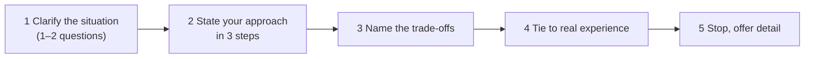

# Situational & Tough Questions

> Situational questions ask what you *would* do. Tough questions probe weaknesses, failures and money. Answer with a clear approach, name the trade-offs, anchor it in real experience, then stop.

Roadmap topic 18 · Stage 6: Interview & Career Moves

**Go deeper:** `1` How Behavioral Interviews Work · `2` STAR · `7` Failure · `9` Conflict · `11` Communication · `16` Career Story · `20` Offers & Negotiation · `05-system-design/31-Interview-Answer-Structure`.

**Marks:** 🟢 must know · 🟡 good to know

---

#### 1. What Is It?

*Hypotheticals, traps and probes, and how to answer them honestly and briefly.*

| 🟢 Must know | 🟡 Good to know |
|---|---|
| behavioral vs situational | trap questions |
| situational: clarify, approach, trade-offs, real example | salary and leaving-early questions |
| follow-up probes | hypotheticals about releases and incidents |
| no perfect story: use a related one or explain your approach | staying concise |
| | handling a question you didn't understand |

1. **Behavioral:** "What did you do?" (a real past event, use STAR).
2. **Situational:** "What would you do?" (a hypothetical; show your thinking).
3. **Probe:** a follow-up that tests depth ("why?", "what was your part?", "what would you change?").

**Signals in an interview:** "What would you do if…", "How would you handle…", "Imagine that…", "What's your biggest weakness?", "Why should we hire you?".

---

#### 2. How It Works

**Answering a situational question.**



1. **Clarify:** what is the severity? who is affected? what are the constraints (time, authority)? One or two questions, not an interrogation.
2. **Approach:** 3 steps in order, with the reason for each.
3. **Trade-offs:** what you give up, the risk you accept.
4. **Experience:** "I faced something like this when…" (one sentence).
5. **Stop.** Then offer to go deeper.

**Follow-up probes.**

| Probe | What they test | How to answer |
|---|---|---|
| "Why?" | reasoning | give the principle and the evidence |
| "What was your part?" | ownership | name your decisions, credit others |
| "What would you change?" | learning | one specific change |
| "What if that didn't work?" | resilience | name the plan B |
| "What if your manager disagreed?" | judgment and respect | data, options, commit |

**When you have no perfect story.** Use a related story ("I haven't led an outage that large, but I handled a smaller one…") or say what you would do and why, and what you'd check. Don't invent.

🟡 **Trap questions.**

| Question | What they want | Good approach |
|---|---|---|
| "Biggest weakness?" | self-awareness | a real, non-critical weakness with action (topic 16) |
| "A time you disagreed with your boss?" | respect plus backbone | evidence, private conversation, commit (topic 9) |
| "A time you failed?" | ownership and learning | topic 7 |
| "Why should we hire you?" | fit and clarity | 2 strengths linked to the role's needs, with evidence |
| "Why was there a gap?" | honesty | brief, forward-looking |
| "How do you handle criticism?" | openness | a real example of acting on feedback |
| "Do you have other offers?" | honesty without pressure | "I'm in several processes; this role is a strong fit because…" |

🟡 **Salary or leaving-early questions.** Be honest and calm. If asked about salary early: "I'd like to understand the role and level first; what's the range for this position?" If asked "will you stay?": "I'm looking for a place to grow for years; here's what I hope to build." Don't promise what you can't. (Details in topic 20.)

🟡 **Hypotheticals on releases and incidents.** "What if the release has a crash and you cannot roll back?" Answer in order: assess impact, stop the harm (halt rollout, flag off), communicate, fix, prevent (topic 8).

🟡 **Concise.** Answer, then stop. A 60 to 90 second answer is normal for a situational question.

🟡 **A question you didn't understand.** Ask: "Could you give me an example of what you mean?" or restate: "So you're asking how I'd handle X; is that right?"

**Example (illustrative): "A release is crashing for 3% of users and you can't roll back. What do you do?"**

> "First I'd confirm the impact: how many users, which versions and devices, and whether it's data loss or just a crash. Then I'd stop the harm: halt the staged rollout and turn off the feature behind a remote flag, if there is one. I'd tell the team and stakeholders what we know, what we don't, and when the next update is. Then I'd find the root cause from the stack trace and reproduce it, ship a hotfix with a staged rollout, and run a blameless review to add the test or alert that was missing. The trade-off is speed against risk: a rushed hotfix can cause a second incident, so I'd keep the change minimal and test the upgrade path. I handled something like this when a migration crashed users upgrading from an old version; flagging the feature off cut the crashes by 90% in 20 minutes."

---

#### 3. Weak Answer vs Strong Answer

| | Weak | Strong |
|---|---|---|
| Start | jumps to an answer | clarifies severity and constraints |
| Structure | rambling | 3 ordered steps with reasons |
| Trade-offs | none | names the risk and the cost |
| Experience | none or invented | a real related example |
| Weakness | "I work too hard" | real, small, with action |
| Money | evasive or aggressive | calm, honest, asks for the range |
| Length | 4 minutes | 60 to 90 seconds, then stops |
| Unknown question | guesses | asks for clarification |

---

#### 4. Templates & Worked Examples

**Situational template.**

```text
CLARIFY: What is the impact / who is affected / what can I decide?
APPROACH: 1) … because …   2) … because …   3) … because …
TRADE-OFFS: I accept … in exchange for …
EXPERIENCE: "I faced a similar situation when …"
STOP: "I can go deeper on …"
```

**More situational answers (outlines).**

| Question | Approach |
|---|---|
| A product manager asks you to skip tests to hit a date. | Understand the date's importance; propose the smallest safe cut (keep tests for risky areas, cut optional features); show the risk (bugs reach users, cost to fix later); get the owner's decision in writing; roll out in stages. |
| A teammate's PR has a security issue. | Review privately and kindly, explain the risk with an example (SBI), suggest a fix, offer to pair, re-review; escalate only if it ships or repeats. |
| Two urgent tasks arrive at the same time. | Ask what each is worth and the deadline; rank (impact, urgency, effort); tell stakeholders what waits and when; ask the manager to decide if there's a real conflict. |
| You disagree with your tech lead's architecture decision. | Make sure you understand their reasons; bring data or a small test; present concerns once; if the decision stands, commit and set a checkpoint. |
| You're asked to estimate something you've never done. | Ask for the outcome and constraints; break it down; spike the riskiest part; give a range with assumptions; re-estimate. |
| A stakeholder insists on an unrealistic date. | Show the work and the critical path; offer options (scope, date, risk); recommend one; agree the decision owner. |

**Replies to common traps.**

| Question | Sample reply |
|---|---|
| "Biggest weakness?" | "I tend to take on too much myself. I've started delegating with clear context; last quarter I handed off two modules and they shipped without issues." |
| "Why should we hire you?" | "You need someone to make an Android app reliable at scale and to mentor. I've cut crashes from 1.4% to 0.5% and coached a junior to own a feature in eight weeks." |
| "Other offers?" | "I'm talking to a few teams. This one is my first choice because of the offline-first work, and I'd like to decide in the next two weeks." |
| "Where do you see yourself?" | "Leading technical direction for a mobile product and growing other engineers." |

**Salary question reply.**

> "I'd like to understand the scope and level first. Could you share the range for this role? Based on my research for senior Android roles in this market, I'd expect something in the range of… but I'm flexible depending on the whole package."

**Counting your answer (code).**

```kotlin
fun answerTooLong(text: String, maxSeconds: Int = 90, wpm: Int = 140) =
    text.trim().split(Regex("\\s+")).size * 60.0 / wpm > maxSeconds
```

Checks: a 200-word answer → `false` (about 86 seconds); a 300-word answer → `true` (about 129 seconds). Trim, then stop.

---

#### 5. Numbers & Metrics to Quote

| Item | Guide |
|---|---|
| Situational answer | 60 to 90 seconds |
| Clarifying questions | 1 or 2 |
| Steps in your approach | 3 |
| Experience | 1 sentence, with a number if possible |
| Weakness answer | 30 to 45 seconds |
| Salary | ask for the range first; know your market data |
| Probes | expect 1 to 3 follow-ups per story |

---

#### 6. Common Mistakes & Edge Cases

1. Answering a hypothetical as if you knew the details.
2. A "perfect" answer with no trade-offs.
3. Inventing a story to fit.
4. Over-long answers.
5. Blaming people in a hypothetical.
6. Dodging weakness or salary questions.
7. Giving a guess when you didn't understand the question.
8. Arguing with the interviewer.

Edge cases: a trick question with no good answer (be honest, stay calm); an illegal or inappropriate question (politely redirect to the job: "I'd prefer to focus on my qualifications"); the interviewer pushes back (stay open, restate, give evidence); a question outside your experience (explain how you'd learn and a related example); you blank (pause, take a breath, restate the question).

---

#### 7. Say This in the Interview

1. "Before I answer, may I ask one question: how many users are affected?"
2. "My approach would be three steps: first…, then…, then…"
3. "The trade-off is…; I'd accept X to reduce Y."
4. "I haven't faced exactly that, but a similar case was…"
5. "A real weakness of mine is…, and here's what I'm doing about it."
6. "Could you share the salary range for this role?"
7. "Could you give me an example of what you mean?"

---

#### 8. Quick Check

1. What is the difference between behavioral and situational?
2. What are the five steps of a situational answer?
3. What should you do if you have no perfect story?
4. How do you answer a salary question early on?

<details>
<summary>Answers</summary>

1. Behavioral asks for a real past event; situational asks what you would do.
2. Clarify, approach in steps, trade-offs, real experience, stop.
3. Use a related story or explain what you would do and why, without inventing.
4. Ask for the range and say you'd like to understand the role first.

</details>

---

#### 9. Practice

**Interview questions**

1. What would you do if a release crashes and you can't roll back?
2. What would you do if a manager asked you to skip tests?
3. What's your biggest weakness?
4. Why should we hire you?
5. Tell me about a time you disagreed with your boss.
6. What are your salary expectations?
7. Do you have other offers?

**Exercises**

1. Answer the six situational outlines in 90 seconds each, recorded.
2. Write your weakness answer with a real action and evidence.
3. Practise "I don't understand; could you give an example?" aloud.
4. Prepare a calm salary-range reply with your market data.

**Remember:** clarify → three steps → trade-offs → real example → stop · don't invent · honest, calm replies to traps · 60–90 seconds · ask when unsure.
