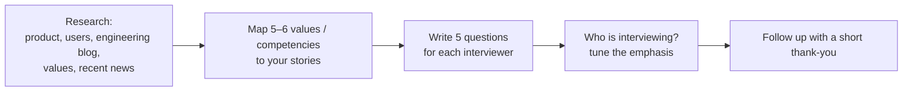

# Company Values & Interviewer Types

> Every company tests a slightly different list of behaviours, and every interviewer listens for different things. Research the company, map your stories to its values, know who is in the room, and prepare good questions to ask.

Roadmap topic 19 · Stage 6: Interview & Career Moves (New)

**Go deeper:** `1` How Behavioral Interviews Work · `3` Story Bank · `15` Hiring (the interviewer's view) · `16` Career Story · `20` Offers.

**Marks:** 🟢 must know · 🟡 good to know · (New) beyond your original ten topics

---

#### 1. What Is It?

*Tailoring the same real stories to the company and the interviewer.*

| 🟢 Must know | 🟡 Good to know |
|---|---|
| research the company: product, users, culture, news, values | what each interviewer type listens for |
| map your stories to their values | large company vs startup values rounds |
| prepare good questions to ask | red flags in the company |
| know who you are talking to | thank-you follow-up |
| | reading the job description |

1. **Values / leadership principles:** the behaviours a company says it rewards, and tests in interviews.
2. **Interviewer type:** their role decides what they care about.
3. **Your questions:** a chance to show judgment and to check the company too.

**Signals in an interview:** "Which of our values resonates with you?", "Do you have questions for us?", an interviewer you haven't met before, a "bar raiser" or "values" round.

---

#### 2. How It Works

**Preparing for a company.**



**What to research.**

| Source | What to learn |
|---|---|
| The app / product | use it; note what's great and what you'd improve |
| Engineering blog, talks, open source | architecture, tools, quality practices |
| Values / leadership principles page | the behaviours they test |
| Job description | must-have skills, level, team goals |
| News, funding, reviews | direction, risks |
| LinkedIn / interviewers' public talks | their background (respectfully) |

**Mapping stories to values.** Make a table: value → your best story → the one number or action that proves it. Example for Amazon's Leadership Principles (check the current list): Customer Obsession, Ownership, Invent and Simplify, Are Right A Lot, Learn and Be Curious, Hire and Develop the Best, Insist on the Highest Standards, Think Big, Bias for Action, Frugality, Earn Trust, Dive Deep, Have Backbone; Disagree and Commit, Deliver Results, and two newer ones about being an employer and about broad responsibility. Other companies publish similar lists; read yours.

| Value | Your story | Proof |
|---|---|---|
| Ownership | stability programme nobody asked for | crash-free 98.6% → 99.5% |
| Dive Deep | cold start analysis | found 900 ms in `Application.onCreate` |
| Disagree and Commit | pagination dispute | duplicates 4% → 0, supported the compromise |
| Customer Obsession | offline-first rebuild | "lost note" tickets 11% → 2% |
| Deliver Results | payments launch | on time, 97.8% success on day one |

**Who is interviewing, and what they listen for.**

| Interviewer | Listens for | Tune your answer |
|---|---|---|
| Hiring manager | ownership, fit with team goals, growth, judgment | stories with outcomes and your plans |
| Peer engineer | collaboration, technical judgment, code quality | decisions, trade-offs, how you work with others |
| Product / design partner | communication, user focus, trade-offs | user impact, simple language |
| Senior / skip-level | scope, influence, strategic thinking | cross-team impact, business metrics |
| Bar raiser / values interviewer | consistency with the company's standard; depth of examples | specific, honest, probe-proof stories |
| Recruiter | basics, motivation, logistics | career story, why us, expectations |

🟡 **Large company vs startup.**

| | Large company | Startup |
|---|---|---|
| Values round | formal, scored, structured | informal, "can you wear many hats?" |
| Stories | process, scale, influence | speed, ownership, ambiguity |
| Questions to ask | career ladder, team structure, on-call | runway, product direction, role growth |

🟡 **Red flags in the company.** Unclear ownership, constant firefighting, no plan for quality (no tests, no staged rollout), high turnover, interviewers who can't describe their roadmap or who disparage past people, and evasive answers about on-call, pay or leveling. Treat the interview as two-sided.

🟡 **Thank-you note.** Within 24 hours: two or three sentences, thank them, mention one specific thing you discussed, and restate interest. Keep it short.

🟡 **Reading the job description.** Count the repeated words (ownership, quality, mentoring, cross-team) and make sure you have a story for each. "Must have" vs "nice to have"; the level (senior/staff) sets the scope of your stories.

**Good questions to ask.**

| Topic | Question |
|---|---|
| The team | "How is the Android team organised, and who do you work with most?" |
| Quality | "What are your crash-free and ANR targets? How do you release?" |
| Decisions | "How are technical decisions made and recorded?" |
| Growth | "What does success look like in the first 6 months? How do people grow into lead roles?" |
| Challenges | "What's the hardest problem the team faces right now?" |
| Culture | "How does the team handle incidents and disagreements?" |
| Practicalities | "What does on-call look like?" |

---

#### 3. Weak Answer vs Strong Answer

| | Weak | Strong |
|---|---|---|
| Research | reads the homepage | used the product, read the blog and values |
| Values | recites them | proves them with a real story and a number |
| Questions | "no questions" or about perks only | thoughtful, role-specific, a few per interviewer |
| Interviewer | same pitch to everyone | tunes emphasis to the role of the interviewer |
| Honesty | says what they think the company wants | true stories, mapped to values |
| Follow-up | none | short, specific thank-you |
| Two-sided | passive | also checks the company for red flags |

---

#### 4. Templates & Worked Examples

**Company research sheet.**

```text
COMPANY:                         ROLE / LEVEL:                    DATE:
Product (what I like / what I'd improve):
Users and scale:
Engineering practices I learned (blog, talks, open source):
Values / principles (list) → my story for each:
Job description keywords (repeated words) → my proof:
Questions for: hiring manager ___ | peers ___ | product ___ | skip-level ___
Possible red flags to check:
```

**A thank-you note.**

```text
Hi Priya – thank you for the conversation today. I especially enjoyed discussing how your team handles
offline sync; it's the kind of problem I like working on. I'm very interested in the role and happy to share
anything else that would help. Best, <name>
```

**Matching stories to values: a coverage check (code).**

```kotlin
fun uncovered(values: List<String>, storiesByValue: Map<String, List<String>>, minStories: Int = 1) =
    values.filter { (storiesByValue[it]?.size ?: 0) < minStories }
```

Checks: with values `[Ownership, Dive Deep, Frugality]` and stories `Ownership → [A, B]`, `Dive Deep → [C]` (none for Frugality), `uncovered(...)` → `[Frugality]`: a gap to fill with a new story (for example, a time you saved cost or did more with less).

**Tuning one story for two interviewers.**

| Story: offline-first rebuild | For the hiring manager | For the product partner |
|---|---|---|
| Emphasis | ownership, plan, outcomes, team | user problem, trade-offs, metrics |
| Key line | "I owned the plan and the staged rollout." | "Lost-note tickets fell from 11% to 2%; we cut the share sheet to keep the date." |

**Reading a job description (example).**

```text
"You will own the Android app's reliability, mentor engineers, and work with backend and design."
→ stories needed: reliability (crash-free), mentoring, cross-team API contract
"Nice to have: KMP" → mention what I know honestly (a small shared module), and that I'm learning.
```

---

#### 5. Numbers & Metrics to Quote

| Item | Guide |
|---|---|
| Research | 2 to 3 hours per company |
| Values mapped | 5 or 6 of them, each with a story and a number |
| Questions | 5 per interview, 2 or 3 used per interviewer |
| Thank-you | within 24 hours, 2 to 3 sentences |
| Story reuse | at most 3 uses of one story in a loop |
| Interview loop | usually 3 to 6 conversations |

---

#### 6. Common Mistakes & Edge Cases

1. No research.
2. Reciting values instead of proving them.
3. Claiming a value you can't back up with a story.
4. Having no questions.
5. Asking only about pay and perks.
6. The same emphasis for every interviewer.
7. Ignoring red flags because you want the job.
8. Criticising the product rudely.

Edge cases: the company's values don't match yours (be honest with yourself); a values round with a very structured format (answer in STAR, concisely); a surprise interviewer (ask about their role, then tune); an interviewer is late or distracted (stay professional, ask to continue); you're interviewing at many companies (keep a sheet per company, don't mix up the details).

---

#### 7. Say This in the Interview

1. "I've used the app for a few weeks; I especially like X, and I wondered about Y."
2. "This story shows Ownership: nobody asked me to, and the result was…"
3. "Since you're on the product side, let me describe the user impact first."
4. "What are your crash-free and ANR targets, and how do you release?"
5. "What's the hardest problem the team faces right now?"
6. "Thank you for your time. I enjoyed discussing…"

---

#### 8. Quick Check

1. How do you prove a value in an interview?
2. What does a peer engineer listen for?
3. Name two good questions to ask.
4. Name two red flags.

<details>
<summary>Answers</summary>

1. A real story with your actions and a number that shows the behaviour.
2. Collaboration, technical judgment and code quality.
3. For example: "What are your quality targets and release process?" and "What's the hardest problem the team faces?"
4. For example: unclear ownership, constant firefighting, no plan for quality, evasive answers on on-call or pay.

</details>

---

#### 9. Practice

**Interview questions**

1. Which of our values resonates with you most? Give an example.
2. Why do you want to work here?
3. What do you know about our product?
4. Do you have any questions for us?
5. What would you improve in our app?

**Exercises**

1. Fill in the research sheet for a company you like.
2. Map five values to five of your stories; find the gap with the coverage idea.
3. Write five questions each for a manager, a peer and a product partner.
4. Draft a thank-you note for your last interview.

**Remember:** research and use the product · prove values with stories and numbers · tune to the interviewer · ask good questions · watch for red flags · send a short thank-you.
