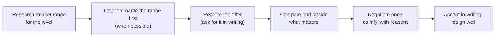

# Offers, Negotiation & Career Moves

> An offer is the start of a conversation. Understand every part of it, know your market value, negotiate calmly and honestly, compare offers on the whole picture, and leave your current job well.

Roadmap topic 20 · Stage 6: Interview & Career Moves (New)

**Go deeper:** `16` Career Story · `18` Tough Questions (salary) · `19` Company Values · `21` Mock Interviews · `12` Leadership (level and scope).

**Marks:** 🟢 must know · 🟡 good to know · (New) beyond your original ten topics

**Note:** pay, taxes, equity rules and notice periods vary by country and company. Use this note for the method, and check local facts. It is not financial or legal advice.

---

#### 1. What Is It?

*Turning an offer into a good decision and a smooth move.*

| 🟢 Must know | 🟡 Good to know |
|---|---|
| the parts of an offer | timing: when to talk numbers; many processes |
| know your worth: market data and your level | leveling: what a level change means |
| negotiate calmly and honestly | notice periods; leaving on good terms |
| compare offers on the whole picture | counter-offers |
| | your first 90 days |

1. **Total compensation:** base pay + bonus + equity + benefits + other (sign-on, relocation).
2. **Level:** the company's job grade; it decides scope, pay band and future growth.
3. **Negotiation:** a collaborative conversation to agree terms both sides accept.
4. **BATNA:** your best alternative if this deal does not happen (other offers, your current job).

**Signals in an interview:** "What are your salary expectations?", an offer call, "do you have other offers?", "when can you start?".

---

#### 2. How It Works

**The offer process.**



**Parts of an offer.**

| Part | Questions to ask |
|---|---|
| Base salary | amount, review cycle, currency, pay frequency |
| Bonus | target, how it's paid, past payout |
| Equity | type (RSU/options), amount, vesting schedule, cliff, refresh grants, tax treatment |
| Benefits | health, retirement matching, leave, learning budget, remote / hybrid rules |
| Level and title | the level, the band, promotion path |
| One-time | sign-on bonus (and clawback), relocation |
| Terms | start date, notice, probation, non-compete, IP rules |

**Know your worth.** Use market data (public salary data, recruiters, peers, levels sites), your **level** (not only your years), location, company stage and your evidence (impact and scope). Build a range with a floor, a target and a stretch.

**Negotiating calmly.**

1. Be positive: "I'm excited about the role."
2. Ask, don't demand: "Is there flexibility on the base / equity / level?"
3. Give a reason with evidence: market data, scope, a competing offer (only if true).
4. Negotiate the whole package (base, equity, sign-on, level, start date).
5. Do it once, in one conversation, then decide. Get the final terms in writing.
6. Be ready to walk away if it doesn't meet your needs.

**Comparing offers.**

| Factor | Question |
|---|---|
| Total compensation | what is it per year, expected, not just the headline? |
| Growth | will I learn, and is there a path to lead / staff? |
| Team and manager | who will I work with? |
| Scope and impact | the problems and user scale |
| Stability and risk | company health, runway, layoffs |
| Life | location, hours, on-call, remote |
| Mission and interest | do I care about the product? |

🟡 **Timing.** Avoid giving a number first if you can. Let the company share the range ("what's the range for this role?"). Talk numbers once there's mutual interest. If you have several processes, tell each company the truth about timing; ask for reasonable extra time if needed.

🟡 **Leveling.** A lower level than expected means smaller scope and pay band; ask what evidence moves you up and how fast. A higher level means higher expectations. Negotiate level, not only pay, as it compounds over time.

🟡 **Notice and leaving well.** Give written notice, offer a handover plan, finish key work, document, thank people. The industry is small and references matter.

🟡 **Counter-offers.** A current employer may match to keep you. Ask why it took an offer to get it, and whether the real reasons for leaving (growth, scope, manager) change. Many people still leave later.

🟡 **First 90 days.** Listen and learn, meet people, ship a small win early, learn the codebase and release process, agree expectations with your manager, and write down what you notice (fresh eyes are valuable).

**Example (illustrative): comparing two offers.**

> Offer A: base 150k, bonus 10% target, equity 80k over 4 years (20k/year), growth to staff, big team. Offer B: base 165k, no bonus, equity 40k over 4 years (10k/year), small team, less clear growth.
>
> First-year total compensation: A = 150 + 15 + 20 = **185k**; B = 165 + 0 + 10 = **175k**. A is higher on total pay and offers a growth path. If B's team and product are more interesting, that's a real reason, but I would know the price of choosing it (about 10k a year).

---

#### 3. Weak Answer vs Strong Answer

| | Weak | Strong |
|---|---|---|
| Preparation | no data | market range, level and evidence |
| First number | gives it too early | asks for the range first when possible |
| Focus | base pay only | total package, level, growth |
| Tone | aggressive or apologetic | warm, factual, collaborative |
| Competing offers | bluff | true, specific, polite |
| Process | many rounds of haggling | one clear conversation, in writing |
| Decision | by headline | by the whole picture |
| Leaving | burn bridges | notice, handover, thanks |

---

#### 4. Templates & Worked Examples

**Offer comparison (code).**

```kotlin
data class Offer(
    val base: Double, val bonusPercent: Double = 0.0,
    val equityTotal: Double = 0.0, val vestYears: Int = 4, val signOn: Double = 0.0
)

fun firstYearTotal(o: Offer) = o.base + o.base * o.bonusPercent / 100 + o.equityTotal / o.vestYears + o.signOn
fun annualSteadyState(o: Offer) = o.base + o.base * o.bonusPercent / 100 + o.equityTotal / o.vestYears
```

Checks: Offer A `(150_000, 10, 80_000, 4, 0)` → `firstYearTotal` = `150,000 + 15,000 + 20,000` = `185,000`. Offer B `(165_000, 0, 40_000, 4, 0)` → `175,000`. Add a `30,000` sign-on to B: `firstYearTotal` = `205,000`, but `annualSteadyState` is still `175,000`: a sign-on is paid once. (Equity values are estimates: a stock can fall, and private-company equity may be worth nothing; ask about refreshers and the tax treatment.)

**Negotiation script.**

> "Thank you; I'm excited about the role and the team. Based on my research for senior Android roles at this level, and my experience leading an offline-first rebuild and mentoring engineers, I was hoping for a base closer to 165k. Is there flexibility there, or on the equity?"

**If they say "this is our best offer".**

> "I appreciate that. Could you help me understand how the band works and what would move me within it, such as the level, the sign-on or a six-month review?"

**Asking about the level.**

> "What is the level of this role, and what does promotion to the next level look like here?"

**Resignation note.**

```text
Hi <manager>, I'm writing to give formal notice. My last day will be <date>. Thank you for the opportunities
here, especially <specific>. I'll create a handover plan for <projects> and help make the transition smooth.
```

**Counter-offer checklist.**

```text
[ ] Why was this not offered before I had another option?   [ ] Do my real reasons for leaving change?
[ ] Is the manager/scope/growth different?                  [ ] Is it in writing, including level and date?
[ ] How will this affect trust and my next review?
```

**First-90-days plan.**

```text
Days 1–30: learn  – meet people, run the app, read the architecture, fix one small bug, learn the release process
Days 31–60: contribute – own a small feature, give feedback on onboarding, agree goals with my manager
Days 61–90: impact – deliver something visible, propose one improvement, share what I've learned
```

---

#### 5. Numbers & Metrics to Quote

| Item | Guide |
|---|---|
| Offer review time | ask for 3 to 7 days to decide (reasonable) |
| Negotiation | one conversation, 1 to 3 asks |
| Typical negotiation room | often a few percent to 10–15% on base, more on equity and sign-on; varies widely |
| Equity vesting | commonly 4 years with a 1-year cliff |
| Notice period | commonly 2 to 4 weeks (longer in some countries) |
| Comparison | first-year total and steady-state annual compensation |
| First 90 days | learn → contribute → impact |

---

#### 6. Common Mistakes & Edge Cases

1. Accepting on the spot, or not asking for details in writing.
2. Looking only at base pay.
3. Giving a number first, with no research.
4. Bluffing about competing offers.
5. Negotiating many times, or in a hostile tone.
6. Accepting a lower level without a plan.
7. Burning bridges when you resign.
8. Taking a counter-offer without changing the reasons you were leaving.

Edge cases: the equity is in a private company (risk; ask about valuation and liquidity); remote pay varies by location policy (ask how bands are set); an exploding offer (ask politely for time; decide on what matters); a verbal offer only (wait for the written one); a visa, relocation or non-compete issue (check early with the recruiter and a lawyer).

---

#### 7. Say This in the Interview

1. "I'd like to understand the role and level first. What is the range for this position?"
2. "I'm excited about the team. Is there flexibility on the base or equity?"
3. "Could you send the full offer in writing, including level, vesting and bonus?"
4. "I'd like to take a few days to decide; I'll get back to you by Friday."
5. "I'm choosing based on growth, team, scope and pay, not only pay."
6. "I'll make sure the handover is smooth."

---

#### 8. Quick Check

1. What is total compensation?
2. Why is level important?
3. When should you give your number?
4. What is a BATNA?

<details>
<summary>Answers</summary>

1. Base + bonus + equity + benefits + one-time items (sign-on, relocation).
2. It sets scope, the pay band and the path for future growth, and compounds over time.
3. Preferably after the company gives its range and there is mutual interest.
4. Your best alternative if the deal does not happen; it sets your walk-away point.

</details>

---

#### 9. Practice

**Interview questions**

1. What are your salary expectations?
2. Do you have other offers?
3. How do you decide between offers?
4. How would you handle a counter-offer?
5. How do you plan your first 90 days?

**Exercises**

1. Build a range (floor, target, stretch) from three sources of market data.
2. Compare two real or imaginary offers with the comparison function.
3. Write your negotiation script and practise it aloud.
4. Write a resignation note and a handover plan.

**Remember:** total compensation, not base alone · know your range and level · ask for the range first · negotiate once, calmly, with reasons · compare on growth, team, scope and pay · leave on good terms.
