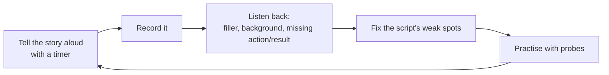

# Mock Interviews & Practice Plan

> Stories improve when you say them aloud, with a timer and honest feedback. A short, regular practice plan turns your prepared stories into natural, clear answers.

Roadmap topic 21 · Stage 6: Interview & Career Moves

**Go deeper:** `2` STAR · `3` Story Bank · `18` Situational Questions · `19` Company Values · `03-leetcode-patterns/22-Practice-Plan-and-Problem-Sets` and `05-system-design/32-Practice-Projects-and-Designs` (the technical practice plans).

**Marks:** 🟢 must know · 🟡 good to know

---

#### 1. What Is It?

*Deliberate practice for behavioral interviews.*

| 🟢 Must know | 🟡 Good to know |
|---|---|
| tell each story aloud with a timer, and record it | keep your story matrix up to date |
| ask a friend or mentor to interview you | practise in the real setting |
| listen back: cut filler, strengthen action and result | practise the hard stories most |
| practise short and full answers | plan the day |
| practise with follow-ups | |

1. **Mock interview:** a practice interview with a friend, mentor or recording.
2. **Feedback loop:** record → listen → fix → repeat.
3. **Probing:** follow-up questions that test your stories.

**Signals:** you hesitate on follow-ups, your stories run past three minutes, or you reach for the same story every time.

---

#### 2. How It Works

**The practice loop.**



**A two-week plan.**

| Days | Focus | Output |
|---|---|---|
| 1 to 3 | topics 1 to 3: collect stories, shape them in STAR, build the matrix | 8 to 10 written stories |
| 4 to 7 | topics 4 to 8: projects, decisions, architecture, failure, incident | 2-minute and 30-second versions, recorded |
| 8 to 10 | topics 9 to 13: conflict, cross-team, communication, leadership, mentoring | people stories, with SBI and numbers |
| 11 to 12 | topics 16 to 19: career story, situational questions, company research | the three basics and a company sheet |
| 13 to 14 | topic 21: two full mock interviews; fix the weakest stories | a clean story matrix and a rested mind |

**What to listen for.**

| Issue | Fix |
|---|---|
| over 3 minutes | cut the situation; keep 3 to 5 actions |
| no number in the result | find one (dashboard, ticket count, timing) |
| "we" everywhere | say "I" for your actions |
| filler ("um", "like", "you know") | pause instead; practise the opening sentence |
| no lesson | add one sentence of learning |
| monotone | emphasise the key action and the result |
| you ramble on probes | answer in one or two sentences, then stop |

**Mock-interview roles.**

| Role | What they do |
|---|---|
| Interviewer (friend or mentor) | asks 3 to 4 main questions, probes with "what was your part?", "what would you change?" |
| Observer (optional) | writes notes of signals and gaps |
| You | answer as in the real interview |
| After | 10 minutes of feedback: strengths, gaps, one thing to fix |

**Feedback questions to ask.** "What was the clearest part? Where did you lose me? What was my part, in your words? What number do you remember? Did I sound honest?"

🟡 **Keep the matrix updated.** After every practice, mark which stories worked and which competencies are still thin.

🟡 **Practise in the real setting.** Same device and camera for video calls; a whiteboard or document for design rounds; the same time of day.

🟡 **Practise the difficult stories most.** Failure, conflict and incident stories feel risky, so rehearse them until you can tell them calmly.

🟡 **Plan the day.** Sleep, eat, arrive (or log in) 10 minutes early, do a 5-minute warm-up (say your career story aloud), keep water and a notepad with your story titles, not scripts.

---

#### 3. Weak Answer vs Strong Answer

| | Weak practice | Strong practice |
|---|---|---|
| Method | read stories silently | tell aloud, timed, recorded |
| Feedback | none | a mentor, honest and specific |
| Probes | only the first answer | two or three follow-ups per story |
| Focus | favourite stories | the hard ones most |
| Timing | night before | two weeks, with regular short sessions |
| Delivery | memorised paragraphs | the structure and key numbers, in natural words |
| Tracking | none | matrix, notes, and a list of fixes |

---

#### 4. Templates & Worked Examples

**A 30-minute mock interview.**

```text
0:00–0:03  Warm-up: "Tell me about yourself" (career story)
0:03–0:10  Q1: a project / impact story  → probe: "What was your part? How did you measure?"
0:10–0:17  Q2: a conflict or failure story → probe: "What would you change?"
0:17–0:24  Q3: a situational question → probe: "What if that didn't work?"
0:24–0:30  Feedback: clearest part, gaps, one thing to fix
```

**Feedback sheet.**

```text
Story: ______   Time: ___ min
Clear? (1–5) _   Specific actions? (1–5) _   Result with a number? Y/N   "I" vs "we"? OK / too "we"
Lesson? Y/N   Honest / credible? (1–5)   Probes handled? (1–5)
Best moment:            Fix first:
```

**Timing log (code).**

```kotlin
data class Run(val story: String, val seconds: Int)

fun overTime(runs: List<Run>, targetSeconds: Int = 150) = runs.filter { it.seconds > targetSeconds }.map { it.story }
fun averageSeconds(runs: List<Run>) = runs.map { it.seconds }.average()
```

Checks: runs `A 135`, `B 200`, `C 170`, `D 120` with `targetSeconds = 150` → `overTime` = `[B, C]`; `averageSeconds` = `156.25`. Trim the stories that run long; the aim is about 120 seconds on average.

**Opening warm-up (say aloud before the interview).**

```text
1. My career story (60–90 seconds).   2. My best result in one sentence with a number.
3. Why this company (three reasons).   4. One question I will ask.
```

**The night before / day of.**

```text
[ ] Review the story matrix and 30-second versions   [ ] Re-read the company sheet and my questions
[ ] Test camera, sound, link (or route)              [ ] Prepare water, notepad, resume copy
[ ] Sleep; no new stories                            [ ] Warm up with the career story
```

**After the interview.**

```text
[ ] Send the thank-you note               [ ] Write down the questions asked and how it went
[ ] Update the matrix: what to improve    [ ] Note any new story ideas
```

**Common feedback and the fix.**

| Feedback | Fix |
|---|---|
| "I couldn't tell what you did." | rewrite the action in the first person, with reasons |
| "Too long." | cut the situation; remove side details |
| "No result." | find a metric or a clear outcome |
| "Sounded rehearsed." | practise the structure and key numbers, not the words |
| "Defensive on probes." | answer plainly: "Fair question. What I'd do differently is…" |

---

#### 5. Numbers & Metrics to Quote

| Item | Guide |
|---|---|
| Practice time | 30 to 60 minutes a day for two weeks |
| Story length | 2 minutes (about 280 words); 30-second version (about 70 words) |
| Repetitions | each story aloud at least 3 times |
| Mock interviews | at least 2 full ones, with someone who will be honest |
| Recordings | listen to every story at least once |
| Probes | 2 or 3 per story |
| Feedback | 10 minutes after each mock |

---

#### 6. Common Mistakes & Edge Cases

1. Reading stories silently and calling it practice.
2. Memorising word for word.
3. Practising only first answers, not probes.
4. Avoiding the hard stories.
5. Only asking friends who say "it's great".
6. Practising the night before.
7. Not recording.
8. Ignoring feedback.

Edge cases: nobody to practise with (record yourself, or use an online mock partner); too nervous (practise in a low-stakes setting first, e.g. with a recording); an interview next day (do the essentials: career story, 3 best stories, questions); a bad practice run (note one fix and move on).

---

#### 7. Say This in the Interview

1. (Opening) "Let me start with a quick overview of my background…" (the career story you practised)
2. "Let me pick the best example for that." (a calm pause)
3. "Fair question. What I'd do differently is…" (a non-defensive reply to a probe)
4. "To summarise, the result was… and what I learned was…"
5. "Do you have any follow-up questions on that?"

---

#### 8. Quick Check

1. Why record yourself?
2. What do you listen for?
3. How many mock interviews do you need?
4. What do you do the night before?

<details>
<summary>Answers</summary>

1. To hear filler, length and missing results that you don't notice while speaking.
2. Length, filler, "we" vs "I", the result and number, the lesson, and tone on probes.
3. At least two full ones, with someone who gives honest feedback.
4. Review the matrix and 30-second versions, prepare logistics, and sleep; no new stories.

</details>

---

#### 9. Practice

**Interview questions (a practice set)**

1. Tell me about yourself.
2. Tell me about a project you're proud of.
3. Tell me about a hard technical decision.
4. Tell me about a failure.
5. Tell me about a production incident.
6. Tell me about a disagreement.
7. Tell me about helping someone grow.
8. What would you do if…? (one situational question)

**Exercises**

1. Schedule two 45-minute mock interviews in the next two weeks.
2. Record all ten stories and keep a timing log.
3. Ask a mentor to give feedback with the feedback sheet.
4. Update the matrix, then re-record the three weakest stories.

**Remember:** aloud, timed, recorded · honest feedback · practise probes and the hard stories · two full mocks · structure and numbers, not memorised words · prepare logistics the night before.
