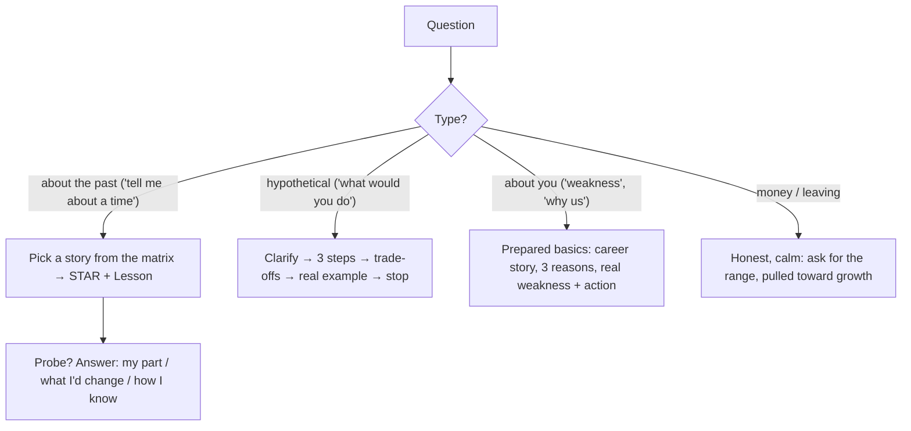

# Behavioral & Leadership Cheat Sheet

> One-page revision for the night before an interview. The full explanations are in notes 1–21.

---

#### 1. Key Takeaways

1. **They hunt for evidence.** Past behaviour predicts future behaviour. Give specific, first-person, honest examples with numbers. Scope must match the level.
2. **STAR + Lesson.** Situation (short) → Task (your job) → **Action** (3 to 5 steps, "I", with reasons) → Result (number) → Lesson. About 2 minutes (≈ 280 words).
3. **Build a story bank:** 8 to 10 real stories, each with a 30-second and a 2-minute version, mapped to competencies; cover win, failure, conflict, decision, incident, mentoring.
4. **Project stories:** a specific difficulty, your role, decisions, before/after impact, how you measured, a trade-off, what you'd change.
5. **Decisions:** options (incl. do nothing) → criteria first → evidence (spike, benchmark, data) → decision → bring people along → outcome → "what if the other option".
6. **Architecture:** start from pain and measurable quality goals; pilot behind a flag, expand step by step, keep a rollback; ADR, teach, guard against drift.
7. **Failure:** a real mistake with a real cost; own it; fast response; a concrete change; proof it stuck. No blame, no hidden strengths.
8. **Incidents:** detect → assess → stop the harm → root cause → fix → prevent. Communicate on a schedule. Blameless review with owners. Mobile: halt rollout, flag off, server fix, hotfix.
9. **Conflict:** listen first → shared goal → data or a small test → compromise or decision owner → disagree and commit → keep the relationship.
10. **Cross-team:** dependencies in week one, written API contract (add-only, old versions), mock server, one owner per piece, short regular updates, share credit.
11. **Communication:** answer first; plain words; cost, risk, time, user impact; options with a recommendation; bad news early; "no" with an alternative.
12. **Leadership without authority:** notice what nobody owns → measure → propose a small step → pilot → buy-in → make it stick. Staff scope = several teams, longer horizon, business impact.
13. **Mentoring:** goal first, give context, let them try, explain the why in reviews, SBI feedback, delegate goal + authority, show an observable change.
14. **Delivery:** score and rank (RICE), say what's not done; fix two of scope/time/quality visibly; estimate in ranges; steady debt share; protect the team.
15. **Hiring:** structured questions, rubric, notes before the debrief, bias controls, honest selling, onboarding, psychological safety.
16. **Career story:** present – past – future in 60 to 90 seconds; three specific reasons for the company; pulled toward, not pushed away; real weaknesses with action.
17. **Ambiguity, pressure, change:** clarify the outcome, write assumptions, small reversible bets; cut scope not quality; price changes and offer options.
18. **Situational and tough:** clarify → three steps → trade-offs → real example → stop. Be honest about salary. Ask when unsure.
19. **Company and interviewer:** research, use the product, prove values with stories, tune to the interviewer, ask good questions, thank-you note.
20. **Offers:** total compensation, level, market range, negotiate once and calmly, compare on growth, team, scope and pay, leave well.
21. **Practice aloud:** timed, recorded, probed; hard stories most; two full mocks.

---

#### 2. Numbers and Rules of Thumb

| Topic | Remember |
|---|---|
| Answer length | 2 minutes ≈ 250 to 300 words (≈ 140 words per minute); 30-second version ≈ 70 words |
| STAR time split | Situation 15% · Task 10% · **Action 50%** · Result 15% · Lesson 10% |
| Career story | 60 to 90 seconds (140 to 210 words) |
| Stories to prepare | 8 to 10; each competency has at least 2 |
| Steps in the Action | 3 to 5 |
| Result | at least 1 number, before and after, with a time frame |
| Options in a decision | 2 to 4, including do nothing |
| Status update | every 30 minutes in an incident; weekly in a project |
| Capacity | plan 60 to 80% of nominal; 15 to 25% for debt |
| Practice | each story aloud ≥ 3 times; ≥ 2 full mock interviews |
| Offer | ask for 3 to 7 days; negotiate once; compare first-year and steady-state total pay |
| Thank-you | within 24 hours, 2 to 3 sentences |

| Metric type | Examples |
|---|---|
| Quality | crash-free users, ANR rate, bugs per release |
| Speed | cold start, build time, review turnaround |
| Product | checkout completion, retention, rating |
| Cost | cloud cost, support tickets |
| Delivery | lead time, release frequency, time to restore |
| People | time to first PR, retention, promotions |

---

#### 3. Patterns and How to Identify Them

| Signal in the question | Story to use | Note |
|---|---|---|
| "Tell me about yourself" | career story (present–past–future) | 16 |
| "most challenging project / proudest" | project story with impact | 4 |
| "a hard decision / choose between X and Y" | decision story | 5 |
| "an architecture change you led" | architecture story | 6 |
| "a time you failed / a mistake" | failure story | 7 |
| "a production issue" | incident story | 8 |
| "a disagreement" | conflict story | 9 |
| "working with another team" | cross-team story | 10 |
| "explain to a non-technical person / bad news" | communication story | 11 |
| "led without authority / took initiative" | leadership story | 12 |
| "helped someone grow / feedback" | mentoring story | 13 |
| "prioritize / deadline / estimate / struggling teammate" | delivery story | 14 |
| "how do you interview / hire" | hiring answer | 15 |
| "unclear requirements / tight deadline / change" | ambiguity story | 17 |
| "what would you do if…" | situational answer | 18 |
| "why us? why leaving? weakness?" | basics | 16, 18, 19 |
| "salary / other offers" | negotiation answers | 18, 20 |



---

#### 4. Templates to Memorise

**STAR + Lesson**

```text
S: When/where, what was at stake (1–2 sentences).   T: My responsibility (1 sentence).
A: 1) I … because …  2) I … because …  3) I …        R: metric before → after, time frame.
L: What I do differently now.
```

**Decision**

```text
Problem → options (incl. do nothing) → criteria → evidence → decision (who agreed) → rollout + check → outcome → counterfactual
```

**Incident**

```text
Detect → impact → mitigate (halt rollout / flag off) → communicate (every 30 min) → root cause (5 whys) → fix → prevent (tests, alerts, owners)
```

**Conflict**

```text
Listen → shared goal → evidence → compromise / decision owner → disagree and commit → relationship after
```

**SBI feedback:** "In <situation>, you <behaviour>; the impact was <impact>. Can we <ask>?"

**Status update:** Where are we (on track / at risk / blocked) · What's at risk · What I need (decision, person, date).

**Bad news:** headline + recommendation · what happened · impact · options A/B/C · next update.

**No with an alternative:** "I can't do X by Friday. I can do A and B by Friday and C by the 28th. Which do you prefer?"

**One-page proposal:** problem (number) · goals / non-goals · options · recommendation + first step · cost · metric · risks / rollback · what I need.

**RICE:** Reach × Impact × Confidence ÷ Effort. **Three-point estimate:** (optimistic + 4 × likely + pessimistic) ÷ 6.

**Career story:** "I'm a ___ with ___ years in ___, strongest at ___. Recently ___ (result). Before, ___. Now I'm looking for ___ because ___."

**Why us (3 reasons):** product/problem · team/engineering practices · fit and growth.

**Offer comparison:** first-year total = base + bonus + equity/vest years + sign-on; steady state excludes one-time items.

---

#### 5. Weak to Strong

| Weak | Strong |
|---|---|
| "We did…" | "I proposed… I wrote… I convinced…" |
| "It went well." | "Crash-free users rose from 98.6% to 99.5% in eight weeks." |
| three minutes of background | two sentences of situation |
| one option | options, criteria, evidence |
| "mistakes happen" | "I didn't check X; now I do Y, and it worked on the next project." |
| fix first | stop the harm first, then fix |
| win the argument | shared goal, evidence, compromise, commit |
| jargon | plain words, user impact |
| bad news at the deadline | bad news the day you know, with options |
| "I'm a perfectionist" | a real weakness with an action |
| say yes to everything | rank, say what's not done |
| memorised script | structure and numbers, natural words |
| base pay only | total compensation, level and growth |

---

#### 6. Common Mistakes and Edge Cases

1. Vague, general answers; no specific event.
2. All "we"; or taking the team's credit.
3. No result, no number, no lesson.
4. Blaming people, teams or employers; fake failures.
5. Rambling past three minutes; background first, action last.
6. Inventing or inflating stories (they fall apart under probes).
7. Skipping the hard stories (failure, conflict, incident) in practice.
8. Edge cases: no story for a question (use a related one, or explain what you'd do); confidential details (generalise); a mixed or negative result (say so and show learning); a probe you don't understand (ask); you freeze (pause, restate, pick the story).

---

#### 7. What to Say Out Loud

1. "Let me pick the best example." (pause)
2. "The situation was… My responsibility was… What I did was… The result was… What I learned was…"
3. "I did X because Y; the alternative was Z, which I rejected because…"
4. "I stopped the harm first, then found the root cause."
5. "I listened to their constraint first; we agreed the shared goal was…; I disagreed once with data and then supported the decision."
6. "I can't do all of it by Friday. Here are the options and my recommendation."
7. "A real weakness of mine is…; here is what I'm doing about it."
8. "I'm drawn to this role because of…, and I'd bring…"
9. "What are your quality targets and how do you release?"

---

#### 8. Practice Order

| Step | Do |
|---|---|
| 1 | List 10 to 15 real events; fill the capture sheet for the best 8 to 10 (3) |
| 2 | Shape each in STAR + Lesson with a number; write the 30-second version (2) |
| 3 | Build the matrix; fill gaps: failure, conflict, incident, mentoring (3) |
| 4 | Write the career story, "why us", leaving and weakness answers (16) |
| 5 | Rehearse situational answers and the salary reply (18, 20) |
| 6 | Research the company; map values; write questions (19) |
| 7 | Record each story; fix length, "we", missing result (21) |
| 8 | Two full mock interviews with probes; fix the weakest stories (21) |
| 9 | Night before: read this sheet and the 30-second versions; prepare logistics; sleep |
