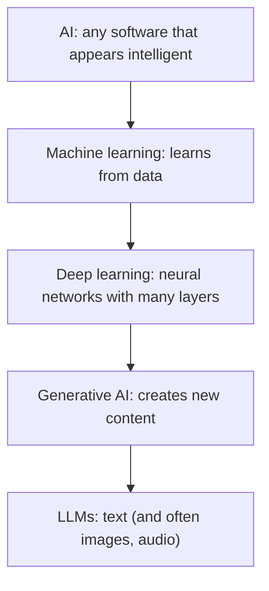
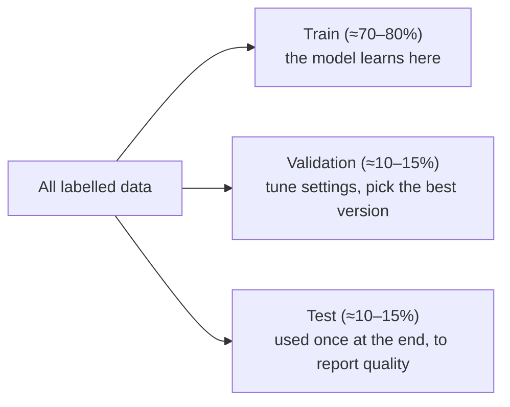

# AI Landscape & ML Basics

> Before building with LLMs, know the map: what AI, machine learning, deep learning and generative AI mean, how a model learns, and how to tell whether it is any good.

Roadmap topic 1 · Stage 1: Foundations

**Go deeper:** `2` How LLMs Work · `3` Training, Fine-Tuning & Model Choice · `15` Evaluation & Quality · `16` Safety (bias) · `001-AI Terminology - Basic` (35 plain-language terms).

**Marks:** 🟢 must know · 🟡 good to know · (New) still changing

---

#### 1. What Is It?

*The vocabulary and the habits of thinking that every later topic uses.*

| 🟢 Must know | 🟡 Good to know |
|---|---|
| AI vs ML vs deep learning vs generative AI vs LLM | precision, recall, accuracy (when accuracy misleads) |
| training vs inference | classic ML tasks: classification, regression, clustering, recommendation |
| supervised, unsupervised, reinforcement learning | the neural network idea (layers, weights, learning from errors) |
| overfitting; train / validation / test data | bias and fairness: where they come from |

1. **AI** is software that does tasks that normally need human intelligence.
2. **Machine learning (ML)** learns patterns from data instead of following hand-written rules.
3. **Deep learning** is ML with many-layered neural networks.
4. **Generative AI** creates new content (text, images, audio, code).
5. **LLM** (large language model) is a generative model for text, trained to predict the next token.

**Signals in an interview:** "what is the difference between AI and ML?", "training vs inference", "why is 99% accuracy not good?", "what is overfitting?".

---

#### 2. How It Works

**The nesting.**



**Training vs inference.**

| | Training | Inference |
|---|---|---|
| What happens | the model adjusts its weights to reduce errors on data | the trained model produces an output for new input |
| Cost | very high (many GPUs, days to months) | per request (small, but at scale it dominates) |
| Who does it | model providers (you rarely train from scratch) | your app, through an API or on a device |
| Changes the model? | yes | no |

**Three ways to learn.**

| Type | Idea | Example |
|---|---|---|
| Supervised | learn from labelled examples (input → correct answer) | spam vs not spam; price prediction |
| Unsupervised | find structure in unlabelled data | customer clustering, anomaly detection |
| Reinforcement | learn by trial, reward and penalty | game playing, robot control; shaping chat behaviour (RLHF, topic 3) |

**Classic ML tasks.** *Classification* (which category?), *regression* (what number?), *clustering* (which items group together?), *recommendation* (what might this user like?).

**The neural network idea (no math).** Layers of simple units pass numbers forward. Each connection has a **weight**. During training, the model compares its output with the right answer, measures the error, and nudges the weights to reduce it, millions of times. After training, the weights hold what it "learned".

**Train / validation / test.**



**Overfitting.** The model memorises the training data (including noise) and fails on new data. Sign: high training score, much lower validation score. Fixes: more or better data, a simpler model, regularisation, early stopping, and never tuning on the test set.

🟡 **Precision, recall, accuracy.** Given predictions on a "positive" class (say, spam):

| Metric | Meaning | Formula |
|---|---|---|
| Accuracy | how many predictions were right | (TP + TN) / all |
| Precision | when it says positive, how often is it right | TP / (TP + FP) |
| Recall | of all real positives, how many it found | TP / (TP + FN) |
| F1 | balance of precision and recall | 2 × P × R / (P + R) |

**Accuracy misleads on rare events.** If only 1% of emails are spam, a model that always says "not spam" is 99% accurate and catches nothing (recall 0).

🟡 **Bias and fairness.** Models copy patterns in their data: unrepresentative samples, historical bias, biased labels, and proxies (a postcode standing in for a protected group). Check performance by group, document limits, keep a human in the loop for high-stakes decisions (topic 16).

---

#### 3. Naive vs Better Design

| Naive | Better |
|---|---|
| "AI" for everything | pick the simplest tool: a rule, a query, a classic model, then an LLM |
| judge a model by accuracy alone | precision, recall and cost of each error type |
| tune on the test set | tune on validation; touch the test set once |
| train on all the data | hold out data you never train on |
| trust a model that was great in a demo | measure on your own data (topic 15) |
| ignore who is missing from the data | check groups and edge cases |

```kotlin
// Naive: "always predict the common class" looks great and is useless
fun predictSpam(email: String) = false
```

---

#### 4. Code

Metrics from a confusion matrix, plus a train/validation/test split:

```kotlin
data class Confusion(val tp: Int, val fp: Int, val fn: Int, val tn: Int) {
    val total get() = tp + fp + fn + tn
    val accuracy get() = (tp + tn).toDouble() / total
    val precision get() = if (tp + fp == 0) 0.0 else tp.toDouble() / (tp + fp)
    val recall get() = if (tp + fn == 0) 0.0 else tp.toDouble() / (tp + fn)
    val f1 get() = if (precision + recall == 0.0) 0.0 else 2 * precision * recall / (precision + recall)
}

fun <T> split(items: List<T>, trainPct: Int = 70, valPct: Int = 15, seed: Long = 42): Triple<List<T>, List<T>, List<T>> {
    val shuffled = items.shuffled(java.util.Random(seed))
    val nTrain = items.size * trainPct / 100
    val nVal = items.size * valPct / 100
    return Triple(shuffled.take(nTrain), shuffled.drop(nTrain).take(nVal), shuffled.drop(nTrain + nVal))
}

fun looksOverfit(trainScore: Double, valScore: Double, gap: Double = 0.1) = trainScore - valScore > gap
```

Checks: `Confusion(tp = 6, fp = 2, fn = 4, tn = 88)` → precision `0.75`, recall `0.6`, accuracy `0.94`, f1 `0.667`. The "always not spam" classifier on 1,000 emails with 10 spam: `Confusion(0, 0, 10, 990)` → accuracy `0.99` but recall `0.0`. `split` of 100 items → sizes `70, 15, 15` (the same seed gives the same split every time). `looksOverfit(0.99, 0.70)` → `true`; `(0.90, 0.88)` → `false`.

Choosing a metric by the cost of mistakes:

| Task | Costly error | Favour |
|---|---|---|
| spam filter | a real email lost (false positive) | precision |
| cancer screening | a missed case (false negative) | recall |
| fraud review queue | both, with limited reviewers | F1 or a chosen threshold |

---

#### 5. Numbers & Limits

| Item | Rule of thumb |
|---|---|
| Split | 70 / 15 / 15 or 80 / 10 / 10 |
| Class imbalance | if the positive class is under 5%, never rely on accuracy |
| Overfitting signal | training score ≥ 10 points above validation |
| Training cost | millions of dollars for frontier models; you will almost never train from scratch |
| Data quality | small, clean, representative data beats large, noisy data |
| Test set | use once; if you tune on it, it is no longer a test |

---

#### 6. Common Mistakes & Edge Cases

1. Using AI where a rule or a SQL query would do.
2. Reporting accuracy on imbalanced data.
3. Tuning on the test set (the score becomes optimistic).
4. Data leakage: the same user or document in both training and test sets.
5. Believing a demo; no evaluation on real inputs.
6. Ignoring bias in the data.
7. Mixing up "the model learned it" with "the model looked it up".

Edge cases: data drift (the world changes and the model decays); rare classes with few examples; labels that are wrong; distribution shift between training data and production; privacy of training data.

---

#### 7. Say This in the Interview

1. "AI is the broad field, ML learns from data, deep learning uses many-layered neural networks, and generative AI creates new content; an LLM is a generative model for text."
2. "Training changes the model's weights; inference uses the trained model. I use inference through an API, and I rarely train."
3. "Accuracy can mislead on rare events; I look at precision and recall for the cost of each kind of error."
4. "To avoid overfitting I hold out validation and test data, and I touch the test set once."
5. "Before using an LLM I check whether a rule or classic model solves it more cheaply and predictably."

---

#### 8. Quick Check

1. What is the difference between training and inference?
2. Why is 99% accuracy not always good?
3. What does a test set protect against?
4. Name a source of bias.

<details>
<summary>Answers</summary>

1. Training adjusts the model from data; inference runs the trained model on new input.
2. On rare events a model that always predicts the common class scores high and finds nothing (recall 0).
3. Fooling yourself: it gives an honest score on data the model never saw or was tuned on.
4. Unrepresentative or historically biased data, biased labels, or proxy features.

</details>

---

#### 9. Practice

**Interview questions**

1. AI vs ML vs deep learning vs generative AI vs LLM?
2. Training vs inference?
3. Supervised vs unsupervised vs reinforcement learning?
4. What is overfitting, and how do you detect it?
5. Precision vs recall: when does each matter?
6. Where does bias come from?

**Hands-on**

1. Build a confusion matrix for a spam rule on 100 emails and compute the four metrics.
2. Write a split function and check it gives the same result with the same seed.
3. Find a feature in your app that an LLM is overkill for.

**Coding warm-ups (LeetCode)**

| # | Question | Link to this topic |
|---|---|---|
| 1 | [Two Sum](https://leetcode.com/problems/two-sum/) (Easy) | counting with a map |
| 347 | [Top K Frequent Elements](https://leetcode.com/problems/top-k-frequent-elements/) (Medium) | frequency counting, as in class counts |
| 528 | [Random Pick with Weight](https://leetcode.com/problems/random-pick-with-weight/) (Medium) | sampling from probabilities |

**Remember:** AI ⊃ ML ⊃ deep learning ⊃ generative AI · training changes weights, inference uses them · accuracy misleads on rare events · hold out data, touch the test set once · watch for bias · use the simplest tool that works.
