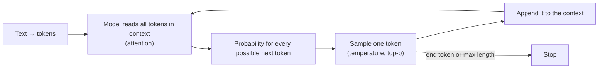

# How LLMs Work

> An LLM reads tokens and predicts the next token, over and over. Everything else (context limits, randomness, hallucination, statelessness) follows from that one fact.

Roadmap topic 2 · Stage 1: Foundations

**Go deeper:** `1` AI Landscape · `3` Training & Model Choice · `4` Prompting · `5` Calling an LLM API · `13` Memory & Context · `17` Cost, Latency & Reliability.

**Marks:** 🟢 must know · 🟡 good to know

---

#### 1. What Is It?

*The mental model of a language model that predicts well and explains behaviour.*

| 🟢 Must know | 🟡 Good to know |
|---|---|
| tokens and tokenization | transformers and attention (the idea only) |
| context window | the same prompt can give different answers |
| next-token prediction | very long context can lower quality and costs more |
| temperature and top-p | |
| hallucination | |
| the model is stateless | |
| knowledge cutoff | |

1. A **token** is a chunk of text (often part of a word).
2. The **context window** is the most tokens the model can consider at once (input and output).
3. The model **predicts one token at a time**, choosing from a probability distribution.
4. It is **stateless**: it knows only what is in the current context.

**Signals in an interview:** "why does it hallucinate?", "why does it forget?", "what is temperature?", "what happens when the chat gets long?", "why is it expensive?".

---

#### 2. How It Works

**The generation loop.**



**Tokens.** Text is split into tokens by a tokenizer. In English, 1 token ≈ 4 characters ≈ ¾ of a word; code, numbers and many non-English languages use more tokens per word. Providers charge and limit by tokens, so count them with the provider's counter, not by words.

**Context window.** Prompt + history + tool results + the answer must all fit. When it is full, you must drop or summarise something (topic 13). Larger windows (some current models offer around a million tokens) help, but cost more, run slower, and quality can drop when the context is huge or cluttered, so send what is relevant.

**Next-token prediction and sampling.** The model produces a score (logit) for each token; **softmax** turns scores into probabilities.

| Setting | Effect |
|---|---|
| Temperature | low → sharp, predictable; high → flatter, more varied. 0 is near-deterministic |
| Top-p (nucleus) | sample only from the smallest set of tokens whose probabilities add up to p |
| Top-k | sample only from the k most likely tokens |

Some newer models fix these settings or reject them; check your provider's docs.

**Hallucination.** The model produces the most plausible continuation, not a checked fact. It can state wrong things confidently, invent citations or APIs, and agree with a false premise. It rises when the answer is not in the context, the question is vague, or the topic is rare. What reduces it: give the facts (RAG, topic 7), ask it to answer only from the provided text and to say "I don't know", use tools for calculations and lookups, validate outputs, and lower the temperature for factual tasks.

**Stateless.** Each API call is independent. A chat "remembers" only because your app sends the earlier messages again each time. Memory is something you build (topic 13).

**Knowledge cutoff.** The model's training data ends at some date. It does not know later events, new library versions or your private data unless you put them in the context (or give it a search tool).

🟡 **Transformers and attention.** The architecture behind LLMs. **Attention** lets every token look at every other token to decide what matters for the next prediction. The cost grows with context length, which is one reason long prompts are slow and expensive.

🟡 **Probabilistic output.** Sampling means the same prompt can produce different answers. Plan for variation: test with many runs, use structured output and validation, and don't build logic that needs exact wording.

🟡 **Long context costs.** More input tokens → higher cost and latency, and "lost in the middle" effects (details in the middle of a long prompt get less attention). Put key instructions and data where they are easy to use, and trim noise.

---

#### 3. Naive vs Better Design

| Naive | Better |
|---|---|
| treat the model like a database of facts | give it the facts (RAG, tools) and ask it to cite them |
| assume it remembers the last chat | send the history each time, or store memory yourself |
| dump 200 pages into the prompt | retrieve the relevant parts |
| temperature high for everything | low for extraction and facts; higher for brainstorming |
| trust confident answers | validate; require sources |
| count words to estimate cost | count tokens |
| ask for today's news | provide the data, or use search |

```kotlin
// Naive: assumes the model remembers the earlier question
suspend fun ask(question: String) = llm.complete(messages = listOf(user(question)))
// "and what about its population?" now has no idea what "its" refers to
```

---

#### 4. Code

Softmax, temperature and top-p, step by step:

```kotlin
fun softmax(logits: List<Double>, temperature: Double = 1.0): List<Double> {
    val scaled = logits.map { it / temperature }
    val max = scaled.max()
    val exps = scaled.map { Math.exp(it - max) }          // subtract max for numerical stability
    val sum = exps.sum()
    return exps.map { it / sum }
}

fun topP(probs: List<Double>, p: Double): List<Int> {       // indices to keep
    val order = probs.indices.sortedByDescending { probs[it] }
    var cumulative = 0.0
    val keep = mutableListOf<Int>()
    for (i in order) {
        keep += i
        cumulative += probs[i]
        if (cumulative >= p) break
    }
    return keep
}
```

Checks: `softmax(listOf(2.0, 1.0, 0.0))` → about `[0.665, 0.245, 0.090]`. With `temperature = 0.5` → `[0.867, 0.117, 0.016]` (sharper); with `temperature = 2.0` → `[0.506, 0.307, 0.186]` (flatter). `topP([0.665, 0.245, 0.090], 0.9)` → indices `[0, 1]` (0.665 + 0.245 = 0.91 ≥ 0.9), so the least likely token can never be picked.

Stateless chat: keep the history yourself, and trim it to fit the window.

```kotlin
data class Msg(val role: String, val text: String)

fun approxTokens(text: String) = (text.length + 3) / 4              // rough: 1 token ≈ 4 characters

fun trimToBudget(history: List<Msg>, maxTokens: Int): List<Msg> {
    var used = 0
    val kept = ArrayDeque<Msg>()
    for (m in history.asReversed()) {                                  // keep the most recent first
        val t = approxTokens(m.text)
        if (used + t > maxTokens) break
        used += t
        kept.addFirst(m)
    }
    return kept.toList()
}
```

Checks: messages of about `100`, `200` and `300` tokens with `maxTokens = 550` keep the last two (500 tokens) and drop the oldest; with `maxTokens = 1000` all three are kept. `approxTokens("hello world")` → `3` (11 characters). This is an estimate: use the provider's token counter for billing and hard limits.

The shape of one request (provider-neutral JSON):

```json
{
  "model": "<model-id>",
  "system": "You answer only from the provided context. If it is not there, say you don't know.",
  "messages": [
    { "role": "user", "content": "Context: ...\n\nQuestion: What is the refund window?" }
  ],
  "max_tokens": 500
}
```

Hallucination guard in the prompt:

```text
Answer using ONLY the context between <context> tags. If the answer is not in the context, reply exactly: "I don't know."
Quote the sentence you used.
```

---

#### 5. Numbers & Limits

| Item | Rule of thumb |
|---|---|
| English | 1 token ≈ 4 characters ≈ 0.75 words; 1,000 tokens ≈ 750 words ≈ 1.5 pages |
| Code / other languages | often 1.5 to 3× more tokens per word |
| Context window | from tens of thousands to about a million tokens on current models; check the provider |
| Output limit | separate from, and smaller than, the context window |
| Cost | input tokens + output tokens (output usually costs several times more per token) |
| Latency | time to first token grows with input size; total time grows with output length |
| Temperature | 0 to 0.3 for extraction and facts; 0.7 to 1.0 for creative tasks |

---

#### 6. Common Mistakes & Edge Cases

1. Treating the model as a source of truth.
2. Forgetting it is stateless.
3. Filling the whole context with everything "just in case".
4. Asking for exact counts, math or recent facts without tools.
5. Expecting the same answer every time.
6. Ignoring the output-length limit (answers get cut off).
7. Estimating by words rather than tokens.

Edge cases: a prompt plus history exceeding the window (the request fails or older text must be dropped); non-English text using many more tokens; numbers and spelling (tokenisation makes letter counting unreliable); the model agrees with a wrong premise in the question; very long context where early instructions are ignored.

---

#### 7. Say This in the Interview

1. "An LLM predicts the next token from everything in its context, one token at a time."
2. "It is stateless: chat memory is the history I send each call, and the context window limits how much fits."
3. "Hallucination is a plausible continuation that isn't grounded. I reduce it with retrieval, answer-only-from-context instructions, tools for exact work, and validation."
4. "Temperature controls randomness: low for extraction and facts, higher for creative tasks."
5. "Cost and latency scale with tokens, so I send only what's relevant and cache stable prefixes."

---

#### 8. Quick Check

1. Why does the model "forget" the previous chat?
2. What does temperature 0 do?
3. Why can a long context reduce quality?
4. How do you give a model recent information?

<details>
<summary>Answers</summary>

1. It is stateless; only the messages you send again are in its context.
2. It makes the output nearly deterministic by always choosing the most likely token.
3. Irrelevant text dilutes attention, details in the middle can be missed, and it costs more.
4. Put the information in the context (retrieval, pasted text, or a search/tool call).

</details>

---

#### 9. Practice

**Interview questions**

1. What is a token, and why does it matter?
2. What is the context window?
3. How does an LLM generate text?
4. What are temperature and top-p?
5. Why do LLMs hallucinate, and how do you reduce it?
6. What does "stateless" mean for a chat app?
7. What is a knowledge cutoff?

**Hands-on**

1. Count tokens of a short English paragraph, a code snippet and a non-English paragraph with the provider's counter; compare.
2. Implement `softmax` and `topP`, and print the distributions at three temperatures.
3. Build a chat that sends the history, then break it by dropping history; observe what the model "forgets".

**Coding warm-ups (LeetCode)**

| # | Question | Link to this topic |
|---|---|---|
| 295 | [Find Median from Data Stream](https://leetcode.com/problems/find-median-from-data-stream/) (Hard) | streaming statistics (latency percentiles) |
| 528 | [Random Pick with Weight](https://leetcode.com/problems/random-pick-with-weight/) (Medium) | sampling from a probability distribution |
| 1235 | [Maximum Profit in Job Scheduling](https://leetcode.com/problems/maximum-profit-in-job-scheduling/) (Hard) | picking the best subset under a budget (like context packing) |

**Remember:** next-token prediction · tokens, not words · context window is a hard limit · stateless · temperature and top-p control randomness · hallucination is plausible-but-ungrounded · give it the facts.
