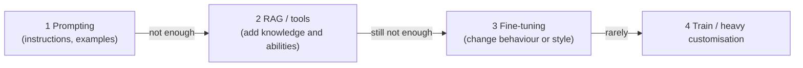

# Training, Fine-Tuning & Model Choice

> Most teams don't train models. They choose one and shape it: prompt first, then retrieval, then fine-tuning only if needed. This topic is about that ladder and about choosing the right model for the job.

Roadmap topic 3 · Stage 1: Foundations

**Go deeper:** `2` How LLMs Work · `4` Prompting · `7` RAG · `15` Evaluation · `17` Cost, Latency & Reliability · `19` On-Device vs Cloud AI.

**Marks:** 🟢 must know · 🟡 good to know · (New) still changing

---

#### 1. What Is It?

*How a model is made, how it can be adapted, and how to pick one.*

| 🟢 Must know | 🟡 Good to know |
|---|---|
| pretraining vs fine-tuning vs prompting; try the cheapest first | base vs instruction-tuned models |
| open-weight vs closed (API-only) models | RLHF and preference tuning |
| small vs large models: cost, speed, quality | distillation |
| reasoning models | quantization |
| multimodal models | LoRA (name only) |
| | benchmarks vs your own task |

1. **Pretraining:** learn language and world knowledge from huge text, by predicting the next token. Very expensive; done by providers.
2. **Fine-tuning:** continue training on a narrow set of examples to change behaviour, style or format.
3. **Prompting:** change behaviour with instructions and examples at request time. No training.
4. **Model choice:** pick the smallest model that meets the quality bar.

**Signals in an interview:** "fine-tune or RAG?", "open or closed model?", "which model would you use?", "what is a reasoning model?", "why quantize?".

---

#### 2. How It Works

**The adaptation ladder: try the cheapest first.**



| Need | Best first tool |
|---|---|
| Follow a format or tone | prompt + examples (few-shot) |
| Use private or fresh facts | RAG or tools |
| Take actions | tool use / agents |
| Consistent specialised style or a very narrow task at high volume | fine-tuning (or a small tuned model) |
| Lower cost at scale | smaller model, caching, routing |

Fine-tuning teaches *behaviour*, not reliably new *facts*; use RAG for facts that change.

**Open-weight vs closed.**

| | Closed (API-only) | Open-weight (downloadable) |
|---|---|---|
| Access | through the provider's API | you run it yourself or via hosts |
| Quality | typically strongest frontier models | strong and improving; sizes vary |
| Control & privacy | data goes to the provider (check retention terms) | data stays in your environment |
| Cost model | pay per token | pay for hardware; cheap at high steady volume |
| Effort | lowest | you run, scale and update it |
| Customisation | prompts, sometimes fine-tuning | full fine-tuning, quantization |

**Small vs large.**

| | Small model | Large model |
|---|---|---|
| Cost | low | high |
| Speed | fast | slower |
| Quality on hard tasks | lower | higher |
| Good for | classification, extraction, routing, simple chat, on-device | complex reasoning, long documents, coding, agents |

A common design is **routing**: a small model for easy requests, a large one for hard ones (topic 5).

**Reasoning models.** They spend extra "thinking" tokens before answering, so they do better on multi-step problems (maths, code, planning), but cost more and take longer. Many current models let you set an effort level or thinking depth; use low effort for routine work and raise it only where quality needs it.

**Multimodal models** accept more than text (images, audio, video) and sometimes produce them. Use them for screenshots, documents, speech, and camera input; mind the extra token cost of images and privacy of what you send.

🟡 **Base vs instruction-tuned.** A *base* model only continues text. An *instruction-tuned* (chat) model has been further trained to follow instructions and hold a conversation. You almost always want the instruction-tuned one.

🟡 **RLHF and preference tuning.** Humans (or other models) rank answers; the model is trained to prefer the helpful, honest, safe ones. This shapes behaviour but doesn't make it perfect.

🟡 **Distillation.** Train a small "student" model to imitate a large "teacher". You get much of the quality at lower cost and latency.

🟡 **Quantization.** Store weights with fewer bits (16 → 8 → 4). The model is 2 to 4× smaller and faster, with a small quality loss. Essential for running models on devices and modest GPUs.

🟡 **LoRA (parameter-efficient fine-tuning).** Train small add-on matrices instead of all weights; much cheaper than full fine-tuning. Name only.

🟡 **Benchmarks vs your task.** Public benchmarks measure general skills and may be contaminated or irrelevant to your task. Always build an eval from your own data (topic 15).

---

#### 3. Naive vs Better Design

| Naive | Better |
|---|---|
| fine-tune first | prompt, then RAG, then fine-tune |
| fine-tune to add changing facts | RAG for facts, fine-tune for style/format |
| the biggest model for every call | the smallest that passes your eval; route by difficulty |
| pick by leaderboard rank | evaluate 2 or 3 candidates on your data |
| hard-code one model name | configurable model per feature, with a fallback |
| ignore data rules | check retention, region and training-use terms |
| run an open model "to save money" without counting ops cost | compare total cost at your volume |

```kotlin
// Naive: one expensive model for everything, name hard-coded everywhere
val answer = bigModel.complete(prompt)
```

---

#### 4. Code

Model choice as a function (a simple, explicit policy):

```kotlin
enum class Tier { SMALL, MEDIUM, LARGE }

data class Task(val needsReasoning: Boolean, val longContext: Boolean, val privateData: Boolean, val latencySensitive: Boolean)

fun chooseTier(t: Task): Tier = when {
    t.needsReasoning || t.longContext -> Tier.LARGE
    t.latencySensitive -> Tier.SMALL
    else -> Tier.MEDIUM
}

fun mustStayInHouse(t: Task) = t.privateData           // e.g. use an open-weight or in-region deployment
```

Checks: a classification task `(false, false, false, true)` → `SMALL`; a contract-analysis task `(true, true, true, false)` → `LARGE` and `mustStayInHouse` → `true`; a normal chat `(false, false, false, false)` → `MEDIUM`.

Cost per request at example prices (per 1M tokens: large `$4 in / $20 out`, mid `$2 / $10`, small `$0.10 / $0.50`; these are illustrative):

```kotlin
data class Price(val inPerMillion: Double, val outPerMillion: Double)

fun requestCost(inputTokens: Int, outputTokens: Int, p: Price) =
    inputTokens * p.inPerMillion / 1_000_000 + outputTokens * p.outPerMillion / 1_000_000
```

Checks: `2,000` input and `500` output tokens → large `$0.018`, mid `$0.009`, small `$0.00045`. At 1,000,000 requests a month: large `$18,000`, mid `$9,000`, small `$450`. A router that sends 80% of traffic to the small model and 20% to the large: `0.8 × 0.00045 + 0.2 × 0.018 = $0.00396` per request, about 56% cheaper than all-mid, if the quality holds on your eval.

Model memory with quantization:

```kotlin
fun modelGigabytes(parametersBillions: Double, bitsPerWeight: Int) = parametersBillions * bitsPerWeight / 8.0
```

Checks: a 7-billion-parameter model → 16-bit `14.0` GB, 8-bit `7.0` GB, 4-bit `3.5` GB (weights only; running needs extra memory for the context cache and activations). That is why a 4-bit 7B model can run on a high-end phone or a modest GPU, and a 16-bit 70B model (`140` GB) cannot.

A fine-tuning data example (chat format, one JSON object per line):

```json
{"messages":[{"role":"system","content":"You write short, friendly product replies."},{"role":"user","content":"Is it waterproof?"},{"role":"assistant","content":"Yes, it handles splashes and light rain (IP67). Please don't submerge it for long."}]}
```

---

#### 5. Numbers & Limits

| Item | Rule of thumb |
|---|---|
| Fine-tuning examples | hundreds to a few thousand good examples for style or format tasks; quality over quantity |
| Price gap | small models can be 10 to 50× cheaper per token than large ones |
| Quantization | 16-bit → 4-bit shrinks weights 4×; expect small quality loss; test on your task |
| Memory | parameters (billions) × bits ÷ 8 = gigabytes of weights |
| Reasoning models | more tokens, higher latency, higher accuracy on hard multi-step tasks |
| Re-evaluation | when you change the model or provider, re-run your eval; models are retired |
| Open model ops | you pay for GPUs, monitoring, scaling and updates |

---

#### 6. Common Mistakes & Edge Cases

1. Fine-tuning before trying a good prompt and RAG.
2. Expecting fine-tuning to teach new facts reliably.
3. Choosing the model by a leaderboard.
4. Using the largest model everywhere.
5. Ignoring data-retention and region rules.
6. Hard-coding a model that is later retired.
7. No evaluation after switching models.
8. Running an open model without counting operations cost.

Edge cases: a provider changes or retires a model (your behaviour changes; keep an eval and a fallback); a fine-tuned model that overfits to its examples; quantization that hurts a rare skill; images and audio costing many tokens; a reasoning model overthinking an easy request.

---

#### 7. Say This in the Interview

1. "I'd try prompting first, then add retrieval or tools, and fine-tune only if I need a consistent style or behaviour at scale."
2. "Fine-tuning shapes behaviour, not facts; for changing knowledge I use RAG."
3. "I'd pick the smallest model that passes my eval, and route hard requests to a larger one."
4. "Closed models are the strongest and simplest to use; open-weight models give control and privacy but I have to run them."
5. "Reasoning models spend extra thinking tokens on hard tasks; I raise effort only where it improves results."
6. "I judge models on my own eval set, not on public benchmarks."

---

#### 8. Quick Check

1. In what order do you try prompting, RAG and fine-tuning?
2. What is distillation?
3. How much memory does a 7B model need at 4 bits?
4. Why not choose by benchmark?

<details>
<summary>Answers</summary>

1. Prompting, then RAG/tools, then fine-tuning.
2. Training a small model to imitate a large one.
3. About 3.5 GB for the weights (7 × 4 ÷ 8).
4. Benchmarks measure general skills, may not match your task, and can be contaminated; use your own eval.

</details>

---

#### 9. Practice

**Interview questions**

1. Pretraining vs fine-tuning vs prompting?
2. When would you fine-tune instead of using RAG?
3. Open-weight vs closed models?
4. How do you choose between a small and a large model?
5. What is a reasoning model, and when is it worth it?
6. What are distillation and quantization?
7. How do you evaluate a model for your use case?

**Hands-on**

1. Run the same 20 prompts through a small and a large model; compare quality and cost with your own rubric.
2. Compute the monthly cost of your feature at three volumes for three model tiers.
3. Write down the data-retention terms of the provider you would use.

**Coding warm-ups (LeetCode)**

| # | Question | Link to this topic |
|---|---|---|
| 322 | [Coin Change](https://leetcode.com/problems/coin-change/) (Medium) | minimum cost to reach a target (cost planning) |
| 1235 | [Maximum Profit in Job Scheduling](https://leetcode.com/problems/maximum-profit-in-job-scheduling/) (Hard) | choosing under constraints |
| 215 | [Kth Largest Element in an Array](https://leetcode.com/problems/kth-largest-element-in-an-array/) (Medium) | selecting the top candidates |

**Remember:** prompt → RAG/tools → fine-tune · fine-tuning is for behaviour, RAG for facts · smallest model that passes your eval · route by difficulty · quantization shrinks models · evaluate on your own data.
