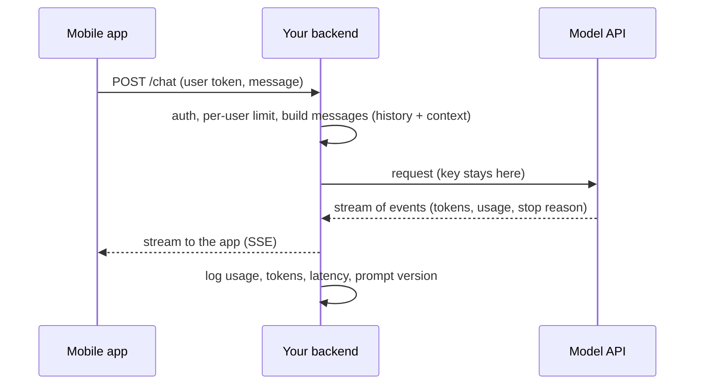

# Calling an LLM API

> Calling a model is an ordinary HTTPS request with unusual details: tokens, streaming, stop reasons, structured output and rate limits. Your server calls the model, never the mobile app.

Roadmap topic 5 · Stage 2: Build with LLMs

**Go deeper:** `2` How LLMs Work · `4` Prompting · `17` Cost, Latency & Reliability · `20` AI Features in the App · `04-backend-engineering/02-Networking-and-HTTP` · `05-system-design/22-Reliable-Requests-and-External-Services` · `05-system-design/24-Real-Time-Communication-and-Push`.

**Marks:** 🟢 must know · 🟡 good to know

**Note:** field names differ between providers. The shapes below are provider-neutral; check your provider's SDK for exact names. Prefer the provider's official SDK over hand-written HTTP.

---

#### 1. What Is It?

*The request, the response, and the engineering around them.*

| 🟢 Must know | 🟡 Good to know |
|---|---|
| request and response: messages, roles, usage, stop reason | prompt caching and batch APIs |
| streaming | model routing |
| structured output and validation | max output length, stop sequences |
| conversation state: send the history | |
| context limits: truncate or summarise | |
| API keys stay on your server | |
| rate limits, timeouts, retries with backoff | |

1. **Request:** model, system prompt, messages, limits (max output tokens), optional tools and output schema.
2. **Response:** content, **usage** (input and output tokens), and a **stop reason** (finished, hit the length limit, wants a tool, refused).
3. **Streaming:** tokens arrive as events, so users see progress.
4. **Server-side only:** the key never ships in the app.

**Signals in an interview:** "how do you call an LLM from a mobile app?", "how do you stream?", "how do you get JSON reliably?", "what if you hit a rate limit?", "how do you cut cost?".

---

#### 2. How It Works

**The path of a call.**



**Request anatomy.**

```json
{
  "model": "<model-id>",
  "system": "You are a helpful assistant for the Notes app.",
  "messages": [
    { "role": "user", "content": "Summarise my meeting notes." }
  ],
  "max_tokens": 800,
  "stream": true
}
```

**Response anatomy (simplified).**

```json
{
  "content": [{ "type": "text", "text": "Here is a summary: ..." }],
  "usage": { "input_tokens": 1240, "output_tokens": 210 },
  "stop_reason": "end_turn"
}
```

| Stop reason (names vary) | Meaning | What to do |
|---|---|---|
| end of turn / stop | finished normally | use the answer |
| max tokens / length | cut off at the output limit | raise the limit or ask for shorter output; don't show a half answer as complete |
| tool use | the model wants your code to run a tool | run it, send the result back (topic 8) |
| refusal / content filter | the provider's safety layer declined | show a safe message; don't retry the same text blindly; consider a fallback |
| pause / timeout | long work was paused | continue the turn |

Always check the stop reason before using the content.

**Streaming.** Use server-sent events (SSE) or the provider's stream helper. The first token arrives in a fraction of a second even when the full answer takes seconds, so the UI feels fast. Your backend forwards events to the app; the app appends tokens and supports **cancel** (closing the connection should cancel the model call to stop paying for tokens).

**Structured output.** When code consumes the answer, don't ask politely for JSON. Use the provider's structured-output / JSON-schema feature (or a tool whose arguments are the schema), then **validate** the result in your code anyway. If validation fails, retry once with the error message, then fall back.

**Conversation state.** The API is stateless. Keep the history (in your database, per conversation), send it each call, and trim it to fit (topic 13). Store the model's replies exactly; some providers need special blocks (such as tool calls or reasoning blocks) passed back unchanged.

**Context limits.** Count tokens with the provider's counter before sending; if over budget, drop or summarise the oldest turns, shorten tool outputs, or retrieve less.

**Keys stay on your server.** Anything in an app package can be extracted. The app calls your backend with the user's token; your backend adds the provider key, enforces per-user quotas, and logs.

**Rate limits, timeouts, retries (`SD 22`).** Providers limit requests and tokens per minute. Handle `429` (and overload errors) with **exponential backoff and jitter**, respect `Retry-After`, set a timeout on every call (streaming: a long overall limit plus an idle limit), and retry only safe cases. A non-streaming call that generates a lot of text can time out; stream instead.

🟡 **Prompt caching and batch.** *Prompt caching* reuses an unchanged **prefix** of the prompt (system prompt, tool definitions, long documents), so repeated parts are read at a fraction of the normal input price and faster. Order the prompt: stable content first, changing content last; any change early in the prefix invalidates the cache after it. Check the usage fields for cache-read tokens to confirm it works. *Batch APIs* process non-urgent work asynchronously at a discount (often about half the price) within hours.

🟡 **Model routing.** Send easy requests to a small, cheap model and hard ones to a larger one; start with a classifier or simple rules, and measure the quality (topic 17).

🟡 **Max output and stop sequences.** Set a sensible max output length (a hard cap on cost and time), and stop sequences if you need the model to end at a marker.

---

#### 3. Naive vs Better Design

| Naive | Better |
|---|---|
| provider key in the mobile app | app → your backend → provider |
| wait for the whole answer | stream tokens; cancel on stop |
| "reply in JSON please" and `JSON.parse` | schema-constrained output + validation + one retry |
| ignore the stop reason | branch on it (cut-off, tool use, refusal) |
| retry instantly forever on `429` | backoff with jitter, `Retry-After`, a limit |
| resend all history, forever | trim or summarise to a token budget |
| no usage logging | log tokens, latency, prompt version, cost per user |
| change the system prompt on each call | stable prefix first, so caching works |

```kotlin
// Naive: key in the app, blocking call, no limits, no stop-reason check
val text = http.post("https://api.provider.com/chat", headers = mapOf("Authorization" to "Bearer sk-live-..."), body = prompt).body
```

---

#### 4. Code

A backend route that streams to the app (Ktor, with the provider's client behind an interface so it can be faked):

```kotlin
interface LlmClient {
    fun stream(request: LlmRequest): Flow<LlmEvent>          // tokens, usage, stop reason
}

sealed interface LlmEvent {
    data class Token(val text: String) : LlmEvent
    data class Done(val inputTokens: Int, val outputTokens: Int, val stopReason: String) : LlmEvent
}

fun Route.chatRoute(llm: LlmClient, history: HistoryStore, limiter: UserLimiter) {
    post("/chat") {
        val user = call.principal<UserPrincipal>()!!.id
        if (!limiter.tryAcquire(user)) return@post call.respond(HttpStatusCode.TooManyRequests)
        val body = call.receive<ChatRequest>()
        val messages = trimToBudget(history.load(user) + Msg("user", body.text), maxTokens = 6_000)

        call.respondTextWriter(contentType = ContentType.Text.EventStream) {
            llm.stream(LlmRequest(system = SYSTEM, messages = messages, maxTokens = 800)).collect { e ->
                when (e) {
                    is LlmEvent.Token -> write("data: ${Json.encodeToString(mapOf("t" to e.text))}\n\n")
                    is LlmEvent.Done -> write("event: done\ndata: ${e.stopReason}\n\n")
                }
                flush()
            }
        }
    }
}
```

Parsing the SSE stream on the client (a pure function, easy to test):

```kotlin
fun parseSse(lines: List<String>): List<String> {
    val tokens = mutableListOf<String>()
    var event = "message"
    for (line in lines) when {
        line.startsWith("event:") -> event = line.removePrefix("event:").trim()
        line.startsWith("data:") && event == "message" -> tokens += Json.parseToJsonElement(line.removePrefix("data:").trim()).jsonObject.getValue("t").jsonPrimitive.content
        line.isEmpty() -> event = "message"                              // a blank line ends an event
    }
    return tokens
}
```

Checks: lines `data: {"t":"Hel"}`, ``, `data: {"t":"lo"}`, ``, `event: done`, `data: end_turn`, `` → `["Hel", "lo"]` (the `done` event isn't a token). `tokens.joinToString("")` → `"Hello"`.

Structured output with validation and one retry:

```kotlin
@Serializable data class Extracted(val title: String, val dueDate: String? = null, val priority: Int)

suspend fun extract(llm: suspend (String) -> String, text: String): Extracted? {
    var prompt = "Extract the task as JSON {title, dueDate (ISO or null), priority (1-3)}.\nText: $text"
    repeat(2) { attempt ->
        val raw = llm(prompt)
        runCatching { Json { ignoreUnknownKeys = true }.decodeFromString<Extracted>(raw) }
            .onSuccess { if (it.priority in 1..3 && it.title.isNotBlank()) return it }
            .onFailure { prompt += "\nYour last answer was invalid JSON: ${it.message}. Reply with JSON only." }
    }
    return null                                                         // caller falls back (ask the user, default)
}
```

Checks: a fake model answering `{"title":"Pay rent","dueDate":null,"priority":2}` → `Extracted("Pay rent", null, 2)`. If the first answer is `Sure! {"title":...}` (extra words) and the second is clean JSON, the result is the parsed value after one retry; two bad answers → `null`. A `priority` of `7` is rejected by the range check even though the JSON is valid.

Retry on rate limits:

```kotlin
suspend fun <T> withRetry(maxTries: Int = 4, call: suspend () -> T): T {
    var attempt = 0
    while (true) {
        try { return call() }
        catch (e: CancellationException) { throw e }
        catch (e: RateLimited) {
            if (++attempt >= maxTries) throw e
            val wait = e.retryAfterMs ?: minOf(30_000L, 500L shl attempt)
            delay(Random.nextLong(wait / 2, wait + 1))                  // jitter
        }
    }
}
class RateLimited(val retryAfterMs: Long?) : Exception()
```

Cost with and without prompt caching (example price `$2` per million input tokens, cache reads about 10% of that):

```kotlin
fun inputCost(tokens: Int, pricePerMillion: Double, cachedShare: Double, cachedFraction: Double = 0.1): Double {
    val cached = tokens * cachedShare
    return (cached * pricePerMillion * cachedFraction + (tokens - cached) * pricePerMillion) / 1_000_000
}
```

Checks: a 10,000-token system prompt on every request, no caching: `$0.02` per request, `$20,000` per million requests. With all of it cached (`cachedShare = 1.0`): `$0.002` per request, `$2,000` per million: a 90% saving on that part. Caching only works if the prefix is byte-identical, so keep timestamps and user-specific text *after* it.

Config on the server, not in the app:

```kotlin
val apiKey = System.getenv("LLM_API_KEY") ?: error("LLM_API_KEY missing")   // from a secrets manager in production
```

---

#### 5. Numbers & Limits

| Item | Rule of thumb |
|---|---|
| Time to first token | often 0.3 to 2 s; total time grows with output length |
| Output speed | tens to a few hundred tokens per second, depending on the model |
| Max output | set it explicitly (for example 500 to 2,000 tokens for chat); the model's cap is much higher |
| Retries | 3 to 5 tries; delay 0.5 s, 1 s, 2 s … capped, with jitter |
| History budget | keep the prompt well under the window (for example 6,000 tokens for chat) |
| Cache | reads are billed at roughly 10% of the normal input price (check your provider); minimum prefix length applies |
| Batch | about 50% cheaper, results within hours |
| Per-user limits | requests per minute and tokens per day, enforced on your server |
| Streaming | use for anything with long output or an interactive UI |

---

#### 6. Common Mistakes & Edge Cases

1. A provider key in the app.
2. No stop-reason handling: a cut-off answer shown as complete.
3. Parsing free text instead of using schema output.
4. No timeouts, or infinite retries.
5. Sending the entire history every time.
6. No per-user quota (one user burns the budget).
7. Not cancelling the upstream call when the user leaves.
8. Putting changing text at the start of the prompt (cache never hits).
9. Logging prompts with personal data.

Edge cases: a stream that stops midway (keep the partial text, offer retry); a refusal (show a safe message, log it); provider outage (fallback model or degraded mode); the same request retried after a timeout (idempotency key on your side, so you don't double-charge a user's quota); non-ASCII tokens split across chunks (concatenate bytes, not characters).

---

#### 7. Say This in the Interview

1. "The app calls my backend with the user's token. The backend holds the provider key, enforces per-user limits, calls the model and streams the answer back over SSE."
2. "I check the stop reason: cut-off, tool use and refusal each need different handling."
3. "For machine-readable output I use schema-constrained output, validate it, and retry once."
4. "The API is stateless, so I store and trim the history to a token budget."
5. "For `429` I use exponential backoff with jitter and honour `Retry-After`; every call has a timeout."
6. "I cut cost with a stable prompt prefix for caching, a small model for easy requests, capped outputs and batch for offline jobs."

---

#### 8. Quick Check

1. Why must the key stay on the server?
2. What does `max tokens` as a stop reason mean?
3. Why should the prompt prefix be stable?
4. How do you cancel a streamed answer?

<details>
<summary>Answers</summary>

1. An app package is public; the key can be extracted and abused.
2. The output hit the length limit and is incomplete.
3. Prompt caching matches on the exact prefix; a change early on invalidates the rest.
4. Close the connection from the app and cancel the upstream call on the server.

</details>

---

#### 9. Practice

**Interview questions**

1. How would you call an LLM from a mobile app?
2. How do you stream a response, and how does the user cancel?
3. How do you get reliable JSON?
4. How do you handle history and context limits?
5. How do you handle rate limits and outages?
6. How do you reduce the cost of repeated prompts?
7. What do you log for each call?

**Hands-on**

1. Build a `/chat` route with SSE and a fake `LlmClient`; add a cancel test.
2. Write the extraction function with schema validation and one retry; test with bad and good fake answers.
3. Add a per-user token-bucket limiter.

**Coding warm-ups (LeetCode)**

| # | Question | Link to this topic |
|---|---|---|
| 362 | [Design Hit Counter](https://leetcode.com/problems/design-hit-counter/) (Medium, premium) | per-user request counting |
| 359 | [Logger Rate Limiter](https://leetcode.com/problems/logger-rate-limiter/) (Easy, premium) | rate limiting |
| 146 | [LRU Cache](https://leetcode.com/problems/lru-cache/) (Medium) | caching repeated answers |

**Remember:** app → your backend → model · check the stop reason · stream and allow cancel · schema output + validation · history is yours to store and trim · backoff + jitter · stable prefix for caching.
