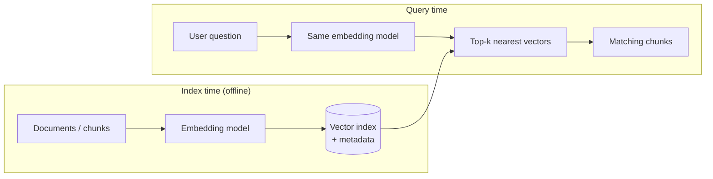

# Embeddings & Vector Search

> An embedding turns text into a list of numbers so that similar meanings land close together. Vector search finds the closest ones. It powers semantic search, RAG, recommendations and duplicate detection.

Roadmap topic 6 · Stage 2: Build with LLMs

**Go deeper:** `7` RAG · `4` Prompting · `15` Evaluation (retrieval quality) · `10-database` (indexes, search) · `05-system-design/33-Follow-Up-Topics` (search, Bloom filters) · `02-algorithm` (heaps, top-k).

**Marks:** 🟢 must know · 🟡 good to know

---

#### 1. What Is It?

*Searching by meaning instead of by exact words.*

| 🟢 Must know | 🟡 Good to know |
|---|---|
| embedding: text → numbers; similar meaning means close | keyword vs semantic vs hybrid search |
| similarity search (cosine similarity) | approximate nearest-neighbour indexes (HNSW) |
| vector database or index: embeddings + metadata | choosing an embedding model; re-embedding |
| | other uses: recommendation, clustering, duplicates |

1. **Embedding:** a vector (for example 768 or 1,536 numbers) produced by an embedding model.
2. **Cosine similarity:** how close two vectors point in direction (1 = same, 0 = unrelated, −1 = opposite).
3. **Vector index:** stores vectors with ids and metadata and returns the top-k nearest.

**Signals in an interview:** "how does semantic search work?", "keyword vs vector search?", "how do you store embeddings?", "what if you change the embedding model?".

---

#### 2. How It Works

**Index time and query time.**



The query and the documents must use the **same** embedding model.

**Similarity measures.**

| Measure | Meaning | Note |
|---|---|---|
| Cosine similarity | angle between vectors | most common for text; ignores length |
| Dot product | direction and length | same as cosine if vectors are normalised |
| Euclidean distance | straight-line distance | smaller = closer |

**Brute force vs approximate search.** Comparing the query with every vector is exact but slow at scale (`O(N × d)`). Indexes such as **HNSW** (a layered graph) or IVF find *approximately* the nearest neighbours very quickly, trading a little recall for large speed-ups. A vector database also stores metadata (user id, document id, date, tags) so you can **filter** (only this user's documents) while searching.

🟡 **Keyword, semantic and hybrid search.**

| | Keyword (BM25) | Semantic (vectors) |
|---|---|---|
| Finds | exact words, names, ids, codes | similar meaning, paraphrases |
| Misses | synonyms, different wording | exact rare terms, numbers |
| Good for | "error 0x80070005", product codes | "how do I get my money back?" |

**Hybrid search** runs both and merges the lists, often with **reciprocal rank fusion (RRF)**: each document scores `Σ 1 / (k + rank)` across lists (k ≈ 60). A reranker model can then reorder the top results (topic 7).

🟡 **Choosing an embedding model.** Match language and domain, vector size (bigger = more storage and slower), cost, and quality on *your* retrieval eval. If you switch models, you must **re-embed everything**, because vectors from different models are not comparable. Store the model name and version with each vector.

🟡 **Other uses.** Recommendations (items near what a user liked), clustering (topics), duplicate detection (similarity above a threshold), classification with few examples, anomaly detection.

---

#### 3. Naive vs Better Design

| Naive | Better |
|---|---|
| only keyword `LIKE '%word%'` | hybrid: keyword + semantic |
| only vector search for ids and codes | keyword (or filters) for exact terms |
| brute force over millions of vectors | an ANN index (HNSW) |
| mixing two embedding models in one index | one model per index, versioned |
| search all users' vectors | filter by user/tenant before returning |
| embed whole documents | embed chunks (topic 7) |
| no way to rebuild | keep source text, so you can re-embed |

```kotlin
// Naive: exact-match search misses "refund" vs "get my money back"
fun search(docs: List<String>, q: String) = docs.filter { it.contains(q, ignoreCase = true) }
```

---

#### 4. Code

Cosine similarity and brute-force top-k:

```kotlin
fun dot(a: DoubleArray, b: DoubleArray) = a.indices.sumOf { a[it] * b[it] }
fun norm(a: DoubleArray) = Math.sqrt(dot(a, a))
fun cosine(a: DoubleArray, b: DoubleArray): Double {
    val d = norm(a) * norm(b)
    return if (d == 0.0) 0.0 else dot(a, b) / d
}

data class Hit(val id: String, val score: Double)

fun topK(query: DoubleArray, index: Map<String, DoubleArray>, k: Int, allow: (String) -> Boolean = { true }): List<Hit> =
    index.asSequence()
        .filter { allow(it.key) }                                   // metadata filter (user, tenant)
        .map { Hit(it.key, cosine(query, it.value)) }
        .sortedByDescending { it.score }
        .take(k).toList()
```

Checks: `cosine([1,0], [1,1])` → `0.7071`; `cosine([1,2,3], [2,4,6])` → `1.0` (same direction, different length); `cosine([1,0], [0,1])` → `0.0`; `cosine([1,0], [-1,0])` → `-1.0`. With index `a=[1,0]`, `b=[0.9,0.1]`, `c=[0,1]` and query `[1,0]`: `topK(…, 2)` → `a` (1.0), `b` (0.994); with `allow = { it != "a" }` → `b`, `c`.

Reciprocal rank fusion for hybrid search:

```kotlin
fun rrf(lists: List<List<String>>, k: Int = 60): List<String> {
    val scores = HashMap<String, Double>()
    for (list in lists) list.forEachIndexed { i, id -> scores.merge(id, 1.0 / (k + i + 1), Double::plus) }
    return scores.entries.sortedByDescending { it.value }.map { it.key }
}
```

Checks: keyword results `[d1, d2, d3]` and vector results `[d3, d1, d4]` → scores `d1 = 1/61 + 1/62 = 0.03252`, `d3 = 1/63 + 1/61 = 0.03227`, `d2 = 0.01613`, `d4 = 0.01587` → merged order `[d1, d3, d2, d4]`. Documents that both lists like rise to the top without comparing their raw scores.

Calling an embedding endpoint and storing vectors (provider-neutral):

```kotlin
interface Embedder { suspend fun embed(texts: List<String>): List<DoubleArray>; val modelId: String }

suspend fun indexChunks(chunks: List<Chunk>, embedder: Embedder, store: VectorStore) {
    chunks.chunked(64).forEach { batch ->                                    // batch requests
        val vectors = embedder.embed(batch.map { it.text })
        store.upsert(batch.zip(vectors).map { (c, v) ->
            VectorRow(id = c.id, vector = v, text = c.text, userId = c.userId, model = embedder.modelId)
        })
    }
}
```

A SQL sketch with a vector column (PostgreSQL with the pgvector extension):

```sql
CREATE TABLE chunks (id BIGSERIAL PRIMARY KEY, user_id BIGINT NOT NULL, doc_id BIGINT NOT NULL, text TEXT NOT NULL,
                     embedding VECTOR(1536) NOT NULL, model TEXT NOT NULL);
CREATE INDEX ON chunks USING hnsw (embedding vector_cosine_ops);

SELECT id, text, 1 - (embedding <=> :query) AS score        -- <=> is cosine distance
FROM chunks WHERE user_id = :user ORDER BY embedding <=> :query LIMIT 5;
```

Near-duplicate detection:

```kotlin
fun isDuplicate(a: DoubleArray, b: DoubleArray, threshold: Double = 0.95) = cosine(a, b) >= threshold
```

Storage maths:

```kotlin
fun vectorBytes(dimensions: Int, bytesPerNumber: Int = 4) = dimensions * bytesPerNumber
```

Checks: 1,536 dimensions × 4 bytes = `6,144` bytes per vector; 1,000,000 vectors ≈ `6.1` GB (plus the index and the text). Stored as 8-bit numbers, ≈ `1.5` GB. This is why vector size and quantization matter at scale.

---

#### 5. Numbers & Limits

| Item | Rule of thumb |
|---|---|
| Vector size | 256 to 3,072 dimensions; 768 to 1,536 is common |
| Storage | dimensions × 4 bytes per vector (float32), plus the index (≈ 1.5 to 2×) |
| Brute force | fine up to roughly 10⁵ vectors; use an ANN index beyond that |
| ANN recall | commonly 95 to 99% of true neighbours; tune per use case |
| Top-k | retrieve 20 to 50, rerank to 3 to 8 for the prompt |
| Re-embedding | required after changing the model; plan the cost and a reindex |
| Latency | milliseconds for the index; the embedding call for the query adds tens of ms |
| Duplicate threshold | cosine ≥ 0.9 to 0.95, tuned on examples |

---

#### 6. Common Mistakes & Edge Cases

1. Mixing embeddings from different models.
2. Pure vector search for exact identifiers.
3. No metadata filter, so users see each other's data (topic 7).
4. Embedding huge documents instead of focused chunks.
5. Never re-evaluating retrieval quality.
6. Forgetting to delete vectors when a document is deleted (privacy).
7. Assuming a high similarity means "correct".
8. Not storing the source text and the model version.

Edge cases: very short queries (low signal; expand or ask for more); multilingual content (use a multilingual model); stale vectors after a document changes (re-embed the chunks); numbers and negation ("not allowed" vs "allowed" can embed close together); embedding drift after a provider updates a model.

---

#### 7. Say This in the Interview

1. "An embedding maps text to a vector so similar meanings are close. I compare vectors with cosine similarity."
2. "At index time I chunk documents, embed them with one model and store vectors with metadata; at query time I embed the question with the same model and fetch the top-k."
3. "I use an ANN index like HNSW for scale, and metadata filters so each user only searches their own data."
4. "Hybrid search combines keyword and semantic results, for example with reciprocal rank fusion, because each misses things the other finds."
5. "If I change the embedding model I must re-embed everything, so I store the model version and keep the source text."

---

#### 8. Quick Check

1. What does cosine similarity of 1 mean?
2. Why use hybrid search?
3. What happens if you change the embedding model?
4. Why store metadata with vectors?

<details>
<summary>Answers</summary>

1. The vectors point in the same direction (the same meaning, as far as the model can tell).
2. Keyword search finds exact terms and ids; semantic search finds paraphrases; together they miss less.
3. All vectors must be recomputed; old and new vectors cannot be compared.
4. To filter (user, tenant, date), delete, and show sources.

</details>

---

#### 9. Practice

**Interview questions**

1. What is an embedding?
2. How does semantic search work end to end?
3. Cosine similarity vs dot product vs Euclidean distance?
4. Why use an ANN index, and what do you give up?
5. Keyword vs semantic vs hybrid search?
6. What are the risks of changing the embedding model?
7. Name three uses of embeddings besides RAG.

**Hands-on**

1. Embed 50 short notes, search with five paraphrased questions, and compare with keyword search.
2. Implement `rrf` and merge keyword and vector results for 10 queries.
3. Compute the storage for 1 million chunks at your embedding size.

**Coding warm-ups (LeetCode)**

| # | Question | Link to this topic |
|---|---|---|
| 215 | [Kth Largest Element in an Array](https://leetcode.com/problems/kth-largest-element-in-an-array/) (Medium) | top-k selection |
| 347 | [Top K Frequent Elements](https://leetcode.com/problems/top-k-frequent-elements/) (Medium) | top-k with a heap |
| 973 | [K Closest Points to Origin](https://leetcode.com/problems/k-closest-points-to-origin/) (Medium) | nearest neighbours by distance |
| 23 | [Merge k Sorted Lists](https://leetcode.com/problems/merge-k-sorted-lists/) (Hard) | merging ranked lists |
| 208 | [Implement Trie (Prefix Tree)](https://leetcode.com/problems/implement-trie-prefix-tree/) (Medium) | the keyword-side index |

**Remember:** same model for index and query · cosine similarity · top-k with metadata filters · ANN index for scale · hybrid = keyword + semantic · re-embed when the model changes · keep source text and model version.
