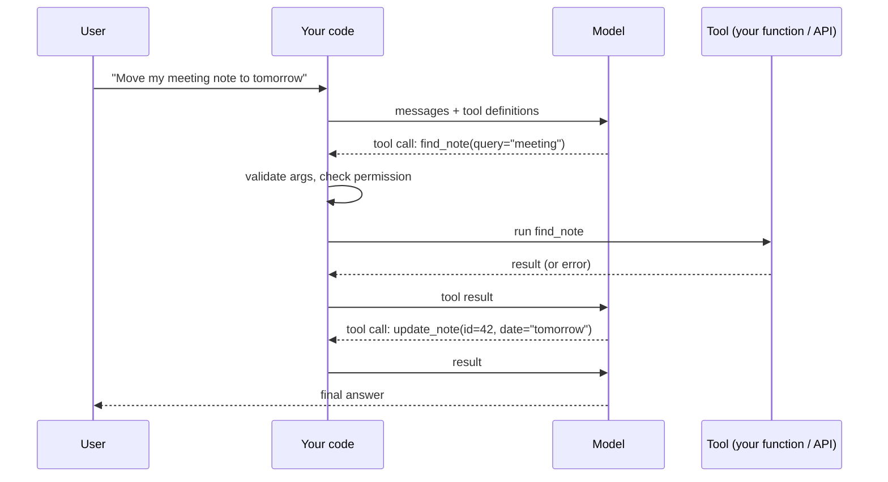

# Tool Use & Function Calling

> A model cannot do anything by itself. With tool use, it asks your code to run a function and reads the result. You decide what tools exist, what arguments are valid, and what is allowed.

Roadmap topic 8 · Stage 3: Tools & Agents

**Go deeper:** `5` Calling an LLM API · `9` MCP · `10` Agents · `11` Agent Harness · `16` Safety · `04-backend-engineering/03-API-Design` (idempotency) · `05-system-design/22-Reliable-Requests-and-External-Services`.

**Marks:** 🟢 must know · 🟡 good to know

---

#### 1. What Is It?

*The model asks, your code runs, the result goes back.*

| 🟢 Must know | 🟡 Good to know |
|---|---|
| how it works: ask → run → return the result | tool errors: clear messages so the model can recover |
| the model never runs anything; your code does | parallel tool calls |
| name, description, argument schema | provider-hosted tools (web search, code execution) |
| validate arguments and check permissions | too many tools confuse the model |
| side effects: confirmation and idempotency | |

1. **Tool definition:** a name, a description (when to use it), and a JSON schema of arguments.
2. **Tool call:** the model's request to run a tool with specific arguments.
3. **Tool result:** what your code returns; the model reads it and continues.
4. **Stop reason "tool use":** the model is waiting for you.

**Signals in an interview:** "how does an LLM call an API?", "how do you keep tool calls safe?", "what if a tool fails?", "what about a tool that sends an email?".

---

#### 2. How It Works

**One round trip.**



**The model never executes anything.** It only produces text that says "call this tool with these arguments". Your code is the one that runs functions, so your code is where validation, permissions and limits live.

**A tool definition (provider-neutral).**

```json
{
  "name": "create_note",
  "description": "Create a new note for the current user. Use when the user asks to save or write down something. Do not use for searching.",
  "input_schema": {
    "type": "object",
    "properties": {
      "title": { "type": "string", "description": "Short title, max 80 characters" },
      "body": { "type": "string" },
      "dueDate": { "type": "string", "description": "ISO date, optional" }
    },
    "required": ["title"],
    "additionalProperties": false
  }
}
```

Good descriptions matter more than clever code: say **what it does, when to use it, when not to, and what each argument means**, with units and formats.

**Before running a call.**

1. **Validate arguments** against the schema (types, required, ranges); the model can send wrong or missing values.
2. **Check permissions**: the tool acts as *this user*, never with more power than the user has (least privilege).
3. **Check limits**: rate, cost, size.
4. **Confirm side effects** (send, delete, pay) with the user when needed.

**Tools with side effects.** Reads are safe to retry; writes are not. Use confirmations for irreversible actions, give writes an **idempotency key** (the tool-call id works), and return what was done so the model can report it. A retried call must not charge twice (`BE 3`).

🟡 **Tool errors.** Return a clear, short error as the tool result ("note 42 not found; use find_note to search") and mark it as an error. The model can fix its arguments or try another approach. Don't crash the loop; don't hide the error.

🟡 **Parallel tool calls.** The model may request several independent calls in one turn. Run them concurrently and return **all results together in one message**, each tied to its call id.

🟡 **Provider-hosted tools.** Some providers run tools for you (web search, web fetch, code execution). Less code, but know what data leaves your system and what it costs.

🟡 **Keep the tool set small.** Many similar tools make the model pick the wrong one. Prefer a few well-named tools; merge near-duplicates; load rarely used tools on demand (tool search or MCP, topic 9).

---

#### 3. Naive vs Better Design

| Naive | Better |
|---|---|
| execute whatever the model outputs | validate against the schema first |
| tool with the app's admin power | tool runs with the user's permissions |
| a `run_sql(query)` tool | narrow tools (`search_notes`, `get_note`) |
| vague description: "notes tool" | what, when, when not, argument meanings |
| tool errors thrown and the loop dies | error text returned to the model |
| `send_email` runs immediately | draft first, user approves, then send |
| retry a payment tool blindly | idempotency key |
| 40 tools in every request | a few relevant ones |

```kotlin
// Naive: model output goes straight into a shell
val cmd = model.reply.toolCall.arguments["command"]
Runtime.getRuntime().exec(cmd)
```

---

#### 4. Code

A tiny tool registry with schema validation:

```kotlin
enum class ParamType { STRING, INT, BOOL }

data class ToolSpec(
    val name: String,
    val description: String,
    val params: Map<String, ParamType>,
    val required: Set<String>,
    val sideEffect: Boolean = false
)

fun validate(spec: ToolSpec, args: Map<String, Any?>): List<String> = buildList {
    (spec.required - args.keys).forEach { add("missing: $it") }
    (args.keys - spec.params.keys).forEach { add("unknown argument: $it") }
    args.forEach { (k, v) ->
        val t = spec.params[k] ?: return@forEach
        val ok = when (t) { ParamType.STRING -> v is String; ParamType.INT -> v is Int; ParamType.BOOL -> v is Boolean }
        if (!ok) add("$k must be $t")
    }
}
```

Checks (spec `create_note`: `title: STRING`, `body: STRING`, required `title`): `{title: "Buy milk"}` → `[]`; `{}` → `["missing: title"]`; `{title: 5}` → `["title must be STRING"]`; `{title: "x", colour: "red"}` → `["unknown argument: colour"]`.

The dispatcher: validation, permission, confirmation, idempotency, error text:

```kotlin
data class ToolCall(val id: String, val name: String, val args: Map<String, Any?>)
data class ToolResult(val callId: String, val content: String, val isError: Boolean = false)

class Dispatcher(
    private val specs: Map<String, ToolSpec>,
    private val impls: Map<String, (Map<String, Any?>) -> String>,
    private val allowed: Set<String>,                         // tools this user may use
    private val approve: (ToolCall) -> Boolean                // user confirmation for side effects
) {
    private val done = HashMap<String, ToolResult>()           // idempotency: call id → result

    fun run(call: ToolCall): ToolResult = done.getOrPut(call.id) {
        val spec = specs[call.name] ?: return@getOrPut ToolResult(call.id, "unknown tool: ${call.name}", true)
        if (call.name !in allowed) return@getOrPut ToolResult(call.id, "not permitted: ${call.name}", true)
        val errors = validate(spec, call.args)
        if (errors.isNotEmpty()) return@getOrPut ToolResult(call.id, "invalid arguments: ${errors.joinToString("; ")}", true)
        if (spec.sideEffect && !approve(call)) return@getOrPut ToolResult(call.id, "the user declined this action", true)
        try { ToolResult(call.id, impls.getValue(call.name)(call.args)) }
        catch (e: Exception) { ToolResult(call.id, "tool failed: ${e.message}", true) }
    }
}
```

Checks: a call `create_note` with valid args and approval → result `"created note 1"` and the implementation counter is `1`. Running the **same call id** again returns the stored result and the counter stays `1` (no duplicate note). A call with a tool name that does not exist → `ToolResult(isError = true, "unknown tool: …")`. `delete_note` for a user whose `allowed` set lacks it → `not permitted`. A side-effect call that the user declines → `the user declined this action`. A thrown exception becomes `tool failed: …` and the loop continues.

Parallel calls, all results returned together:

```kotlin
suspend fun runAll(calls: List<ToolCall>, d: Dispatcher): List<ToolResult> =
    coroutineScope { calls.map { c -> async(Dispatchers.IO) { d.run(c) } }.awaitAll() }      // one message with every result
```

Narrow tools instead of raw SQL:

```kotlin
val searchNotes = ToolSpec("search_notes", "Search the current user's notes by keyword. Returns up to 5 matches (id, title). Use before update_note.",
    params = mapOf("query" to ParamType.STRING), required = setOf("query"))

fun searchNotesImpl(userId: Long, q: String) = db.query("SELECT id, title FROM notes WHERE user_id = ? AND title ILIKE ? LIMIT 5", userId, "%$q%")
// the user id comes from the session, never from a model argument
```

---

#### 5. Numbers & Limits

| Item | Rule of thumb |
|---|---|
| Tool count per request | under about 10 to 20; fewer is better |
| Tool description | 1 to 4 sentences, plus argument descriptions |
| Tool result size | cap at a few thousand tokens; summarise or paginate big outputs |
| Parallel calls | independent reads in parallel; writes with care |
| Timeouts | every tool has one; tell the model if it timed out |
| Retries | reads: yes; writes: only with an idempotency key |
| Loops | a maximum number of tool calls per request (topic 10) |
| Errors | short and actionable (what failed, what to try) |

---

#### 6. Common Mistakes & Edge Cases

1. Running model-chosen commands without validation.
2. Tools that can do more than the user can.
3. Letting the model supply the user id.
4. Vague tool names and descriptions.
5. A giant tool result that floods the context.
6. Hiding errors or throwing exceptions that kill the loop.
7. Irreversible actions without confirmation.
8. Not making writes idempotent.
9. Splitting parallel results into separate messages (the model learns to stop parallelising).

Edge cases: the model hallucinates a tool name or argument; arguments that are valid JSON but unsafe (path traversal, huge limits); a tool that takes minutes (run async, return a job id); tool output containing instructions (prompt injection, topic 16); the user changes their mind between the call and the approval.

---

#### 7. Say This in the Interview

1. "The model only asks for a tool call. My code validates the arguments, checks permissions, runs the function and returns the result."
2. "Tools run as the user: least privilege, with the user id from the session, never from model arguments."
3. "For side effects I ask for confirmation and use an idempotency key, so a retry can't act twice."
4. "Errors go back to the model as short, clear messages so it can recover."
5. "I keep the tool set small with specific names and descriptions, and cap big outputs."

---

#### 8. Quick Check

1. Who runs the tool?
2. Why validate arguments the model produced?
3. How do you make a write tool safe to retry?
4. What do you return when a tool fails?

<details>
<summary>Answers</summary>

1. Your code. The model only requests it.
2. The model can produce missing, wrong or unsafe values; the schema is your contract.
3. Use an idempotency key (for example the tool-call id) and store the result.
4. A short error result (marked as an error) saying what failed and what to try.

</details>

---

#### 9. Practice

**Interview questions**

1. How does function calling work?
2. How do you make tool use safe?
3. How do you handle a tool that has side effects?
4. How do you write a good tool description?
5. What happens when a tool fails?
6. Why keep the tool set small?
7. Run tools in parallel: how do you return results?

**Hands-on**

1. Define `search_notes`, `get_note` and `create_note`; implement the dispatcher and test the five checks above.
2. Add an approval step for `delete_note` and test decline and approve.
3. Make the tool results at most 1,000 tokens (truncate with a "more results available" hint).

**Coding warm-ups (LeetCode)**

| # | Question | Link to this topic |
|---|---|---|
| 20 | [Valid Parentheses](https://leetcode.com/problems/valid-parentheses/) (Easy) | validating structured text |
| 394 | [Decode String](https://leetcode.com/problems/decode-string/) (Medium) | parsing nested input |
| 1188 | [Design Bounded Blocking Queue](https://leetcode.com/problems/design-bounded-blocking-queue/) (Medium, premium) | concurrency for parallel calls |

**Remember:** the model asks, your code runs · validate, authorise, limit · least privilege, user id from the session · confirm side effects, use idempotency keys · return errors as text · few, well-described tools.
