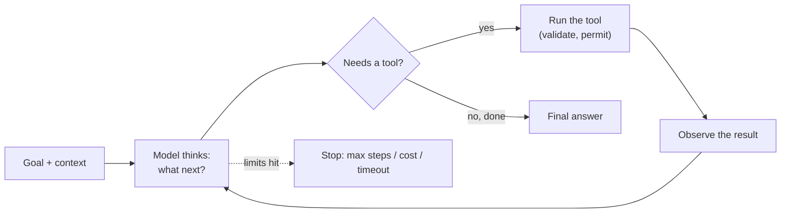
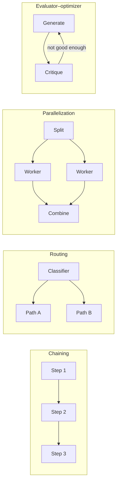

# Agents

> An agent is a model with tools and a loop: it decides what to do, does it, looks at the result, and repeats until the goal is met. Many problems need only a fixed workflow, which is simpler, cheaper and more predictable.

Roadmap topic 10 · Stage 3: Tools & Agents

**Go deeper:** `8` Tool Use · `11` Agent Harness · `12` Building an Agent · `13` Memory & Context · `14` Multi-Agent Systems · `15` Evaluation · `16` Safety · `17` Cost & Reliability.

**Marks:** 🟢 must know · 🟡 good to know · (New) still changing

---

#### 1. What Is It?

*Model + tools + a loop that works toward a goal.*

| 🟢 Must know | 🟡 Good to know |
|---|---|
| agent = model + tools + loop | planning and ReAct |
| the loop: think → act → observe → repeat | reflection |
| workflow vs agent: prefer the simpler | why agents fail |
| workflow patterns: chaining, routing, parallelization, orchestrator–workers, evaluator–optimizer | levels of autonomy |
| stop conditions: goal, max steps, max cost, timeout | (New) coding agents |
| human-in-the-loop for risky actions | (New) computer-use and browser agents |

1. **Workflow:** *your code* decides the steps; the model fills in some of them.
2. **Agent:** *the model* decides the next step, using tools, until it thinks it is done.
3. **Autonomy** is a dial: from "suggest" to "act alone". More autonomy = more power and more risk.

**Signals in an interview:** "what is an agent?", "agent or workflow?", "how do you stop an agent from looping or overspending?", "how do you keep it safe?".

---

#### 2. How It Works

**The loop.**



**Workflow vs agent.**

| | Workflow | Agent |
|---|---|---|
| Steps decided by | your code | the model |
| Predictability | high | lower |
| Cost and latency | lower, known | higher, variable |
| Testing | easy (each step) | harder (many paths) |
| Good for | tasks with known steps | open-ended tasks where the steps depend on what is found |
| Examples | summarise → translate → format | investigate a bug; research a topic; fix failing tests |

**Rule: start with the simplest option.** One good prompt → a fixed workflow → an agent, only when needed.

**Five workflow patterns.**

| Pattern | Idea | Example |
|---|---|---|
| Prompt chaining | step A's output feeds step B | draft → check against rules → polish |
| Routing | classify the input, send it to a specialised path | support ticket → billing / bug / how-to |
| Parallelization | run independent calls at once and combine | review a document from three angles; split a long input |
| Orchestrator–workers | a lead model splits the task and delegates to workers | change many files; research several sources |
| Evaluator–optimizer | one call produces, another critiques, loop until good | translation, writing, code with tests |



**Stop conditions (always have several).**

| Condition | Why |
|---|---|
| Goal reached | the normal exit |
| Max steps (for example 10 to 25) | prevents endless loops |
| Max cost / tokens | prevents surprise bills |
| Timeout | the user can't wait forever |
| Needs the user | a decision or approval is required |
| Repeated failure or no progress | the same call failing three times |

**Human-in-the-loop.** A person approves the risky or irreversible steps (send, delete, pay, deploy) and can interrupt. Design the approval so it shows *exactly* what will happen.

🟡 **Planning and ReAct.** *ReAct* = Reason, Act, Observe, repeat: the model writes a short reasoning step, calls a tool, reads the observation, and continues. Some agents write a plan first and update it as they learn. Reasoning models do much of this internally.

🟡 **Reflection.** The agent checks its own work (run the tests, re-read the requirements, verify the numbers) before finishing. Checking against something external (tests, a validator) beats self-opinion.

🟡 **Why agents fail.** Loops (repeating the same step); picking the wrong tool; losing the goal as the context fills; small errors adding up over many steps; misreading tool output; confident but unverified "done"; acting on injected text; over-reaching permissions.

🟡 **Levels of autonomy.**

| Level | Behaviour | Use when |
|---|---|---|
| Suggest | proposes, the user does it | high risk, new trust |
| Ask first | acts after approval for each step | side effects, money, data |
| Act alone, then report | acts within a safe sandbox or reversible scope | low risk, good tests |
| Fully autonomous | long unattended runs | rare; strong sandbox, limits, evals |

🟡 **(New) Coding agents.** Read the codebase, edit files, run tests, and loop until they pass. They work well because tests give a clear signal; they need sandboxing, permission modes and review of the diff.

🟡 **(New) Computer-use and browser agents.** The model sees screenshots/DOM and issues clicks and typing. Flexible but slow, costly and fragile; the biggest injection risk (any web page can contain instructions).

---

#### 3. Naive vs Better Design

| Naive | Better |
|---|---|
| an agent for a task with three known steps | a workflow |
| `while (true)` loop | max steps, cost cap, timeout |
| the agent acts on everything it can | approval for risky actions; least privilege |
| "done" when the model says so | verify with tests / validators |
| one giant agent with 30 tools | few tools, or split into workflows |
| unlimited retries on the same failing call | stop after repeated failure and report |
| no trace of what happened | log every step (topic 18) |

```kotlin
// Naive: unbounded loop, unbounded cost, no approvals
while (true) { val r = model.next(messages); if (r is Text) break; messages += run(r) }
```

---

#### 4. Code

Workflow patterns as small functions (each LLM call is a `suspend (String) -> String`, so they can be tested with fakes):

```kotlin
typealias Llm = suspend (String) -> String

suspend fun chain(llm: Llm, input: String, steps: List<(String) -> String>): String =
    steps.fold(input) { acc, make -> llm(make(acc)) }                      // each step's output feeds the next

suspend fun route(llm: Llm, input: String, paths: Map<String, Llm>): String {
    val label = llm("Classify into one of ${paths.keys}: $input").trim().lowercase()
    return (paths[label] ?: paths.getValue("other"))(input)                // unknown label → the default path
}

suspend fun parallel(llm: Llm, parts: List<String>): List<String> =
    coroutineScope { parts.map { async { llm(it) } }.awaitAll() }

suspend fun improve(generate: Llm, critique: Llm, task: String, maxRounds: Int = 3): String {
    var draft = generate(task)
    repeat(maxRounds) {
        val review = critique("Review this. Reply OK if good, otherwise list problems:\n$draft")
        if (review.trim() == "OK") return draft
        draft = generate("$task\nFix these problems:\n$review\nPrevious draft:\n$draft")
    }
    return draft                                                              // bounded: never loops forever
}
```

Checks (fake models): `chain` with steps `["Summarise: …", "Translate: …"]` makes exactly 2 calls, in order. `route` with a classifier that answers `"billing"` runs the billing path; an answer of `"gibberish"` runs `other`. `parallel` with 3 parts makes 3 calls and returns 3 results in order. `improve` with a critic that says `"OK"` on the second look makes 2 `generate` calls and 2 `critique` calls; a critic that never says `OK` stops after `maxRounds` (1 + 3 generate calls).

A stop-condition check shared by loops:

```kotlin
enum class Stop { CONTINUE, DONE, MAX_STEPS, TOKEN_BUDGET, TIMEOUT, NO_PROGRESS }

fun checkStop(step: Int, tokens: Int, elapsedMs: Long, done: Boolean, recentCalls: List<String>,
              maxSteps: Int = 15, maxTokens: Int = 100_000, timeoutMs: Long = 120_000): Stop = when {
    done -> Stop.DONE
    step >= maxSteps -> Stop.MAX_STEPS
    tokens >= maxTokens -> Stop.TOKEN_BUDGET
    elapsedMs >= timeoutMs -> Stop.TIMEOUT
    recentCalls.size >= 3 && recentCalls.takeLast(3).toSet().size == 1 -> Stop.NO_PROGRESS      // the same call three times
    else -> Stop.CONTINUE
}
```

Checks: `checkStop(5, 20_000, 10_000, false, listOf("a","b"))` → `CONTINUE`; `step = 15` → `MAX_STEPS`; `tokens = 100_000` → `TOKEN_BUDGET`; `recentCalls = [x, x, x]` → `NO_PROGRESS`; `done = true` → `DONE`.

Approval gate by autonomy level:

```kotlin
enum class Autonomy { SUGGEST, ASK_FIRST, ACT_ALONE }

fun mayRun(level: Autonomy, sideEffect: Boolean, userApproved: Boolean) = when (level) {
    Autonomy.SUGGEST -> false                         // never executes; only proposes
    Autonomy.ASK_FIRST -> !sideEffect || userApproved
    Autonomy.ACT_ALONE -> true
}
```

Checks: `ASK_FIRST` with a read-only tool → `true`; with a write tool and no approval → `false`; after approval → `true`; `SUGGEST` → always `false`.

---

#### 5. Numbers & Limits

| Item | Rule of thumb |
|---|---|
| Max steps | 10 to 25 for most tasks; set per task type |
| Cost per run | an agent run can use 10 to 50× the tokens of one call; budget it |
| Error compounding | if each step is 95% reliable, 20 steps give about 36% end-to-end (0.95²⁰) |
| Tools | a handful; each adds confusion |
| Latency | each step is a model call (seconds); 15 steps can take a minute or more |
| Autonomy | start at "ask first"; raise it as evals and sandboxing earn trust |
| Evals | measure task success, steps, tools used, and cost (topic 15) |

---

#### 6. Common Mistakes & Edge Cases

1. Building an agent when a workflow would do.
2. No step, cost or time limits.
3. Letting it act without approval on irreversible steps.
4. Trusting "I'm done" with no verification.
5. Too many tools or vague tool descriptions.
6. No traces: failures can't be debugged.
7. Giving the agent your own credentials.
8. Treating tool results and web pages as instructions.

Edge cases: the same failing call repeated; a tool result so big it fills the context; the user interrupts mid-run; a half-finished side effect; conflicting instructions from the user and from a document; the goal changing mid-task.

---

#### 7. Say This in the Interview

1. "An agent is a model with tools in a loop: think, act, observe, repeat until done."
2. "I start with the simplest design: a single prompt, then a fixed workflow such as chaining or routing, and only use an agent when the steps can't be known in advance."
3. "Every agent has a max-step, cost and time limit, and repeated-failure detection."
4. "Risky actions need human approval, and the agent runs with the user's permissions in a sandbox."
5. "I verify results with something external (tests, validators) instead of trusting the model's 'done'."
6. "I evaluate agents on task success, steps, tool choices and cost, and read the traces."

---

#### 8. Quick Check

1. What is the difference between a workflow and an agent?
2. Name three stop conditions.
3. If each step is 95% reliable, how reliable are 20 steps?
4. Why verify with tests?

<details>
<summary>Answers</summary>

1. In a workflow your code decides the steps; in an agent the model decides.
2. Goal reached, max steps, max cost/tokens, timeout, needs the user, no progress.
3. About 36% (0.95 to the power 20).
4. They are an external, objective signal; the model can believe it is done when it is not.

</details>

---

#### 9. Practice

**Interview questions**

1. What is an agent?
2. Agent vs workflow: how do you choose?
3. Name the five workflow patterns and an example of each.
4. How do you stop an agent from looping or overspending?
5. How do you keep an agent safe?
6. Why do agents fail?
7. What is ReAct?

**Hands-on**

1. Build a three-step workflow (extract → validate → summarise) with fakes and tests.
2. Build the routing workflow for support tickets and measure its accuracy on 30 examples.
3. Implement `checkStop` and write a test for each stop reason.

**Coding warm-ups (LeetCode)**

| # | Question | Link to this topic |
|---|---|---|
| 207 | [Course Schedule](https://leetcode.com/problems/course-schedule/) (Medium) | ordering steps and detecting cycles |
| 210 | [Course Schedule II](https://leetcode.com/problems/course-schedule-ii/) (Medium) | planning a valid order |
| 1472 | [Design Browser History](https://leetcode.com/problems/design-browser-history/) (Medium) | state and history of steps |

**Remember:** model + tools + loop · workflow first, agent only when steps are unknowable · limits on steps, cost, time · approvals for side effects · verify with external checks · trace everything.
